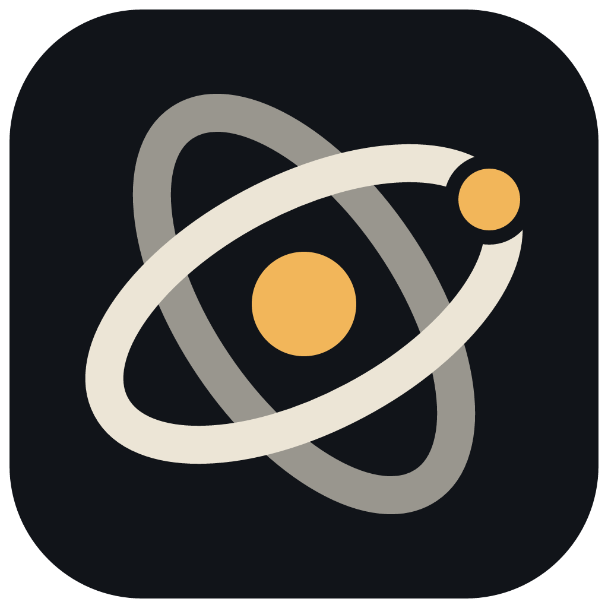
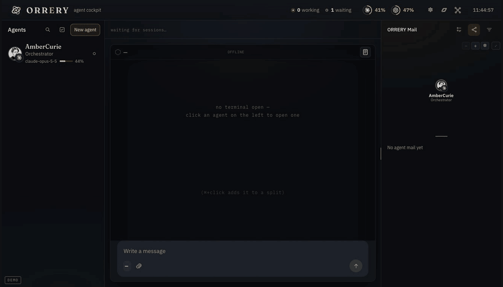
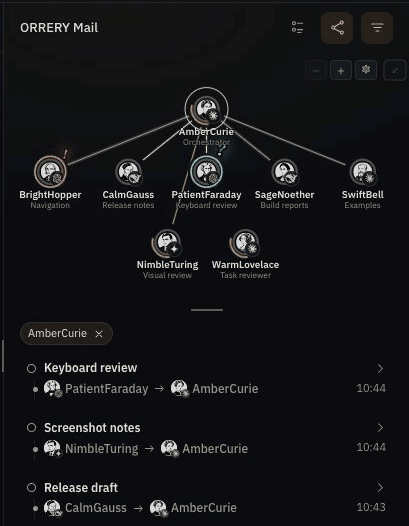
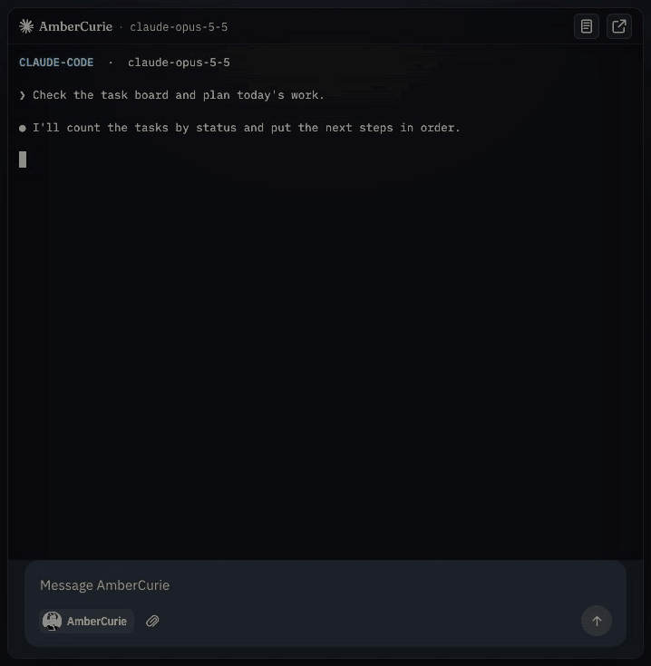
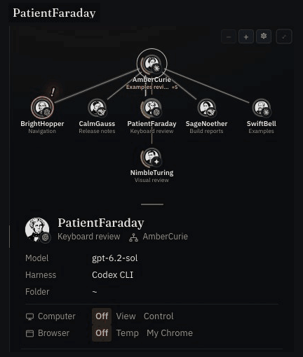
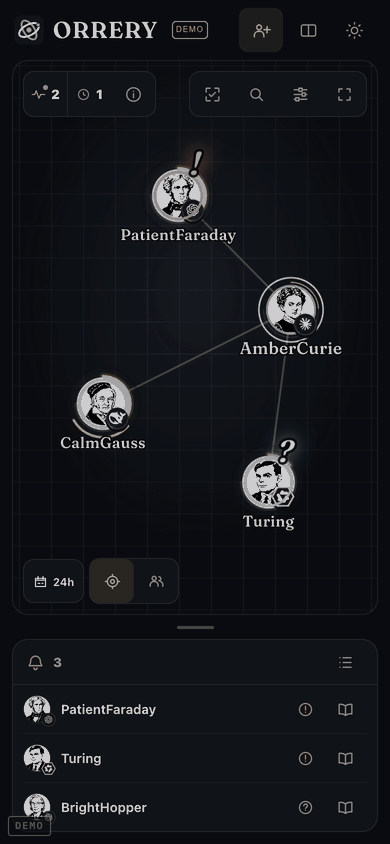
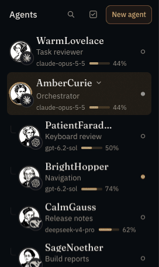
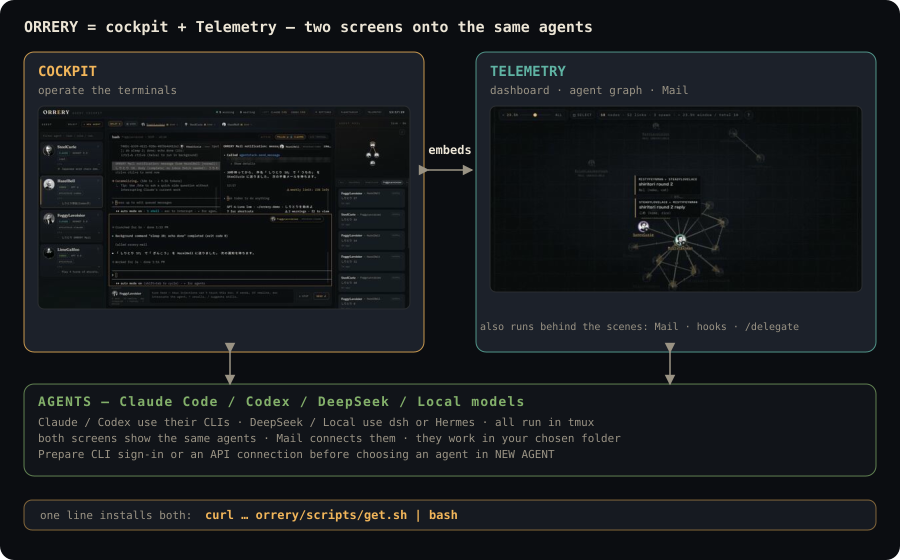

# ORRERY

> 日本語 [README.md](README.md)



ORRERY is a cockpit for AI agents to talk directly to each other and work as a team.

Give an orchestrator agent a task, and it will divide the work among child agents. The agents send each other requests and reports through ORRERY Mail. You can watch it all on one screen without relaying messages between agents yourself. You can mix Claude Code, Codex, Gemini, DeepSeek, and local LLMs in the same interface and operate them the same way.



## What you can do

### See agents talk to each other

When one agent sends Mail to another, a light travels from sender to recipient in the Mini Graph on the right, and the subject appears below the recipient. Open the message from the list to read who asked whom to do what.



See [Read incoming ORRERY Mail](docs/en/read-mail.md) and [See agent details in the Mini Graph](docs/en/inspect-mini-graph.md).

### Follow an agent’s work in Reader

In a terminal, agent messages, tool calls, and long outputs scroll past together. Reader separates messages, operations, and results and folds long output so you can follow the work. You can also view tables, diffs, and files the agent worked with right there.



See [Follow the work and open referenced files in Reader](docs/en/read-a-file.md).

### Switch computer and browser controls at any time

You can change each agent’s computer and browser permissions while it works. For computer use, choose Off, View, or Control. For browser use, let the agent work in your signed-in Chrome or choose a temporary browser that doesn’t inherit your cookies or sign-ins. When you switch, the agent restarts and the roster and Mini Graph show that it is restarting. Agents that support resuming a conversation return to work with their conversation intact.



See [See agent details and restarts in the Mini Graph](docs/en/inspect-mini-graph.md).

### Work from a phone or tablet

You can see the same agents in your phone or tablet browser while away from your computer. Select an agent, read its work, and type and send it an instruction. The connection goes through Tailscale, and access is limited to your Tailscale account.



See [Use ORRERY on a phone](https://github.com/gyroid-eth/orrery-telemetry/blob/master/docs/mobile.en.md).

### See which agents need a decision from you

Agents waiting for approval or an answer are marked, and **need you** at the top of the screen shows how many are waiting. You can select several agents to send them the same request at once or exit them together.



See [Check agent status and select multiple agents](docs/en/manage-agents.md).

The numbered [cockpit map](docs/en/cockpit-map.md) shows where to find things. For other tasks, [choose a guide](docs/en/README.md#choose-a-task).

## Get started

Run this line in a terminal on macOS or Ubuntu 24.04 or later. On Windows, use Ubuntu in WSL2.

```bash
curl -fsSL https://raw.githubusercontent.com/gyroid-eth/orrery/master/scripts/get.sh | bash
```

Install Python 3.11 or later, git, tmux, and curl first. If anything is missing, the installer shows you how to install it and stops.

The installer shows a plan of what it will install. Review it and type `yes` to proceed. It displays the cockpit URL at the end (by default, `http://127.0.0.1:8791/cockpit.html`). Open it in your browser to start **Your first flight**, an on-screen guide from launching an agent to reading Mail.

If you’re signed in to the Claude Code or Codex CLI, you can start using it immediately. The [installation guide](docs/en/install.md) covers Gemini, DeepSeek, local LLMs, phone access, and Obsidian integration. An agent you already use can also help with the installation ([instructions](docs/en/install-with-agent.md)).

## How it works

ORRERY consists of two repositories. This repository provides the cockpit. [ORRERY Telemetry](https://github.com/gyroid-eth/orrery-telemetry) records agent status and provides ORRERY Mail and the installer. Agents run inside tmux, so they keep working when you close the browser.



The introductory video (about 90 seconds, in Japanese) illustrates what changes when agents talk directly to each other.

[](https://youtu.be/JXoa93TQolU)

## Learn more

- [Choose a guide by task](docs/en/README.md#choose-a-task)
- [Cockpit map](docs/en/cockpit-map.md)
- [Install, update, or uninstall](docs/en/install.md)
- [Configuration and stored data](docs/en/configuration.md)
- [Troubleshooting](docs/en/troubleshooting.md)
- [Architecture overview](docs/en/ARCHITECTURE_OVERVIEW.md)

## Security and privacy

The cockpit listens only on `127.0.0.1` and does not accept connections from other machines. It does not authenticate requests from the same machine, so use it on a machine where you trust the programs that run.

Terminal history is stored in `~/.orrery/history`. The browser keeps drafts and the last 50 messages you sent. Before working with sensitive information, check [what data is stored](docs/en/configuration.md#stored-data-and-privacy).

## License

This repository uses the **PolyForm Perimeter License 1.0.1**, with the exception of portrait images (see “Third-party components” below). It is source-available and does not meet the OSI definition of open source. See [LICENSE](LICENSE) for the full text. © 2026 gyroid.

- You may use, modify, and distribute it for any purpose.
- You may not **provide others with a product that competes with this software**. This includes offering it at no charge, porting it to another language, or providing it as a service, library, or plug-in.
- It comes without a warranty or a promise of support.

## Third-party components

ORRERY integrates with ORRERY Telemetry, `tmux`, `xterm.js`, and other components. This repository does not contain the ORRERY Mail code. See [ORRERY Telemetry](https://github.com/gyroid-eth/orrery-telemetry) for the ORRERY Mail license and third-party notices.

The portraits in `assets/portraits/` and `assets/portraits_64/` are outside the scope of the PolyForm Perimeter License. See [CREDITS.md](CREDITS.md) for each image’s license (public domain, CC0, CC BY 4.0, or CC BY-SA 2.0 / 4.0), author, source, and modifications. Modified CC BY-SA images use the same CC BY-SA license. Portraits missing from the manifest or CREDITS are not considered cleared for distribution. The 50 pixel-art portraits in `assets/portraits_px/` were generated by gyroid using ChatGPT (OpenAI image generation) from text prompts alone. No photographs were used as inputs. These images are distributed under the same terms as the repository (PolyForm Perimeter License 1.0.1).

## Report a problem

Report problems in GitHub Issues. Include steps to reproduce, the ORRERY and ORRERY Telemetry startup logs, and the result from `/telemetry/health` to help narrow down the cause.
