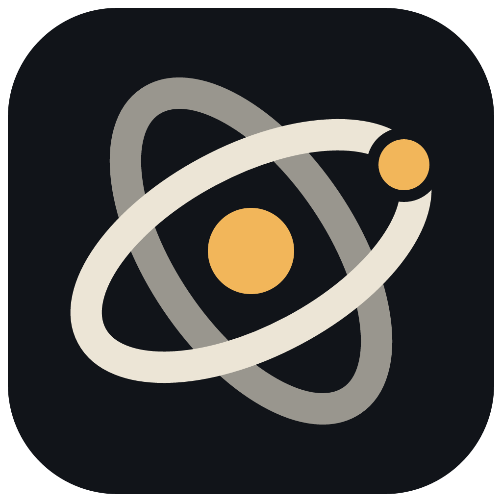
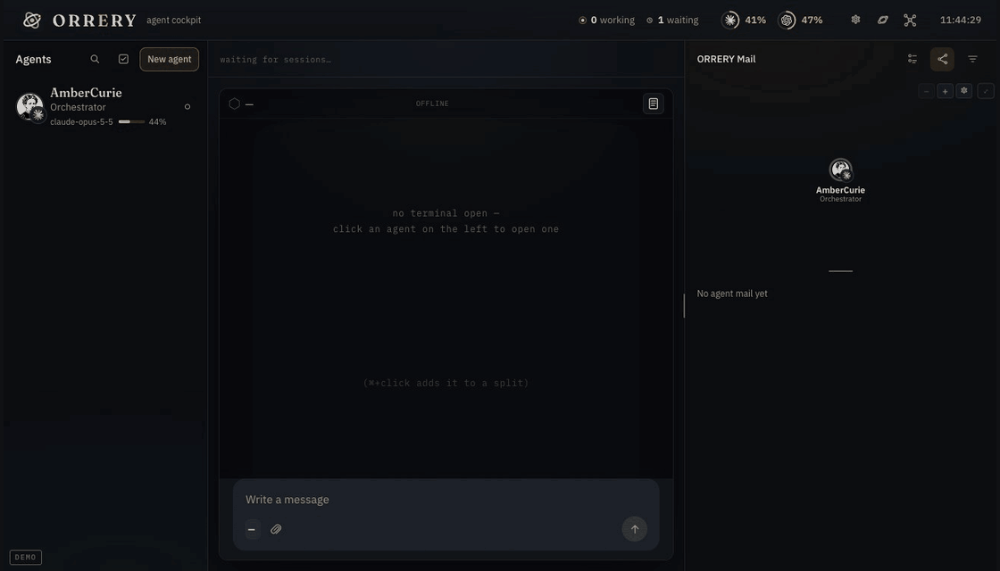
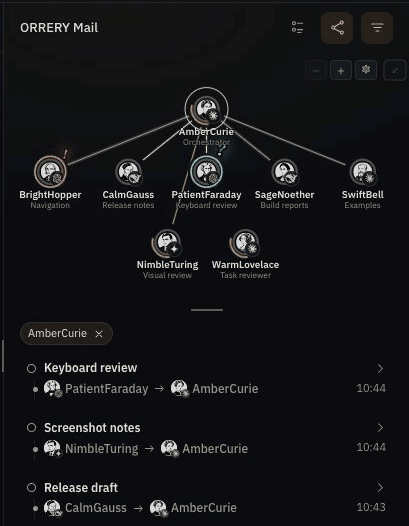
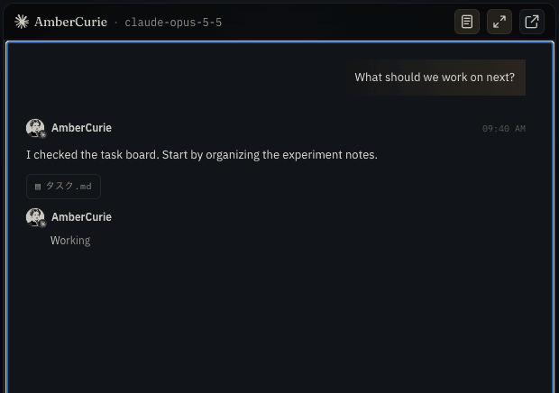
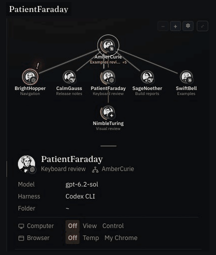
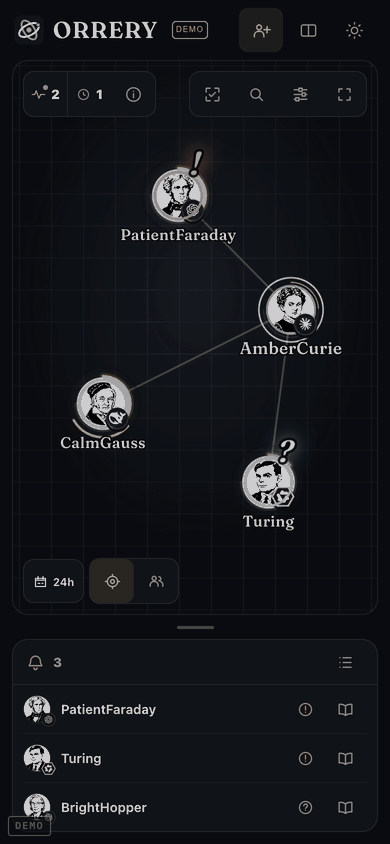
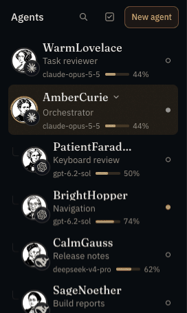
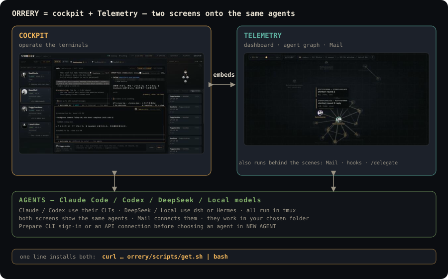

# ORRERY

> English: [README.en.md](README.en.md)



ORRERY は、AI agent どうしを直接話させ、チームで仕事を進めるための cockpit です。

オーケストレータの agent に頼むと、オーケストレータが子の agent に仕事を分け、agent どうしが ORRERY Mail で依頼と報告をやり取りします。あなたが agent の間で伝言を運ぶ必要はなく、その様子は一つの画面でそのまま見えます。Claude Code・Codex・Gemini・DeepSeek・Local LLM を、同じ画面と同じ操作で混ぜて使えます。



## 何ができるか

### agent どうしのやり取りが見える

agent が別の agent に Mail を送ると、右の Mini Graph で送り手から受け手へ光が走り、受け手の下に件名が出ます。一覧から本文を開けば、誰が誰に何を頼んだかを、その場で読めます。



詳しくは [届いた ORRERY Mail を読む](docs/read-mail.md) と [Mini Graph で agent の詳細を見る](docs/inspect-mini-graph.md)。

### agent の作業を読みやすく見る

terminal には、agent の発言・ツールの呼び出し・長い出力が一度に流れてきます。Reader は、そこから発言と操作と結果を取り出し、長い出力を折りたたんで、人が追える形に整えます。表や差分、agent が触ったファイルも、その場で開けます。



詳しくは [Reader で作業と参照ファイルを見る](docs/read-a-file.md)。

### 画面操作とブラウザ操作を、いつでも切り替える

agent ごとに、画面操作（computer use）とブラウザ操作を、作業の途中でも切り替えられます。画面操作は「使わない・見るだけ・操作する」から選べます。ブラウザは、ログイン済みの自分の Chrome を使わせるか、あなたの cookie やログインを引き継がない一時的なブラウザで作業させるかを、仕事に合わせて使い分けられます。切り替えると agent は起こし直され、その間は一覧と mini graph に起こし直し中の表示が出ます。会話の引き継ぎに対応した agent は、それまでの会話を保ったまま作業に戻ります。



詳しくは [Mini Graph で agent の詳細と起こし直しを見る](docs/inspect-mini-graph.md)。

### スマホやタブレット から操作する

出先でも、スマホやタブレット のブラウザから同じ agent たちを見られます。agent を選んで作業を読み、そのまま指示を打って送れます。接続は Tailscale を通り、あなたの Tailscale のアカウントからだけ開けます。



詳しくは [スマホから使う](https://github.com/gyroid-eth/orrery-telemetry/blob/master/docs/mobile.md)。

### あなたの判断を待つ agent が分かる

承認や返事を待っている agent には印が付き、画面上部の need you に数が出ます。何体かをまとめて選び、同じ依頼を一度に送ったり、まとめて終わらせたりもできます。



詳しくは [agent の状態を見てまとめて選ぶ](docs/manage-agents.md)。

画面のどこに何があるかは、[画面一覧](docs/cockpit-map.md)に番号つきでまとめています。ほかの使い方は[目的別のガイド](docs/README.md#目的から選ぶ)から選べます。

## 始める

macOS か Ubuntu 24.04 以降（Windows では WSL2 の Ubuntu）のターミナルで、次の 1 行を実行します。

```bash
curl -fsSL https://raw.githubusercontent.com/gyroid-eth/orrery/master/scripts/get.sh | bash
```

先に Python 3.11 以上・git・tmux・curl を入れておきます。足りないものがあれば、installer が入れ方を表示して止まります。

installer は、何を入れるかの計画を表示します。確かめて `yes` と入力すると導入が進み、最後に cockpit の URL（既定は `http://127.0.0.1:8791/cockpit.html`）が表示されます。ブラウザで開くと最初のガイド（Your first flight）が始まり、agent の起動から Mail を読むところまでを、画面の上で順に案内します。

Claude Code と Codex は、それぞれの CLI にログインしておけば、そのまま使えます。Gemini・DeepSeek・Local LLM、スマホからの閲覧、Obsidian との連携などの準備は、[導入ガイド](docs/install.md)にまとめています。使っている agent に導入を手伝ってもらうこともできます（[手順](docs/install-with-agent.md)）。

## 仕組み

ORRERY は 2 つの repository でできています。この repository が画面（cockpit）で、[ORRERY Telemetry](https://github.com/gyroid-eth/orrery-telemetry) が agent の状態の記録・ORRERY Mail・installer を受け持ちます。agent は tmux の中で動くので、ブラウザを閉じても作業は止まりません。



紹介動画（約 90 秒・日本語）では、agent どうしが直接話すと何が変わるかを、図で説明しています。

[](https://youtu.be/JXoa93TQolU)

## もっと知る

- [目的別のガイド](docs/README.md#目的から選ぶ)
- [画面一覧](docs/cockpit-map.md)
- [導入・更新・アンインストール](docs/install.md)
- [設定と保存されるデータ](docs/configuration.md)
- [うまく動かないとき](docs/troubleshooting.md)
- [全体の設計](docs/ARCHITECTURE_OVERVIEW.md)

## セキュリティとプライバシー

cockpit は `127.0.0.1` だけで待ち受け、ほかの機械からの接続は受けません。同じ機械の中では認証をしないので、信頼できないプログラムが動く機械では使わないでください。

端末の記録は `~/.orrery/history` に、入力の下書きと最近 50 件の送信はブラウザに残ります。機密を扱うときは、[保存されるデータ](docs/configuration.md#保存データとプライバシー)を先に確かめてください。

## ライセンス

この repository は **PolyForm Perimeter License 1.0.1** です（肖像画像を除く。下の「第三者コンポーネント」を参照）。source-available であり、OSI の意味での open source ではありません。全文は [LICENSE](LICENSE) にあります。© 2026 gyroid.

- 目的を問わず、使う・変える・配ることができます
- ただし、**このソフトウェアと競合する製品を他者に提供すること**はできません。無償の配布、別の言語への移植、service・library・plug-in としての提供も競合に含みます
- 無保証です。サポートは約束しません

## 第三者コンポーネント

ORRERY は ORRERY Telemetry、`tmux`、`xterm.js` などと連携します。この repository は ORRERY Mail のコードを含みません。ORRERY Mail のライセンスと第三者 notice は [ORRERY Telemetry](https://github.com/gyroid-eth/orrery-telemetry) を参照してください。

`assets/portraits/`・`assets/portraits_64/` の肖像画像は PolyForm Perimeter License の対象外です。各画像のライセンス（public domain、CC0、CC BY 4.0、CC BY-SA 2.0 / 4.0）、作者、出典、加工内容は [CREDITS.md](CREDITS.md) に従います。CC BY-SA の画像は、加工後の画像も同じ CC BY-SA で提供します。manifest / CREDITS にない portrait は配布承認済み asset とみなしません。ただし `assets/portraits_px/` のドット絵 50枚は、作者 gyroid が ChatGPT（OpenAI の画像生成）で文章の指示だけから生成したものです。写真は入力に使っていません。repository と同じ条件（PolyForm Perimeter License 1.0.1）で配布します。

## 不具合の報告

GitHub の Issues に報告してください。再現の手順、ORRERY と ORRERY Telemetry の起動 log、`/telemetry/health` の結果を添えると、原因を早く絞れます。
