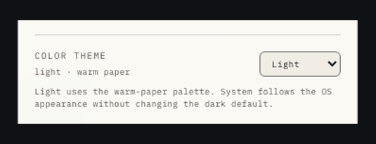

# cockpit の見た目を調整する

1. ヘッダーの歯車 **Settings** を押します。
2. **Appearance → Color theme** で配色、**Terminal → Terminal font size** で端末の文字サイズを調整します。
3. **Orrery → Mini view** の既定は、開いている agent を中心にする **Telemetry network** です。更新時も一度だけ切り替わります。親子を表示する **Orrery** を選ぶと、その選択が保存されます。

配色は **Dark**、紙のような **Light**、OS に合わせる **System** から選べます。Light はターミナルの中や埋め込みの Telemetry にも反映されます。差分の文字の見え方は[配色テーマ](usage.md#配色テーマlight-mode)を参照してください。

[English](en/adjust-cockpit.md) · [画面一覧](cockpit-map.md) · [Settings の詳細](usage.md#settings)
