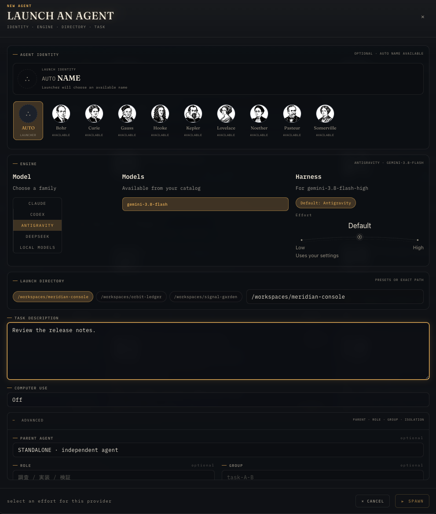

# Google Antigravity / Gemini provider



共通 installer を使い、Antigravity CLI にサインインします。NEW AGENT で Antigravity とモデルを選びます。

ORRERY では、Claude Code や Codex と並んで Google Antigravity CLI（`agy`）を
使えます。利用者が Antigravity でサインインしたアカウントを使います。

## `/log` と `/delegate`

共通インストーラーは、個人用の `~/.gemini/config/skills.json` に
同梱の `log` と `delegate` の正本（既定では `~/.agentstack/skills/`）を登録します。
この場所を使うと、すべてのプロジェクトで Antigravity CLI と IDE の両方から使えます。
利用者が設定済みの同名スキルが優先されます。
CLI の候補が古い場合は `/skills reload` を実行します。

Terminal に出る候補は `agy` のものです。Reader の入力欄は、標準のユーザー用または
作業ツリーのスキルと、個人用の `skills.json` で登録したスキルを候補に出します。Reader で dsh・Hermes のスキルを選ぶと、
選んだ子の履歴に対応するプロファイルから候補が表示されます。

## Prerequisites

先に ORRERY core と稼働中の ORRERY Mail を用意します。
[Google の手順](https://antigravity.google/docs/getting-started?tab=cli)で CLI を導入し、
利用者がサインインします。macOS / Linux 向けの公式 `install.sh` は最後に
`agy install` を呼び、シェルの PATH 設定などを変更します。利用者の了承を得て実行し、
設定ファイルをそのままにしたい場合はバイナリだけを導入する段階で止めます。
現在のシェルから次の両方が通ることを確認します。

```sh
agy --version
agy models
```

標準のバイナリ配置は `~/.local/bin/agy` です。

## Gemini を使うための設定

通常の [`scripts/install.sh`](telemetry-install.md) は、macOS と WSL（Ubuntu）で Gemini の
連携ファイルを導入・更新し、Dashboard を起動します。`agy` の導入とサインインは
利用者が Gemini を使うときに行います。`--dashboard-only` は同梱の対象外です。

[**NEW AGENT**](#dashboard-new-agent) では、Mail MCP は親なし起動の専用設定か、
委任起動の作業用 worktree に用意されます。

**`agent-start-gemini` で立てる親なし agent から Mail を送る場合**は、
`scripts/install-gemini-provider.sh --dry-run --configure-mcp` で追加先を確認します。
`~/.gemini/config/mcp_config.json` に `orrery-mail` を設定する変更を利用者に示し、
了承後に Telemetry の checkout で次を実行します。

```sh
scripts/install-gemini-provider.sh --configure-mcp
```

更新時も連携ファイルは共通 installer で更新します。導入に失敗した場合は、
表示された原因を解消して `scripts/install.sh` を再実行します。
通常のアンインストールは所有記録にある連携ファイルを削除し、Antigravity CLI と
利用者の設定を保持します。手動で追加した Mail MCP を外す場合は、先に
`~/.agentstack/bin/agentstack-gemini-setup --uninstall` を実行します。

## Usage left に利用枠を表示

利用枠を表示する場合は、利用者の了承を得て Dashboard の runtime ディレクトリに
`antigravity-quota.enabled` を作ります。標準の導入先なら次の手順です。
`AGENTSTACK_RUNTIME_DIR` をカスタマイズした場合は、Dashboard サービスが使う設定値を指定します。

```sh
quota_runtime="$HOME/.agentstack/runtime"
test -d "$quota_runtime" && touch "$quota_runtime/antigravity-quota.enabled"
```

有効にすると Dashboard は `agy -p /usage --output-format json` でサインイン済みの
アカウントの利用枠を読みます。CLI 1.1.24 以降が必要です。導入後は Cockpit の
**Usage left** で **Antigravity (Gemini)** を確認します。初回の取得や、すでに表示されている
`unavailable` の更新には、キャッシュ分の最大約3分かかることがあります。
`unavailable / no windows` が続く場合は、marker の場所、CLI のバージョン、サインインを確認し、
`agy -p /usage --output-format json` が利用枠を返すか確認します。利用枠の表示には Gemini API キーは不要です。

## Top-level launcher

```sh
~/.agentstack/bin/agentstack-gemini-setup --check
~/.agentstack/bin/agent-start-gemini /path/to/project
```

`--check` は管理されたグローバル MCP 定義を確認します。起動後は `agy` の `/mcp` で
`orrery-mail` が接続済みであることを確認し、Mail にはその `send_message` を使います。
プロジェクト専用の MCP 定義を使う場合も、接続の確認場所は `/mcp` です。
名簿への登録は別の処理です。MCP が見つからない、または承認が必要なら利用者に伝えます。
この対話起動は legacy runtime 用です。global runtime の
`GEMINI_INTERACTIVE_RUNTIME_UNSUPPORTED` が出る場合は、対応する委任経路を使います。

### Reader

管理された対話型 `agy` の作業は、デスクトップとスマホの Reader で追えます。Antigravity が記録した発言、ツール操作、結果を整理して表示します。対応する Cockpit と Telemetry API 48 が必要です。既存の `--configure-mcp` が `hooks.json` に `orrery-reader` グループを追加します。管理グループ以外の設定は保持します。設定後に起動したセッションは、最初の入力から作業を表示し、前の発言も確認できます。本文は Antigravity が記録した時点で表示し、compact の完了は **Context compacted** として表示します。同じ起動で異なる会話 UUID を検出したときは、次の管理された起動まで binding を保留します。

Defaults:

- binary: `agy`
- model: `gemini-3.8-flash-high`
- effort: `high` (from `AGENTSTACK_GEMINI_EFFORT`)

The CLI launchers (`agent-start-gemini`, `spawn_gemini_child.sh`, and a direct
`spawn_gemini_preregistered.sh` run) keep this `high` fallback. The Dashboard
does not use it; see [Dashboard NEW AGENT](#dashboard-new-agent).

For binary-free validation:

```sh
AGENTSTACK_GEMINI_BIN=agy-not-installed \
  ~/.agentstack/bin/agent-start-gemini --dry-run /path/to/project
```

Dry-run stops before binary lookup, tmux, ORRERY Mail registration, and MCP
bootstrap. A real launch still fails clearly if `agy` is absent.

## Delegated child

```sh
PARENT_AGENT=<parent-name> \
~/.agentstack/hooks/spawn_gemini_child.sh \
  --resources "src/**,tests/**" \
  "Implement the requested change and run relevant tests." \
  /path/to/project
```

launcher は子を事前登録し、専用の worktree を作り、宣言したファイルを予約します。
Mail はその子に紐付いた MCP wrapper を通ります。owner token は private な runtime に保持します。

macOS では `agy` の対話画面を開き、最初の仕事を `-i` で渡します。
子は Mail の `send_message` で報告したあとも待機し、追加 Mail は共通 watcher が入力欄へ届けます。
サンドボックスを有効にし、その子の worktree だけを起動時の `trustedWorkspaces` に渡します。
ネイティブ編集は共通の登録・予約確認を通ります。macOS の対話子には Antigravity Reader の payload が必要です。

Linux／WSL の既存経路は最初の task を stream-json の標準入力に流し、自動報告して終了します。

A nominal Antigravity `SUCCESS` is not enough when required actions were denied
or the textual response is empty. Those cases are reported to the parent as
incomplete. A non-zero launcher/runtime status is likewise incomplete.

## Dashboard NEW AGENT

[Gemini の設定](#gemini-を使うための設定)を済ませ、**NEW AGENT** で Antigravity と model を選びます。
macOS でカタログが親なし起動に対応している場合（API 50 以降）は、親を選ばず、
指定したフォルダで対話型 agent を起動できます。Git を使っていないフォルダも選べます。
最初の task は CLI に一度だけ渡り、Mail、Reader、履歴からの Resume を使えます。
ORRERY の Mail と hook の設定は起動ごとの専用ディレクトリに置き、終了時に削除します。
選んだフォルダと個人設定には起動用の設定を書き込みません。
Linux／WSL や、カタログが親なし起動に対応していない場合は、親を選んで委任起動します。

API 53 では macOS の **Computer use** で Off／View／Control を選べます。
**Browser** はカタログが示す利用可能なモードから選べます。
[画面操作の前提と設定](computer-use.md)と[起動 API](https://github.com/gyroid-eth/orrery-telemetry/blob/master/docs/api.md#get-apispawn-names)を参照してください。

起動条件は ORRERY Mail の登録前に確認します。

- 委任起動には、親の agent とそのローカルの owner 資格が必要です。
- 委任起動と、親なしで Isolation を選んだ場合は、Git リポジトリ内のフォルダと
  コミットに解決できる worktree base（既定は `HEAD`）が必要です。
- `agy`、`tmux`、選択された Python、adapter hook、Gemini provider の helper が必要です。
- `AGENTSTACK_GEMINI_MODELS` を明示した場合、モデルはその許可リストに限定されます。
  未設定なら、`agy models` が返した有効な Gemini ID を表示します。有効な結果が得られないときは、
  同梱の `gemini-3.8-flash-{high,medium,low}` を使います。モデルの取得時は起動前の検査と同じ方法で
  `agy` を探すため、Dashboard の PATH に `~/.local/bin` がなくても標準の場所を使えます。
  この取得時に CLI がモデルサービスと通信する場合があります。ORRERY は CLI の認証情報を読みません。
  `gemini-3.8-flash` しか表示されない場合は、`agy models` の結果、Dashboard を再起動したか、
  許可リストの設定を確認します。
  取得を待つ時間は5秒、出力は64 KiBまでです。成功は5分間キャッシュされ、失敗時は前回の
  成功結果を保ち、5秒後以降に再試行します。Claude と GPT の ID は除外します。
  許可リストに Claude／Codex と同じ ID を指定すると Antigravity のタブは無効になります。
  リストにない正式な Gemini ID も起動時に指定でき、利用可否は CLI が確認します。

モデル欄には `gemini-3.8-flash` や `gemini-4-argon` など、モデルの系統ごとに1項目を表示します。
自動で用意した候補に `gemini-3.8-flash-high` がある場合は、それが既定です。系統ごとに、現在の一覧にある
モデルで利用可能な Effort を選べます。

登録前に、Dashboard は選んだ Effort を対応するモデル ID に解決します。たとえば
`low` は `gemini-3.8-flash-low`、`medium` は `gemini-3.8-flash-medium`、`high` は
`gemini-3.8-flash-high` になります。Mail の登録と起動ログには解決後のモデル ID を記録し、
起動時は `agy --model` に同じ ID を渡し、`--effort` も明示します。許可リストを使う場合は、
対応するモデル ID も含めてください。含まれていなければ登録前に拒否します。許可リストが
未設定なら、一覧に出なかった正式な `gemini-*` ID も CLI が利用可否を確認します。
Effort の接尾辞がないモデル ID はそのまま渡します。モデルの取得は候補を表示するために行い、
起動時と `dry_run` では `agy models` を実行しません。

起動と隔離の規則は次のとおりです。

- **Effort を調整できるモデルでは選択が必要です。** `low`、`medium`、`high`、または候補にある
  `xhigh` を選ぶと `SPAWN` が有効になります。未指定のリクエストはサーバーが
  `effort required for provider gemini` で拒否します。CLI launcher の既定の `high` は
  Dashboard での起動には適用されません。
- **Orchestrator モデルの Effort は固定です。** Effort を選ぶ欄は表示されず、モデル ID だけで起動します。
- **委任起動は isolated worktree を使います。** macOS の親なし起動で worktree を作るには、
  Isolation を選びます。
- **委任起動は予約対象（resources）が必要です。** 親なし起動では resources を空欄にします。
  委任時はリポジトリの root からの相対パスを `src/**,tests/**` のようにカンマ区切りで指定します。
  絶対パス、`..`、`~`、制御文字、先頭の `-`、バックスラッシュ、`.git`、
  リポジトリの外を指す既存のシンボリックリンクを含むパスは拒否します。
  予約前に空白や `./`、連続するスラッシュ、重複を正規化し、`./-rf` のように
  正規化後に `-` で始まるパスも拒否します。既定の APFS のように大文字小文字を区別しない
  ファイルシステムに合わせ、`.GI?/config` や `SR?/**` は `.git` や `src` にも照合します。
  adapter は予約前に新しい worktree 内でも検査を行います。

専用 launcher が最初の task を Antigravity の CLI へ直接渡すため、Dashboard は別の
task Mail を作りません。Linux／WSL の委任は終了時に自動で親へ報告します。
macOS の対話型 agent は、起動後に Mail から追加の依頼を受け取れます。
`/api/spawn-status` と `dashboard/logs/spawn.log` は `provider=gemini` を記録します。

Dashboard の起動画面は、provider が返す `capabilities` に従います。Gemini の連携は
Antigravity のカタログ項目と `/api/spawn` の起動処理を登録し、共通の画面を使います。
共通の画面に capability のマーカーや Resources 欄がない場合は Antigravity のタブを
表示せず、起動を拒否した理由を Dashboard のログに記録します。

## Dashboard controls

管理された対話型 Antigravity では、親なしの **Standalone** と委任された子の両方で、
cockpit の左の一覧とスマホの一覧に context window のバーが出ます。
Antigravity の statusLine が現在の使用率を返すと表示され、まだ観測値がない間は表示されません。

macOS の対話子は `EXIT` で終了し、予約を解放して保持期間に入ります。
`Resume` は確認できた同じ登録・worktree・会話 ID を使います。
再開後に編集するときは必要な予約を取り直します。履歴を照合できない場合は理由を返します。

stream-json の子には、直前に確認した `agy` に `SIGINT` を送り、runner が報告・予約解放・退役を行います。
親なしの対話 Antigravity は通常の `/exit` を使い、人のシェルが残った場合は `finished` から端末を開けます。

## Headless permission caveat

`agent-start-gemini` と stream-json の子は `--mode` を指定しません。
CLI の `/config` にある実行モードと `toolPermission` が適用されます。1.5.7 以降、
`agentMode` が未設定なら、利用可能な環境で Auto、それ以外は `default` になります。
`accept-edits` は作業領域の編集を自動承認し、`plan` は調査と計画に使います。
Auto が利用できるかはアカウントと端末の sandbox に依存し、MCP の呼び出しには別途確認が出ることがあります。
[Google の CLI 権限ガイド](https://antigravity.google/docs/permissions?tab=cli)

Gemini child は headless で動き、対話で答える必要がある承認は失敗として返ります。
[Claude／Codex の子の起動設定](delegation.md)とは別に扱われます。たとえば親付き Codex の
`--ask-for-approval never` は Gemini に引き継がれません。ORRERY は Gemini に
`--sandbox` や `--dangerously-skip-permissions` を追加せず、CLI の設定に従います。

In a measured macOS run using Antigravity CLI 1.1.27, headless `view_file`
inside the delegated worktree was auto-denied until `read_file` was explicitly
allowed by the user. The stderr message stated that headless mode could not
prompt for the required permission.

Use the narrowest rule that covers the **resolved** delegated-worktree root.
New installs default to `~/.agentstack/worktrees`; replace the example user
home with the actual resolved path. Keep the legacy `/private/tmp` rule only
while a pre-#57 worktree remains there:

```json
{
  "permissions": {
    "allow": [
      "read_file(/path/to/home/.agentstack/worktrees)",
      "read_file(/private/tmp/cc-worktrees)"
    ]
  }
}
```

Merge such a rule with the user's existing settings; do not replace existing
permission entries. If `AGENTSTACK_WORKTREE_ROOT` is customized, scope the rule
to that resolved root instead. Remove the legacy rule after its old worktrees
are gone; ORRERY does not migrate or delete them.

ORRERY does not add `read_file(*)`, does not enable
`--dangerously-skip-permissions`, and does not otherwise broaden user-owned
Antigravity permissions.

macOS の管理された対話セッションでは、起動時に選んだ画面の段に応じて
`--settings` で `orrery-screen` の個々の道具をそのセッションだけ許可します。
View は読み取り系、Control は読み取りと操作系を許可します。
利用者の既存の Ask と Deny が優先され、グローバル設定は書き換えません。
この対話型の起動では、Dashboard の親なし agent と委任した子に、管理された
`orrery-mail` の道具も起動時にそのセッションだけ許可します。対象は `whois` を含む、
Codex の子と同じ Mail proxy の道具です。グローバル設定や作業フォルダで同名の別定義の
サーバーが有効な場合は、自動許可を追加しません。
親なしの Resume は初回の選択と前世代の relay の状態を照合し、低い方から新しい relay と
CLI の自動許可を作ります。親ありの Resume は作業ツリーの MCP 設定をそのまま使います。
無効化、ツールの制限、relay の接続先を引き継ぎ、画面ツールは既存の CLI の承認ルールに従います。
親なしで選んだ作業フォルダに競合する画面・ブラウザ用 MCP が有効な場合は、
競合の理由を返して起動を止めます。

## Credential boundary

The session-bound wrapper resolves the current agent's mode-0600 runtime token
file when the MCP process starts. Antigravity workspace/global MCP config stores
only the wrapper command, not the owner-token value or token-file path.

`agy` and ORRERY still run as the same operating-system user. This reduces
accidental configuration/argv exposure; it is not an OS-level isolation
boundary against another process running as that user.

## Design boundary

共通のプロセスツリーの稼働判定は `program=antigravity` / `agy` に対応します。
Gemini の連携ファイルは共通 installer で導入し、通常の更新でも一式を更新します。

- Top-level `agy` exits to its interactive shell, which remains attachable as `finished`.
- A delegated launcher reports the result, releases reservations, soft-retires the identity,
  and removes transient config and credentials before its own exit.

The Dashboard reports measured process and tmux state.

## Measured macOS E2E

The pre-upstream prototype was exercised on macOS with Antigravity CLI 1.1.27
and Gemini 3.8 Flash High.

Normal delegated completion was measured through preregistration, worktree
creation, reservation, headless execution, non-empty `SUCCESS`, parent
`Gemini child complete` reporting, release/retire/cleanup, and child tmux
session disappearance.

A live Dashboard `EXIT` run produced Antigravity `ERROR / interrupted`; the
launcher-owned runner remained alive long enough to report
`Gemini child incomplete`, release the reservation, retire/clean transient
state, and then let the child tmux session disappear. The parent and
`mail-watcher` survived, and the same resource was immediately reservable by a
subsequent child.

Those real-machine observations are evidence for the provider lifecycle. Final
upstream-ready validation must be repeated after integrating onto the current
upstream base.
