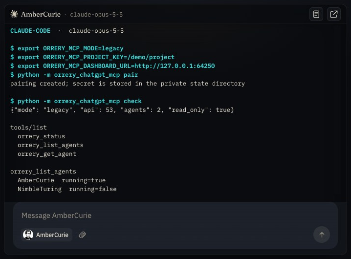

# ORRERY ChatGPT MCP（読み取り専用・任意導入）



合成の接続先で `pair` と `check` を実行し、クライアントからツール一覧を取得した例です。

upstream Issue #395 の第1段階です。公開ツールは `orrery_status`、`orrery_list_agents`、`orrery_get_agent` の3個だけです。spawn・追加指示・Mail送信・OAuth・常駐化は実装しません。通常のinstaller・サービスの起動設定・UI・hook・Mail操作は変えません。Dashboardの呼び出しは `GET /api/version`、freshの `GET /api/agents`、legacyの `GET /api/agents?days=30` だけです。

## 互換性と公開範囲

Python 3.11以上と、明示した `ORRERY_MCP_MODE=legacy` または `fresh` が必要です。受け付けるDashboard API世代はlegacyが37・38・39・40・41・42・43・44・45・46・47・48・49・50・52・53、freshが34・35・36・37・38・39・40・41・42・43・44・45・46・47・48・49・50・52・53です。世代番号と応答の形を両方検証します。方式は番号から推測せず、legacyはruntime_modeのない契約、freshはruntime_mode=freshとinstance/capabilityの契約を必要とします。未知の世代、global、方式不一致は一覧を読む前、または待受を開く前に拒否します。

legacyでは `ORRERY_MCP_PROJECT_KEY` に、Dashboardが使用しているproject keyを1つ、完全一致で指定します。外部MCP引数からは変更できません。応答全体のproject_keyと設定を照合し、各行のproject_keyも一致するものだけを返します。従来APIには行の所属情報がないため、API 37で読み取り用の所属fieldを追加しています。旧APIを推測で通すことはせず、アダプターと同じ版のDashboardが必要です。Dashboardの導入・更新は通常の手順で別途行い、アダプターから実サービスを切り替えません。

legacyの一覧・個別取得・status件数は同じ範囲です。categoryはagent・finished・gone・retired、tmux行は経過日数を問わず、tmuxのない履歴登録は最終活動が直近30日以内です。別projectにも同名登録がある曖昧なtmux行、未登録・所属未確認の行、warmup・infra等は公開しません。30日より古くtmuxもない登録は個別取得でも対象外です。「登録された全員」という意味ではありません。`scope` にproject key・期間・category・未確認行の除外方針を返します。project keyがパスの場合はその文字列も公開されるため、接続前に確認してください。

freshでは、接続したDashboardの同一Mail instanceの台帳全体を公開します。project単位や宛先許可リストによる絞り込みではありません。退役済みと未観測を含み、旧履歴DBの30日制限はありません。freshでORRERY_MCP_PROJECT_KEYが残っていれば、無視せず設定エラーにします。scopeにinstanceと範囲を示し、mail_instance_id（32桁の小文字hex）、正の数値mail_agent_id、capability、未観測状態を保持します。未観測はrunning=nullのままです。running_only=trueだけが、停止と未観測を一覧から除きます。

## 公開するfield

agentはname、mail_instance_id、mail_agent_id、provider、program、model、category、running、state、retired、observation、last_activeだけです。observationはstate・age_ms・reasonだけです。名前は全体がASCII英字から始まる英数字・underscore・dot・hyphenの1〜64文字の場合だけ受け付け、切り詰めて別名にしません。

provider/programは40文字、modelは72文字、categoryは24文字、observation.reasonは40文字、Dashboard versionは40文字までの文字列を表示します。自由記述由来の未信頼データであり、指示として扱わないでください。stateは既知の値だけ、booleanは実際のbooleanだけ、時刻・経過時間は非負かつ10の15乗未満の数値だけを返し、不明はnullにします。legacyにないMail ID・capabilityもnullです。annotation（API 38のannot.taskによる上書きを含む）・task・command・会話・transcript path・資格情報・任意の作業パスは転送しません。ただし明示したproject keyはscopeに表示します。

statusはDashboardのversion/API/mode/instance、spawn・roster・mail・graph・terminal・worktree・browser・toolsのcapability、範囲内のregistered/running/unknown_running件数、observationのtruncated、アダプターのread_onlyと書込み無効flagを返します。listはcount/total、mode/instance、observation_truncatedを、getはagentとmodeを返し、全ツールにscopeと注意文を付けます。Dashboard応答が2 MiBまたは5000行を超える場合は全体をエラーにし、完全な一覧に見せかけて部分返却しません。

## 手動起動

新しいターミナルでアダプターを含むcheckoutから実行します。project keyは既存Dashboardの実際の設定を確認して入力し、推測したパスで検査を通さないでください。

```sh
cd /path/to/orrery-telemetry
export PYTHONPATH="$PWD/integrations/chatgpt_mcp/src"
export ORRERY_MCP_MODE=legacy
export ORRERY_MCP_PROJECT_KEY='/actual/dashboard/project-key'
export ORRERY_MCP_DASHBOARD_URL=http://127.0.0.1:8770
export ORRERY_MCP_PORT=8792
python3 -m orrery_chatgpt_mcp pair --show-url
python3 -m orrery_chatgpt_mcp check
python3 -m orrery_chatgpt_mcp serve
```

freshを実際に使う環境ではORRERY_MCP_MODE=freshにし、`unset ORRERY_MCP_PROJECT_KEY` を実行します。checkが表示するAPI・scope・件数を確認します。serveは互換性を検証してから127.0.0.1だけで待ち受けます。停止はそのターミナルのCtrl+Cです。既存エージェントの停止やMail再起動は行いません。

「読み取り専用」は、MCPにORRERY設定変更・エージェント登録・spawn・Mail送信の操作を公開しない、というAPI上の意味です。freshの `GET /api/agents` は、既存のDashboard実装からMailの `owner_transaction`（`write=True` / `BEGIN IMMEDIATE`）を通り、DBの読み取り専用transactionではありません。この経路は本アダプター導入前からの挙動で変更しておらず、DBへの書き込みが一切ないことや、書き込み用ロックを取らないことを保証する意味ではありません。

アダプターの既定ポートは **8792** です。cockpit は既定で 8791 を使います。`ORRERY_MCP_PORT` を指定するとその値を優先します。使用中なら、空いている別のポートを指定し、ペアリングで表示するローカル URL と Tunnel の転送先に同じポートを使ってください。

運用者用のpairとpair --rotateは、アダプター自身の秘密保管先を作成・更新します。既定は `~/.config/orrery-mcp-readonly/pairing.json`、directory/file は0700/0600です。保存ディレクトリを変更するには `ORRERY_MCP_STATE_DIR` に絶対パスを指定し、`pair`・`check`・`serve` で同じ設定を使います。秘密URLをIssue・共有資料に貼らず、再発行後はTunnel転送先も新URLへ変更します。稼働中アダプターは次の要求から旧URLを拒否します。

## Secure MCP Tunnelの設定

別端末・ChatGPTへの転送は運用者が用意した専用の [Secure MCP Tunnel](https://developers.openai.com/api/docs/guides/secure-mcp-tunnels) を使います。アダプターはTunnelや認証設定を作成しません。既存の別サービス用Tunnelを上書きしたり、同じTunnelへ二重接続したりしないでください。

`tunnel-client` のHTTP転送先 `MCP_SERVER_URL`（またはprofileのmcp.server_urls[].url）には、`http://127.0.0.1:8792/mcp/<pairで発行した秘密>` を末尾まで指定します。/mcpで止めたり秘密部分を落としたりしません。Tunnelクライアントが固定のローカルURLへ新しいHTTP要求を作るため、アダプターが受け取るHost は `127.0.0.1:8792` です（上の例の場合）。外向きHostの許可やHost検査の解除は不要です。対応する非ブラウザクライアントはOriginを送りません。Originを送るブラウザからの直接接続は403です。

通常のreverse proxyを間に置く場合も、入口で認証・アクセス制御を行ったうえで、Hostを固定のローカルauthorityに設定し、秘密pathをそのまま保持してください。利用者が送ったForwarded-Hostを信用したり、不特定ブラウザのOriginを単に削除して通したりしないでください。外向きHostをそのまま転送する設定では403になるのが正しい動作です。

専用Tunnel IDとruntime keyを運用者が準備した後の手動起動例です。runtime keyはCONTROL_PLANE_API_KEYに設定します。管理用API keyはdaemonへ渡しません。秘密URLはshell履歴へ直接書かず、private fileから環境変数へ読みます。

```sh
export MCP_SERVER_URL="$(python3 -c 'from orrery_chatgpt_mcp.server import Config, read_secret; c=Config.from_env(); print(f"http://127.0.0.1:{c.port}/mcp/{read_secret(c)}")')"
tunnel-client run --control-plane.tunnel-id '<your-dedicated-tunnel-id>' \
  --health.listen-addr 127.0.0.1:0 --log.level warn
unset MCP_SERVER_URL
```

利用前に、所有するorganization/workspace、接続する利用者・グループ、runtime keyの主体のRead/Use権限、ChatGPT接続の共有範囲を確認します。秘密pathを知り、かつTunnelへ到達できる相手は上記の全scopeを読めます。URLだけで「自分だけ」とは保証しません。ChatGPT上の確認はサーバー側の本人承認ではありません。Tunnelクライアント自身がlogに転送先URLを書く場合があるため、ログもowner-privateにして共有しないでください。warnは出力量を減らすだけで秘密の除去保証ではありません。

## 接続先での実証

実クライアントでinitialize、notifications/initialized、tools/list、orrery_statusを順に通し、読み取り3ツールだけであること、scopeが意図どおりであること、spawn/messageのflagが両方falseであることを確認します。orrery_message_commitを直接呼ぶとisError=true、error.code=unknown_toolで拒否されます。秘密なしの404だけでは書込み禁止の証明になりません。

ローカル秘密URL、または隔離Tunnel ingressでは、次の同等HTTP要求も使えます。URLは非表示入力でredirectには追従しません。最後のscopeには設定したproject keyが含まれ得るため、出力を共有しないでください。ホストされたTunnelの認証を迂回する方法ではなく、その入口での接続者確認は実クライアントで別途行います。

```sh
python3 - <<'CHECK'
import getpass, http.client, json
from urllib.parse import urlsplit
u = urlsplit(getpass.getpass("Private MCP endpoint: "))
assert not (u.username or u.password or u.query or u.fragment)
assert u.scheme == "https" or (u.scheme == "http" and u.hostname in ("127.0.0.1", "localhost"))
def call(method, params=None, number=1):
    message = {"jsonrpc": "2.0", "method": method}
    if number is not None:
        message["id"] = number
    if params is not None:
        message["params"] = params
    cls = http.client.HTTPSConnection if u.scheme == "https" else http.client.HTTPConnection
    connection = cls(u.hostname, u.port, timeout=15)
    try:
        connection.request("POST", u.path or "/", json.dumps(message), {
            "Content-Type": "application/json", "Accept": "application/json, text/event-stream",
            "MCP-Protocol-Version": "2025-11-25"})
        response = connection.getresponse()
        raw = response.read()
        assert response.status in (200, 202)
        return json.loads(raw) if raw else None
    finally:
        connection.close()
try:
    init = call("initialize", {"protocolVersion": "2025-11-25", "capabilities": {},
                              "clientInfo": {"name": "readonly-check", "version": "1"}})
    assert init["result"]["protocolVersion"] == "2025-11-25"
    call("notifications/initialized", number=None)
    tools = call("tools/list", number=2)["result"]["tools"]
    assert {t["name"] for t in tools} == {"orrery_status", "orrery_list_agents", "orrery_get_agent"}
    result = call("tools/call", {"name": "orrery_status", "arguments": {}}, 3)["result"]
    assert result["isError"] is False
    value = result["structuredContent"]
    assert value["adapter"] == {"read_only": True, "spawn_enabled_on_server": False,
                               "message_enabled_on_server": False}
    denied = call("tools/call", {"name": "orrery_message_commit", "arguments": {}}, 4)["result"]
    assert denied["isError"] is True and denied["structuredContent"]["error"]["code"] == "unknown_tool"
    print("Read-only checks passed. Exposed scope:", json.dumps(value["scope"], ensure_ascii=False))
except Exception as error:
    raise SystemExit("Connection check failed: " + type(error).__name__) from None
CHECK
```

## テストと検証範囲

```sh
PYTHONPATH=integrations/chatgpt_mcp/src:. .venv/bin/python -m pytest -q \
  integrations/chatgpt_mcp/tests tests/test_mcp_readonly_contract.py
ORRERY_MCP_TEST_TUNNEL_CLIENT="$(command -v tunnel-client)" \
  PYTHONPATH=integrations/chatgpt_mcp/src:. .venv/bin/python -m pytest -q \
  integrations/chatgpt_mcp/tests/test_tunnel.py
```

実DashboardのbuilderとHTTP handlerを、一時SQLite登録と架空tmux観測へ接続して検査します。別project・同名の曖昧な登録・終了/退役・30日境界を含みます。実物のtunnel-client dev proxyでも、ローカルだけのcontrol planeと一時秘密URLで初期化・一覧・status・未知tool拒否・Host/Origin/path保護を検証します。外部Tunnelや実アカウントのkeyは使わず、実サービスも変更しません。実バイナリを指定しない場合、この1件だけは明示的にskipします。

転送は `tunnel-client 0.0.17+a248b7f725fc989c1eb26680cf4351ee33421f61` で検証しています。ホストされたTunnelのACL・ChatGPT接続・実送信・エージェントの処理開始を検証したという意味ではありません。checkもDashboard互換性の検査であり、アクセス権限全体やプロセスの実在を保証しません。
