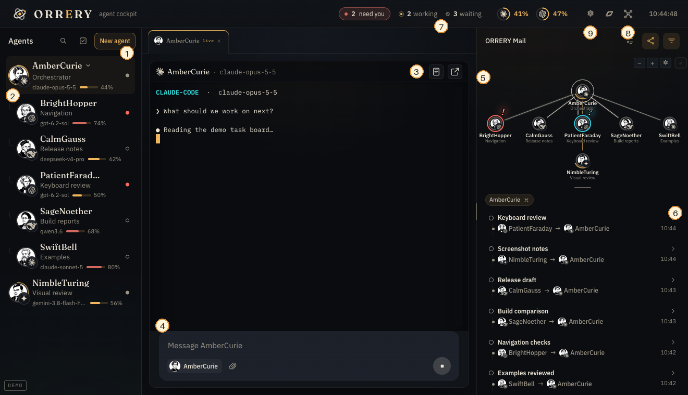

# Cockpit の画面一覧

1. **New agent**　[agent を起動して依頼する](start-an-agent.md)
2. **Agents**　[agent を切り替える](usage.md#roster) · [Select でまとめて選ぶ](usage.md#select-と一括-exit)
3. **端末と Reader**　[参照ファイルを開く](read-a-file.md) · [Reader で承認する](usage.md#reader-で承認する)
4. **入力欄**　[依頼を送る](start-an-agent.md) · [宛先や添付を指定する](usage.md#prompt-composer)
5. **Mini Graph**　[Mail の到着を見る](read-mail.md) · [ノードとつながりを見る](usage.md#mini-orrery)
6. **ORRERY Mail**　[届いた Mail を読む](read-mail.md) · [絞り込みと表示切替](usage.md#orrery-mail)
7. **稼働状況と残量**　[稼働中・待機中の agent を確認する](usage.md#roster) · [利用枠とリセット時刻を見る](usage.md#usage残量表示)
8. **Telemetry と Planetarium**　[状態と履歴を確認する](usage.md#telemetry) · [agent の親子関係を見る](usage.md#planetarium)
9. **Settings**　[見た目と文字サイズを調整する](usage.md#settings) · [Full tour を開く](FULL_TOUR.md)

[English](en/cockpit-map.md) · [ドキュメント索引](README.md)
