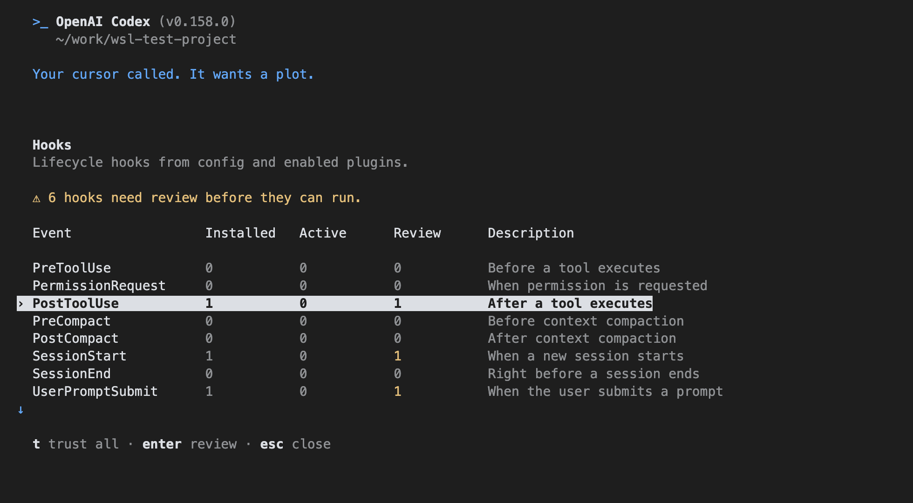

# Codex App 統合



Codex App で ORRERY を使うには、連携を導入して hook を確認します。

> English version: [codex-app.en.md](en/codex-app.md)

[前: Hooks](https://github.com/gyroid-eth/orrery-telemetry/blob/master/docs/hooks.md) · [README に戻る](../README.md) · [次: Dashboard](dashboard.md)

Codex App 統合は、**Codex Desktop で動く root task / subagent** を ORRERY Mail の identity と結び、lifecycle、inbox、file reservation、dashboard telemetry を tmux 外の runtime にも広げる任意機能です。通常の `agent-start-codex` は Codex CLI を tmux で起動するための launcher であり、この Bridge とは別経路です。

| 利用状況 | この統合 |
| --- | --- |
| Codex Desktop の task / subagent を ORRERY Mail と連携したい | 対象。導入してください |
| Codex Desktop の待機 task を inbox 到着時に再開したい | 対象。cold wake を利用できます |
| `agent-start-codex` で Codex CLI だけを使う | 不要。基本 installer の launcher と child MCP proxy だけで足ります |
| Claude Code と dashboard だけを使う | 不要 |

## できること

- Codex Desktop の `SessionStart`、`SubagentStart`、`UserPromptSubmit`、`PostToolUse`、`Stop`、`SubagentStop` を Bridge へ送り、root / subagent ごとの runtime state を維持
- server が確定した ORRERY Mail 名を runtime binding に保存し、再起動後も同じ identity と owner token で再登録
- session に固定された MCP proxy から inbox、message、acknowledgement、file reservation、sanitized runtime status を利用
- active turn では `PostToolUse` 後に pending mail の件数を追加 context として通知
- waiting / dormant の root task では ORRERY Mail signal を検知し、`codex exec resume` で bounded cold wake
- sanitized snapshot を dashboard provider へ渡し、Codex App runtime の状態と `open` action を表示

Bridge は `Codex Desktop` originator を持つ実在 transcript と一致した session だけを受け入れます。Codex CLI の transcript、transcript のない row、別 surface の hook payload は意図的に無視します。

## 構成

```text
Codex Desktop plugin hook
        │ lifecycle metadata only
        ▼
private Unix socket ──► Bridge daemon ──► ORRERY Mail
        │                    │                 │
        │                    ├─ binding/token  └─ inbox signal
        │                    ├─ snapshot              │
        │                    └─ delivery SQLite       ▼
        │                                      codex exec resume
        └─ unavailable 時は private spool

session-bound MCP proxy ──► inbox / message / ack / reservations
dashboard provider      ◄── sanitized snapshot
```

hook は prompt 本文、tool input、tool output を Bridge へ渡しません。allowlist 済みの session ID、subagent ID、cwd、model、event 名、turn ID だけを転送します。socket が利用できない場合も Codex turn は止めず、mode `0600` の spool へ保存して Bridge 起動後に再生します。

## 前提

- 基本の `./scripts/install.sh` が完了し、ORRERY Mail と signal directory が動作している
- absolute path の `AGENTSTACK_PROJECT_KEY`
- ORRERY Mail の `tools/call` を通常の JSON response で返す HTTP endpoint（例: `/mcp`）。core installer が generated `AGENTSTACK_MAIL_HTTP_BEARER_MODE=disabled` を設定
- `python3` と plugin command を持つ Codex executable
- service の自動登録を使う場合は macOS（GUI domain が利用できない場合は supervised background へ自動切替）

基本 installer は spawned child 用の session-scoped MCP proxy を `~/.agentstack/integrations/codex_app/` へ配置しますが、Codex Desktop plugin、Bridge service、delivery DB は有効にしません。これらは次の専用 installer で明示的に導入します。

## Install

まず core install の値を読み、実環境へ書く前に dry-run します。

```bash
. "$HOME/.agentstack/env.sh"

./scripts/install-codex-app-integration.sh \
  --dry-run \
  --project-key "$AGENTSTACK_PROJECT_KEY" \
  --agent-mail-url "$AGENTSTACK_MCP_URL"
```

preview が正しければ `--dry-run` だけを外します。

```bash
./scripts/install-codex-app-integration.sh \
  --project-key "$AGENTSTACK_PROJECT_KEY" \
  --agent-mail-url "$AGENTSTACK_MCP_URL"
```

source 済みの core `env.sh` に custom path があれば installer はそれを使います。
未指定時の互換 bearer file と signal directory は `~/.agentstack/mail` 配下です。
core env は endpoint、signals、
`AGENTSTACK_MAIL_HTTP_BEARER_MODE=disabled` をまとめて渡します。専用 installer は
その selector を Bridge env に保存し、runner、plugin MCP process、orphan cleanup の
いずれも legacy bearer を読み込みません。

installer は次を行います。

1. source、schema、plugin、runner を `~/.agentstack/integrations/codex_app/` へ配置
2. runtime directory を `~/.agentstack/runtime/codex-app/` に作成
3. token を含まない mode `0600` の `env.sh` と install manifest を生成
4. self-contained local marketplace を構築し、Codex plugin を登録
5. macOS では `org.agentstack.codex-app-bridge` を launchd へ実際に bootstrap し、GUI domain が拒否した場合は supervised background で Bridge を起動

plugin の登録だけでは lifecycle hook は実行されません。install 完了後に Codex の `/hooks` を開き、AgentStack の hooks を review・承認してから、新しい Codex process で child を起動してください。既に起動中の process では SessionStart が再発火する保証はありません。

launchd の可否はログイン情報から推測せず、`gui/$UID` への bootstrap、enable、kickstart がすべて成功したかで決めます。ヘッドレス SSH や画面スリープ中などで失敗した場合、live plist を残さず `bridge-supervisor.pid` を持つ background supervisor に切り替わります。この supervisor は Bridge 子プロセスが終了すると既定5秒後に再起動します。install manifest と doctor は、希望した方式ではなく実際に選ばれた方式を記録・表示します。

主な option:

| Option | 用途 |
| --- | --- |
| `--install-dir PATH` | integration source と manifest の配置先 |
| `--runtime-dir PATH` | private socket、binding、snapshot、delivery DB、log の配置先 |
| `--agent-mail-env PATH` | 既存の Mail bearer を参照する絶対パス。token の値はコピーしない |
| `--signals-dir PATH` | ORRERY Mail の信号ディレクトリの絶対パス |
| `--python-bin PATH` | Bridge が使う実行可能な Python |
| `--no-service` | launchd と supervised background のどちらも起動しない。macOS 以外では既定（指定しなくても service は入れない） |
| `--no-plugin` | marketplace は構築するが Codex plugin を登録しない |
| `--refresh-plugin-only` | 配置済み payload から、既存の有効な Codex plugin だけを再導入。Bridge state は変更しない |
| `--wake-limit COUNT` | root task ごとの cold wake 上限回数 / 時 |
| `--stale-after SECONDS` | waiting runtime を dormant にする閾値。300〜604800秒 |
| `--retry-max-attempts N` | ORRERY Mail 登録 retry の最大 call 数 |
| `--retry-max-age SECONDS` | 登録 retry を保持する最長時間 |
| `--retry-max-backoff SECONDS` | 登録 retry の backoff 上限 |
| `--skip-git-check` | review 済み non-git workspace でだけ trust check を明示解除 |

### core 更新後の既存 plugin refresh

core `install.sh` は child MCP proxy と plugin source を配置しますが、optional plugin の marketplace snapshot と Codex cache は更新しません。既に `agentstack-codex-app@agentstack-local` を導入・有効化している環境では、core payload の配置後に、plugin registry を持つ**親 / 共有 CODEX_HOME**を明示して refresh します。

```bash
CODEX_HOME="$HOME/.codex" \
./scripts/install-codex-app-integration.sh \
  --refresh-plugin-only \
  --install-dir "$HOME/.agentstack/integrations/codex_app"
```

先に read-only の確認だけを行う場合は `--dry-run` を加えます。refresh は exact plugin が installed + enabled で、既存 local marketplace root が一致するときだけ、配置済み integration から snapshot を再構築して正規の `codex plugin add` を実行します。未導入または disabled なら理由付きで skip し、plugin を自動導入・有効化しません。別 marketplace、registry 読取失敗、または CLI が選んだ cache payload の hooks / runner / recorder 不一致はエラーです。

この経路は env、plist、service、install-state を再構成しません。**full installer の `--no-service` は純粋な plugin refresh の代用ではありません。** refresh 後は Codex の `/hooks` で AgentStack の lifecycle hooks を review・承認し、その後に新しい Codex process / thread で SessionStart の ID 対応を確認してください。既に起動中の子で SessionStart が再発火することは保証しません。

`--no-service` の install を前面で動かす場合は、生成された runner を実行します。

```bash
~/.agentstack/integrations/codex_app/bin/run-bridge
```

## 確認

専用 doctor は manifest、file mode、payload、marketplace、plugin、実際の service mode、socket、binding store、stale drain、delivery error をまとめて確認します。launchd は登録の有無だけでなく `state = running` または正の `pid` を確認し、supervised background は pidfile の supervisor が生存していることを確認します。

core の `agentstack-doctor` は child launcher が実際に選ぶ `codex` と共有 `CODEX_HOME` を表示し、history binding plugin が未導入・disabled・enabled のどれかを区別します。hook の承認状態を安定した公開情報から確認できない場合は「不明」として `/hooks` での確認を案内します。この診断は Codex history を使わない Claude-only 環境を故障扱いしません。

```bash
~/.agentstack/integrations/codex_app/bin/doctor-codex-app-integration
```

Bridge を意図的に停止して検査するときだけ:

```bash
~/.agentstack/integrations/codex_app/bin/doctor-codex-app-integration \
  --allow-stopped
```

launchd / supervised background の log はどちらも既定で次にあります。

```text
~/.agentstack/runtime/codex-app/bridge.stdout.log
~/.agentstack/runtime/codex-app/bridge.stderr.log
```

## Agent の利用手順

`SessionStart` / `SubagentStart` hook は、現在の `session_id` と必要なら `agent_id` を使って最初に `agentstack.bootstrap` を呼ぶよう additional context を渡します。最初の bootstrap が MCP process を一つの Bridge binding に固定し、その後の tool call では project key、agent 名、owner token を agent から受け取りません。

proxy の公開 tool は次の10個です。

- `bootstrap`
- `fetch_inbox`
- `send_message`
- `acknowledge_message`
- `reserve_files`
- `renew_reservations`
- `release_reservations`
- `runtime_status`
- `show_files`（作った・直した file や画像を、cockpit の History の chip にする。下を参照）
- `whois`（宛先名の確認用。名前は大文字小文字を区別します）

束縛済み proxy の `show_files` は、その proxy の中で完結します。Mail server へは何も送らず、何も書かず、file の中身も読みません。ほかの local tool と同じく、束縛（bootstrap）の後でだけ使えます。1〜8個の path を検査し、`present` に OS の権限で読み取れる通常ファイルを返します。読み取り権限がない場合は理由を返します。相対 path は束縛から分かる agent の作業 folder（Codex App の snapshot）内で照合します。作業 folder が不明なら相対 path に `checked: false`、その外を指す相対 path に `outside_working_folder: true` を返します。絶対 path は作業 folder の外でも使えます。cockpit とスマホは記録に残った呼び出しから chip を出し、preview 時に OS の権限・ファイルの種類・大きさ・シンボリックリンクを検査します。Claude・Codex・dsh・Hermes の managed な指示と、同梱の `/log`・`/delegate` が、見せたい file があるとき最後の報告の前に呼ぶよう案内します。Claude の設定の雛形は、この tool を確認なしで許可します。

`reserve_files`・`renew_reservations`・`release_reservations` は物理絶対 path を受け取り、同じ bound identity / Mail namespace へそのまま送ります。managed `workspace-v1` では、symlink を解決した物理絶対 path（例: `str(Path(target).resolve())`）で取得し、同じ path で更新・解放してください。guard の拒否理由にも必要な path を表示します。既存の相対 path / glob は旧 session 互換として無変換で受け付けますが、cwd・project key・保護 root から絶対化しません。絶対 glob も無変換なので、固定部分には物理 path を使ってください。`..` component、不正文字、空文字、件数・長さの上限違反は引き続き拒否します。

相対予約だけを取得していた managed session は、更新した proxy を正規の resume/restart 手順で読み直し、本人が不要な旧予約を ID で解放して物理絶対 path で取り直してください。既存予約の自動移行はしません。この対応で candidate/global/fresh server への切替や、binding・sandbox・編集権限の変更はありません。

tool call が失敗したとき、proxy は Mail server のエラー 1 行目をそのまま返します（token に見える文字列は `[redacted]` に置き換え、600 文字で切ります）。以前は固定文 "ORRERY Mail tool call failed" だけを返していたため、宛先名の綴り違いのような検証エラーでも child は理由を知れず、直さずに諦めていました。

root task は `session_id` だけを渡します。subagent は同じ `session_id` と自分の `agent_id` を渡し、Bridge が記録した parent lineage と一致しない binding は拒否されます。

`spawn_child.sh` などの launcher が子に渡す proxy は Bridge を使わず、起動時に名前・project・token を直接 bind します。この binding の `lineage` は Codex App の lineage ではなく、launcher が `AGENTSTACK_PROXY_PARENT_AGENT` で渡した ORRERY の親を `parent_agent` に示します（`kind` は `child`）。`--standalone` など親のない agent は `kind: root`・`parent_agent: null` です。launcher は親を子の private な state（`child-agents/<name>.json` の `parent_agent`）にも記録します。dashboard から再開して proxy の設定を作り直すときも、同じ親を渡します。launcher は、生成した proxy が親を示せない組み合わせ（proxy が受け付けない親の名前、proxy を用意できず継承した Codex 設定が Bridge の plugin を有効にしている場合）では、CLI を起動する前に止まります。

launcher が起動時に bind した proxy は、raw の ORRERY Mail と同じ形の引数も受けます。raw で使った会話を再開すると、モデルは以前の形のまま呼ぶためです。`project_key`・`agent_name`・`sender_name` は binding と一致すれば無視し、食い違えばその理由を返します。raw の `whois` の `agent_name` は、調べる相手として扱います。モデルが渡した `registration_token`・`sender_token` は使わず、Mail へも送りません。schema にないその他の引数は、受け付ける引数の一覧をつけて拒否します。この proxy の `runtime_status` の `state` は `bound`（binding がある）で、Mail には問い合わせません。

## Inbox 通知と cold wake

active turn と停止中の task では配送経路が異なります。

| Runtime | Inbox 到着時の挙動 |
| --- | --- |
| `working` | cold wake は開始せず `pending` にし、次の `PostToolUse` で件数を通知 |
| root の `waiting / dormant` | 2秒間 coalesce した後、delivery lease を取り `codex exec resume` |
| subagent | cold wake せず `subagent_cold_wake_unsupported`。durable work は root task 宛てにする |
| `blocked` | 自動 retry せず、原因を修復して明示的に requeue |

wake prompt に入るのは message ID、sender、subject だけです。message body は resume 後に session-bound `fetch_inbox` で取得します。同じ message は delivery SQLite で idempotent に追跡し、既定では1時間12回、最大5 attempt、実行 timeout 900秒です。

## 設定

利用者が通常変更する値は installer option で指定してください。

| 環境変数 | 既定値 | 意味 |
| --- | --- | --- |
| `AGENTSTACK_CODEX_APP_INSTALL_DIR` | `~/.agentstack/integrations/codex_app` | source、plugin、manifest |
| `AGENTSTACK_CODEX_APP_RUNTIME_DIR` | `~/.agentstack/runtime/codex-app` | private runtime state |
| `AGENTSTACK_CODEX_APP_LAUNCHD_LABEL` | `org.agentstack.codex-app-bridge` | launchd label |
| `AGENTSTACK_CODEX_APP_MARKETPLACE` | `agentstack-local` | local marketplace 名 |
| `AGENTSTACK_CODEX_APP_WAKE_LIMIT_PER_HOUR` | `12` | binding ごとの wake 上限 / 時 |
| `AGENTSTACK_CODEX_APP_STALE_AFTER_SECONDS` | `3600` | waiting → dormant の閾値 |
| `AGENTSTACK_CODEX_APP_RETRY_MAX_ATTEMPTS` | `12` | identity 登録 retry の最大 call 数 |
| `AGENTSTACK_CODEX_APP_RETRY_MAX_AGE_SECONDS` | `3600` | identity 登録 retry の寿命 |
| `AGENTSTACK_CODEX_APP_RETRY_MAX_BACKOFF_SECONDS` | `300` | identity 登録 retry の backoff 上限 |
| `AGENTSTACK_CODEX_APP_RESTART_DELAY` | `5` | supervised background で Bridge 子プロセスを再起動するまでの秒数 |
| `AGENTSTACK_CODEX_APP_COLD_WAKE` | `1` | `0` で cold wake だけを無効化 |
| `AGENTSTACK_CODEX_APP_SKIP_GIT_CHECK` | `0` | `1` で resume の git trust check を解除 |
| `AGENTSTACK_CODEX_BINARY` | install 時に解決した `codex` | plugin 操作と `codex exec resume` |
| `AGENTSTACK_MAIL_HTTP_BEARER_MODE` | `disabled` | core ORRERY Mail transport。core install が生成し Bridge へ永続化 |

`AGENTSTACK_CODEX_APP_SOCKET`、`AGENTSTACK_CODEX_APP_SNAPSHOT`、`AGENTSTACK_CODEX_APP_DELIVERY_DB`、`AGENTSTACK_CODEX_APP_PLUGIN_ID` は installer が一貫した値を生成します。`AGENTSTACK_CODEX_APP_SPOOL`、`AGENTSTACK_PROJECT_SLUG`、`AGENTSTACK_CODEX_APP_BOOTSTRAP_WAIT`、`AGENTSTACK_CODEX_APP_RETRY_SECONDS`、`AGENTSTACK_CODEX_APP_WAKE_POLL_SECONDS`、`AGENTSTACK_CODEX_APP_WAKE_COALESCE_SECONDS`、`AGENTSTACK_CODEX_APP_WAKE_TIMEOUT_SECONDS`、`AGENTSTACK_CODEX_APP_WAKE_LEASE_SECONDS`、`AGENTSTACK_CODEX_APP_WAKE_BASE_BACKOFF_SECONDS`、`AGENTSTACK_CODEX_APP_WAKE_MAX_BACKOFF_SECONDS`、`AGENTSTACK_CODEX_APP_WAKE_MAX_ATTEMPTS` は Bridge / test の内部 tuning 値です。通常は手動設定せず、変更する場合は source の validation range と delivery semantics を確認してください。

`AGENTSTACK_CODEX_APP_COLD_WAKE` には installer option がありません。launchd install で無効化する場合は generated `env.sh` に `export AGENTSTACK_CODEX_APP_COLD_WAKE=0` を追加して service を再読込します。再 install は `env.sh` を生成し直すため、この手動変更も再確認してください。

## Security boundary

- install / runtime directory は mode `0700`、generated env、socket、binding、snapshot は mode `0600`
- legacy bearer token は generated `env.sh` へコピーせず、`AGENTSTACK_MAIL_ENV` の参照だけを保存。既定の `disabled` transport では bearer 自体を読み込まない
- owner token は private identity store に分離し、agent や dashboard snapshot へ公開しない
- hook event と dashboard snapshot は field allowlist で検証
- cold wake は固定 instruction と bounded metadata だけを渡し、stdout / stderr 診断は token pattern を redaction
- headless wake が一時的に approve するのは上記9個の session-bound proxy tool だけで、shell、sandbox、他 MCP、global approval policy は変更しない

`--skip-git-check` は untrusted directory を一般に許可する option ではありません。git 管理外であることを確認済みの workspace に限定し、通常は trusted repository 内で task を開始してください。

## よくある失敗

| 症状 | 確認と対処 |
| --- | --- |
| installer が project key を拒否 | `--project-key` に absolute path を渡す |
| Bridge が ORRERY Mail へ接続できない | `tools/call` を通常の JSON で返す generated endpoint と `AGENTSTACK_MAIL_HTTP_BEARER_MODE=disabled` を確認 |
| doctor が service / socket / startup diagnostic を失敗扱い | doctor が表示する実 service mode を確認。launchd なら `launchctl print gui/$(id -u)/org.agentstack.codex-app-bridge`、supervised background なら `bridge-supervisor.pid` と `bridge.stderr.log` を確認。意図的な停止中だけ `--allow-stopped` |
| Codex App runtime が dashboard に出ない | Codex Desktop plugin が有効か確認。CLI session と transcript のない session は意図的に対象外 |
| state が `degraded` | owner token 読み取りまたは ORRERY Mail 登録が失敗。URL、transport mode、runtime file mode、registration retry log を確認し、別 identity を作らない |
| `identity_auth_required` | binding に owner token がない。doctor で binding store を確認し、同名を別 token で再登録しない |
| `untrusted_workspace` | trusted git repository で再開。review 済み non-git workspace だけ installer の `--skip-git-check` を使う |
| `wake_rate_limited` | 1時間の上限を待つか、原因を直してから `--wake-limit` を見直す |
| `subagent_cold_wake_unsupported` | durable な依頼は stopped subagent ではなく parent root task へ送る |
| `wake_failed / dead_letter` | doctor が表示する sanitized error を直し、対象 message だけを明示 requeue |

failed / dead-letter delivery の原因を直した後:

```bash
~/.agentstack/integrations/codex_app/bin/doctor-codex-app-integration \
  --allow-stopped \
  --requeue-message 123 \
  --agent-name ExampleAgent
```

## Cleanup と uninstall

対応する Codex Desktop rollout が消えた binding だけを retire / purge する操作:

```bash
~/.agentstack/integrations/codex_app/bin/doctor-codex-app-integration \
  --allow-stopped \
  --cleanup-orphan-bindings
```

これは remote identity の retire を伴います。対象 rollout が不要であることを確認してから実行してください。

uninstall は最初に preview します。

```bash
~/.agentstack/integrations/codex_app/bin/uninstall-codex-app-integration \
  --dry-run
~/.agentstack/integrations/codex_app/bin/uninstall-codex-app-integration
```

既定では binding と delivery state を runtime directory に保持します。exact runtime path も削除するときだけ `--purge-data` を付けます。

## 関連文書

- [インストール](telemetry-install.md)
- [Launcher と identity](launchers.md)
- [Hooks と運用 helper](https://github.com/gyroid-eth/orrery-telemetry/blob/master/docs/hooks.md)
- [Dashboard](dashboard.md)
- [設定](telemetry-configuration.md)
- [トラブルシューティング](telemetry-troubleshooting.md)
