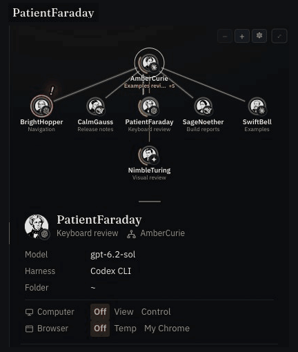

# Computer use



NEW AGENT で画面操作を選びます。起動後は agent の詳細から利用中の権限を確認し、対応する権限を切り替えられます。

[English](en/computer-use.md) · [目的別索引](README.md)

<a id="new-agent"></a>
## NEW AGENT で選ぶ

macOS の dashboard の NEW AGENT では、Claude Code、Codex CLI、dsh、Hermes、Antigravity CLI で **Computer use** を選べます。同じ3段を Telemetry のスマホ画面と、Telemetry API 53 以降に接続した cockpit でも使えます。

| 選択 | ORRERY から渡す画面操作 |
| --- | --- |
| Off | 画面の道具を付けない |
| View | アプリ・窓の一覧と画面状態の読み取り |
| Control | View に加え、クリック・入力などの操作 |

cockpit とスマホの NEW AGENT では、**Browser** から、利用できる Off・Temporary Chrome・My Chrome を別に選びます。Temporary Chrome は一時プロファイル、My Chrome は普段の Chrome を使います。Chrome で接続許可を求められたら、人が Chrome 上で応答します。[ブラウザの準備と許可](delegation.md#ブラウザと-computer-use-何が届くか人がやること)

macOS では親の欄を空にして Antigravity を起動できます。この起動でも Computer use と、対応画面での Browser を選べます。Git が必要なのは Isolation を選ぶ場合です。Antigravity の画面の道具は、選択した段に応じて、そのセッションだけ個別に許可されます。既存の Ask・Deny が優先されます。有効なグローバル Chrome MCP があると Browser の選択肢は表示されません。[Antigravity の導入と起動](antigravity.md#dashboard-new-agent)

## CLI と API で選ぶ

標準の Claude、Codex、dsh、Hermes の子で、`--tools` に `orrery-screen` を明示すると、ORRERY が生成した stdio MCP を使えます。dsh と Hermes は Local 接続でも同じ指定です。権限は起動世代ごとに決まり、relay を起動したセッションでは実行中も operator API から変更できます。

| 起動の指定 | 初期権限 |
| --- | --- |
| `--tools mcp:orrery-screen` | `off` |
| `--tools screen:read:orrery-screen` | `view` |
| `--tools screen:operate:orrery-screen` | `control` |

NEW AGENT の選択を `/api/spawn` で指定する場合、View は `{"tools":{"screen":{"access":"read"}}}`、Control は `access` を `operate` にします。Off は明示した `tools` から画面の指定を外します。対応する子で relay を付けて Off から始める場合は、`{"tools":{"mcp":["orrery-screen"]}}` を渡します。macOS の名前なし `screen:operate` も `orrery-screen` を選びます。installer の既定の道具に `orrery-screen` は追加されません。

Claude を会話だけで再開するときも、`/api/jump` に同じ `tools` を渡せます。指定した回の起動に世代を作ります。再開時に追加の道具を省略すると、前の世代の画面操作資格も失効します。[再開 API の指定例](https://github.com/gyroid-eth/orrery-telemetry/blob/master/docs/api.md#post-apijump)

## 準備

1. [配布元の Cua Driver 0.55.0](https://github.com/trycua/cua/releases/tag/cua-driver-rs-v0.55.0) から対象 OS の artifact を選び、配布元の SHA256 と署名を照合します。
2. OS に応じてユーザーの対話セッションを準備します。
3. Dashboard の install root に、既存の `agentstack-http-operator configure` で operator capability を用意します。すでに作成済みならその値を使います。 [operator の設定](https://github.com/gyroid-eth/orrery-telemetry/blob/master/docs/global-delivery-client.md#operator-ui-access)
4. Relay を実行する Python で `python -I -m agentstack_mail.screen_mcp --help` が通ることを確認します。必要なら `AGENTSTACK_SCREEN_PYTHON` に対象の Python の絶対パスを指定します。dashboard から起動・resume する場合は dashboard の実行環境に設定を渡します。

| OS | 上流の起動と前提 |
| --- | --- |
| macOS | `cua-driver mcp`。CuaDriver.app の Developer ID と公証を確認し、ユーザーがアクセシビリティと画面収録を許可します。PATH に無ければ標準の Applications 配置を探します。 |
| Windows＋WSL | `cua-driver.exe mcp --socket \\.\pipe\cua-driver`。Windows 側で Authenticode 署名を確認します。ユーザーの対話ログオンで daemon を起動し、名前付きパイプの Windows アカウントと昇格状態を WSL 側から呼ぶ実行ファイルに合わせます。通常は昇格なしと Limited を使います。 |
| Linux | `cua-driver mcp`。配布元の Linux 版を X11、またはドライバーが扱える KDE の KWin セッションで使います。 |

PATH で見つからない場合は `AGENTSTACK_CUA_DRIVER` に実行ファイルの絶対パスを指定します。WSL では `/mnt/c/…/cua-driver.exe` のような WSL 側の絶対パスです。公開される定義は 0.55.0 の確認済みの定義に固定しています。実行時の版・入力・出力 schema のいずれかが違えば、呼び出しを拒否します。更新時は固定した定義と実際の `tools/list` を照合します。

WSL の中継は普通の stdio パイプを使います。動作には起動経路の WSL interop と、Windows ユーザーの対話ログオンが必要です。interop と distro の寿命は WSL の設定に従います。ログイン中の Windows Terminal、昇格なし、Limited から先に確認します。

## macOS の起動設定

NEW AGENT で View または Control を選ぶと、`orrery-screen` から Cua Driver を呼びます。`--tools screen:read` と `--tools screen:operate` も同じ経路です。`--tools mcp:orrery-screen` は Off で公開し、起動後の切替を待ちます。

生成する Claude Code では同名の組み込み MCP を起動設定で拒否します。Codex CLI の生成ホームでは、Computer use の選択にかかわらず GUI 同梱の `node_repl` と `unified-computer-use@openai-bundled` を無効にします。Hermes の生成プロファイルでは組み込みの Cua toolset を外します。Chrome DevTools など別途選んだ Browser use は独立しています。

Antigravity CLI の global MCP 設定で Cua Driver を直接有効にしている場合、生成時に対象の MCP 名を表示して起動を止めます。Antigravity の global MCP 設定は本人が管理します。 [Antigravity の MCP 設定](https://antigravity.google/docs/mcp/#global-and-workspace-server-configs)

<a id="permission-status"></a>
## 起動後の状態を確認する

cockpit の agent の詳細やスマホの Reader に Computer use と Browser use が表示されます。起動の記録がある場合は保存した選択を使い、画面 relay の起動世代を照合できる場合はその実効値を表示します。Antigravity では起動の記録などから値を確定できない項目に `Unknown` と理由が付きます。

起動記録のない legacy の稼働中の Claude Code／Codex CLI では、Telemetry API 52 以降がプロセスの起動引数と子孫プロセスからローカル Cua Driver、Codex の Chrome DevTools、Claude の明示的な Chrome フラグを確認します。プロセスや引数を読めない場合、relay のモードや Claude のフラグを確認できない場合は `Unknown` と理由が表示されます。この表示の対象は画面とブラウザの道具の選択・観測値です。Chrome の接続や OS の許可はそれぞれの画面で確認します。

## 起動中に権限を変える

[computer use API](https://github.com/gyroid-eth/orrery-telemetry/blob/master/docs/api.md#computer-use-api) の `GET /api/computer-use` で、`project`、`runtime`、`agent`、`generation`、実効値 `computer_use`、由来 `source` を読みます。変更時は同じ起動を示す 4 項目と新しい `computer_use` を、operator capability 付きの `POST /api/computer-use` に渡します。

次は人がローカルの dashboard を操作する例です。変数 `dashboard_url` にはこの install の loopback URL を指定します。

```bash
operator_capability="$(agentstack-http-operator show)"
operator_request() {
  printf 'header = "Authorization: Bearer %s"\n' "$operator_capability" |
    curl --config - --silent --show-error --fail-with-body "$@"
}
operator_request "$dashboard_url/api/computer-use"
```

返った対象の 4 項目をコピーして変更します。

```bash
operator_request "$dashboard_url/api/computer-use" \
  --json '{"project":"sample-project","runtime":"11111111111111111111111111111111","agent":"SampleAgent","generation":"22222222222222222222222222222222","computer_use":"control"}'
unset operator_capability
```

子は、生成した `orrery-screen` の起動定義の環境で `python -I -m agentstack_mail.screen_mcp --status` を実行すると、同じ起動の project・runtime・世代・権限・由来を JSON で確認できます。生成した資格の値を表示する必要はありません。子の資格で状態を変更しようとすると HTTP 403 が返ります。relay の権限変更は、Antigravity CLI のセッションに起動時に与えた個別の許可を変更しません。

引き下げは次に照会する呼び出しから有効です。すでに上流に渡った入力はそのまま実行されます。resume で新しい世代が始まると、保持した道具の指定から初期権限を作り直します。親なしの Antigravity を Resume すると、初回の選択と前の relay 権限のうち低い方を、新しい relay と CLI の許可に使います。`agentstack-resume --tools` で道具を付け替える場合は、新しい指定の初期値になります。明示的に外すには、停止した子を `agentstack-resume <agent> --base default` で再開します。

## 一覧と応答

`view` では `check_permissions`、`list_apps`、`list_windows`、`get_window_state` が使えます。`control` では、さらに `launch_app`、`click`、`type_text`、`press_key`、`hotkey`、`scroll`、`set_value`、`invoke_menu` が使えます。どの権限でも `tools/list` は同じで、権限不足は個々の呼び出しで分かります。

画像保存先など、宣言した schema にない引数は拒否します。窓の木は既定で最大250要素、深さ25、画像の長辺は最大1,280 pxです。各応答は MCP の JSON で最大2 MiB、テキストと構造化データは合計64 KiB、画像は合計1,638,400画素までです。木は行と要素の境界で切り、画像は上流の縮小結果をそのまま返して座標を維持します。上限を超えたブロックを外したときは結果に印が付きます。

## 確認と復旧

| 確かめること | 手順と期待する結果 |
| --- | --- |
| 本人と権限 | operator の一覧と子の `--status` で project・runtime・世代・実効値・由来を照合する。同名で起動し直したときは古い資格が拒否される。別 project の対象に古い世代を指定しても変更できない。 |
| 一覧と承認 | `off`、`view`、`control` で12道具の名前と schema が一致する。View または Control で起動し、利用者の Ask・Deny がない状態で、偽の上流の `check_permissions` が承認待ちにならず通ることを確かめる。生成設定とモデルの道具一覧で Cua Driver の直接経路も確認する。 |
| 切替と拒否 | 同じセッションを `off` → `view` → `control` → `off` に切り替える。許可不足、不明な道具名、照会停止・時間切れのときは、偽の上流に呼び出しが届かない。 |
| 引数 | 例として `get_window_state` に `screenshot_out_file` を渡す。引数拒否になり、ファイルも試験用の窓も変わらない。 |
| 上限と終了 | 大きな木・画像、版不一致、stdio 切断と時間切れを偽の上流で再現する。JSON と要素番号が保たれ、必要な箇所に省略の印が付き、入力の再送なしで上流プロセスが終了する。 |
| 付与と経路 | 明示選択あり、選択なし、明示で外した resume を試す。ユーザー設定・overlay・plugin の直接経路も確認する。 |
| 履歴 | operator の `GET /api/computer-use/events` で ID、道具名、開始・終了時刻、結果を確認する。引数、窓の題名、結果本文、画像が記録に含まれない。 |

Cua Driver の版・実行ファイル・stdio が合わないときは、relay の理由を読み、上流の版と起動コマンドを確認します。WSL で pipe が開けないときは、WSL interop、Windows のログオンと daemon、pipe の所有者と昇格状態を順に確かめます。Mac がロック中に操作が拒否されたら、ユーザーが対話セッションに戻ってから試験用の窓で確認します。照会失敗なら dashboard と世代を確かめます。harness の承認待ちなら生成設定にある各道具の承認を確かめます。上流が切断された relay は呼び出しを再送しないため、復旧後は子を再開します。

画面を見せている間は、秘密を含む窓を開いたままにしないでください。この中継が制御するのは、ORRERY が生成した MCP 経路です。同じ OS ユーザーで動く shell からの直接実行や、同一アプリの窓の取り違えには、別の境界が必要です。
