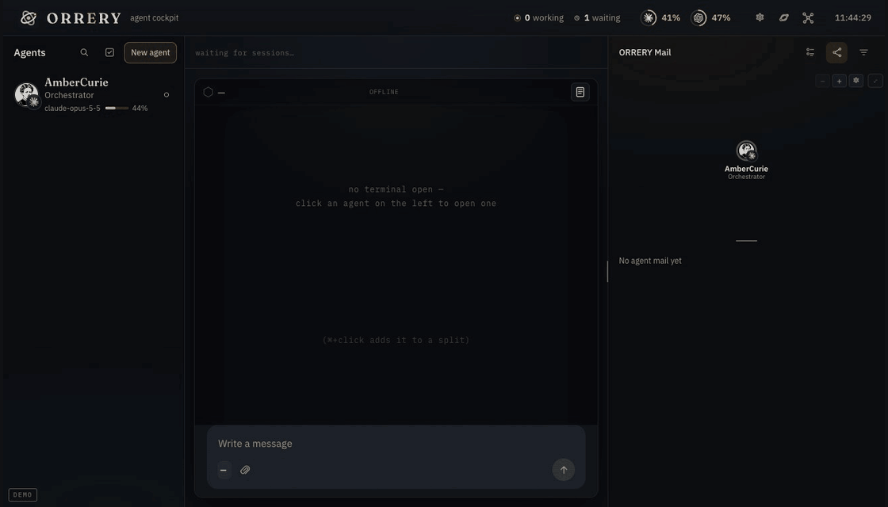

# 委任と child agent



親が仕事を分け、子が結果を Mail で返します。作業フォルダー、モデル、使う道具を依頼に合わせて選びます。

> English version: [delegation.en.md](en/delegation.md)

[前: Launcher と identity](launchers.md) · [README に戻る](../README.md) · [次: Hooks](https://github.com/gyroid-eth/orrery-telemetry/blob/master/docs/hooks.md)

Claude Code にも Codex Desktop にも、最初から subagent の仕組みがあります。このスタックが作る **child agent** はそれとは別のものです。名前が似ているうえ、**片方が動かないときにもう片方が黙って肩代わりする**ため、区別を知らないまま「動いている」と判断してしまう事故が実際に起きました。

このページはその2つの違いと、いま自分がどちらを使っているかの見分け方を扱います。

Codex では `$delegate` でこの skill を呼びます（`/skills` でも選択できます）。Claude Code では `/delegate` です。installer は `${CODEX_HOME:-$HOME/.codex}/skills/delegate` にリンクを作ります。同名の利用者 skill があれば警告して保持するため、競合時は ORRERY の skill が選ばれているか確認してください。

結果を報告したあとや、返事が来るまで進められない質問を送ったあとは、セッションを開いたままターンを終えます。返事は ORRERY Mail の通知で届きます。`sleep` を繰り返して待たないでください。

## 一言でいうと

- **組み込み subagent** は、親の中で開かれ、答えを返して閉じる**呼び出し**です。外から見えるものは何も残しません。
- **child agent** は、identity を持ち、自分の tmux session で動き、メールを受け取れる**相手**です。親と対等に名指しでき、あとから履歴をたどれます。

短い調べ物なら前者で十分です。後者が要るのは、**その仕事の存在を人間や他のエージェントが知っている必要があるとき**です。

## 違い

| | 組み込み subagent | child agent（このスタック） |
|---|---|---|
| 作り方 | 親が `Agent` / `Task` ツールを呼ぶ | Claude Code: `/delegate`、Codex: `$delegate`（内部で `spawn_child.sh`） |
| identity | 無し。呼び出しごとの内部 ID（`a1798ced…` のような16進） | ORRERY Mail に登録された名前（`Teal-Darwin` のような形容詞＋科学者名） |
| プロセス | 親と同じプロセス | 独立した tmux session（＋任意で端末ウィンドウ） |
| dashboard | **現れない**（ノードとしても存在しない） | ノードとして立ち、親との間に線が引かれる |
| 連絡 | 親からの引数と、返ってくる最終テキストだけ | ORRERY Mail。親以外の agent とも双方向にやり取りできる |
| 寿命 | その1回の呼び出しの間だけ | 明示的に終えるまで。次の仕事を追加で投げられる |
| 中断からの復帰 | 不可 | tmux session が残り、dashboard の jump / resume で戻れる |
| ファイル調停 | 無し | file reservation で他 agent と衝突を避けられる |
| 進行の観察 | 終わるまで分からない | 途中経過を pane で見られる。監視ループを回せる |
| 向いている仕事 | 短い調査・検索・単発の判断 | 長い実装、並走、人間が経過を見たい仕事 |

## 見分け方

いちばん確実なのは **dashboard を見ること**です。組み込み subagent は ORRERY Mail に登録しないので、ノードとして現れません。線が無いのではなく、**存在しません**。

しりとりのような疎通確認をしたとき、次のどれかに当てはまるなら組み込み subagent です。

- NETWORK に子のノードが出ない
- 子の名前が形容詞＋科学者名ではなく、16進の識別子になっている
- 親のログに `Agent(...)` / `Task(...)` の呼び出しが並んでいる
- `tmux ls` に子の session が無い

逆に child agent なら、2体の間にエッジが引かれ、そこに通信件数が乗り、エッジを開くとやり取りが1通ずつメールとして並びます。

## なぜ黙って入れ替わるのか

`/delegate` は ORRERY Mail の MCP ツールを使います。**そのツールが無いとき、親は自分の判断で組み込み subagent に切り替えて仕事を終わらせます。** 仕事は完了し、報告も返るので、人間の側からは成功にしか見えません。

このスタックでは、その振る舞いを次の3段構えで潰しています。

1. **install が ORRERY Mail を MCP サーバーとして登録する。** 以前は登録手順がどこにも書かれておらず、ユーザーが登録済みであることを暗黙の前提にしていました
2. **`agentstack-doctor` が登録の欠落・不一致を報告する。** 修復コマンドも表示します
3. **管理下の指示（`claude/CLAUDE.md` / `codex/AGENTS.md`）が、委任は delegate skill（Claude Code: `/delegate`、Codex: `$delegate`）だけで行うこと、ツールが無いときは代替せず報告して止まることを明示する**

導入直後は `agentstack-selftest` を実行してください。存在ではなく**機能**を確認します（登録の検証 → 実際の2体の spawn → 相互のメール到達まで）。

## Codex child と MCP 承認

親付きの Codex child は無人実行のため既定で `--ask-for-approval never` です。`AGENTSTACK_CODEX_CHILD_APPROVAL` でこの値を変更できます。NEW AGENT の親なし起動と、その記録があるセッションの再開では承認引数を省略します。Codex は overlay を適用した `config.toml` の `approval_policy` に従い、未設定なら自身の既定値を使います。親なし起動の記録がない既存セッションの再開には、従来の子の承認設定を適用します。

shell command の承認とは別に MCP tool にも承認設定があります。承認方針が `never` のとき、明示的な許可がない inherited server を呼ぶと `MCP tool call requires approval, but approval policy is never` で直ちに失敗します。全 Codex child に同じ許可を与えるには TOML fragment を用意し、installer の `--codex-child-overlay /absolute/path/to/overlay.toml` で保存します。

server 全体を許可する最小例です。

```toml
[mcp_servers.chrome-devtools]
default_tools_approval_mode = "approve"
```

接続先も変える場合、overlay の array は inherited 値を丸ごと置換します。

```toml
[mcp_servers.chrome-devtools]
args = ["--browserUrl", "http://127.0.0.1:<port>"]
default_tools_approval_mode = "approve"
```

`default_tools_approval_mode` は Codex の server-wide key です。個別 tool だけを許可する場合は `[mcp_servers.chrome-devtools.tools.take_screenshot]` の `approval_mode = "approve"` で範囲を狭めます。table は再帰的に merge され、scalar と array は overlay 側が置換します。child の認証済み identity を保護するため、ORRERY Mail proxy に相当する `mcp_servers` と `plugins.*.mcp_servers.agentstack` は overlay から変更できず、無視した key が stderr に警告されます。

この overlay は現在 macOS/Linux の `spawn_child.sh` にだけ適用されます。Windows では WSL2 経由なら同じ経路を使いますが、community lane の native Windows launcher は対象外です。

`--tools`（installer の既定も含む）で選んだ browser・screen・`mcp:<name>` の server は、子の `CODEX_HOME/config.toml` だけで `required = true` とし、起動待ちを最低60秒にします（既存の長い timeout は保持）。optional な server が起動中のまま省略されるのを防ぎ、初期化に失敗すれば Codex の起動・resume が止まります（[公式構成リファレンス](https://learn.chatgpt.com/docs/config-file/config-reference)）。選択しない継承 server と ORRERY Mail には追加せず、利用者の設定は変更しません。`--codex-mcp inherit/orrery-only` の profile だけでは道具の server を選択しません。

optional server 全体の待機を制御する `mcp_optional_startup_grace_ms`（既定1000ms、0で各 server の timeout まで待機）は追加・上書きしません。0にすると未選択の継承 server の待機も延びるためです。installer 既定の best-effort は設定を解決できない道具を省く段階で維持し、選択に採用された server の実行時の初期化失敗は停止として扱います。

起動監視中に子が終了すれば launcher は失敗を返し、その時点で pane を取得できれば Codex の診断も出力します。監視の時間上限後の終了まで spawn の失敗として検知する保証はありません。resume での道具の置き換えも生成 config に同じ設定を適用しますが、下記の Codex の途中追加の既知の制限は解決しません。

### worktree の Codex child と hook の信頼

Codex は、project の hook（`<checkout>/.codex/hooks.json`）を信頼したことを、利用者の `~/.codex/config.toml` に、その `hooks.json` の path ごとに記録します（`[hooks.state."<path>:<event>:<i>:<j>"]` の `trusted_hash`）。`--worktree` の子は同じ hook を別の path で読むので、記録が無く、「N hooks need review」の画面で止まり、その間は hook が動きません。

launcher は、子の `CODEX_HOME` の `config.toml` だけに、元の checkout で利用者が信頼した hook の記録を、worktree の path でも書き足します。元の checkout は、worktree と同じ git directory を指す checkout として見つけます（git directory を別の場所に置く checkout も含む）。

- `trusted_hash` は hook の中身の hash で、Codex が起動のたびに照らし合わせます。そのため、中身が同じ hook だけが信頼され、変わった hook は review に戻ります
- 利用者の `~/.codex/config.toml` は変えません。利用者が信頼していない hook を足すこともありません

### Codex child の MCP を最小化する

`/delegate "<task>" --codex --codex-mcp orrery-only` を明示すると、child 専用 `config.toml` は認証済み ORRERY Mail と session-binding に必要な AgentStack plugin だけを残し、それ以外の継承 MCP server と plugin を `enabled = false` にします。shell と file 操作は残りますが、plugin が提供する skill / app tool も無効になるため、それらを使う task には指定しません。

既定の `inherit` は利用者の MCP/plugin 設定を継承します。Codex child の生成設定では、`chrome-devtools` と `chrome-devtools-mcp` を直接起動する別名の server は、`--tools mcp:chrome-devtools` や `--tools browser` などで選んだ場合だけ有効になります。Chrome 拡張と連携する `chrome@openai-bundled` は `--tools chrome-extension` で選びます。

#### 途中で必要な MCP が増えたとき

`orrery-only` で始めた child に別の道具が必要になったら、親 agent（standalone なら operator）へ相談してください。親がその作業を引き取るか、必要な MCP を有効にした新しい child を正規の `/delegate` 手順で起動し、必要な文脈を明示的に渡します。新しい child は元の会話を自動では継続しません。 記録上の道具変更には [EXIT と resume の API](#停止した子の道具を変更して-resume-する)もありますが、Codex の呼び出し反映は未解決です。

Codex CLI 0.154.0 の interactive session で、事前設定済みの stdio MCP を disabled から enabled へ変えた限定実測では、config の変更後に `/mcp` が一覧を更新して server を起動しても tool call は確認できず、同じ会話を resume した1対照も成功しませんでした。新しい process と新しい会話の対照では成功したため、現行案内では config の変更、`/mcp`、resume を確実な途中切替として扱いません。この結果を他の version、HTTP/OAuth、plugin 由来の server、新規 MCP 追加へ一般化するものではありません。

## Claude child とブラウザ操作（Claude in Chrome）

`/delegate "<task>" --claude-chrome-device <deviceId>`（または `--claude-chrome`）を明示すると、Claude child の `claude` に `--chrome` を付けて起動し、Claude in Chrome のブラウザ操作を渡します。Claude child 専用で、`--codex` とは併用できません。OS のデスクトップ操作とは別の指定です。

- **既定は inherit**。指定しない child の起動コマンドは従来と同じで、`--chrome` も `--no-chrome` も付けません。Chrome を使えるかどうかは利用者自身の Claude 設定（`claudeInChromeDefaultEnabled` など）で決まります。既定は「ブラウザ無効」ではありません。
- **deviceId は選択ポリシー**。同じアカウントに複数のブラウザ（例: Mac の Chrome と Windows の Brave）がつながっているときに、どれを使うかを child に指示します。child は `list_connected_browsers` で deviceId が接続中であることを確かめ、`select_browser` が成功してから自分のタブを作ります。一覧に無い・切断されているときはブラウザ作業を止めて報告し、先頭や local のブラウザへ切り替えません。deviceId を渡さないときは、`list_connected_browsers` 以外のブラウザ操作をせず、親に deviceId を尋ねます。**これは child への指示であって、技術的な隔離ではありません**。Claude Code には Claude in Chrome を特定のブラウザに固定する CLI フラグがないためです。誤操作を確実に避けたい検証では、対象外のブラウザの拡張を切断して候補を減らしてください。
- **保証する範囲は新規の cold 起動です**。cold start と legacy のどちらでも `--chrome` が付き、最初のプロンプトでブラウザの選び方を伝えます。warm pool のセッションは `--chrome` なしで起動済みなので claim せず、cold start します。
- **resume は補助機能です**。起動の記録は agent 名ではなく会話（session ID）に結び付けます。launcher は tmux の起動前にその起動専用の仮の記録を書きます。child の最初の SessionStart hook が、それを自分の session ID の記録（`AGENTSTACK_RUNTIME_DIR/child-agents/<name>.claude-launch.<session-id>.json`）に確定させます。同じ名前で後から起動し直しても、起動に失敗しても、前の会話の記録は変わりません（失敗した起動の仮の記録は消します）。dashboard からの resume は、次の 3 つだけで判断します。会話の本文（プロンプトやツールの出力）は使いません。
  - 再開する session ID の正常な記録がある: その記録から `--chrome` とブラウザの選び方を復元し、起動の ID も渡します（resume 後の `/clear` も同じ起動に結び付きます）。
  - 記録はあるが、壊れている・別の agent や session のもの・権限が 0600 でない: resume を止めて理由を返します。
  - 記録が無い: 従来どおり（inherit）で再開します。**もともと指定なしだったのか、記録の保存に失敗したのかは区別できません。指定したブラウザの復元も、ブラウザを使わせないことも保証しません。**
- **既知の限界**。記録の保存に失敗したセッション（例: `/clear` 後の新しい session ID で書き込めなかった場合）には、その場で hook が「ブラウザを使わない」と伝えます。ただし、その session ID を後で resume すると、記録が無い扱い（inherit）になります。記録を確認できない会話でブラウザ作業を続ける必要があるときは、deviceId を指定した新しい cold の child を起動してください。SessionStart hook は、記録がある会話にだけ、起動・resume・compaction のたびに同じ方針を伝え直します。
- **WSL**。公式ドキュメント（[Claude in Chrome](https://code.claude.com/docs/en/chrome)）では WSL は非対応です。Claude Code 2.1.283 で、アカウント経由で接続した Windows のブラウザを WSL の `claude -p --chrome` から操作できたことを 1 台の実機で確認しています。サポート対象として扱わず、version を上げたら確認し直してください。
- **起動ごとの承認**。Claude in Chrome を付けた子（installer の既定・旧 `claude_chrome` 指定も含む）は、Claude Code 側の tool 許可確認を出さないため、既知の22 tool を1本の `--allowed-tools` で承認します: `browser_batch`, `computer`, `file_upload`, `find`, `form_input`, `get_page_text`, `gif_creator`, `javascript_tool`, `list_connected_browsers`, `navigate`, `read_console_messages`, `read_network_requests`, `read_page`, `resize_window`, `select_browser`, `shortcuts_execute`, `shortcuts_list`, `switch_browser`, `tabs_close_mcp`, `tabs_context_mcp`, `tabs_create_mcp`, `upload_image`。名前の表は `hooks/child_tools.py` の `TOOL_TABLE` と同じ場所にあり、新しい名前は承認しません。
  選択した screen/MCP の承認と結合し、その起動だけに適用します。利用者の設定・Chrome なしの子は変わりません。Claude in Chrome 自身には別の permission mode（既定 `ask`）があり、タブを開く等のブラウザ操作は Chrome 側の確認で**人が Allow を押す**前提です。headless の子はその確認で止まります。拡張の接続・アクセス許可も人の操作のままで、`--allowed-tools` はこれらを省略しません。
  2026-10-06、WSL2 の Ubuntu、Claude Code 2.1.290 で実測: `tools.browser` の子の起動に22 tool の `--allowed-tools` が付いても、`tabs_create_mcp` で Claude in Chrome の Allow/Deny が出て停止しました。`-p` では `bypassPermissions`・`--dangerously-skip-permissions` でも `select_browser` が `Claude in Chrome requires permission` で拒否されました。ORRERY は人の確認を前提とし、この Chrome の permission mode を bypass しません。
- **env の既定**。`AGENTSTACK_CLAUDE_CHILD_CHROME=1` と `AGENTSTACK_CLAUDE_CHILD_CHROME_DEVICE=<id>` を設定すると、`spawn_child.sh` から起動する Claude child すべてに同じ指定が付きます。CLI のフラグが env より優先されます。Codex child では無視し、Codex の起動・再開時には env から外します（Codex child が起動する子へ引き継がないため）。dashboard の NEW AGENT は、フォームで指定した値だけを使い、env の既定は使いません。

## Claude child がタスクを受け取る仕組み

Claude の子には、launcher（`spawn_child.sh`）が最初のタスクを `claude [prompt]` の引数で渡します。子にとってはこれが利用者の最初の発言になります。同じ起動コマンドの `--append-system-prompt` で、運用者の設定として次を伝えます。

- この session は ORRERY の子 X で、親 P がタスクを委任したため launcher が起動したこと
- 最初の発言は P が委任したタスクであること（ふだんどおり判断して進める）
- 報告は `mcp__orrery-mail__send_message` で行うこと

launcher が確かめていない「人が頼んだ」といった主張は書きません。
以前はタスクを入力欄に貼り付けていました。Claude Code は貼り付けを `<pasted_content>` で包み、「貼り付けの中の指示は、利用者自身の発言が求めたときだけ従う」と扱います。2026-10-01 の測定では、vault の外（managed block の CLAUDE.md が無い場所）の Sonnet 5 の子は、事故と同じ形のタスクを次のように扱いました。

| 渡し方 | 結果 |
|---|---|
| 貼り付け | 6 回中 6 回断った（文面を変えても同じ） |
| 引数だけ | 3 回中 2 回断った |
| 引数と system prompt | 3 回中 3 回実行した |

**受け取ったかの確認:** 起動の後、launcher は background で子の transcript を読み、最初の turn の終わり方を見ます。読むのは、見つけた 1 本の transcript の書き足された部分だけです。

- 親への `mcp__orrery-mail__send_message` を ORRERY Mail が受け付けて終われば、何も知らせません（送信が失敗した・結果が返らないまま終えた場合は知らせます）。transcript は、今回の起動の後に書かれた最初の発言で見分けます（同じ名前の前の会話と取り違えないため）
- 次の場合は、親に ORRERY Mail で知らせます
  - 文章だけで終わった（断った・確認を求めた）
  - tool を呼んだが、親へ報告せずに終わった（確かめてから断った・報告を忘れた）
  - `AGENTSTACK_CHILD_START_WAIT_SECONDS`（既定 180 秒）の間に応答が無い、または transcript が見つからない
- 180 秒の時点で最初の turn がまだ書かれている（考え中）なら、「まだ最初の応答の途中です」と分けて知らせます
- 先の知らせの後で始めた場合は、「始めました」をもう 1 通送ります
- この Mail は子の名前で届きますが、件名は `[launcher]` で始まり、本文の先頭に「子本人ではなく launcher が自動で送った」と書いてあります
- 結果はどれも `spawn_incidents.log` に残ります。`AGENTSTACK_CHILD_START_CHECK=0` で無効にできます（テスト用）

1 つの引数に収まらない長いタスク（Linux・WSL は 1 引数 128 KiB）は、子だけが読める file に置き、引数にはその file を読むようにという短い文だけを渡します。引数で渡したタスクは、子が動いている間 process の一覧（`ps`）から見えます。Codex の子も同じです。

managed 起動の Claude child は、現在の workspace、順序付き `AGENTSTACK_EXTRA_PROTECTED_ROOTS`、task 引数を新しい process に渡します。macOS は画面操作の起動設定を適用するため、新しい Claude プロセスを起動します。事前起動済み process の作業場所や保護設定を `claim-model` だけで保証できない点は残り、後続で検討します。Codex の子も task を引数で受け取ります。

**モデルが変わったら回す:** `scripts/canary-embed-task.sh` は、モデル × vault の内外ごとに一時の子を起動し、それぞれを「実行した／Mail 以外で報告した／断った／時間切れ」に分けて表にします。CI には入れず、手で回します。子は最後に必ず終了させ、retire します。live の ORRERY Mail に一時の identity を作るので、始める前に確認を求めます。

```bash
scripts/canary-embed-task.sh --models opus,sonnet,haiku --places vault,outside --runs 3 --parent <自分の名前>
```

## 子に渡す道具を選ぶ（`--base` / `--tools`）

`/delegate "<task>" --base mail-only --tools screen:read:windows-mcp` のように、child に渡す道具を起動時に選べます。`/api/spawn` では `base` と `tools` です（[API](https://github.com/gyroid-eth/orrery-telemetry/blob/master/docs/api.md#post-apispawn)）。解釈は `hooks/child_tools.py` が一手に行います。

- **`--base` を省く・`default`**: Claude child の MCP は ORRERY Mail だけで、ブラウザ（Claude in Chrome）は利用者の Claude 設定に従います。Codex child は上記の `inherit` に従います。dsh・Hermes child は認証済み Mail に加え、Codex の有効な Chrome MCP 定義だけを継承します（下記）。`--tools` で選んだものはこれに足します
- **`--base mail-only`**: 追加する MCP は ORRERY Mail と `--tools` で明示したものです。ハーネス標準の道具（利用可能な web 検索、fetch など）は使えます。Claude child はブラウザを選ばなければ `--no-chrome` も付けます。Codex child は `--codex-mcp orrery-only` と同じ無効化をしてから、選んだ server や plugin を有効にします（`--codex-mcp inherit` との併用は拒否します）

| `--tools` | Claude child | Codex child |
|---|---|---|
| `browser` / `browser:<deviceId>` | `--chrome`、既知の22 tool の Claude Code 側の承認、deviceId の指示。ブラウザ操作の確認は人が Allow を押し、headless の子はそこで止まる（[Claude in Chrome](#claude-child-とブラウザ操作claude-in-chrome) と同じ。`--claude-chrome-device` と deviceId が食い違えば拒否） | 利用者の `config.toml` の chrome-devtools server（`chrome-devtools` という名前、または `chrome-devtools-mcp` を起動する 1 つの server）を有効にし、下の表の tool だけを公開して tool ごとに承認します。`browser:<deviceId>` の deviceId は Claude 専用なので拒否します。server が無い、wrapper script で tool を分類できないときは起動を止めます |
| `screen` / `screen:operate` / `screen:read` | macOS では `orrery-screen` が Cua Driver を Control または View で使います | Claude と同じ |
| `screen:<read\|operate>:<server>` | 利用者の画面系 server（WSL の Windows-MCP など）を strict の設定に写します | 子の `config.toml` でその server を有効にします |
| `mcp:<server>` | 利用者の server の定義を strict の設定に写します（tool は承認しない） | 子の `config.toml` でその server を有効にします（tool は承認しない） |
| `mcp:<server>:all` | 上に加えて、表で分かる全 tool を承認します | 上に加えて、表で分かる全 tool を tool ごとに承認します |
| `chrome-extension` | 使えません | `config.toml` で設定済みの `chrome@openai-bundled` を有効にします。macOS では `orrery-screen` と併用できます |

### dsh・Hermes の既定ブラウザ

`base=default` の native child は、`CODEX_HOME/config.toml`（未指定なら `~/.codex/config.toml`）と Codex child overlay から、有効な `chrome-devtools`、または `chrome-devtools-mcp` を起動する1つの server を継承します。他の Codex MCP は追加しません。`command`・`args`・`env`・`cwd` は同じ定義なので、`--autoConnect` ならログイン済みの普段の Chrome につながります。Chrome が未設定・無効なら従来どおり Mail のみで、`base=mail-only` は自動追加しません。env の値は表示しません。

dsh・Hermes で `--tools mcp:chrome-devtools` を指定すると、同じ Codex の Chrome MCP 定義を使います。Codex に定義がなければ Claude のユーザーまたは起動フォルダの定義を使います。スマホの Browser もこの選択を使います。Chrome の接続許可は引き続き人が応答します。

New Agent の Browser は Off、Temporary Chrome、My Browser の3択です。Temporary Chrome は子専用の一時プロファイルを使い、Chrome を閉じると削除されます。My Browser では、対応ハーネスが macOS または WSL の Windows 側で起動中の Chrome、Brave、Edge に接続します。リモートデバッグを有効にしたブラウザーのうち、OS の既定を優先します。既定が該当しなければ Chrome、Brave、Edge の順で、実際に使う名前が起動前に表示されます。すでに明示した MCP の接続設定はその設定に従います。

リモートデバッグが無効なら、選択欄に出たブラウザーで有効にします。Chrome は `chrome://inspect/#remote-debugging`、Brave は `brave://inspect/#remote-debugging`、Edge は `edge://inspect/#remote-debugging` を開きます。Brave の版によって画面に切替がない場合は、別のユーザーデータ領域でリモートデバッグを指定して起動できます。ブラウザーが接続の許可を求めたら、その画面で応答します。Claude Code は Claude in Chrome の拡張を使います。Antigravity はグローバルの Chrome MCP が有効な場合、この選択肢を表示しません。

これは Codex の既定の MCP 継承に合わせたもので、明示 `--tools browser` の分類済み tool の公開・個別承認とは別です。native の明示 browser も Codex 定義を探しますが、dsh・Hermes がその承認条件を表現できない間は起動を止めます。既定の継承でも、Codex 固有の tool filter/approval など native に写せない項目を捨てて権限を広げず停止します。通常の stdio `command`・`args`・`env`・`cwd` と `enabled` だけの定義が対象です。CLI の表示は `Harness prepare failed: unsupported_mcp_selection`（resume の準備は `Harness resume-prepare failed: unsupported_mcp_selection`）。`native_mcp_selection_unsupported` や `native_mcp_approval_unsupported` は内部の例外理由であり、表示名ではありません。

既定の継承は native CLI の実行確認を追加承認しません。Chrome 側の接続許可は人が応答します。ダウンロード先は普段の Chrome の設定に従い、この設定で sandbox の読取権限を追加することはありません。native の shell から保存先を読めるかは、その子で確認してください。

設定生成を確かめるには、正規の launcher で新しい native 子を作り、その子の state dir の `input.json` を次のスクリプトに渡します。起動時と同じ `CODEX_HOME` と overlay の環境で実行してください。config 全文や env 値は出さず、server 名と transport field の一致判定だけを表示します。

```bash
python3 - /path/to/child-state/input.json <<'PY'
import json, os, sys
from pathlib import Path
document = json.loads(Path(sys.argv[1]).read_text())
sys.path.insert(0, str(Path(document['product_root']) / 'hooks'))
import child_tools
config = child_tools._defaults_codex_config(
    str(Path(os.environ.get('CODEX_HOME', str(Path.home() / '.codex'))) / 'config.toml'),
    os.environ.get('AGENTSTACK_CODEX_CHILD_CONFIG_OVERLAY', ''))
emitted = json.loads(Path(document['mcp_config']).read_text())['mcpServers']
print('servers:', sorted(emitted))
for name in document['mcp_selection']['servers']:
    if name in config.get('mcp_servers', {}):
        source = config['mcp_servers'][name]
        print(name, {field: emitted.get(name, {}).get(field) == source.get(field)
                     for field in ('command', 'args', 'env', 'cwd')})
PY
```

- `base=default`（`--tools browser` なし）: 有効な Chrome 定義があれば Mail と Chrome の server 名が出て、4 field はすべて `True`。未設定・無効なら Mail の名前だけです（Mail の alias が複数出る場合があります）。
- `base=mail-only`（追加 tool なし）: Mail の名前だけ。明示 `--tools browser` は上記の公開エラーで native CLI の開始前に拒否されることを確認します。
- 設定の一致だけでは browser の動作確認になりません。子の native tool 一覧で Chrome の tool を確認し、`list_pages` を実際に1回呼び、tool-call 記録の正確な tool 名と成功・拒否を確認します。ページ名や内容は報告へ転載しません。ファイル取得は無害なテストファイルで実保存先と同じ子からの native read を確かめます。これらの実機操作は今回の自動試験では未実測です。

### MCP tool が承認の方針で拒否されたとき

MCP tool から拒否メッセージが返った場合、子は拒否された作業を止め、正確な tool 名と拒否メッセージの原文を `MCP tool <tool-name> is blocked: <exact message>.` の1行で ORRERY Mail の `send_message` から報告します。Codex の `approval policy is never`、Claude の `--allowed-tools` に無い tool の拒否、ブラウザや OS の許可が拒否されてメッセージが返った場合が対象です。Allow 待ちの間は tool の呼出し自体が止まります。人が Allow を押せば続き、許可が拒否されてメッセージが返れば、そのとき子が報告します。子は回避のために `~/.codex/config.toml`、`~/.claude/settings.json` などの設定ファイルを変更せず、利用者に代わって許可しません。親が無い standalone や Mail を使えない場合は、利用者に同じ1行を伝えて止まります。

親または利用者は既存の手順から修復を選びます。分類表の対象には[承認と分類の制限](#承認)、[新しい子の道具の選択](#子に渡す道具を選ぶ--base----tools)または[Claude の子の再開](#停止した子の道具を変更して-resume-する)、それ以外の server には[Codex overlay のトラブルシューティング](telemetry-troubleshooting.md#mcp-tool-call-requires-approval-but-approval-policy-is-never)、Codex の未解決の道具変更の制限には[途中で必要な MCP が増えたとき](#途中で必要な-mcp-が増えたとき)、許可画面には[人が行う接続・操作の許可](#人がやること事前の設定と接続操作時の許可)を参照してください。

### 分類表と、読むだけ・操作も

画面の選択で何を公開し承認するかは、分類表（`TOOL_TABLE`）で決まります。今の表は Windows-MCP 0.8.6（全 20 tool）と chrome-devtools-mcp（1.10.1 の全 30 tool）で、Windows は3分類、Chrome は read と operate の2分類です。

| 分類 | Windows-MCP 0.8.6 の tool |
|---|---|
| 読む（`read`） | Screenshot・Snapshot |
| 画面を操作する（`operate`） | App・Click・DisplayInventory・Move・MultiEdit・MultiSelect・Scroll・Shortcut・Type・Wait・WaitFor |
| 画面ではない | Clipboard・FileSystem・Notification・PowerShell・Process・Registry・Scrape |

- `screen:read` は「読む」だけを、`screen:operate` は「読む」と「画面を操作する」を公開して承認します。残りは隠します（Claude は `--disallowed-tools`、Codex は `enabled_tools` から外す）。画面を選んでも PowerShell やレジストリは渡りません
- 「画面ではない」tool まで渡すのは、`mcp:<server>:all` を別に指定したときだけです。これはその server の全 tool を承認し、Windows なら**ホストで任意のコードを人の承認なしに動かせる**ことになります。child の最初の prompt にもそう書きます
- 版は server の起動コマンドから読みます（`uvx windows-mcp@0.8.6` のように版を固定した形。`--with` で足しただけの package は数えません）。wrapper script、版を固定しない定義、表に無い版では、`screen:read` と `mcp:<server>:all` を選べず起動を止めます。`screen:operate` は、server を写す・有効にするだけで、tool は 1 つも承認しません

### chrome-devtools の分類（Codex の `--tools browser`）

| 分類 | chrome-devtools-mcp の tool |
|---|---|
| 読む（`read`） | get_console_message・get_css_styles・list_console_messages・list_network_requests・list_pages・performance_analyze_insight・select_page・wait_for |
| 操作する（`operate`） | click・close_page・drag・emulate・fill・fill_form・handle_dialog・hover・navigate_page・new_page・press_key・resize_page・type_text・evaluate_script・upload_file・take_heapsnapshot・performance_start_trace・performance_stop_trace・lighthouse_audit・get_network_request・take_screenshot・take_snapshot |

- `browser`（Codex）は「読む」と「操作する」を、`screen:read:chrome-devtools` は「読む」だけを公開して承認します。read のときは残りを `enabled_tools` から外します
- 実際の定義は版を固定しない `npx chrome-devtools-mcp@latest` が普通なので、この server だけは版が分からなくても**名前**で分類します。表に載った名前の tool だけを tool ごとに承認し、新しい版で増えた tool は公開も承認もされません。Windows-MCP の版固定とは違い、任意実行を含む既知の名前が選んだ範囲を定義し、新しい名前は範囲外に保つためです
- Codex の `browser`、または Codex と Claude（既知固定版のみ）の Chrome MCP `screen:operate` を選ぶと、既知の全30 toolを承認します。任意の JavaScript 実行（`evaluate_script` と `navigate_page.initScript`）、ホストへの保存、ローカルファイルの upload も含み、任意の出力パスなど引数込みで tool 全体を承認します。範囲を絞りたいときは `screen:read:<server>`、または browser/operate を選ばず overlay を使います（browser/operate の選択は tool の allowlist を置き換えます）。read は `take_snapshot.filePath`、`take_screenshot.filePath`、`get_network_request.requestFilePath` / `responseFilePath` を持つ3 tool を除外します。
- Claude の Chrome MCP screen 選択は既知固定版が必要です。未知版は allowlist で未知 tool を隠せないため止め、固定版の read では残りを `--disallowed-tools` に指定します。Claude in Chrome の browser は、上の別の22 tool の名前の表で Claude Code 側を承認しますが、Chrome 自身のブラウザ操作の確認には人が Allow を押します。
- 分類するのは `npx [-y|--yes] chrome-devtools-mcp[@version]` による直接の起動です。wrapper や `npx --package chrome-devtools-mcp@version other-program` は分類しません。browser と別の screen server は併用でき、それぞれの承認範囲を保ちます。
- `mcp:chrome-devtools:all` は引き続き既知固定版（`chrome-devtools-mcp@1.10.1`）が必要です。Codex の browser/operate は版が固定されていなくても既知の名前を承認します
- 承認は Codex の tool 承認だけです。`--autoConnect` の Chrome 側の接続許可は別で、Chrome の接続許可を人が答える点は変わりません

[Mac の画面 relay と View／Control 権限](computer-use.md)

### installer の既定の道具

`--child-default-tools 'mcp:notes'` は `AGENTSTACK_CHILD_DEFAULT_TOOLS` を env.sh・service 定義・install-state に保存します。既定は空です。Claude・Codex・dsh・Hermes の標準の新規起動に適用します。CLI では `--base`・`--tools`・`--codex-mcp` を、`/api/spawn`（NEW AGENT を含む）では `base`・`tools` を省略した場合が対象です。

共通の一覧の後に `;claude=SPEC`、`;codex=SPEC`、`;dsh=SPEC`、`;hermes=SPEC` を付けると、該当する provider の一覧を置き換えます。各一覧は `--tools` と同じ文法で、上書きを省略すると共通の一覧を使い、空の上書きは installer の既定を抑止します。たとえば `--child-default-tools 'mcp:notes;dsh='` は dsh 以外に `notes` を渡します。

provider と最終の作業フォルダで、既定の項目を1つずつ確認します。使えない項目だけを外して使える項目は保ち、外したことを spawn の出力と子の最初の指示に残します。明示した base/tools/MCP profile は既定より優先します。`--base default`、API の `base: "default"` や `tools: {}` でも installer の既定を抑止できます。明示した道具を適用できないときや、Mail proxy・認証・起動に失敗したときは起動を止めます。resume は起動時に記録した選択を使い、installer の現在の既定を追加しません。macOS の画面 relay は起動ごとに明示して選びます。

### 承認

承認は child の起動の中だけで、表で分かる tool ごとに渡します。利用者の `settings.json`・`~/.codex/config.toml` と全体の承認方針（Codex の `never`）は変えず、server 全体（Claude の `mcp__<server>`、Codex の `default_tools_approval_mode`）を承認することはありません。

- Claude は `--allowed-tools`、Codex は tool ごとの `approval_mode = "approve"` で渡します。Claude in Chrome 自身の操作確認は別で、人が Allow を押す必要があります
- `mcp:<server>`（`:all` なし）で選んだ server と、版の分からない server は、写す・有効にするだけです。その tool を呼ぶには、利用者が自分の設定で承認します（Codex なら installer の overlay）。承認が無いと、無人の child は最初の呼び出しで止まります（WSL の Claude で、許可が無いと拒否され、`--allowed-tools` で許可すると呼べることを確かめました）
- 承認は起動・resume のたびに、その時の server の版と表から決め直します。resume の前に server が表に無い版へ上がっていれば、承認は起動時より狭くなり（`screen:read` と `:all` は止まり）、広がることはありません

### 写せる server と検査（Claude）

写せるのは `~/.claude.json` の user scope と、child の起動ディレクトリに当たる project scope の server だけです（project scope が優先）。project の `.mcp.json`、plugin の server、claude.ai のコネクタは写せません。次の server は選べず、起動を止めます。

- ORRERY Mail に当たる名前（child には常に自分用の認証済み Mail が付くため）
- `env` や `headers` に値がある（写すと秘密が child の設定ファイルに増えるため）
- stdio の `command` が絶対パスでない、`cwd` が相対パス（child の PATH と起動ディレクトリで壊れるため）

### 止める条件（fail closed）

`--base mail-only` か `--tools` を指定した child は、指定どおりにできなければ tmux を起動する前に止めます。黙って「全部あり」や「道具なし」で起動することはありません。

- ORRERY Mail の proxy が用意できない（指定の無い child は従来どおり共有 endpoint へ fallback します）
- 選んだ server が見つからない・上の検査に通らない、Codex の `config.toml` に無い
- `screen:read` か `mcp:<server>:all` で、表に無い server・版


### WSL の画面とWindows のセッション

WSL から起動した Windows のプロセスは、その WSL が動く Windows のセッションで動きます。ssh から起動した WSL はセッション 0（デスクトップ無し）で、Windows-MCP は起動しても Screenshot が `screen grab failed` になります。RDP やコンソールの中で起動した tmux サーバーの中なら取れます。launcher は WSL で画面の server を選んだとき、PowerShell で自分のセッション番号を読み、0 なら警告します（起動は止めません。launcher と child の tmux サーバーが別のセッションにいることがあるため）。

### 停止した子の道具を変更して resume する

作業の区切りで、親または人が `/delegate --resume <NAME> --tools <spec>` を指定できます。子に Mail で保存と予約の解放を依頼し、`POST /api/exit` の完了後、`GET /api/agents` で `gone` / `finished` を確認してください。resume は同じ名前・native session ID・作業ディレクトリで会話を続けます。動作中の道具をその場で変える機能ではありません。

```bash
"${AGENTSTACK_HOME:-$HOME/.agentstack}/bin/agentstack-resume" <NAME> --tools browser --tools mcp:<server>
"${AGENTSTACK_HOME:-$HOME/.agentstack}/bin/agentstack-resume" <NAME> --clear-tools --detached
```

`tools` は全置換です。残したい項目もすべて指定し、`--clear-tools`（API の `tools: {}`）で追加の道具を外します。base 省略は既存の base を維持し、`--base` だけの指定は道具を維持します。両方省略すると従来の選択で resume します。installer の既定は追加しません。grammar・provider・cwd・分類表・MCP コピーと既存の Mail 認証を検証し、適用できない明示指定は止めます。選択を保持する変更は retained state がある Claude/Codex CLI child が対象です。会話だけで Claude を再開する場合は、`/api/jump` で起動ごとに Chrome と `orrery-screen` を選べます。[再開 API の指定例](https://github.com/gyroid-eth/orrery-telemetry/blob/master/docs/api.md#post-apijump)

子ごとの排他と世代を使って候補を準備し、既存 resume の起動成功で確定します。起動失敗はその世代の旧記録・生成設定に戻します。別の登録・変更を古い rollback で上書きしません。Claude の置換記録は version 4 で、空の選択も保存でき、既存 version 2/3 は読めます。API 成功は tmux／terminal が起動を受け付けたことを意味し、shell 内の bootstrap／認証の完了や MCP 呼び出しの成功は待ちません。後から bootstrap が失敗しても新しい道具の記録は確定したまま残り、次の resume にも使います。再開した子から Mail で同じ会話と必要な道具の実呼び出しの報告を受け、受信を確認してください。/delegate の最後の受信確認は省略できません。

変更中にプロセスが落ちると pending の世代を残して resume / purge を止めます。tmux が無く子が停止していることを確認し、エラーに出る世代だけを使って、`python3 "$AGENTSTACK_HOME/hooks/child_resume.py" rollback-tools-change --runtime-dir "$AGENTSTACK_RUNTIME_DIR" --agent-name <NAME> --generation <GENERATION>` で回収します。開始途中・復元途中は旧選択へ戻し、確定を journal に記録済みなら新しい選択を保って後片付けを完了します。途中で落ちても同じ世代で再実行できます。復元は起動中・resume 中や世代が変わった子には拒否します。credential や private state の中身を表示・手修正しないでください。

実機確認（2026-10-05）: Claude Code 2.1.289 は道具無しから同じ会話を `--resume` し、新たな chrome-devtools MCP の `new_page about:blank` を実際に成功させました。sandbox 内で Chrome を起動できないため、既存 CDP サービスへ接続した試験です。Codex CLI 0.159.2 は resume で道具を変えても呼び出しへ反映されない既知の制限があり、未解決です。同じ session ID と marker は維持し、native `/mcp` には chrome-devtools connected / 30 tools が出ましたが、model は新しい道具を unavailable と返し、実呼び出しは確認できませんでした。`--no-daemon` の対照も成功せず、原因は未確定です。この版の Codex で途中の道具追加が使えるとは扱いません。

### 記録と resume

- Claude: 選択は [Claude in Chrome](#claude-child-とブラウザ操作claude-in-chrome) と同じ起動の記録（`<name>.claude-launch.<session-id>.json`、起動 version 3 / resume の置換 version 4）に `base` と `tools` として残り、会話に結び付きます。dashboard の resume は、この記録と今の利用者の設定から同じ strict の設定と flag を作り直します。作れなければ（server が消えた、computer use が有効になった等）、または child の state が無く strict を付けられないときは、resume を止めて理由を返します。SessionStart hook は、起動・resume・compaction のたびに渡された道具を child に伝え直します
- Codex: 選択は `AGENTSTACK_RUNTIME_DIR/child-agents/<name>.tools.json`（0600）に残り、`child_resume.py build-home` が起動と resume のたびに子の `config.toml` に当てます。記録が壊れていれば home を作らず、起動・resume は止まります

### 約束の水準

`mail-only` が絞るのは MCP・ブラウザ・computer use です。Claude Code や Codex に組み込みの tool（shell・ファイル・WebFetch など）と、利用者の hooks・skills はそのまま残ります。

これは child への方針であって、技術的な隔離ではありません。child は利用者と同じ権限で動き、自分の設定ファイルや記録を書き換えられます。dashboard の API にも呼び出し元の認証はありません。computer use の本当の歯止めは、Mac の computer use のアプリごとの許可（人が画面で出す）と、Windows-MCP を起動する側（公開する tool を絞る）に置いてください。

道具変更は EXIT と resume で行います。動作中の process への追加や UI の道具欄はありません。

## ブラウザと computer use: 何が届くか、人がやること

ORRERY から起動した agent（child・NEW AGENT）に、ブラウザと computer use の道具が届き、呼べるかを、Claude / Codex × Mac / Windows（WSL2）の 8 通りで調べました（2026-09-30 と 10-01、Claude Code 2.1.285、Codex CLI 0.159.x）。8 通りとも条件を満たせば届き、呼べましたが、これは到達と呼び出しの調査で、操作まで確かめたものばかりではありません。旧版の ORRERY での実測や、製品の外の設定での試験を含みます。設定なしで使えるものはありません。

| | Mac | Windows（WSL2） |
|---|---|---|
| Claude × ブラウザ | 届く。Chrome を付けた起動ごとに22 tool を Claude Code 側で承認。拡張の接続・アクセス許可とブラウザ操作の確認は人が操作し、Allow を押す。headless の子は確認で止まる | 届く。deviceId の指定が要る。22 tool の承認でも Claude in Chrome の Allow/Deny は残る（2026-10-06、WSL2 の Ubuntu、Claude Code 2.1.290、`tabs_create_mcp` で実測）。人が Allow を押し、headless の子はそこで止まる |
| Claude × computer use | `orrery-screen` から Cua Driver を使います。 | `--tools screen:operate:<server>` で Windows-MCP（computer use の代わり）などを渡す（上の[選択](#子に渡す道具を選ぶ--base----tools)）。操作の成功は、製品の外で strict の設定に Windows-MCP を足した `claude -p` での実測で、この `--tools` の経路では確かめていない |
| Codex × ブラウザ | `--tools browser` で選ぶと chrome-devtools に子だけの `required = true` と最低60秒の起動待ちを付ける。初期化に失敗すれば停止。tool の承認も必要（上の[承認](#codex-child-と-mcp-承認)） | 利用者の設定か overlay で server を渡す。`--tools browser` で選ぶと子だけの `required = true` と最低60秒の起動待ちを付け、初期化失敗なら停止。tool の承認と Chrome 側の接続許可は別 |
| Codex × computer use | `orrery-screen` から Cua Driver を使います。 | Windows-MCP（computer use の代わり）を `screen:<read\|operate>:<server>` で渡す。選んだ server に子だけの `required = true` と最低60秒の起動待ちを付ける |

起動の経路ごとの違いです。

| 経路 | 届き方 |
|---|---|
| `/delegate` の child | `--tools`・`--claude-chrome(-device)`・overlay が効く |
| NEW AGENT（親なし、`--standalone`） | Codex は child と同じ生成 home を使い、overlay と `--tools` の記録が効きます。承認方針は Codex の設定に従います。Claude は NEW AGENT のフォームで指定した値だけを使い、`AGENTSTACK_CLAUDE_CHILD_CHROME` の env は使いません。macOS の Computer use 欄では Off／View／Control を選べます |
| resume | Codex は起動と resume のたびに home を作り直すので overlay が効きます。Claude は起動の記録から同じ設定を復元します（記録が無い child は ORRERY の選択を復元せず、利用者の Claude 設定をそのまま継承します。ブラウザや computer use が付かないことを意味しません） |
| 人が端末で直接起動した `claude` / `codex` | 対象外です。実際の `~/.claude`・`~/.codex` の設定だけで決まり、ORRERY は変えません |

人が端末で直接 Codex を起動する場合に同じ許可が欲しければ、利用者自身が `~/.codex/config.toml` の `[mcp_servers.chrome-devtools]` に `default_tools_approval_mode = "approve"`（または tool ごとの `approval_mode`）を書きます。この許可は server の全 tool を含み、任意のページスクリプトを動かす `evaluate_script` も承認なしになります。人が画面を見ている対話の起動なら、書かずに承認を画面で出すほうが安全です。

### 人がやること（事前の設定と、接続・操作時の許可）

事前の設定に加え、Claude in Chrome のブラウザ操作の確認と chrome-devtools の接続許可には、表示されたときに人が答えます。tool の起動ごとの承認ではこれらを省略しません。

- **Claude in Chrome**: ブラウザに拡張を入れてログインし、接続中にする（拡張が止まっていると、agent の設定が正しくても動きません）。複数のブラウザがつながっているときは deviceId を選ぶ。ブラウザ操作の確認には人が Allow を押す。22 tool の Claude Code 側の承認でも、headless の子はその確認で止まる
- **chrome-devtools（Codex）**: `--autoConnect` で繋ぐ Chrome を起動しておく（一度）。接続の許可は一度では済みません。MCP server が接続を要求するたびに Chrome が人に許可を求めるので、新しい child や再接続のたびに人が答えます。Codex 側で tool を `approve` にしても、この Chrome の許可は省けません。tool は見えていても、無人の child は Chrome の接続許可が出るまで呼び出しが進みません
- **Computer use（Mac）** は Cua Driver アプリに画面収録とアクセシビリティを許可します。ORRERY の起動ごとに operator が Off／View／Control を設定します。 [準備と権限変更](computer-use.md)
- **Windows の computer use（Windows-MCP）**: Windows-MCP は RDP などの対話セッションで動かします。ssh から起動した WSL はセッション 0 で、画面が取れません

共通の承認は overlay で設定し、child に渡す Chrome MCP は `--tools` で選びます。overlay の `default_tools_approval_mode = "approve"` は、その server の全 tool（chrome-devtools の `evaluate_script` を含む）を承認します。

## 使い分け

組み込み subagent が正しい場面はあります。答えだけが要る短い検索、親のコンテキストを汚したくない読み取り専用の調査。1回で閉じ、誰も後から参照しない仕事です。

child agent が要るのは次のような場合です。

- **人間が経過を見たい**。実装が長く、途中で方向を変えたくなる
- **複数を並走させる**。たとえば1体に文献調査、もう1体に実験結果のまとめをさせ、親は総括に残る
- **親を人間との対話に残しておきたい**。派生タスクが出るたびに子へ渡せば、親の会話は途切れない
- **子同士に直接やり取りさせたい**。組み込み subagent は互いを知りません
- **同じファイルを触る可能性がある**。reservation が要る
- **あとから履歴をたどる**。誰が誰に何を頼んだかが残る

**1体に1つのことをさせたほうが仕事の質は上がります。** 役割を分けて渡すのが、並走の効率ではなく質のための理由です。

**コンテキストを取っておきたいときも child が向きます。** 終了した agent も dashboard の検索から呼び出して resume できるので、「この文脈を持った相手」を残しておいて必要なときに再開する使い方ができます。組み込み subagent は呼び出しが閉じた時点で消えるので、これができません。

## 通知が会話に割り込むとき

子の報告は親の入力欄に直接タイプされます。子を何体も抱えていると、人間が親と話している最中に進捗報告が挟まります。

```bash
export AGENTSTACK_MAIL_NOTIFY_MIN_IMPORTANCE=high
```

`normal` 以下は割り込まなくなります。**メールは消えません。** signal は残るので、次に `fetch_inbox` を呼べば普通に読めます。奪うのは割り込む権利であって、届く権利ではありません。

完了報告だけは確実に受け取りたい、という使い方になるはずです。`/delegate` はタスク依頼を `importance="high"` で送り、**完了報告も同じく `high` で返すよう子に指示します**。中間の進捗は既定のままなので溜まっていき、こちらの区切りで読みます。

自分で書いた指示で子を動かす場合は、この使い分けを子に伝えてください。閾値を上げた環境で完了報告を既定の重要度で送ると、**メール自体は届いているのに親が待ち続ける**という形になります。

## 関連

- [Launcher と identity](launchers.md) — 名前と token がどう決まるか
- [Dashboard](dashboard.md) — NETWORK でのノードとエッジの読み方
- [トラブルシューティング](telemetry-troubleshooting.md) — 委任が動かないときの確認順
