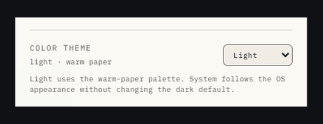

# Adjust the cockpit appearance

1. Select the **Settings** gear in the header.
2. Set the palette in **Appearance → Color theme**, and adjust **Terminal → Terminal font size**.
3. **Orrery → Mini view** defaults to **Telemetry network**, centered on the active agent. Updates switch to this view once. Choose **Orrery** to see agent families and save that choice.

Choose **Dark**, paper-toned **Light**, or **System** to follow the operating system. Light also updates terminal colors and the embedded Telemetry dashboard. See [color theme](usage.md#color-theme-light-mode) for how it keeps diff text readable.

[日本語](../adjust-cockpit.md) · [Cockpit map](cockpit-map.md) · [Settings reference](usage.md#settings)
