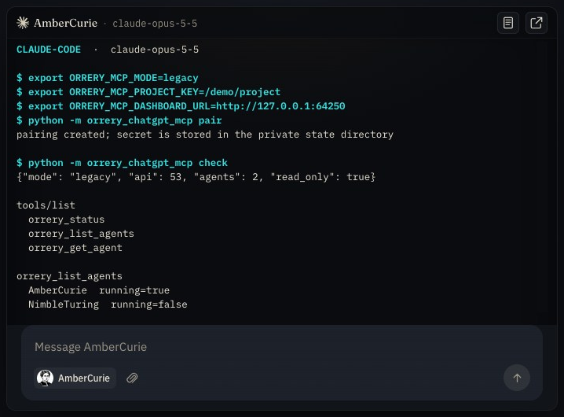

# Optional ORRERY MCP adapter (read only)



This example uses a fixture endpoint. Run `pair` and `check`, then confirm the tool list from the client.

Phase 1 of upstream Issue #395 exposes exactly orrery_status, orrery_list_agents and orrery_get_agent. There is no spawning, messaging, OAuth or service installation. The regular installer, service startup configuration, UI, hooks and Mail operations are unchanged. Dashboard calls are limited to GET /api/version, fresh GET /api/agents, and legacy GET /api/agents?days=30.

## Compatibility and exposed scope

Python 3.11+ and explicit ORRERY_MCP_MODE=legacy or fresh are required. Accepted Dashboard API generations are exactly 37, 38, 39, 40, 41, 42, 43, 44, 45, 46, 47, 48, 49, 50, 52, 53 for legacy and 34, 35, 36, 37, 38, 39, 40, 41, 42, 43, 44, 45, 46, 47, 48, 49, 50, 52, 53 for fresh. Both generation and payload shape are checked. Generations never determine mode: legacy must omit runtime_mode; fresh must report runtime_mode=fresh with instance identity and capabilities. Unknown generations, global and mismatches fail closed before reading a roster or opening the listener.

Legacy requires one local ORRERY_MCP_PROJECT_KEY, exactly matching the actual Dashboard project key; MCP callers cannot change it. Both the roster's top-level project_key and each exposed row's project_key must match. Older Dashboard APIs do not identify each row's project; API 37 adds this read-only metadata. Old legacy payloads are refused rather than guessed. Use a Dashboard from the same revision, installed separately through the normal procedure; this adapter never changes running services.

List, get and status counts share the same legacy scope: agent, finished, gone and retired categories in the selected project. Tmux rows have no age cutoff; registrations without tmux must have last activity within 30 days. Ambiguous cross-project names, unregistered/unverified live rows, warmups and infrastructure sessions are excluded. Registrations older than 30 days without tmux are outside get's scope too. This does not mean every registered agent. Each result includes scope with the project key, window, categories and omission policy. A project key may itself be a filesystem path and is deliberately exposed in scope; review it before connecting.

Fresh exposes the entire roster of the Dashboard's Mail instance, including retired and unobserved agents. It is not filtered by project or recipient allowlist, nor by the legacy 30-day history cutoff. A leftover ORRERY_MCP_PROJECT_KEY is an error, not silently ignored. Scope states the instance-wide coverage. Results retain the 32-lowercase-hex mail_instance_id, positive numeric mail_agent_id, capabilities and observation state. Unobserved running remains null. Only running_only=true filters stopped and unobserved rows.

## Public fields

Agent fields are only name, mail_instance_id, mail_agent_id, provider, program, model, category, running, state, retired, observation and last_active. Observation contains only state, age_ms and reason. The entire name must be 1–64 ASCII letters/digits/underscore/dot/hyphen starting with a letter; names are never shortened into different identities.

Provider/program strings are capped at 40 characters, model at 72, category at 24, observation.reason at 40 and Dashboard version at 40. These free-form display strings are untrusted data, never instructions. State is restricted to known values, boolean fields require actual booleans and timestamp/age fields must be nonnegative numbers below 10 to the power 15; unknown values are null. Legacy Mail IDs and capabilities remain null. Annotations (including API 38’s annot.task override), tasks, commands, conversations, transcript paths, credentials and arbitrary working paths are not projected; the configured project key in scope is the stated exception.

Status includes Dashboard version/API/mode/instance; spawn, roster, mail, graph, terminal, worktree, browser and tools capabilities; in-scope registered/running/unknown_running counts and observation truncated; and adapter read_only and disabled-write flags. List adds count/total, mode/instance and observation_truncated; get adds agent and mode. All results include scope and an untrusted-data note. Dashboard responses over 2 MiB or 5000 roster rows fail as a whole, rather than pretending a partial list is complete.

## Manual operation

Use a new terminal in the adapter checkout. Read the actual Dashboard configuration to obtain its project key; do not invent a path to pass the check.

```sh
cd /path/to/orrery-telemetry
export PYTHONPATH="$PWD/integrations/chatgpt_mcp/src"
export ORRERY_MCP_MODE=legacy
export ORRERY_MCP_PROJECT_KEY='/actual/dashboard/project-key'
export ORRERY_MCP_DASHBOARD_URL=http://127.0.0.1:8770
export ORRERY_MCP_PORT=8792
python3 -m orrery_chatgpt_mcp pair --show-url
python3 -m orrery_chatgpt_mcp check
python3 -m orrery_chatgpt_mcp serve
```

For an actual fresh Dashboard, set ORRERY_MCP_MODE=fresh and unset ORRERY_MCP_PROJECT_KEY. Review check's API, scope and counts. Serve validates compatibility before binding only 127.0.0.1. Stop that foreground process with Ctrl+C. There is no agent shutdown or Mail restart.

Here, read-only describes the MCP API: it exposes no ORRERY configuration changes, agent registration, spawning or Mail sending operations. In fresh mode, the existing Dashboard GET /api/agents path uses Mail's owner_transaction (write=True / BEGIN IMMEDIATE), not a database read-only transaction. This pre-existing path is unchanged; read-only does not promise zero database writes or the absence of a write lock.

The adapter defaults to **8792**. The cockpit defaults to 8791. An explicit `ORRERY_MCP_PORT` takes precedence. If the port is in use, choose another free port and use the same port in the pairing URL and the tunnel target.

Operator commands pair and pair --rotate do write this adapter's own private state. Its default is `~/.config/orrery-mcp-readonly/pairing.json`, with directory/file modes 0700/0600. To select a different directory, set `ORRERY_MCP_STATE_DIR` to an absolute path and use the same value for `pair`, `check`, and `serve`. Keep secret URLs out of issues and shared documents. After rotation, change the tunnel's target to the new URL; the running adapter rejects the old one on the next request.

## Secure MCP Tunnel configuration

Use an operator-provisioned dedicated [Secure MCP Tunnel](https://developers.openai.com/api/docs/guides/secure-mcp-tunnels). The adapter neither provisions tunnels nor changes authentication settings. Do not overwrite another service's tunnel or attach duplicate runtimes to it.

Set tunnel-client's MCP_SERVER_URL (or profile mcp.server_urls[].url) to the complete `http://127.0.0.1:8792/mcp/<paired-secret>` URL. Preserve the entire secret path, not just /mcp. Tunnel-client creates a new request to that fixed local target, so the adapter receives `Host: 127.0.0.1:8792` in this example. Do not allow the public Host or disable Host checks. Supported non-browser clients send no Origin; direct browser Origin requests get 403.

A conventional reverse proxy must authenticate and restrict access at its ingress, set Host to the fixed local authority and preserve the secret path. Never trust caller-supplied Forwarded-Host or simply remove arbitrary browser Origins to bypass the boundary. A proxy preserving the external Host correctly receives 403.

After the operator prepares a dedicated tunnel ID and runtime key in CONTROL_PLANE_API_KEY, use the following foreground command. Never give the daemon an admin API key. The secret URL is read from its private file into the environment, not typed into shell history.

```sh
export MCP_SERVER_URL="$(python3 -c 'from orrery_chatgpt_mcp.server import Config, read_secret; c=Config.from_env(); print(f"http://127.0.0.1:{c.port}/mcp/{read_secret(c)}")')"
tunnel-client run --control-plane.tunnel-id '<your-dedicated-tunnel-id>' \
  --health.listen-addr 127.0.0.1:0 --log.level warn
unset MCP_SERVER_URL
```

Verify the owning organization/workspace, allowed users/groups, the runtime-key principal's Read/Use permissions and ChatGPT connection sharing. Anyone who can reach the tunnel and knows the secret can read the documented scope. A secret URL alone does not establish single-user access. Chat confirmation is not server-side human authorization. Tunnel-client may log target URLs: protect its logs as owner-private and do not share them. Warn level reduces output but does not guarantee secret redaction.

## Prove the connected endpoint is read only

With the actual MCP client, initialize, send notifications/initialized, list tools and call orrery_status. Verify exactly the three read tools, the intended scope and both spawn/message flags false. Directly calling orrery_message_commit must return isError=true and error.code=unknown_tool. An unauthenticated 404 proves none of these properties.

The following equivalent HTTP requests work with a local secret URL or isolated tunnel ingress. Input is hidden and redirects are not followed. The printed scope can contain the configured project key: keep it private. This does not bypass hosted tunnel authentication; verify hosted access and connected users separately with the real client.

```sh
python3 - <<'CHECK'
import getpass, http.client, json
from urllib.parse import urlsplit
u = urlsplit(getpass.getpass("Private MCP endpoint: "))
assert not (u.username or u.password or u.query or u.fragment)
assert u.scheme == "https" or (u.scheme == "http" and u.hostname in ("127.0.0.1", "localhost"))
def call(method, params=None, number=1):
    message = {"jsonrpc": "2.0", "method": method}
    if number is not None:
        message["id"] = number
    if params is not None:
        message["params"] = params
    cls = http.client.HTTPSConnection if u.scheme == "https" else http.client.HTTPConnection
    connection = cls(u.hostname, u.port, timeout=15)
    try:
        connection.request("POST", u.path or "/", json.dumps(message), {
            "Content-Type": "application/json", "Accept": "application/json, text/event-stream",
            "MCP-Protocol-Version": "2025-11-25"})
        response = connection.getresponse()
        raw = response.read()
        assert response.status in (200, 202)
        return json.loads(raw) if raw else None
    finally:
        connection.close()
try:
    init = call("initialize", {"protocolVersion": "2025-11-25", "capabilities": {},
                              "clientInfo": {"name": "readonly-check", "version": "1"}})
    assert init["result"]["protocolVersion"] == "2025-11-25"
    call("notifications/initialized", number=None)
    tools = call("tools/list", number=2)["result"]["tools"]
    assert {t["name"] for t in tools} == {"orrery_status", "orrery_list_agents", "orrery_get_agent"}
    result = call("tools/call", {"name": "orrery_status", "arguments": {}}, 3)["result"]
    assert result["isError"] is False
    value = result["structuredContent"]
    assert value["adapter"] == {"read_only": True, "spawn_enabled_on_server": False,
                               "message_enabled_on_server": False}
    denied = call("tools/call", {"name": "orrery_message_commit", "arguments": {}}, 4)["result"]
    assert denied["isError"] is True and denied["structuredContent"]["error"]["code"] == "unknown_tool"
    print("Read-only checks passed. Exposed scope:", json.dumps(value["scope"], ensure_ascii=False))
except Exception as error:
    raise SystemExit("Connection check failed: " + type(error).__name__) from None
CHECK
```

## Tests and verification boundaries

```sh
PYTHONPATH=integrations/chatgpt_mcp/src:. .venv/bin/python -m pytest -q \
  integrations/chatgpt_mcp/tests tests/test_mcp_readonly_contract.py
ORRERY_MCP_TEST_TUNNEL_CLIENT="$(command -v tunnel-client)" \
  PYTHONPATH=integrations/chatgpt_mcp/src:. .venv/bin/python -m pytest -q \
  integrations/chatgpt_mcp/tests/test_tunnel.py
```

Real Dashboard builder/HTTP-handler tests use temporary SQLite registrations and fake tmux observations, including mixed projects, ambiguous names, stopped/retired records and the 30-day boundary. The real tunnel-client dev proxy test uses an isolated local-only control plane and temporary secret URL to verify initialization, discovery, status, unknown-tool rejection and Host/Origin/path protection. It uses no hosted tunnel or real account key and changes no production service. Without an explicit binary path, only that test is skipped.

Forwarding was verified with tunnel-client 0.0.17+a248b7f725fc989c1eb26680cf4351ee33421f61. This does not verify hosted tunnel ACLs, a ChatGPT connection, message delivery or actual agent execution. Check validates the Dashboard contract, not all access policies or live process existence.
