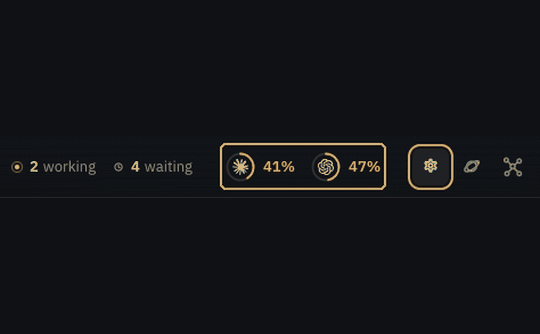

# Check your usage allowance

1. Select the **Usage left** rings in the header.
2. Read the remaining allowance and the next reset time for each window and account.

[日本語](../check-usage.md) · [Cockpit map](cockpit-map.md) · [Usage reference](usage.md#usage-remaining-quota)
