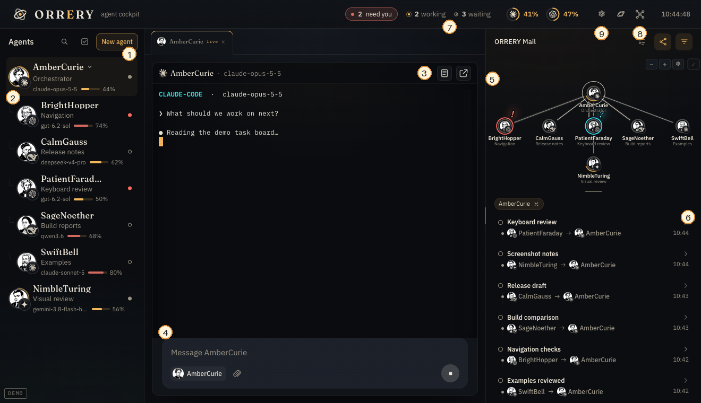

# Cockpit map

1. **New agent**　[Start an agent and send a task](start-an-agent.md)
2. **Agents**　[Switch agents](usage.md#roster) · [Select agents for a bulk action](usage.md#select-and-bulk-exit)
3. **Terminal and Reader**　[Open a referenced file](read-a-file.md) · [Approve an action in Reader](usage.md#approvals-in-reader)
4. **Composer**　[Send a task](start-an-agent.md) · [Choose recipients and attach files](usage.md#prompt-composer)
5. **Mini Graph**　[Watch a message arrive](read-mail.md) · [Inspect nodes and connections](usage.md#mini-orrery)
6. **ORRERY Mail**　[Read incoming mail](read-mail.md) · [Change views and filters](usage.md#orrery-mail)
7. **Working, waiting and usage**　[Check agent activity](usage.md#roster) · [See remaining quota and reset times](usage.md#usage-remaining-quota)
8. **Telemetry and Planetarium**　[Check status and history](usage.md#telemetry) · [Explore the agent family tree](usage.md#planetarium)
9. **Settings**　[Adjust appearance and text size](usage.md#settings) · [Open the Full tour](FULL_TOUR.md)

[日本語](../cockpit-map.md) · [Documentation index](README.md)
