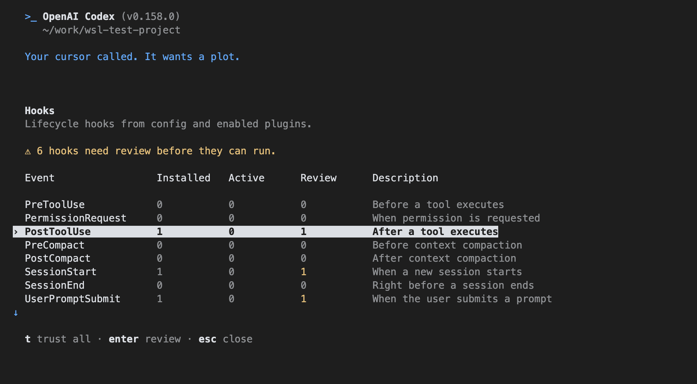

# Codex App integration



Install the integration and review its hooks to use ORRERY with Codex App.

> 日本語版: [codex-app.md](../codex-app.md)

[Previous: Hooks](https://github.com/gyroid-eth/orrery-telemetry/blob/master/docs/hooks.en.md) · [Back to README](../../README.en.md) · [Next: Dashboard](dashboard.md)

Codex App integration is an optional feature that associates **root tasks / subagents running in Codex Desktop** with ORRERY Mail identities and extends lifecycle, inbox, file reservations, and dashboard telemetry to runtimes outside tmux. The regular `agent-start-codex` is a launcher for running Codex CLI inside tmux and follows a separate path from this Bridge.

| Usage | This integration |
| --- | --- |
| Connect Codex Desktop tasks / subagents to ORRERY Mail | Applicable. Install it |
| Resume waiting Codex Desktop tasks when inbox mail arrives | Applicable. Cold wake is available |
| Use only Codex CLI through `agent-start-codex` | Unnecessary. The core installer's launcher and child MCP proxy are sufficient |
| Use only Claude Code and the dashboard | Unnecessary |

## Capabilities

- Send Codex Desktop `SessionStart`, `SubagentStart`, `UserPromptSubmit`, `PostToolUse`, `Stop`, and `SubagentStop` events to the Bridge and maintain per-root / per-subagent runtime state
- Save the ORRERY Mail name confirmed by the server in the runtime binding and reregister with the same identity and owner token after restart
- Use inbox, messaging, acknowledgement, file reservations, and sanitized runtime status through a session-bound MCP proxy
- During an active turn, notify the agent of the pending-mail count as additional context after `PostToolUse`
- For a `waiting` / `dormant` root task, detect an ORRERY Mail signal and perform a bounded cold wake with `codex exec resume`
- Pass a sanitized snapshot to the dashboard provider and display Codex App runtime state plus an `open` action

The Bridge accepts only sessions that match real transcripts with a `Codex Desktop` originator. Codex CLI transcripts, rows without transcripts, and hook payloads from other surfaces are deliberately ignored.

## Architecture

```text
Codex Desktop plugin hook
        │ lifecycle metadata only
        ▼
private Unix socket ──► Bridge daemon ──► ORRERY Mail
        │                    │                 │
        │                    ├─ binding/token  └─ inbox signal
        │                    ├─ snapshot              │
        │                    └─ delivery SQLite       ▼
        │                                      codex exec resume
        └─ unavailable 時は private spool

session-bound MCP proxy ──► inbox / message / ack / reservations
dashboard provider      ◄── sanitized snapshot
```

The hook does not send prompt bodies, tool input, or tool output to the Bridge. It forwards only allowlisted session ID, subagent ID, cwd, model, event name, and turn ID. If the socket is unavailable, it does not stop the Codex turn; it saves the event in a mode-`0600` spool for replay after the Bridge starts.

## Prerequisites

- The core `./scripts/install.sh` has completed, with ORRERY Mail and the signal directory working
- An absolute-path `AGENTSTACK_PROJECT_KEY`
- An ORRERY Mail HTTP endpoint that returns `tools/call` as an ordinary JSON response (for example `/mcp`). The core installer sets generated `AGENTSTACK_MAIL_HTTP_BEARER_MODE=disabled`
- `python3` and a Codex executable with plugin commands
- macOS when using automatic service registration (automatically switches to supervised background when the GUI domain is unavailable)

The core installer places the session-scoped MCP proxy for spawned children under `~/.agentstack/integrations/codex_app/`, but does not enable the Codex Desktop plugin, Bridge service, or delivery database. Install those explicitly with the dedicated installer below.

## Installation

First read the core installation values and run a dry run before writing to the real environment.

```bash
. "$HOME/.agentstack/env.sh"

./scripts/install-codex-app-integration.sh \
  --dry-run \
  --project-key "$AGENTSTACK_PROJECT_KEY" \
  --agent-mail-url "$AGENTSTACK_MCP_URL"
```

If the preview is correct, remove only `--dry-run`.

```bash
./scripts/install-codex-app-integration.sh \
  --project-key "$AGENTSTACK_PROJECT_KEY" \
  --agent-mail-url "$AGENTSTACK_MCP_URL"
```

The installer uses custom paths from the sourced core `env.sh` when available. When unspecified, the compatibility bearer file and signal directory are under `~/.agentstack/mail`. Core env passes the endpoint, signals, and `AGENTSTACK_MAIL_HTTP_BEARER_MODE=disabled` together. The dedicated installer persists that selector in the Bridge environment, so the runner, plugin MCP process, and orphan cleanup never read a legacy bearer.

The installer performs the following steps.

1. Place source, schema, plugin, and runner in `~/.agentstack/integrations/codex_app/`
2. Create the runtime directory at `~/.agentstack/runtime/codex-app/`
3. Generate a token-free mode-`0600` `env.sh` and install manifest
4. Build a self-contained local marketplace and register the Codex plugin
5. On macOS, actually bootstrap `org.agentstack.codex-app-bridge` into launchd; if the GUI domain rejects it, start the Bridge in supervised-background mode

Registering the plugin is not enough to run its lifecycle hooks. After installation, open `/hooks` in Codex, review and approve the AgentStack hooks, then start a new Codex process before launching a child. An already-running process is not guaranteed to refire SessionStart.

launchd availability is not inferred from login information. It is determined by whether bootstrap, enable, and kickstart against `gui/$UID` all succeed. If this fails during headless SSH, display sleep, or another condition, the installer leaves no live plist and switches to a background supervisor with `bridge-supervisor.pid`. This supervisor restarts the Bridge child process after five seconds by default when it exits. The install manifest and doctor record and display the method actually selected, not the preferred one.

Primary options:

| Option | Purpose |
| --- | --- |
| `--install-dir PATH` | Location for integration source and manifest |
| `--runtime-dir PATH` | Location for the private socket, bindings, snapshot, delivery database, and logs |
| `--agent-mail-env PATH` | Absolute path to an existing Mail bearer reference file. The token value is kept in that file |
| `--signals-dir PATH` | Absolute path to the ORRERY Mail signals directory |
| `--python-bin PATH` | Executable Python interpreter for the Bridge |
| `--no-service` | Start neither launchd nor supervised background. The default outside macOS (no service is installed even without it) |
| `--no-plugin` | Build the marketplace without registering the Codex plugin |
| `--refresh-plugin-only` | Reinstall only an existing enabled Codex plugin from the deployed payload, without changing Bridge state |
| `--wake-limit COUNT` | Cold-wake limit per root task per hour |
| `--stale-after SECONDS` | Threshold for changing a waiting runtime to dormant, from 300 to 604800 seconds |
| `--retry-max-attempts N` | Maximum number of ORRERY Mail registration retry calls |
| `--retry-max-age SECONDS` | Maximum time registration retries are retained |
| `--retry-max-backoff SECONDS` | Upper bound for registration retry backoff |
| `--skip-git-check` | Explicitly disable the trust check only for a reviewed non-Git workspace |

### Refreshing an existing plugin after a core update

Core `install.sh` deploys the child MCP proxy and plugin source, but does not update the optional plugin's marketplace snapshot or Codex cache. When `agentstack-codex-app@agentstack-local` is already installed and enabled, refresh it after deploying the core payload. Explicitly target the **parent/shared CODEX_HOME** that owns the plugin registry.

```bash
CODEX_HOME="$HOME/.codex" \
./scripts/install-codex-app-integration.sh \
  --refresh-plugin-only \
  --install-dir "$HOME/.agentstack/integrations/codex_app"
```

Add `--dry-run` to perform only the read-only preflight. Refresh rebuilds the snapshot from the deployed integration and runs the official `codex plugin add` path only when the exact plugin is installed and enabled and its existing local marketplace root matches. An absent or disabled plugin is skipped with a reason; it is never installed or enabled implicitly. A different marketplace, an unreadable registry, or a mismatch in the hooks, runner, or recorder selected in the CLI cache is an error.

This path does not reconfigure env, plist, service, or install-state. **A full installer run with `--no-service` is not a substitute for a pure plugin refresh.** After refresh, open `/hooks` in Codex and review/approve the AgentStack lifecycle hooks, then verify the SessionStart ID mapping in a new Codex process/thread. It does not promise to refire SessionStart in an already-running child.

To run a `--no-service` installation in the foreground, execute the generated runner.

```bash
~/.agentstack/integrations/codex_app/bin/run-bridge
```

## Verification

The dedicated doctor checks the manifest, file modes, payload, marketplace, plugin, actual service mode, socket, binding store, stale drain, and delivery errors together. For launchd it checks `state = running` or a positive `pid`, not merely registration. For supervised background it checks that the supervisor named by the pidfile is alive.

The core `agentstack-doctor` also reports the exact `codex` binary and shared `CODEX_HOME` selected by the child launcher, and distinguishes a missing, disabled, or enabled history-binding plugin. When hook approval cannot be established from stable public information, it reports the state as unknown and directs the operator to `/hooks`. This diagnostic does not treat a Claude-only installation as broken.

```bash
~/.agentstack/integrations/codex_app/bin/doctor-codex-app-integration
```

Only when intentionally checking a stopped Bridge:

```bash
~/.agentstack/integrations/codex_app/bin/doctor-codex-app-integration \
  --allow-stopped
```

Both launchd and supervised-background logs are in the following locations by default.

```text
~/.agentstack/runtime/codex-app/bridge.stdout.log
~/.agentstack/runtime/codex-app/bridge.stderr.log
```

## Agent usage

The `SessionStart` / `SubagentStart` hooks add context instructing the agent to first call `agentstack.bootstrap` with the current `session_id` and, when needed, `agent_id`. The first bootstrap pins an MCP process to one Bridge binding. Subsequent tool calls do not accept the project key, agent name, or owner token from the agent.

The proxy exposes these ten tools:

- `bootstrap`
- `fetch_inbox`
- `send_message`
- `acknowledge_message`
- `reserve_files`
- `renew_reservations`
- `release_reservations`
- `runtime_status`
- `show_files` (turns files or images you created or changed into chips in the cockpit's History; see below)
- `whois` (to confirm a recipient name; names are case-sensitive)

In a bound session, `show_files` runs inside the proxy. It sends nothing to the Mail server, writes nothing and does not read the files. Like the other local tools, it works only after the binding (bootstrap). It checks 1 to 8 paths and lists readable regular files under `present`. Paths denied by OS permissions include a reason. Relative paths are checked inside the bound agent's working folder (from a Codex App snapshot). A missing working folder yields `checked: false` for relative paths, and a relative path outside that folder yields `outside_working_folder: true`. Absolute paths can refer to files outside the working folder. The cockpit and the phone use the recorded call to show chips. Previews check OS read permissions, file type, size, and symbolic links. The managed instructions for Claude, Codex, dsh and Hermes and the bundled `/log` and `/delegate` ask agents to call it before their final report when there is a file to show. Claude's settings template allows it without a prompt.

`reserve_files`, `renew_reservations`, and `release_reservations` accept physical absolute paths and forward them unchanged under the same bound identity and Mail namespace. In managed `workspace-v1` sessions, acquire using the physical absolute path with symlinks resolved (for example, `str(Path(target).resolve())`), then use that same path to renew/release. Guard denials also display the required path. Existing relative paths and glob patterns remain accepted unchanged for legacy sessions; the proxy does not derive a cwd from the project key or protected roots. Absolute globs also pass through unchanged, so use a physical path for their fixed prefix. Parent `..` components, invalid characters, empty strings, and batch/length limit violations remain rejected.

Managed sessions that acquired only relative reservations must load the updated proxy through the normal resume/restart procedure, release obsolete leases by ID as their owner, and reacquire physical absolute paths. Existing leases are not migrated automatically. This does not activate the candidate/global/fresh server or change the binding, sandbox, or editing permissions.

When a tool call fails, the proxy returns the first line of the Mail server's own error (anything that looks like a token is replaced with `[redacted]`, and the line is cut at 600 characters). It used to return only the fixed text "ORRERY Mail tool call failed", so a child hit by a plain validation error such as a misspelled recipient never learned why and gave up instead of correcting the name.

A root task passes only `session_id`. A subagent passes the same `session_id` and its own `agent_id`; bindings that do not match the parent lineage recorded by the Bridge are rejected.

The proxy a launcher such as `spawn_child.sh` gives a child does not use the Bridge: it is bound directly to the child's name, project and token at startup. Its `lineage` is not a Codex App lineage. `parent_agent` names the ORRERY parent the launcher passed in `AGENTSTACK_PROXY_PARENT_AGENT` (`kind` is `child`); an agent with no parent, such as `--standalone`, is `kind: root` with `parent_agent: null`. The launcher also records the parent in the child's private state (`parent_agent` in `child-agents/<name>.json`), so a dashboard resume that rebuilds the proxy config passes the same parent. The launcher stops before the CLI starts when the generated proxy could not state the parent: a parent name the proxy does not accept, or no proxy prepared while the inherited Codex config enables the Bridge plugin.

A proxy a launcher bound at startup also accepts arguments shaped for raw ORRERY Mail, because a conversation resumed after using raw Mail keeps calling the tools that way. `project_key`, `agent_name` and `sender_name` are ignored when they match the binding and refused with the reason when they do not. In a raw-style `whois`, `agent_name` is taken as the agent to look up. A `registration_token` or `sender_token` from the model is never used or forwarded. Any other argument outside the schema is refused with the list of accepted arguments. For this proxy `runtime_status` reports `state: bound` (the binding exists) without contacting Mail.

## Inbox notifications and cold wake

Delivery paths differ between an active turn and a stopped task.

| Runtime | Behavior when inbox mail arrives |
| --- | --- |
| `working` | Do not start cold wake; mark it `pending` and report the count after the next `PostToolUse` |
| root `waiting / dormant` | After two seconds of coalescing, acquire a delivery lease and run `codex exec resume` |
| subagent | Do not cold-wake; report `subagent_cold_wake_unsupported`. Address durable work to the root task |
| `blocked` | Do not retry automatically; repair the cause and explicitly requeue |

The wake prompt contains only message ID, sender, and subject. The message body is obtained with the session-bound `fetch_inbox` after resume. Delivery SQLite tracks the same message idempotently. Defaults are 12 attempts per hour, five maximum attempts, and a 900-second execution timeout.

## Configuration

Specify values that users normally change as installer options.

| Environment variable | Default | Meaning |
| --- | --- | --- |
| `AGENTSTACK_CODEX_APP_INSTALL_DIR` | `~/.agentstack/integrations/codex_app` | Source, plugin, and manifest |
| `AGENTSTACK_CODEX_APP_RUNTIME_DIR` | `~/.agentstack/runtime/codex-app` | Private runtime state |
| `AGENTSTACK_CODEX_APP_LAUNCHD_LABEL` | `org.agentstack.codex-app-bridge` | launchd label |
| `AGENTSTACK_CODEX_APP_MARKETPLACE` | `agentstack-local` | Local marketplace name |
| `AGENTSTACK_CODEX_APP_WAKE_LIMIT_PER_HOUR` | `12` | Wake limit per binding per hour |
| `AGENTSTACK_CODEX_APP_STALE_AFTER_SECONDS` | `3600` | Threshold from waiting to dormant |
| `AGENTSTACK_CODEX_APP_RETRY_MAX_ATTEMPTS` | `12` | Maximum identity registration retry calls |
| `AGENTSTACK_CODEX_APP_RETRY_MAX_AGE_SECONDS` | `3600` | Lifetime of identity registration retries |
| `AGENTSTACK_CODEX_APP_RETRY_MAX_BACKOFF_SECONDS` | `300` | Upper bound for identity registration retry backoff |
| `AGENTSTACK_CODEX_APP_RESTART_DELAY` | `5` | Seconds before restarting a Bridge child in supervised-background mode |
| `AGENTSTACK_CODEX_APP_COLD_WAKE` | `1` | Set to `0` to disable only cold wake |
| `AGENTSTACK_CODEX_APP_SKIP_GIT_CHECK` | `0` | Set to `1` to disable the resume Git trust check |
| `AGENTSTACK_CODEX_BINARY` | `codex` resolved at installation | Plugin operations and `codex exec resume` |
| `AGENTSTACK_MAIL_HTTP_BEARER_MODE` | `disabled` | Core ORRERY Mail transport, generated by core installation and persisted for the Bridge |

The installer generates consistent values for `AGENTSTACK_CODEX_APP_SOCKET`, `AGENTSTACK_CODEX_APP_SNAPSHOT`, `AGENTSTACK_CODEX_APP_DELIVERY_DB`, and `AGENTSTACK_CODEX_APP_PLUGIN_ID`. `AGENTSTACK_CODEX_APP_SPOOL`, `AGENTSTACK_PROJECT_SLUG`, `AGENTSTACK_CODEX_APP_BOOTSTRAP_WAIT`, `AGENTSTACK_CODEX_APP_RETRY_SECONDS`, `AGENTSTACK_CODEX_APP_WAKE_POLL_SECONDS`, `AGENTSTACK_CODEX_APP_WAKE_COALESCE_SECONDS`, `AGENTSTACK_CODEX_APP_WAKE_TIMEOUT_SECONDS`, `AGENTSTACK_CODEX_APP_WAKE_LEASE_SECONDS`, `AGENTSTACK_CODEX_APP_WAKE_BASE_BACKOFF_SECONDS`, `AGENTSTACK_CODEX_APP_WAKE_MAX_BACKOFF_SECONDS`, and `AGENTSTACK_CODEX_APP_WAKE_MAX_ATTEMPTS` are internal Bridge / test tuning values. Normally, do not set them manually; before changing them, check the validation ranges and delivery semantics in the source.

`AGENTSTACK_CODEX_APP_COLD_WAKE` has no installer option. To disable it in a launchd installation, add `export AGENTSTACK_CODEX_APP_COLD_WAKE=0` to the generated `env.sh` and reload the service. Reinstallation regenerates `env.sh`, so recheck this manual change as well.

## Security boundary

- Install / runtime directories use mode `0700`; generated env, socket, bindings, and snapshot use mode `0600`
- The legacy bearer token is not copied into generated `env.sh`; only an `AGENTSTACK_MAIL_ENV` reference is saved. The default `disabled` transport does not read the bearer itself
- Owner tokens are isolated in a private identity store and are not exposed to agents or dashboard snapshots
- Hook events and dashboard snapshots are validated with field allowlists
- Cold wake sends only fixed instructions and bounded metadata; stdout / stderr diagnostics redact token patterns
- Headless wake temporarily approves only the nine session-bound proxy tools above; it does not change shell, sandbox, other MCPs, or the global approval policy

`--skip-git-check` is not an option that generally permits untrusted directories. Limit it to a workspace already reviewed as non-Git, and normally start tasks inside trusted repositories.

## Common failures

| Symptom | Check and remedy |
| --- | --- |
| Installer rejects the project key | Pass an absolute path to `--project-key` |
| Bridge cannot connect to ORRERY Mail | Check the generated endpoint that returns `tools/call` as ordinary JSON and `AGENTSTACK_MAIL_HTTP_BEARER_MODE=disabled` |
| Doctor reports service / socket / startup diagnostic failure | Check the actual service mode shown by the doctor. For launchd, inspect `launchctl print gui/$(id -u)/org.agentstack.codex-app-bridge`; for supervised background, inspect `bridge-supervisor.pid` and `bridge.stderr.log`. Use `--allow-stopped` only while intentionally stopped |
| Codex App runtime does not appear on dashboard | Confirm that the Codex Desktop plugin is enabled. CLI sessions and sessions without transcripts are deliberately excluded |
| State is `degraded` | Owner-token reading or ORRERY Mail registration failed. Check URL, transport mode, runtime file modes, and registration retry log; do not create another identity |
| `identity_auth_required` | The binding has no owner token. Check the binding store with the doctor and do not reregister the same name with another token |
| `untrusted_workspace` | Resume in a trusted Git repository. Use installer `--skip-git-check` only for a reviewed non-Git workspace |
| `wake_rate_limited` | Wait for the hourly limit or fix the cause before reconsidering `--wake-limit` |
| `subagent_cold_wake_unsupported` | Send durable requests to the parent root task, not a stopped subagent |
| `wake_failed / dead_letter` | Fix the sanitized error shown by the doctor and explicitly requeue only the affected message |

After fixing the cause of a failed / dead-letter delivery:

```bash
~/.agentstack/integrations/codex_app/bin/doctor-codex-app-integration \
  --allow-stopped \
  --requeue-message 123 \
  --agent-name ExampleAgent
```

## Cleanup and uninstall

To retire / purge only bindings whose corresponding Codex Desktop rollout is gone:

```bash
~/.agentstack/integrations/codex_app/bin/doctor-codex-app-integration \
  --allow-stopped \
  --cleanup-orphan-bindings
```

This retires the remote identity. Run it only after confirming that the target rollout is no longer needed.

Preview uninstall first.

```bash
~/.agentstack/integrations/codex_app/bin/uninstall-codex-app-integration \
  --dry-run
~/.agentstack/integrations/codex_app/bin/uninstall-codex-app-integration
```

By default, bindings and delivery state remain in the runtime directory. Add `--purge-data` only when the exact runtime path should also be removed.

## Related documentation

- [Installation](telemetry-install.md)
- [Launchers and identity](launchers.md)
- [Hooks and operational helpers](https://github.com/gyroid-eth/orrery-telemetry/blob/master/docs/hooks.en.md)
- [Dashboard](dashboard.md)
- [Configuration](telemetry-configuration.md)
- [Troubleshooting](telemetry-troubleshooting.md)
