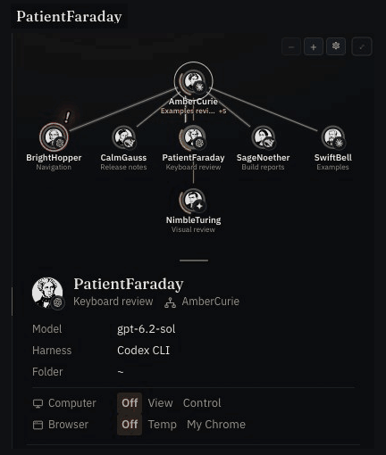

# Computer use



Choose computer use in NEW AGENT. After launch, open the agent’s details to inspect its permissions and switch supported controls.

[日本語](../computer-use.md) · [Documentation index](README.md)

<a id="new-agent"></a>
## Choose in NEW AGENT

On macOS, the dashboard's NEW AGENT offers **Computer use** for Claude Code, Codex CLI, dsh, Hermes, and Antigravity CLI. The same three modes are available from Telemetry's phone view and from the cockpit connected to Telemetry API 53 or later.

| Mode | Screen access supplied by ORRERY |
| --- | --- |
| Off | No screen tools |
| View | List apps and windows and inspect screen state |
| Control | View plus interaction such as clicking and typing |

In the cockpit and phone NEW AGENT forms, use **Browser** to choose from Off, Temporary Chrome, and My Chrome where available. Temporary Chrome uses a temporary profile. My Chrome uses your usual Chrome. If Chrome asks for connection permission, respond in Chrome. See [browser setup and approvals](delegation.md#browser-and-computer-use-what-is-reachable-and-what-a-person-does).

On macOS, leave the parent field blank to start Antigravity without a parent. Computer use is available for this launch, and Browser is available in the forms that offer it. Git is required when you choose Isolation. Antigravity grants individual screen tools for the session according to the selected screen mode. Existing Ask and Deny rules take precedence. Browser options are hidden if a global Chrome MCP is enabled. See [Antigravity setup and launch](antigravity.md#dashboard-new-agent).

## Choose in the CLI or API

The standard Claude, Codex, dsh, and Hermes child launchers can use the generated stdio MCP when you explicitly select `orrery-screen` with `--tools`. dsh and Hermes use the same selection with a Local connection. The permission belongs to one launch generation. A session with a relay can change its permission at runtime through the operator API.

| Launch flag | Initial permission |
| --- | --- |
| `--tools mcp:orrery-screen` | `off` |
| `--tools screen:read:orrery-screen` | `view` |
| `--tools screen:operate:orrery-screen` | `control` |

To reproduce the NEW AGENT selection with `/api/spawn`, use `{"tools":{"screen":{"access":"read"}}}` for View and set `access` to `operate` for Control. For Off, omit the screen selection from the explicit `tools` object. To attach a relay and start it in Off for a supported child, use `{"tools":{"mcp":["orrery-screen"]}}`. On macOS, `screen:operate` without a server name selects `orrery-screen`. The installer leaves `orrery-screen` out of the default tool selection.

You can pass the same `tools` to `/api/jump` when resuming a Claude conversation by itself. This creates a generation for that launch. Omitting extra tools on Resume also revokes the previous generation's screen credential. See the [Resume API example](https://github.com/gyroid-eth/orrery-telemetry/blob/master/docs/api.en.md#post-apijump).

<a id="driver-setup"></a>
## Setup

1. Choose the artifact for your OS from the [Cua Driver 0.55.0 release](https://github.com/trycua/cua/releases/tag/cua-driver-rs-v0.55.0) and verify the publisher's SHA256 and signature.
2. Prepare the user’s interactive session for the OS.
3. Use `agentstack-http-operator configure` to set up an operator capability for the dashboard installation. Reuse the capability if it is already configured. See [operator setup](https://github.com/gyroid-eth/orrery-telemetry/blob/master/docs/global-delivery-client.en.md#operator-ui-access).
4. Verify that `python -I -m agentstack_mail.screen_mcp --help` runs with the Python interpreter that will start the relay. If needed, set `AGENTSTACK_SCREEN_PYTHON` to the interpreter's absolute path. For launches and resumes from the dashboard, set it in the dashboard's environment.

| OS | Driver command and requirements |
| --- | --- |
| macOS | `cua-driver mcp`. Verify the Developer ID and notarization of CuaDriver.app, then grant Accessibility and Screen Recording permissions. If the driver is absent from PATH, the launcher checks the standard Applications locations. |
| Windows + WSL | `cua-driver.exe mcp --socket \\.\pipe\cua-driver`. Verify the Authenticode signature on Windows. Start the daemon in an interactive Windows login and match the pipe's Windows account and elevation to the executable called from WSL. Use an unelevated session with Limited first. |
| Linux | `cua-driver mcp`. Use the upstream Linux build in an X11 session or a KDE KWin session the driver supports. |

Set `AGENTSTACK_CUA_DRIVER` to the executable's absolute path if it is missing from PATH. On WSL, use a WSL path such as `/mnt/c/…/cua-driver.exe`. The exposed tool definitions are pinned to the verified definitions from 0.55.0. Calls fail if the runtime version, input schema, or output schema differs. When updating, compare the pinned definitions with the driver's actual `tools/list`.

The WSL relay uses standard stdio pipes. It needs WSL interop on the launch path and an interactive Windows login. Interop and distro lifetime follow WSL settings. Start your checks in Windows Terminal while logged in, unelevated, and using Limited.

<a id="driver-privacy"></a>
### Usage telemetry and automatic update checks

On macOS and WSL, ORRERY disables usage telemetry and automatic update checks each time the relay launches Cua Driver. For the Windows daemon, save those preferences in Cua Driver under the Windows account that runs it. The preferences persist across Cua Driver updates.

Open PowerShell as that Windows user and run `cua-driver.exe autostart status`. If the logon task is running, use that daemon. If the task is registered and stopped, sign back in to Windows to run it. If you manage the daemon manually, confirm that no daemon is running, then start it with `cua-driver.exe serve --socket '\\.\pipe\cua-driver'`.

In PowerShell with the same user and elevation, run the commands below. Use the executable's absolute Windows path if it is absent from PATH.

```powershell
cua-driver.exe telemetry disable
cua-driver.exe config set update_check_enabled false
cua-driver.exe telemetry status
cua-driver.exe config get update_check_enabled
```

Check for `Telemetry: disabled (source: persisted)` and `false` for the update setting. The startup update check uses the saved preference when the daemon next starts. [Cua Driver operation guide](https://github.com/trycua/cua/blob/cua-driver-rs-v0.55.0/docs/content/docs/cua-driver/guides/operate.mdx)

## macOS launch settings

Selecting View or Control in NEW AGENT invokes Cua Driver through `orrery-screen`. `--tools screen:read` and `--tools screen:operate` use the same route. `--tools mcp:orrery-screen` exposes the relay in Off and allows the operator to change its permission after launch.

Generated Claude Code launch settings block an embedded MCP with the same name. The generated Codex CLI home disables the GUI-bundled `node_repl` and `unified-computer-use@openai-bundled` independently of the Computer use selection. The generated Hermes profile removes the built-in Cua toolset. Browser use, such as Chrome DevTools, is independent of Computer use.

If Antigravity CLI has Cua Driver directly enabled in global MCP settings, the launch stops and names the conflicting MCP. The user manages those settings. See [Antigravity MCP settings](https://antigravity.google/docs/mcp/#global-and-workspace-server-configs).

<a id="permission-status"></a>
## Check permissions after launch

Computer use and Browser use appear in the cockpit's agent details and the phone Reader. When a launch record exists, the display uses the saved selection and shows the effective screen mode when it can verify the relay's launch generation. For Antigravity, any value that cannot be determined from the available records appears as `Unknown` with a reason.

For a running legacy Claude Code or Codex CLI agent without a launch record, Telemetry API 52 or later checks launch arguments and descendant processes for local Cua Driver, Codex Chrome DevTools, and explicit Claude Chrome flags. The display shows `Unknown` with a reason when the process, arguments, relay mode, or Claude flag cannot be verified. The displayed values describe the selected or observed tools. Check Chrome's connection and OS permissions separately.

## Change permissions on a running launch

Use `GET /api/computer-use` to read `project`, `runtime`, `agent`, `generation`, the effective `computer_use` value, and its `source`. To change it, pass the same four identifiers and the new `computer_use` value to `POST /api/computer-use` with the operator capability. See the [Computer use API](https://github.com/gyroid-eth/orrery-telemetry/blob/master/docs/api.en.md#computer-use-api).

The following example uses the local dashboard. Set `dashboard_url` to the installation's loopback URL.

```bash
operator_capability="$(agentstack-http-operator show)"
operator_request() {
  printf 'header = "Authorization: Bearer %s"\n' "$operator_capability" |
    curl --config - --silent --show-error --fail-with-body "$@"
}
operator_request "$dashboard_url/api/computer-use"
```

Copy the four identifiers for the target from the response.

```bash
operator_request "$dashboard_url/api/computer-use" \
  --json '{"project":"sample-project","runtime":"11111111111111111111111111111111","agent":"SampleAgent","generation":"22222222222222222222222222222222","computer_use":"control"}'
unset operator_capability
```

The child can run `python -I -m agentstack_mail.screen_mcp --status` with the environment of its generated `orrery-screen` definition to see the launch's project, runtime, generation, effective permission, and source as JSON. The generated credential values can stay private. The child's credential receives HTTP 403 when used to change the permission. A relay permission change does not update the individual tool grants set at Antigravity CLI session startup.

A downgrade applies at the next permission check. Input already handed to the driver is still executed. Resume starts a new generation from the retained tool selection. Standalone Antigravity Resume uses the lower of the original selection and the previous relay mode for both the new relay and CLI grants. If you replace the tools with `agentstack-resume --tools`, the new selection supplies the initial mode. To explicitly drop the relay for a stopped child, resume it with `agentstack-resume <agent> --base default`.

## Tools and responses

`view` allows `check_permissions`, `list_apps`, `list_windows`, and `get_window_state`. `control` adds `launch_app`, `click`, `type_text`, `press_key`, `hotkey`, `scroll`, `set_value`, and `invoke_menu`. All permissions see the same `tools/list`. Insufficient permission is reported on each call.

The relay rejects arguments outside the declared schema, such as an image output path. A window tree defaults to 250 elements and 25 levels, and images have a maximum long edge of 1,280 px. Each MCP JSON response is limited to 2 MiB, with a combined 64 KiB for text and structured content and 1,638,400 pixels across images. Trees are shortened at line and element boundaries. The relay keeps the driver's resized images as-is to preserve coordinates. A result marks omitted blocks when a limit is reached.

## Verify and recover

| Check | Procedure and expected result |
| --- | --- |
| Identity and permission | Compare the project, runtime, generation, effective value, and source in the operator list and the child's `--status`. Relaunching under the same name revokes the old credential. An old generation cannot change a target in another project. |
| Tool list and approvals | The 12 tool names and schemas match across `off`, `view`, and `control`. Start in View or Control and verify that the fixture driver's `check_permissions` runs without approval when the user has no Ask or Deny rule. Check for direct Cua Driver routes in the generated settings and the model's tool list. |
| Mode changes and refusals | Switch one session through `off` → `view` → `control` → `off`. Insufficient permission, unknown tools, and permission check failures or timeouts keep calls from reaching the fixture driver. |
| Arguments | Pass `screenshot_out_file` to `get_window_state`. The argument is rejected and the file and test window remain untouched. |
| Limits and shutdown | Reproduce large trees and images, version mismatches, stdio disconnects, and timeouts with a fixture driver. JSON and element numbers are preserved, omissions are marked, and the driver process exits without replaying input. |
| Tool selection and routing | Try explicit selection, no selection, and a resume with the relay removed. Also check any direct routes in user settings, overlays, or plugins. |
| History | Use the operator's `GET /api/computer-use/events` to check IDs, tool names, start and end times, and outcomes. Arguments, window titles, result bodies, and images stay out of the record. |

For Cua Driver version, executable, or stdio issues, read the relay's reason and check the driver's version and launch command. If the WSL pipe fails to open, check WSL interop, the interactive Windows login and daemon, and then the pipe owner and elevation. If a Mac rejects an action while locked, return to the interactive session and check in a test window. If permission lookup fails, check the dashboard and launch generation. If the harness is waiting for approval, check the per-tool grants in the generated settings. Resume the child after recovering a disconnected driver. The relay does not replay a failed call.

Close windows with sensitive information before sharing the screen. The relay controls the MCP route generated by ORRERY. Direct execution by a shell running as the OS user and selecting the wrong window in an app require separate controls.
