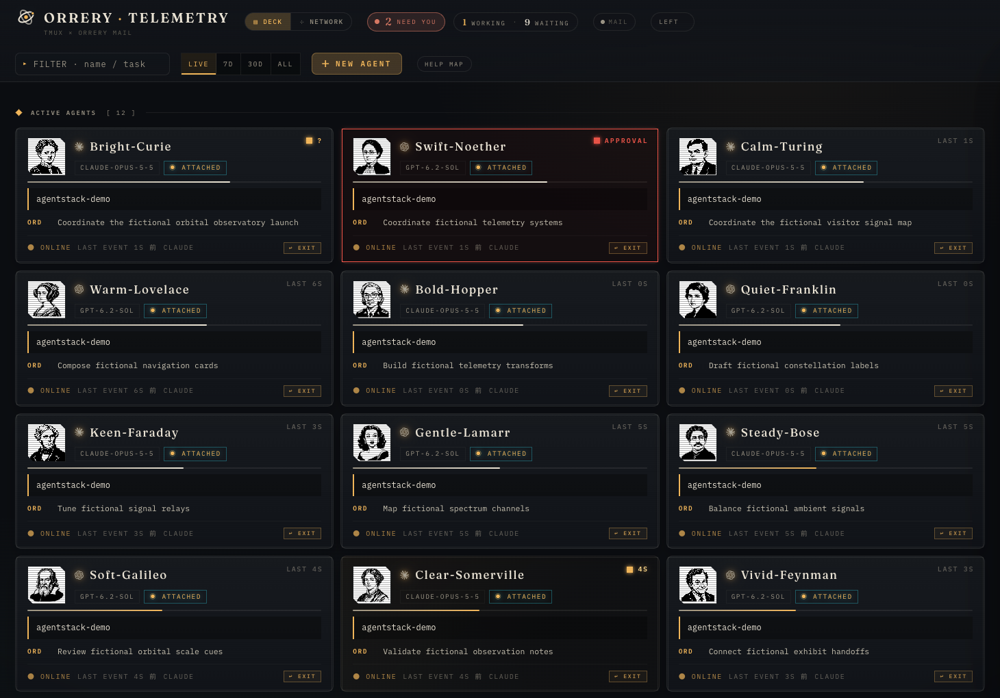
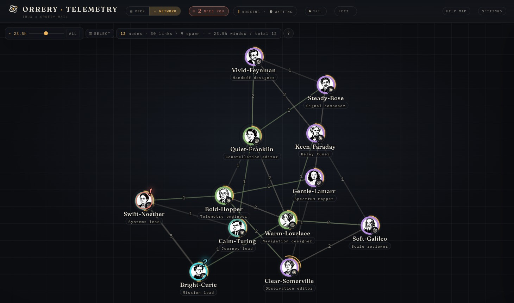
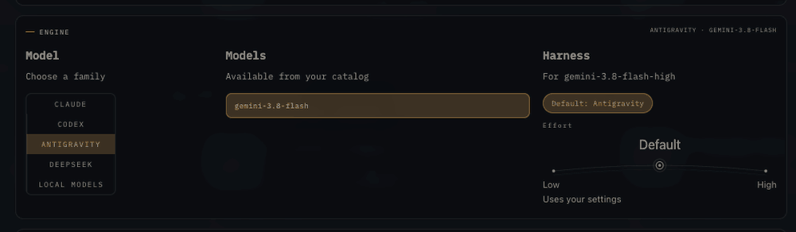

# Dashboard


Use DECK to see agent status, and NETWORK to follow agent families and Mail.

> 日本語版: [dashboard.md](../dashboard.md)

[Previous: Codex App integration](codex-app.md) · [Back to README](../../README.en.md) · [Next: API reference](https://github.com/gyroid-eth/orrery-telemetry/blob/master/docs/api.en.md)

The dashboard is served at `http://127.0.0.1:8770/` by default. It combines tmux, ORRERY Mail SQLite, runtime state, project logs, and optional Obsidian-link hints into one screen for observation and safe control operations.

How it looks and moves is set out in the [design language](https://github.com/gyroid-eth/orrery-telemetry/blob/master/docs/design.en.md). Read that before adding to or changing the UI.

Here, ORRERY Mail / mail watcher means the mechanism for messages among agents inside ORRERY Telemetry. It never accesses the user's email account, mail client, or inbox.

## Find an action

| Goal | Shortest path |
| --- | --- |
| See agents currently running | Open [DECK](#deck) and inspect the cards under `ACTIVE AGENTS`. Click a card to see its task, live state, History, Output, and terminal actions together. |
| See parent-child relationships | Switch to [NETWORK](#network). Spawn edges connect parents and children; click a node for its detail panel. |
| Read what agents said to each other | Click a communication edge in NETWORK. The right-side mail drawer displays subject, importance, time, and body between those two agents. Without [mail configuration](#edges-and-mail), it shows `NOT CONFIGURED`. |
| Operate several agents together | Enable `Select` above NETWORK, then click nodes or drag a rectangle over empty space. The bottom action bar offers `Exit N` for running / finished agents and `Replay N` for two or more. EXIT requires pressing the same button twice. |
| Resume a finished agent | For tmux-based Claude / Codex CLI agents, show past agents with DECK history `30d` / `all` or NETWORK `ALL`. Restore from a card marked `RESUME READY`, or from `RESUME · VERIFY` on an older Claude row. For the latter, one `VERIFY & RESUME` click in the detail panel performs verification and continues through resume. NETWORK `Select` counts only pre-verified gone / retired nodes whose `resume_capability` is `ready` in `Resume N`. Resume requires a verified transcript, original cwd, corresponding CLI, and owner credential. Opening a window also requires a terminal adapter; a Codex child additionally requires provenance, formal registration, a credential, and restorable configuration. |
| See finished agents | Set NETWORK's time window to `ALL` or switch DECK history to `7d` / `30d` / `all`. The default `live` shows only running and finished sessions; `7d` / `30d` add `gone` / `retired` cards active in that period, and `all` lists every agent ever registered. See also [After a child completes](#after-a-child-completes). |

NETWORK may omit nodes outside its selected time window. Absence from the current graph alone does not mean task failure; check `ALL`, DECK history `all`, and the completion report delivered to the parent.

## DECK

### Parent notifications for human input (legacy)

When a Claude, Codex CLI, dsh, Hermes, or Antigravity tmux child stays on a recognized approval, folder trust, sign-in or setup, usage consent, model selection, or update screen for at least 20 seconds, the dashboard sends ORRERY Mail to its parent. The notice uses the child's existing Mail identity, identifies itself as automatic, and names the screen type. It quotes only fixed labels from the screen. This works with the browser closed.

Each screen is reported once. After the dashboard sees normal work or the ordinary input editor again, it can report the next stop. `AGENTSTACK_RUNTIME_DIR/human-waits.json` records send attempts across dashboard restarts and prevents resends when Mail acceptance is uncertain. The worker verifies the parent and the child's Mail credential before sending.

### Provider-stop notifications (legacy)

The dashboard displays `MODEL CAPACITY` on DECK and `CAPACITY` on NETWORK when a running Codex CLI is waiting after `Selected model is at capacity. Please try a different model.` A background worker checks approximately every five seconds even with no browser open, confirms two distinct captures, and sends one ORRERY Mail notice to the child's verified `PARENT_AGENT`. The sender is the existing child identity; the message identifies itself as telemetry's automatic observation and includes the time in JST and the error line. It never resumes the child, changes models, or sends pane keystrokes.

`AGENTSTACK_RUNTIME_DIR/provider-stalls.json` preserves each episode across dashboard restarts. Observed work rearms notification. A new stop can also be detected without observing work when the same pane proves an append of "previous stop → newly submitted input → new capacity error." A second distinct capture must confirm the same input/error boundary before one notice is sent. An unsubmitted composer, Mail delivery records alone, repainting the same error, or footer/width changes alone do not trigger another notice.

Retry detection requires an unambiguous overlap with the previous stop's history. If history is pushed out between captures, repeated sequences make the boundary ambiguous, or quoted/complex input blocks cannot be identified, the current episode is retained without guessing. An old journal without history anchors also uses its first observation only as a baseline. These cases can miss retries. Several retries before confirmation coalesce into one notice after the latest boundary is confirmed. Only hashes and ordering of up to 64 normalized history blocks are stored, never their text.

Parentless sessions get a marker alone. Unverified parents or owner credentials retain the marker. If a send times out with an uncertain acceptance, it is not retried: `delivery_unknown` / `MAIL UNCONFIRMED` remains visible. During transport failures this prioritizes avoiding duplicates over guaranteeing delivery.

Only the confirmed Codex capacity message is supported, either bare or with remote compaction's `Error running remote compact task: ` prefix. Unknown prefixes and other compaction errors are excluded. Historical/quoted errors, busy or approval screens, and unknown provider errors do not trigger a notice. Codex App, headless, and **global mode are not supported yet**.

Detection also handles Codex's own line wrapping of the fixed error text. A single newline is allowed only between its known words; blank lines and unrelated output are never joined.

Detection also accepts Codex's single background-terminal count row, including its `/ps` and `/stop` hints, between the error and the composer. Only the exact singular/plural status row is allowed. Ordinary output, queued-input bodies, and `/ps` results are not skipped.

The state file starts with the first capacity candidate and is saved only when state changes. Work observations for a child that has never been a candidate cause no writes. Once a child has been a candidate, observed work writes the small state file approximately every five seconds, including after rearming. Persisting the latest work capture's order prevents delayed capacity captures from causing another notice in a different process or after a restart. For ticks that do not update capture ordering, observation-time checkpoints are at most hourly.

Capture ordering survives state transitions and work observations, so delayed older captures cannot confirm or clear newer transitions. Replaced generations expire after seven unobserved days; definitively absent sessions expire after thirty. An unavailable tmux inventory retains the record. Only recognized fixed Mail refusals that establish rejection before acceptance (argument validation, contact policy, sender authentication), or JSON-RPC request errors before execution, are `failed`. A tool error can also follow a database commit, so internal errors and unrecognized refusal messages remain `delivery_unknown`. Neither is automatically retried.


DECK opens first. **One card represents one agent**, so you can inspect who is doing what and whether each agent is stopped waiting for input.

In the following image, the top counter and card area both show three agents. The counter is the total; each card shows an individual state.

The screenshots on this page are real screens from an isolated demo environment. Every agent name, task, mail message, and transcript is fictional and does not represent real work.

### Reading a card from top to bottom

| Display | Interpretation |
| --- | --- |
| `GPT-6.1-Sol`, `SONNET 5`, etc. under the name | Current model. `◷ 200K` or `◷ 1M`, when present, is the model's total working-memory capacity. |
| Thin line below the model | **Context remaining**. Longer means more room; below 20% it becomes redder. It is absent when telemetry cannot be obtained. |
| Black strip | Current terminal display, useful for judging whether the agent is working or waiting. |
| `ORD` | Most recent instruction assigned to the agent. |
| `RX` | Most recent instruction received through ORRERY Mail, with sender, subject, and importance. The row is absent before any mail arrives. |
| `● ONLINE` | The agent process is running. **This does not necessarily mean it is currently making progress.** |
| Top-right state | Yellow duration (or `WORKING` when unavailable) indicates the provider's reported or observed work state; faint `LAST …` indicates waiting for input; `?` and `APPROVAL` mean human intervention is required. |
| Footer `LAST EVENT` | Age of the last recorded event. It can stay old during a long tool run and does not mean the agent stopped. An unknown time remains `—`. |
| `↩ EXIT` | Send graceful `/exit` to a running agent. Press twice to confirm. |

`NO LIVE SUMMARY` means no display summary is available; it does not classify the agent as waiting or stopped. Read the separate top-right state. Codex App registering also retains its existing work classification; this does not guarantee progress.

As the team grows, compare `ORD` on each card with `RX` to see the assignment and the last incoming message.

### Separating header counters from card states

The header numbers are a **tally** of the states each card shows in its top-right corner and border.

| Item | What it counts | On the card |
| --- | --- | --- |
| `NEED YOU` | Agents waiting on a human: pending approval (`APPROVAL`) or asking a question (`?`) | red border, or `?` |
| `WORKING` | Agents with a turn in progress | amber LED and duration (or `WORKING` when unavailable) |
| `WAITING` | Agents at the prompt, free to take work | `LAST 1M41S` |

In a narrow Codex pane, a current `Working` / `Thinking` line ending in `…` still indicates work. Elapsed time includes only readable units and is absent when unreadable. Historical status lines superseded by a later reply or completion marker, and quoted examples, do not establish current work.

Work also remains current while Codex shows queued follow-up inputs (`Queued follow-up inputs`) between the current `Working` line and the input box; a queue alone never indicates work. A footer whose model display name separates the variant with a space, such as `GPT-6.1 Terra max`, is recognized as the input footer, and the model is shown as `GPT-6.1-Terra`.

`NEED YOU` appears only while such agents exist; clicking it narrows the DECK to them (click again to restore). An agent whose process has stopped and returned to the shell is in none of these counts; its card says `○ SHELL`. The total of active agents is in the sector heading, `ACTIVE AGENTS [ 29 ]`.

**Decide where the next task goes from the header (WAITING and LEFT); read what each agent is doing from its card.**

### Usage left (LEFT)

The header's `LEFT` is separate from each card's context remaining: it is **what is left of the provider account's usage limits**. It exists to answer "where do I send the next task" when several providers run side by side, and shows each provider's logo with its remaining %. Clicking opens a dial per window the provider returned (5h, 7d, a model-specific cap, …) with the next reset time. Each window carries its source and observation time. When an account refresh fails, the last known window list is retained: the popover says `DEGRADED` while that full list remains, and says `PARTIAL` only when no previous account values exist and windows are actually missing.

- The number is the ordinary window with the least remaining; it turns amber at 50% and below and alert at 20% and below
- Which providers appear is chosen under USAGE in SETTINGS (NETWORK tab). A hidden provider leaves both the pill and the expanded view. The choice stays in this browser only
- Windows the provider did not return are not shown. An account without a 5h window gets no 5h dial
- A provider that could not be read shows `WAITING FOR UPDATE` and the reason in words. An old number is labelled `previous value`, with its source and observation time; it is not presented as a current upper bound
- A previous value is retained until the earlier of 30 minutes after its last successful observation or that window's reset time. Afterward the window name and last-observed time remain, but its current value is `unknown` and no number or remaining ring is drawn. Reaching reset never invents a return to 100%

Acquisition differs per provider (the acquisition layer was contributed by [kame447](https://github.com/kame447), [#31](https://github.com/gyroid-eth/orrery-telemetry/issues/31)).

| Provider | How it is read | Setup |
| --- | --- | --- |
| Codex | `account/rateLimits/read` over `codex app-server` | None. It appears once `codex` is logged in |
| Claude Code | The account's own usage, read with the credentials Claude Code already stored on this machine — the same ones the CLI uses. The per-model weekly windows (Fable and friends) come from here, alongside 5h and 7d | None. It appears once `claude` is signed in. Turn it off with `AGENTSTACK_CLAUDE_ACCOUNT_QUOTA=off` |
| Claude Code (local observation) | Reads the rate limits Claude Code passes to its statusLine, refreshing 5h and 7d between account requests. Newer Claude Code versions can also pass `model_scoped`; the route retains model windows seen by those sessions until the 30-minute/reset deadline above (keeping the window name even after the observer file itself becomes stale), but unlike the account route it cannot be assumed to have every model window | Set `statusLine.command` in `~/.claude/settings.json` to `python3 ~/.agentstack/dashboard/claude_quota_observe.py`. An existing statusLine is never overwritten; if you have your own, wrap it as `python3 ~/.agentstack/dashboard/claude_quota_observe.py --exec <your command>`, which observes only and passes the payload and the output through |
| Gemini (Antigravity) | Read-only usage | Set up Gemini and opt in to quota collection. [Antigravity guide](antigravity.md) |

The API is `GET /api/quotas`. The Claude route checks the local status-line observation through a 30 s cache, while its outbound account reader has a separate budget and never fetches sooner than 600 s plus positive jitter after a success (Codex uses 120 s, Antigravity 180 s, and 60 s is the default for a provider that names no TTL). Claude windows carry their own source, observation time, and `current` / `previous` / `unknown` state. API `status` (freshness) is independent of `degraded` / `partial` (acquisition path and completeness), so both axes can be true at once. Caches and backoff are process-local, so running several dashboard processes on one machine multiplies the requests.

Reading usage sends one authenticated GET to Anthropic's usage endpoint and nothing else — no request body, no project, agent, or task data. Redirects are refused, since following one would hand the token to the named host. The token is read from the local Claude credentials and never reaches a log line or the snapshot. Consecutive 429s wait 600 s, 1200 s, 2400 s, then 3600 s (and 3600 s thereafter), each plus positive jitter; a longer `Retry-After` is never shortened. The streak survives a credential change within this dashboard process, and only a successful authenticated response resets its exponent. During that wait the local observation still updates, and account windows last observed with the same credential remain available under the deadline above. Sign-out or a credential change discards the old snapshot. With the account source turned off nothing reads the credentials, so a sign-out cannot be noticed and each read answers with what it observed then — no window is carried across reads. Codex and Antigravity are asked locally.

### Do not miss human intervention



| Signal | Meaning | How to clear it |
| --- | --- | --- |
| `?` | The agent stopped to ask the user a question. | Enter a choice or answer in the terminal. |
| Red `APPROVAL` border | The agent is waiting for permission approval. | Approve or reject in the terminal. |

Neither progresses until cleared. The process remains alive, so the image still says `RUNNING 12`. This is why header counts and card states must be read separately.

### Opening the corresponding terminal

Click a card to open its detail panel. For a tmux-based Claude / Codex CLI agent, click `OPEN TMUX` at the panel's upper right to raise an existing terminal or open a new one and attach. After clicking a node in NETWORK, the same procedure applies.

### Categories

- `running`: an agent process is active in the tmux pane
- `standby`: the session exists but is waiting
- `finished`: the agent process ended but its session / shell remains
- `gone`: a mail record exists but no tmux session exists
- `retired`: soft-retired

Running is not inferred from mail `last_active` alone. tmux process, pane state, and session state are combined so past sessions are not misreported as currently running.

### Search

Top-bar `FILTER · name / task` searches not only names but also **task descriptions, live pane titles, and the subject and sender of the last received instruction**. If you remember what an agent did, you can find it without remembering its name.

With the default history `live` only running and finished agents appear. Switching to `7d` / `30d` / `all` adds `gone` / `retired` agents active in that range, supporting the pattern of **finding a finished agent through search and resuming it**. This preserves a counterpart with old context for later restart; see “Resume a finished agent” under [Find an action](#find-an-action) for procedure and [After a child completes](#after-a-child-completes) for appearance.

Cards and the detail panel display the backend's `resume_capability`. When a finished Claude row has neither an exact session index nor a confirmed cache entry matching the transcript-directory mtime, display polling returns `verification_required` (`RESUME · VERIFY`) instead of reading thousands of transcripts. One `VERIFY & RESUME` click makes `/api/jump` perform the full check and continue through resume if it becomes `ready`. The confirmed result is reused by display polling until the directory mtime changes. NETWORK bulk resume still includes only `ready` rows. Other non-`ready` reasons change the detail action to `RESUME UNAVAILABLE` and name a fixed reason such as `NO HISTORY`, `PROVENANCE MISSING`, `CREDENTIAL MISSING`, `RETENTION EXPIRED`, or `PURGED`. A new Codex child's bound receipt keeps non-secret child provenance after cleanup, and valid private state / credentials within the retention window make it `ready`. A top-level Codex started by the product, such as through `cx` / `agent-start-codex`, records `launch_origin: standalone`; after its private owner credential is verified, it resumes through the pre-existing path without child retention or child-home rebuilding. Rows from before provenance was recorded, and product-external rows whose origin is unknown, remain closed as `provenance_missing` rather than being guessed from a name or transcript. `/api/jump` repeats the same check immediately before acting, so a stale page or direct API call cannot bypass the gate.

### Card actions

- History panel: Claude / Codex transcript
- Output panel: `LOG_*.md` and artifacts under the project or configured roots
- terminal open / focus
- two-step-confirmation EXIT for a running agent; `/api/exit` itself also accepts finished agents
- KILL / soft retirement for finished / gone agents with no attached tmux client

KILL eligibility is not based only on frontend appearance; the server rechecks the `build_agents()` category. The UI hides KILL for a session with an attached client, and even a direct API call gets a hard `refusing to kill (detach first)` refusal.

Claude / Codex resume follows `AGENTSTACK_AUTO_OPEN_CHILD`. With `0`, the conversation starts in detached tmux and appears in the roster without opening an OS window. You can open it later through Open tmux or the cockpit. Unset / `1` keeps automatic opening. API callers can override this with `POST /api/jump` boolean `open` (`false` means detached, `true` opens). Claude verifies its saved credential and restores Mail delivery before creating the session; missing credentials, expiry, purge, and authentication / unretire failure prevent startup. Top-level Claude also uses its existing owner token.

### After a child completes

In a normal completion flow, a child started by `/delegate` sends an ORRERY Mail completion report to its parent before exiting. The parent reads the report, verifies the artifact, and then returns the result to the user. After the child REPL ends, launcher cleanup releases reservations and soft-retires the remote identity. Claude / Codex children remove generated MCP configuration and runtime artifacts while retaining mode-`0600` resume state / the canonical credential for 30 days by default. Codex also removes its isolated home. The tmux session closes when that command ends.

`RESUME READY` during the retention window does not restore the old home. The dashboard creates a new home / proxy from the current source Codex home and saved profile, completes credential-backed registration and a fresh binding expectation, then un-retires the identity immediately before Codex exec. An expired or explicitly purged entry fails closed with its fixed reason. Hourly maintenance removes expired private material while the dashboard is running, so physical deletion can wait until the next start if the dashboard is stopped.

Thus a completed child's card disappears from the normal DECK view, but this is not a failure. History `30d` displays `gone` / `retired` agents from the last 30 days and `all` displays every period. When a search comes up empty, the empty state names the range it searched and links to the next wider one.

NETWORK overlays current runtime state with the selected time window. Completion or retirement alone does not hide a node immediately, but when last activity leaves the window, the child node and connected spawn / mail edges disappear. Absence from the current window alone does not mean task failure. Use NETWORK `ALL` for history and DECK history (`30d` / `all`) for an individual final state.

## Output / deliverables

Output is not vault-specific. It recursively scans `:`-separated roots in `AGENTSTACK_DELIVERABLE_ROOTS`, or the project's `logs/` when unset, and displays up to 25 `LOG_*.md` files whose frontmatter `agent:` matches the selected agent, newest mtime first.

The project base falls back in the order absolute `AGENTSTACK_PROJECT_KEY`, absolute `AGENTSTACK_VAULT`, then dashboard cwd / Git root. Explicit deliverable roots replace the defaults.

A detected item inside `AGENTSTACK_VAULT` becomes an `obsidian://` link; a generic project / shared log outside it appears as a non-link item. The list and artifact count work without Obsidian.

## Codex App runtime

With [Codex App integration](codex-app.md), the dashboard reads the Bridge's allowlisted snapshot alongside tmux state. It promotes a row with the same ORRERY Mail name to `surface: codex-app` and displays `Codex App · <state>` or `Codex App · wake:<status>` live.

- `registering / working / waiting / blocked`: treated as running
- `dormant / degraded`: treated as finished
- an active state with no snapshot update for more than ten minutes: treated as dormant to avoid stale running state
- capability: `open` only

A Codex App runtime has no tmux pane. The dashboard performs no terminal attach, EXIT / KILL, or wake; jump / resume raises the macOS ChatGPT app. The Bridge, not the dashboard, owns inbox cold wake and delivery retry.

## NETWORK



NETWORK overlays “who spawned whom” and “who communicated” in one force graph. Read **nodes as agents and lines as relationships**.

Before agents exchange Mail or spawn children, each one appears on its own. Layout is adjusted under NETWORK in the drawer opened by `SETTINGS` at the right end of the header.

### Nodes

- One node is one agent. The small badge beside the portrait identifies the provider.
- The **lineage-colored ring** around the portrait shows spawn position. The top-left `?` legend maps parent / child / both; `both` is an intermediate node receiving work from a parent and delegating onward.
- The outer arc is **context remaining**. It spans up to 270 degrees and shortens as less remains.
- Hover, or long-press on touch, shows task, live state, model, and last activity.
- Click a node for its detail panel. From a tmux agent, click `OPEN TMUX` to go to its terminal.

History in the detail panel contains transcript and a 24-hour event sparkline; Output contains project-scoped artifacts. ROLE ASSIGN saves or removes role / group annotations.

### Edges and mail

- spawn edge: parent-child lineage
- communication edge: ORRERY Mail message
- number on a communication edge: message count between the pair
- arrow on a communication edge: direction
- click an edge for the pairwise mail drawer
- drawer contents: subject, importance, time, body
- live messages use comet animation

Lineage-colored rings distinguish agents in each tree, and the number on a Mail edge counts messages for that pair.

The count on a pair’s edge rises as they exchange Mail.

Without `AGENTSTACK_PROJECT_KEY` / `AGENTSTACK_VAULT`, mail edges and the drawer show `NOT CONFIGURED`. tmux telemetry remains, distinguishing missing mail configuration from a complete dashboard failure.

### Display controls

- time-window slider / ALL
- legend
- node search
- SETTINGS › NETWORK: `NODE SIZE`, `LINK DIST`, `LINK WIDTH`, `REPEL`, `CENTER`, `LINK FORCE`; sliders in the drawer opened by `SETTINGS` at the right end of the header adjust node layout
- values are saved in `localStorage`; the same drawer's APPEARANCE switches dark / light / system (standalone only; the [cockpit](https://github.com/gyroid-eth/orrery) decides when embedded)
- dense mode above 300 nodes

Dense mode hides labels, annotations, provider badges, and context arcs to reduce rendering load for large graphs.

## SELECT and bulk actions

SELECT mode supports selecting several nodes by drag rectangle or node click.

| Action | Target | Behavior |
| --- | --- | --- |
| EXIT | running / finished | graceful `/exit` through `/api/exit` |
| RESUME | gone / retired | `/api/jump`; transcript resume when tmux is absent |
| REPLAY | two or more agents with mail history | DIGEST REPLAY |

EXIT / RESUME require two-step confirmation and are sent sequentially at 60 ms intervals. They are not parallel requests without a safety valve, avoiding accidental operations and service spikes.

## DIGEST REPLAY

Chronologically replays mail, spawn, exit / retire, and approval-wait events for selected agents.

- play / pause
- seek and event markers
- absolute / relative clock
- logarithmic speed from `×1` to `×10000`
- message-card HOLD from `0.1s` to `15s`
- GROUP-ONLY
- TIME-TRAVEL

TIME-TRAVEL ON reconstructs nodes, edges, and state from the initial snapshot. OFF replays only comets on the current graph.

The history range auto-fits to the oldest and newest events, widening ranges too short to operate. Large histories are sampled with priority for topology and in-group mail.

`Esc` / CLOSE restores the live graph snapshot and mail polling.

## NEW AGENT



`+ NEW AGENT` is a launch manifest that confirms identity, engine, directory, and task in order. Common fields form a one-way path; parent / role / group / isolation are folded into ADVANCED, creating the shortest path for a standalone agent.

### Identity

- `AUTO`: the server verifies an available `Adjective-Scientist` from shared vocabulary and sends that explicit `name` in the registration request
- scientist rail: portrait and `available / occupied / unknown`
- scientist selection: `/api/suggest-name` attaches an available adjective and verifies it against the live registry
- SHUFFLE: suggest another verified name with the same scientist
- `occupied / unknown`: cannot select
- scientist outside roster or no available candidate: HTTP 409 prompting another scientist / AUTO

Scientist-rail `available` means that at least one pairing with the 134 adjectives is available, not that the bare surname is free. Adjectives are synchronized with ORRERY Mail canonical `SIMPLE_ADJECTIVES`, and the client does not create unverified local names. AUTO also fail-closed verifies up to 75 candidates against the live registry and rejects spawn when none can be confirmed available.

### Engine

- provider tabs built from the server catalog; configured environments also list DeepSeek / Local
- model cards and usage guidance per provider
- Claude: Sonnet, Opus, Haiku, and Fable when offered by the catalog
- Codex defaults to `gpt-6.1-sol` when the selected CLI is 0.159.0 or later (fresh catalog evidence is used if its version is unknown), otherwise `gpt-6-sol`; prior generations remain available through formal IDs such as `gpt-6-sol`
- Codex effort choices follow `model_efforts` / `model_effort_defaults`; Codex CLI makes the final decision for an explicit effort
- DeepSeek / Local show Model and Harness (dsh / Hermes) choices from the configured catalog. Select a model, then an available harness; unavailable choices are disabled and labeled “Coming soon”. Helper and Effort follow that model and harness's capabilities. See the [setup guide](telemetry-install.md) and [API reference](https://github.com/gyroid-eth/orrery-telemetry/blob/master/docs/api.en.md).

The server uses the provider / model / effort allowlist for both catalog and validation.

This section describes the bundled Telemetry screen. Model / Harness uses the same English vocabulary as cockpit; directory dialogs and Lineage controls need not be identical. See the [current combinations and limitations (Japanese)](https://github.com/gyroid-eth/orrery-telemetry/blob/master/docs/managed-catalog.md) for OS credential setup, memory and manual Local effort.

<a id="native-models-and-harnesses"></a>
### DeepSeek / Local with dsh / Hermes

Choose a configured provider, its Model, and an available Harness. The recording uses a fictional catalog and stops before SPAWN.


Local Qwen uses the Qwen logo inside a hexagon; DeepSeek uses its provider badge. Check Harness separately when comparing agents.

### Directory

Displays `AGENTSTACK_SPAWN_DIRS` preset chips and an exact-path input. Persist presets with installer `--spawn-dirs`; shell `export` does not reach the service. See “Spawn directory” in [configuration](telemetry-configuration.md). The input uses root-scoped `/api/fs/dirs` typeahead and supports arrow keys / Enter. The last directory is saved in `localStorage`.

Typeahead does not leave `AGENTSTACK_SPAWN_ROOTS` or suggest hidden directories, `..`, or symlinks outside a root.

In the ORRERY folder picker, the breadcrumbs set the scope for a name search. With an empty query, the picker shows the current folder’s children. As you type, it shows matches below the current folder by relative path. Use the arrow keys to move and Enter to open a child folder or select a search result. The [folder search API](https://github.com/gyroid-eth/orrery-telemetry/blob/master/docs/api.en.md#get-apifsdir-search) describes the scope and limits.

### Task and ADVANCED

Task is required and limited to 4,000 characters. ADVANCED open/closed state is saved in `localStorage`.

- parent: default `STANDALONE · independent agent`
- role: optional, at most 40 characters
- group: optional, at most 24 characters
- isolation: isolated worktree and base revision

With no parent, the request sends `standalone: true` and starts an independent agent without `PARENT_AGENT`. For a normal delegated launch, the child receives the task in its inbox and the parent gets a BCC copy. For Antigravity, the dedicated launcher passes the task directly to the CLI.

### Spawn sequence

1. Create child identity and dedicated token with `register_agent`
2. Apply role / group annotation best-effort
3. For a normal delegated launch, create task Mail with the parent as sender and BCC. The Antigravity launcher passes the task directly
4. Save the token in a mode-`0600` one-shot file
5. Start `spawn_child.sh --pre-registered` in the background
6. Wait up to 120 seconds for launcher readiness verdict
7. Recheck the live tmux session

On failure, clean up the tmux session and token / child credential file and include the end of `dashboard/logs/spawn.log` in API error `detail`. A registered identity is retained because the server lacks delete authority, explicitly reported as `registration_retained: true`.

For Codex, pass `--codex --model <model> --effort <effort>`. The non-Git-directory trust dialog is accepted with `C-m` up to ten times and fails fast if it remains.

Every POST requires a JSON body. Browsers must be same-origin; CLI requests are accepted only without `Origin` / `Sec-Fetch-Site`.

### Isolated worktree

With `worktree: true`, each child uses:

```text
${AGENTSTACK_WORKTREE_ROOT:-$AGENTSTACK_HOME/worktrees}/<child-name>
branch: exp/<child-name>
```

The normal install root is `~/.agentstack`; set `AGENTSTACK_WORKTREE_ROOT` when running the installer to override it. Omitted `worktree_base` means `HEAD`. The task message names the original project key, branch, base, and directory so the worktree path is not mistaken for the ORRERY Mail project key.

## Embed mode

`/?embed=1` or a same-origin iframe uses embed mode with a compact header. [ORRERY cockpit](https://github.com/gyroid-eth/orrery) embeds the dashboard in this mode from the `TELEMETRY` button in its header.

Host checklists can follow successful interactions through same-origin parent notifications. See [Embedded interaction notifications](https://github.com/gyroid-eth/orrery-telemetry/blob/master/docs/embedded-tour-events.md) for the envelope, success boundaries and receiver validation. Standalone pages send none.

From the parent window:

```js
frame.contentWindow.postMessage({type: "net-pause"}, location.origin);
frame.contentWindow.postMessage({type: "net-resume"}, location.origin);
```

- `net-pause`: stop DECK / NETWORK / mail-health polling
- `net-resume`: restart polling and immediately refresh the current view

This contract prevents a hidden iframe from continuing to poll tmux / SQLite. Only same-origin messages are accepted.

### Theme axis bridge

A same-origin parent can send a one-axis A/B override to the dashboard alone. The parent owns selection history and presets; the iframe does not persist them.

```js
frame.contentWindow.postMessage({
  type: "agentstack-theme-axis",
  version: 1,
  axis: "glow",
  value: 1,
}, location.origin);
```

`axis` is one of `dim-contrast`, `small-text`, `tracking`, `glow`, and `background`. A numeric value must be finite with `0 <= value <= 1`; out-of-range values are rejected as `invalid-value`, not clamped. `null` physically removes the override style node and temporary attributes. Initial display applies no Bridge CSS and remains on the legacy rendering path.

The receiver checks both `event.source === window.parent` and `event.origin === location.origin`. A processed request returns this envelope to the parent.

```js
{
  type: "agentstack-theme-axis-result",
  version: 1,
  ok: true,
  requested: {axis: "glow", value: 1},
  state: {axis: "glow", value: 1},
  source: {unit: "declaration", expected: sourceRecords.length, matched: sourceMatched},
  mutation: {unit: "effect-component", expected: snapshot.length, applied: appliedCount},
  effect: {unit: "effect-component", evaluated: 30, changed: 26,
    rendered: 28, inViewport: 26, visibleExpected: 26,
    visibleReached: 26, visibleChanged: 26, deferred: 4},
  reason: null,
}
```

The identifiers above are pseudocode illustrating relationships within the envelope. The source of truth is [`dashboard/theme_effect_manifest.json`](https://github.com/gyroid-eth/orrery-telemetry/blob/master/dashboard/theme_effect_manifest.json), generated from `dashboard/index.html` by [`scripts/dashboard_theme_manifest.py`](https://github.com/gyroid-eth/orrery-telemetry/blob/master/scripts/dashboard_theme_manifest.py), plus the runtime inventory generated from it and embedded in HTML. The former is a review record containing selector / property / line / component; the latter has stable ID lists for those records and rule/source digests. Runtime `source.expected` is derived from each axis's `records.length` and has no independent numeric constant. After changing CSS, run the following and review changes to the record list, rule digest, and source digest together.

```bash
python3 scripts/dashboard_theme_manifest.py --write
python3 scripts/dashboard_theme_manifest.py --check
```

`source` is token / declaration coverage; `mutation` is the compiled count of token-write / element / effect-component applications derived from an immutable snapshot immediately before application. Source units are axis-specific: `dim-contrast` / `background` use `token-write`, while `small-text` / `tracking` / `glow` use `declaration`. Effect membership is fixed only by generated eligibility's pre-apply live match; neither pre/post/endpoint values add or remove targets. Of these, rendered members with nonzero boxes inside the viewport are `visibleExpected`; members whose post-cascade computed value reaches the requested derivation are `visibleReached`. A member already at the requested value also counts as reached. `visibleChanged` counts visible members whose canonical post differs from pre; `changed` is an independent no-op gate counting that difference for all evaluated members. Hidden / zero-box / offscreen members count as `deferred`. A non-null apply succeeds only with `visibleExpected > 0`, `visibleReached === visibleExpected`, `visibleChanged > 0`, and `changed > 0`. Zero or sub-quantization changes are rejected as `no-effective-change`, zero visible targets as `no-visible-targets`, and any member failing to reach the requested derivation as `effect-count-mismatch`, restoring the previous valid axis. Surfaces and units are not summed. The `glow` effect unit is a live `effect-component`: two target radial layers on one surface count as two, and one CSS rule matching ten visible elements counts as ten. Selector and keyframe source components are divided into `emissive | elevation | focus | state`, allowing color halos to weaken while preserving elevation and focus.

After embed initialization or reload, `agentstack-theme-axis-ready` (version 1, surface `telemetry`) is sent to the same-origin parent. The former Vision profile message protocol has been removed; the single-axis contract above remains available.

## Terminal bridge

Opening a terminal from a card or node makes the server open a Ghostty / iTerm2 / Terminal.app jump.

`AGENTSTACK_BIND_HOST=0.0.0.0` also exposes the terminal bridge and control endpoints externally. Because the dashboard has no authentication layer, do not use it outside a trusted LAN / VPN.

Legacy Host admission allows only loopback authorities at the actual listening port by default. Existing LAN / VPN users must configure fixed origins with [`AGENTSTACK_DASHBOARD_ALLOWED_ORIGINS`](telemetry-configuration.md#host-configuration-for-lan--vpn-access) before updating, then use the installer to save them and update the service environment. A wildcard bind alone does not allow external Hosts. A cockpit bridge using its normal loopback connection needs no additional setting. This check does not add authentication.

## Demo (no server required)

The public [agentstack-demo.pages.dev](https://agentstack-demo.pages.dev/) runs this exact `index.html` without Python, SQLite, or tmux; it is not a copy. The screen's communications are GET requests through `fetch` only, so `dashboard/demo/demo_api.js` intercepts `fetch` and constructs time-dependent responses from scripts (`story_*.js`, roles, life/death, mail bodies, and work logs). Write APIs are disabled.

- Play the same demo locally at `http://127.0.0.1:8770/?demo=1`; `demo_tour.js` only overlays captions and target rings and does not change product behavior
- The script format is [`dashboard/demo/STORY_CONTRACT.md`](https://github.com/gyroid-eth/orrery-telemetry/blob/master/dashboard/demo/STORY_CONTRACT.md). Publicly cleared portraits are listed in `PORTRAITS_CLEARED.txt`, and the build does not bundle unlisted portraits
- Build a static bundle with `bash dashboard/demo/build.sh [outdir]`; it works at any path. Every script gets a content-hash version, preventing old CDN copies from pairing with new HTML

## Related documentation

- [Hooks and operational helpers](https://github.com/gyroid-eth/orrery-telemetry/blob/master/docs/hooks.en.md)
- [Codex App integration](codex-app.md)
- [API reference](https://github.com/gyroid-eth/orrery-telemetry/blob/master/docs/api.en.md)
- [Configuration](telemetry-configuration.md)
- [Troubleshooting](telemetry-troubleshooting.md)

<a id="global-mail-view"></a>
## Mail in isolated global mode

Legacy mode remains the default. The global dashboard requires an isolated global server and operator capability. Follow [unlock and Lock](https://github.com/gyroid-eth/orrery-telemetry/blob/master/docs/global-delivery-client.en.md#operator-ui-access); never paste an agent owner token. The page checks its screen capability.

Choose a numeric identity in `View as`, then open a NETWORK edge. Mail visible to that viewpoint appears in the existing right drawer. Replies link by `reply_to` message ID; indentation stays bounded even for long chains. Bodies are literal text, never executable HTML. Unavailable earlier Mail gets a short notice without exposing hidden IDs, bodies or recipients. `Load more visible mail` passes through the server’s keyset cursor.

Save `?view=net&view_as_agent_id=ID&message_id=ID`. Old numeric `thread_id` links resolve a visible origin. Old labels retain separate source groups, never inferred replies or subject joins. Conflicting old/new IDs are refused.

Old instructions produce a short English notice with `Details: English / 日本語`. Cleanup only copies a command; nothing is deleted automatically. Dismiss hides that exact finding for this page session. Settings still shows it; changes to path, block hash, version or state bring it back. Findings refresh every 60 seconds and on explicit inspection. Embedded pages defer the notice to their host. See [legacy block migration](instruction-migration.md#legacy-blocks). Session-start candidate observations do not prove what instructions the running session loaded.

MAIL shows delivery `signal.status`, separately from server readiness. A red delivery state does not disable requests the server can accept. The roster does not infer process activity; unverified session activity is shown as unavailable.

NEW AGENT uses fixed client slots. Existing names offer resume of the same identity without issuing credentials. Missing configuration or trust returns an explicit operator action. Recent work folders retain ten entries and consume the old scalar once. Work folders are not Mail scopes. The browser uses existing `AGENTSTACK_SPAWN_ROOTS`; deliverables use only explicit `AGENTSTACK_DELIVERABLE_ROOTS`. Unset deliverable roots yield an empty result, with no cwd/project fallback.

Legacy screens and routes are retained. Cockpit’s global bridge and right-pane integration follow separately. A new dashboard with an old cockpit keeps the cockpit’s legacy display and does not infer global screen capabilities.

Global network activity is shown as `ACTIVITY UNKNOWN`. A read projection for actual working/waiting, context, and parent/child state is required before PR7 switches the default.

Registration recovery buttons follow status `next_operations`: replay/finalize/configure continue the same slot and intent; Resume is for an existing launch. Registration replay and abandon compare the displayed pending digest. Lock aborts in-flight fetches and invalidates delayed bodies and tab capability handoffs. A fresh tab accepts only its matching request within 500ms; after Lock it requires explicit Unlock. If browser storage is denied, `BROWSER_SESSION_STORAGE_UNAVAILABLE` indicates memory-only access and reload requires input again.

Instruction checks select local contexts by identity, then verify only matching slots. The slot's `wrapper_root` is the sole installation provenance. Agents without a proven Claude/Codex provider slot show `PROVIDER_HOME_UNPROVEN` in Settings only, without repeated conversation notices. Copied cleanup commands explicitly carry the same HOME, provider HOME and installation environment used for detection; never remove a block by dropping those assignments.

Lock also resets drawer participants, count and accessibility state. The configure-provider button is available only for instruction block setup. Codex trust approval and daemon execution configuration link to the English/Japanese CLI steps; an absent profile is reported as `PERSISTENT_EXECUTION_REQUIRED`.

<a id="global-runtime-observation"></a>
### Activity in the global network

API 18 advertises `global_runtime_observation=1`. The network reads working / waiting, context use and parent/child colours from existing private client roots and owner verification through the management socket. Legacy rendering and default installation remain unchanged. Observation never registers agents, creates files or opens Mail SQLite directly.

Readers take the existing operation mutex with a shared nonblocking lock. A busy writer, mismatched owner/generation/binding or uncertain PID/start/pane proof makes only that agent `ACTIVITY UNKNOWN`. The entire request has a five-second deadline. The volatile pane cache lasts at most 4.5 seconds and is invalidated by owner, binding or live-slot changes. Concurrent live sessions show `MULTIPLE SESSIONS`, without merging activity or context. Ended history does not hide a current session.

Codex App snapshots and Desktop session metadata do not prove that the provider is currently alive. App activity and context remain **unknown / null**. Bridge, wake and snapshot writers are unchanged. Parent relationships use existing typed child-state and verified owners, never names or Mail traffic.

Shared browser controllers own capability, Lock, Mail display and registration recovery. Lock invalidates outstanding requests and image object URLs. Extensions granted access to the page can read sessionStorage: use a trusted browser profile. Lock clears the page session, rather than revoking the server capability.

Network and Deck show the same activity without a Mail viewpoint. Confirmed absence is NOT RUNNING; unavailable evidence is ACTIVITY UNKNOWN. Parent/child colours describe direct relationships, so a retired ancestor does not hide a grandchild’s direct parent.

<a id="global-runtime-proof"></a>
### Checking supported capabilities

Prepare an isolated server/dashboard in a temporary HOME, then explicitly configure the existing [operator capability](https://github.com/gyroid-eth/orrery-telemetry/blob/master/docs/global-delivery-client.en.md#operator-ui-access):

```sh
AGENTSTACK_HOME="$TEST_HOME/agentstack" \
AGENTSTACK_GLOBAL_SERVER_CONFIG="$TEST_CONFIG" \
ORRERY_DASHBOARD_URL="http://127.0.0.1:$TEST_PORT" \
agentstack-http-operator probe --service telemetry
```

The capability is read internally and never placed in arguments, URLs or output. Inspect `binding`, `telemetry_api` and `capabilities`. With 6r alone, `cockpit_ready=false` and `cutover_ready=false` are expected. After cockpit integration, use `--service cockpit` with its existing `PORT` environment variable. No persisted cockpit port file or configuration key is added. PR7 activation is a separate gate; a successful probe does not activate global mode.

Verification uses synthetic work / wait, context 0 / 42 / 100, standalone, parent/child, multiple sessions, a busy writer and App unknown. No real provider binary is required. Actual PID/start/tmux proof uses a dedicated test socket, never the live dashboard, Mail or tmux.

Use `127.0.0.1` for the probe origin, matching the CLI default and these examples. `localhost` is a different Origin and is not interchangeable. The probe never uses environment HTTP proxies.

If observation alone fails, that refresh falls back to `ACTIVITY UNKNOWN` for all agents; Unlock, Mail, and registration remain available. Authentication refusal (403) still locks the page. Each observation HTTP request enumerates the roster and client roots once and reuses them for IDs and parent checks. More than 200 IDs requires another enumeration per request. There is no persistent cache, and the 15-second refresh interval is unchanged.
