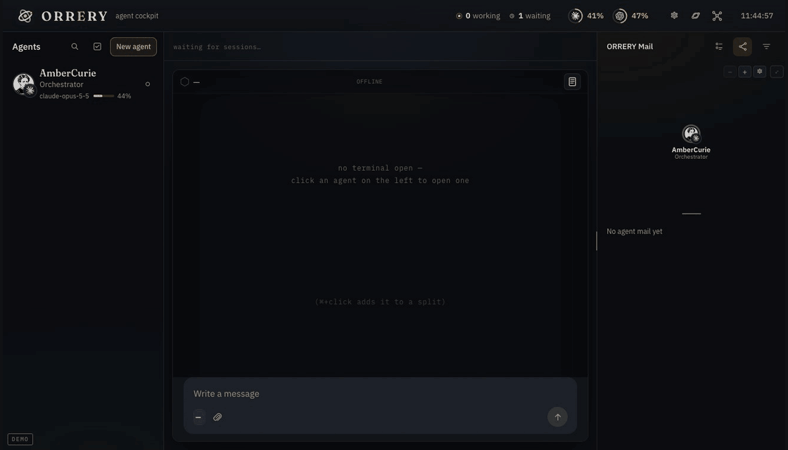

# Delegation and child agents



A parent delegates work and its children report back through Mail. Choose the work folder, model, and tools for the task.

> 日本語版: [delegation.md](../delegation.md)

[Previous: Launchers and identity](launchers.md) · [Back to README](../../README.en.md) · [Next: Hooks](https://github.com/gyroid-eth/orrery-telemetry/blob/master/docs/hooks.en.md)

Both Claude Code and Codex Desktop have built-in subagent mechanisms. The **child agents** created by this stack are different. Their names are similar, and **one may silently substitute for the other when the intended mechanism is unavailable**, so real incidents have occurred where people concluded that delegation was working without knowing the distinction.

This page explains the differences between the two and how to tell which one you are currently using.

In Codex, invoke this skill with `$delegate` (or select it with `/skills`). In Claude Code, use `/delegate`. The installer links `${CODEX_HOME:-$HOME/.codex}/skills/delegate`. If a same-name user skill exists, it is preserved with a warning, so check that you selected the ORRERY skill when a conflict occurs.

After sending your completion report or a question that blocks your work, end your turn and keep the session open. Replies arrive as ORRERY Mail notifications. Do not wait in a sleep loop.

## In one sentence

- A **built-in subagent** is a **call** opened inside its parent, returning an answer and then closing. It leaves nothing externally visible.
- A **child agent** is a **counterpart** with an identity, its own tmux session, and the ability to receive mail. It can be addressed by name as a peer of its parent, and its history remains available afterward.

The former is enough for a short investigation. The latter is necessary when **people or other agents need to know that the work exists**.

## Differences

| | Built-in subagent | Child agent (this stack) |
|---|---|---|
| How it is created | The parent calls the `Agent` / `Task` tool | Claude Code: `/delegate`, Codex: `$delegate` (which uses `spawn_child.sh` internally) |
| Identity | None. An internal ID for each call (a hexadecimal value such as `a1798ced…`) | A name registered with ORRERY Mail (an adjective and scientist name such as `Teal-Darwin`) |
| Process | Same process as the parent | Independent tmux session (and optionally a terminal window) |
| Dashboard | **Does not appear** (it does not exist even as a node) | Appears as a node, with a line connecting it to its parent |
| Communication | Only the arguments from the parent and the final returned text | agent-mail. It can communicate bidirectionally with agents other than its parent |
| Lifetime | Only for that single call | Until explicitly ended. More work can be sent later |
| Recovery after interruption | Not possible | The tmux session remains and can be reopened with dashboard jump / resume |
| File coordination | None | File reservations avoid collisions with other agents |
| Progress visibility | Unknown until it finishes | Intermediate progress can be watched in its pane. A monitoring loop can run |
| Best suited for | Short investigations, searches, and one-off decisions | Long implementations, parallel work, and work whose progress people need to see |

## How to tell them apart

The most reliable method is to **look at the dashboard**. A built-in subagent does not register with ORRERY Mail, so it does not appear as a node. It is not merely missing a line: **it does not exist there**.

If you perform a simple communication check and any of the following is true, you are using a built-in subagent:

- No child node appears in NETWORK
- The child's name is a hexadecimal identifier rather than an adjective and scientist name
- The parent's log contains `Agent(...)` / `Task(...)` calls
- The child has no session in `tmux ls`

With a child agent, by contrast, an edge connects the two agents and displays their message count. Opening the edge shows each exchange as an individual mail message.

## Why they are silently substituted

`/delegate` uses the ORRERY Mail MCP tools. **When those tools are absent, a parent may decide on its own to switch to a built-in subagent and finish the work.** The work completes and a report returns, so from a person's perspective it looks like an unqualified success.

This stack prevents that behavior in three layers.

1. **The installer registers ORRERY Mail as an MCP server.** Previously, the registration procedure was undocumented and silently assumed that users had already completed it
2. **`agentstack-doctor` reports missing or inconsistent registration.** It also displays the repair command
3. **The managed instructions (`claude/CLAUDE.md` / `codex/AGENTS.md`) state that delegation must use only the delegate skill (Claude Code: `/delegate`, Codex: `$delegate`), and that when the tools are absent the agent must report the problem and stop instead of substituting another mechanism**

Run `agentstack-selftest` immediately after installation. It verifies **functionality**, not mere presence (registration validation → spawning two actual agents → mail delivery in both directions).

## Codex children and MCP approvals

Parented Codex children default to `--ask-for-approval never` because they run unattended. `AGENTSTACK_CODEX_CHILD_APPROVAL` can override this value. Standalone NEW AGENT starts and resumes with a recorded standalone start omit approval arguments. Codex uses `approval_policy` from its effective `config.toml`, including any configured overlay, or its built-in default when unset. Resuming sessions without that record uses the existing child approval setting.

MCP tools have an approval setting separate from shell-command approvals. Under `never`, calling an inherited server without an explicit allow rule immediately fails with `MCP tool call requires approval, but approval policy is never`. To give every Codex child the same rule, create a TOML fragment and persist it with installer flag `--codex-child-overlay /absolute/path/to/overlay.toml`.

The minimal server-wide approval is:

```toml
[mcp_servers.chrome-devtools]
default_tools_approval_mode = "approve"
```

When changing the endpoint too, an overlay array replaces the inherited value in full:

```toml
[mcp_servers.chrome-devtools]
args = ["--browserUrl", "http://127.0.0.1:<port>"]
default_tools_approval_mode = "approve"
```

`default_tools_approval_mode` is Codex's server-wide key. To narrow approval to one tool, set `approval_mode = "approve"` under a table such as `[mcp_servers.chrome-devtools.tools.take_screenshot]`. Tables merge recursively; overlay scalars and arrays replace inherited values. To preserve the child's authenticated identity, the ORRERY Mail proxy entries under `mcp_servers` and `plugins.*.mcp_servers.agentstack` are protected: attempted overlay changes are ignored and named in a stderr warning.

The overlay currently applies only to macOS/Linux `spawn_child.sh`. WSL2 uses that path, but the community-lane native-Windows launcher does not apply it.

Browser, screen and `mcp:<name>` servers selected with `--tools` (including installer defaults) receive `required = true` and a startup timeout of at least 60 seconds only in the child's `CODEX_HOME/config.toml` (longer existing timeouts are kept). This prevents pending optional servers from being omitted; initialization failure stops Codex startup/resume ([official configuration reference](https://learn.chatgpt.com/docs/config-file/config-reference)). Unselected inherited servers and ORRERY Mail receive no additions, and user settings stay unchanged. The `--codex-mcp inherit/orrery-only` profiles alone do not select tool servers.

The global optional-server wait, `mcp_optional_startup_grace_ms` (default 1000ms; 0 waits for each server's timeout), is neither added nor overridden. Setting it to 0 would also extend the wait for unselected inherited servers. Installer defaults remain best-effort when resolving configured tools: unavailable choices are omitted at that stage, while runtime initialization failure of an adopted server stops startup.

If the child exits during the startup watch, the launcher reports failure and Codex diagnostics are printed if the pane can still be captured at that point. Exit after the bounded watch is not guaranteed to be reported as a failed spawn. Tool replacement on resume applies the same generated config settings, but does not resolve the known Codex mid-session tool-addition limitation below.

### Codex children in a worktree and hook trust

Codex records that a project's hooks (`<checkout>/.codex/hooks.json`) are trusted in the user's `~/.codex/config.toml`, keyed by the path of that `hooks.json` (`[hooks.state."<path>:<event>:<i>:<j>"]` with a `trusted_hash`). A `--worktree` child reads the same hooks at another path, finds no record, and stops on the "N hooks need review" screen; none of those hooks run meanwhile.

The launcher therefore adds, in the child's own `CODEX_HOME` `config.toml` only, the trust the user gave to the hooks of the source checkout, keyed by the worktree path. The source checkout is the one whose `.git` names the same git directory as the worktree (also when that git directory is kept elsewhere).

- The `trusted_hash` is a hash of the hook's content, which Codex checks at every start: only identical hooks become trusted, and a changed hook goes back to review.
- The user's `~/.codex/config.toml` is not changed, and no hook the user has not trusted is added.

### Minimizing MCP for a Codex child

Explicitly use `/delegate "<task>" --codex --codex-mcp orrery-only` to make the child-owned `config.toml` keep only authenticated ORRERY Mail and the AgentStack plugin needed for session binding. Other inherited MCP servers and plugins are set to `enabled = false`. Shell and file operations remain available, but plugin-provided skills and app tools are disabled too, so do not use this profile when the task depends on them.

The default `inherit` profile carries over the user's MCP and plugin settings. In the generated Codex child configuration, `chrome-devtools` and renamed servers that launch `chrome-devtools-mcp` directly are enabled only when selected, for example with `--tools mcp:chrome-devtools` or `--tools browser`. Select `--tools chrome-extension` to enable the `chrome@openai-bundled` plugin that connects through the Chrome extension.

#### When another MCP is needed partway through a task

If a child started with `orrery-only` needs another tool, ask the parent agent for help (or the operator in standalone mode). The parent can take over that part of the work or launch a new child through the regular `/delegate` procedure with the required MCP enabled, passing the necessary context explicitly. The new child does not automatically continue the original conversation. The [EXIT/resume API](#resume-a-stopped-child-with-different-tools) also changes the recorded selection, but reflected Codex tool calls remain unresolved.

In one limited interactive measurement with Codex CLI 0.154.0, a preconfigured stdio MCP was changed from disabled to enabled. Although `/mcp` then refreshed its inventory and started the server, no tool call was confirmed, and one control that resumed the same conversation did not succeed either. A fresh process with a new conversation did succeed, so the current guidance does not treat a config change, `/mcp`, or resume as a reliable mid-session switch. This result is not generalized to other versions, HTTP/OAuth or plugin-provided servers, or newly added MCP servers.

## Claude children and browser control (Claude in Chrome)

Explicitly passing `/delegate "<task>" --claude-chrome-device <deviceId>` (or `--claude-chrome`) starts the Claude child's `claude` with `--chrome`, which gives it Claude in Chrome browser control. It applies only to Claude children and cannot be combined with `--codex`. It is separate from any OS desktop control.

- **The default is inherit.** A child started without the flag has the same launch command as before, with neither `--chrome` nor `--no-chrome`. Whether Chrome is available is decided by the user's own Claude settings (such as `claudeInChromeDefaultEnabled`). The default does not mean "browser disabled".
- **A deviceId is a selection policy.** When several browsers are connected to the same account (for example Chrome on a Mac and Brave on Windows), it tells the child which one to use. The child checks with `list_connected_browsers` that the deviceId is connected and creates its own tab only after `select_browser` succeeds. If the deviceId is missing or disconnected, the child stops browser work and reports it instead of switching to the first or the local browser. Without a deviceId, the child uses no browser tool except `list_connected_browsers` and asks its parent for one. **This is an instruction to the child, not a technical isolation**: Claude Code has no CLI flag that pins Claude in Chrome to one browser. For tests that must not touch another browser, disconnect the extension in the browsers you are not testing so fewer candidates remain.
- **What is guaranteed is a fresh cold launch.** Both cold start and the legacy path add `--chrome`, and the first prompt tells the child how to choose the browser. A warm-pool session was started without `--chrome`, so it is not claimed and the child cold-starts.
- **Resume is a best-effort extra.** The launch record is bound to the conversation (session ID), not to the agent name. Before starting tmux, the launcher writes a provisional record for that launch. The child's first SessionStart hook turns it into the record for its own session ID (`AGENTSTACK_RUNTIME_DIR/child-agents/<name>.claude-launch.<session-id>.json`). A later launch under the same name, or a launch that fails, does not change an earlier conversation's record (a failed launch removes its own provisional record). Resume from the dashboard decides in exactly three ways; conversation text (prompts or tool output) never takes part:
  - A valid record exists for the session ID being resumed: `--chrome` and the browser policy are restored from it, and the launch ID is passed on (a `/clear` after the resume stays bound to the same launch).
  - A record exists but is corrupt, belongs to another agent or session, or is not 0600: the resume stops and reports why.
  - No record exists: the conversation resumes as before (inherit). **Whether it was started without the flag or its record failed to save cannot be told apart. Neither restoring the chosen browser nor keeping the child off the browser is guaranteed.**
- **Known limitation.** A session whose record could not be saved (for example, a new session ID after `/clear` that could not be written) is told by the hook, at that moment, not to use the browser. A later resume of that session ID is treated as having no record (inherit). To continue browser work from a conversation whose record cannot be confirmed, start a new cold child with a deviceId. The SessionStart hook repeats the policy at every startup, resume and compaction only for conversations that have a record.
- **WSL.** The official documentation ([Claude in Chrome](https://code.claude.com/docs/en/chrome)) lists WSL as unsupported. With Claude Code 2.1.283, `claude -p --chrome` in WSL controlled a Windows browser connected through the account on one test machine. Do not treat this as supported, and check again after upgrading.
- **Approval for each launch.** A Claude child launched with Claude in Chrome (including installer defaults and legacy `claude_chrome`) receives one `--allowed-tools` flag approving the 22 known tools in Claude Code, to avoid Claude Code tool-approval prompts: `browser_batch`, `computer`, `file_upload`, `find`, `form_input`, `get_page_text`, `gif_creator`, `javascript_tool`, `list_connected_browsers`, `navigate`, `read_console_messages`, `read_network_requests`, `read_page`, `resize_window`, `select_browser`, `shortcuts_execute`, `shortcuts_list`, `switch_browser`, `tabs_close_mcp`, `tabs_context_mcp`, `tabs_create_mcp`, `upload_image`. The name list lives beside `TOOL_TABLE` in `hooks/child_tools.py`; new names are not approved.
  Approval is merged with selected screen/MCP tools for this launch only; user settings and children without Chrome are unchanged. Claude in Chrome has its own permission mode (default `ask`): browser operations such as opening a tab require a person to press **Allow** at its Chrome prompt. A headless child stops at that prompt. Connecting and granting access in the extension also remain human actions; `--allowed-tools` does not skip them.
  Measured on 2026-10-06 with Ubuntu on WSL2 and Claude Code 2.1.290: a `tools.browser` child launched with all 22 entries in `--allowed-tools`, but `tabs_create_mcp` stopped at Claude in Chrome's Allow/Deny prompt. In `-p` mode, `select_browser` was rejected with `Claude in Chrome requires permission` even with `bypassPermissions` or `--dangerously-skip-permissions`. ORRERY expects human confirmation and does not bypass this Chrome permission mode.
- **Env defaults.** Setting `AGENTSTACK_CLAUDE_CHILD_CHROME=1` and `AGENTSTACK_CLAUDE_CHILD_CHROME_DEVICE=<id>` applies the same request to every Claude child started by `spawn_child.sh`. CLI flags take precedence over env. Codex children ignore them, and they are removed from the environment when a Codex child starts or resumes, so a Codex child does not hand them on to children it starts. The dashboard's NEW AGENT uses only the value chosen in the form, never the env defaults.

## How a Claude child receives its task

The launcher (`spawn_child.sh`) gives a Claude child its first task as the `claude [prompt]` argument, so it is the user's first message. The same launch command passes `--append-system-prompt` with operator configuration saying:

- this session is ORRERY child X, started by the launcher because parent P delegated a task to it;
- the first message is the task P delegated (to be carried out with the usual judgment);
- reports go through `mcp__orrery-mail__send_message`.

It makes no claim the launcher has not checked, such as that a person asked for the task.
The task used to be pasted into the input box. Claude Code wraps a paste in `<pasted_content>` and follows instructions inside it only when the user's own message asks it to. On 2026-10-01, Sonnet 5 children outside the vault (no CLAUDE.md with the managed block) handled a task shaped like the incident as follows:

| Delivery | Result |
|---|---|
| pasted | declined 6 times in 6, however it was worded |
| argument only | declined 2 times in 3 |
| argument and system prompt | started 3 times in 3 |

**Checking that the child started:** after the launch, the launcher reads the child's transcript in the background and looks at how its first turn ends. It reads one transcript, once found, and only what is appended to it.

- A first turn that ends after ORRERY Mail accepted a `mcp__orrery-mail__send_message` to the parent needs no notice (a send that failed, or whose result never came back, is reported). The transcript is the one whose first message was written after this launch, so an earlier conversation of the same name is not mistaken for it.
- The parent is told by ORRERY Mail when the first turn:
  - ends in text alone (declined, or asked for confirmation);
  - called tools but ended without the report (checked and then declined, or forgot to report);
  - has no answer within `AGENTSTACK_CHILD_START_WAIT_SECONDS` (default 180), or its transcript cannot be found.
- A first turn still being written at 180 s (still thinking) gets a separate "still in its first answer" notice.
- A child that starts after an early notice gets one more message saying it started.
- The message arrives under the child's name, but its subject starts with `[launcher]` and its first line says the launcher sent it, not the child.
- Every outcome is logged in `spawn_incidents.log`. `AGENTSTACK_CHILD_START_CHECK=0` turns the check off (for tests).

A task too long for one argument (128 KiB per argument on Linux and WSL) is kept in a file only the child can read, and the argument only says to read that file. A task passed as an argument is visible in the process list (`ps`) while the child runs, as it already was for Codex children.

Managed Claude children receive their current workspace, ordered `AGENTSTACK_EXTRA_PROTECTED_ROOTS`, and task argument in a fresh process. Warm-pool selection remains unchanged in this PR; the existing claim-model protocol cannot guarantee a prestarted provider uses the requested workspace or protection settings. This limitation needs separate assessment. Codex children also receive the task as an argument.

**Run after a model changes:** `scripts/canary-embed-task.sh` starts short-lived children for each model and place (inside or outside the vault) and tabulates them as started, reported outside Mail, declined, or timed out. It is run by hand, not in CI. Every child is ended and retired at the end. It creates temporary identities in the live ORRERY Mail, so it asks before starting.

```bash
scripts/canary-embed-task.sh --models opus,sonnet,haiku --places vault,outside --runs 3 --parent <your name>
```

## Choosing the tools a child gets (`--base` / `--tools`)

You can choose a child's tools when you start it, for example `/delegate "<task>" --base mail-only --tools screen:read:windows-mcp`. In `/api/spawn` the fields are `base` and `tools` ([API](https://github.com/gyroid-eth/orrery-telemetry/blob/master/docs/api.en.md#post-apispawn)). `hooks/child_tools.py` is the single interpreter of both.

- **`--base` omitted or `default`**: a Claude child's only MCP server is ORRERY Mail, while the browser (Claude in Chrome) still depends on the user's Claude settings. A Codex child follows the `inherit` profile above. dsh and Hermes children inherit only the enabled Chrome MCP definition from Codex, alongside authenticated Mail (see below). Whatever `--tools` selects is added on top
- **`--base mail-only`**: added MCP servers are ORRERY Mail and servers explicitly selected with `--tools`. Built-in harness tools, such as web search and fetch where available, remain usable. A Claude child also gets `--no-chrome` unless a browser was selected. A Codex child gets the same disabling as `--codex-mcp orrery-only`, and then enables the selected servers and plugins (combining it with `--codex-mcp inherit` is rejected)

| `--tools` | Claude child | Codex child |
|---|---|---|
| `browser` / `browser:<deviceId>` | `--chrome`, Claude Code approval for the 22 known tools, plus the deviceId instruction; browser-operation prompts still require a person to press Allow, and stop a headless child (the same as [Claude in Chrome](#claude-children-and-browser-control-claude-in-chrome); rejected when it names a different deviceId than `--claude-chrome-device`) | Enables the user's chrome-devtools server from `config.toml` (named `chrome-devtools`, or the one server that runs `chrome-devtools-mcp`), exposes only the tools in the table below and approves them one by one. A deviceId is Claude-only and is rejected. The launch stops when there is no such server or a wrapper script keeps the tools from being classified |
| `screen` / `screen:operate` / `screen:read` | On macOS, `orrery-screen` runs Cua Driver in Control or View mode | Same as Claude |
| `screen:<read\|operate>:<server>` | Copies the user's screen server (such as Windows-MCP on WSL) into the strict config | Enables that server in the child's `config.toml` |
| `mcp:<server>` | Copies the user's server definition into the strict config (no tool approved) | Enables that server in the child's `config.toml` (no tool approved) |
| `mcp:<server>:all` | The same, and approves every tool the table knows | The same, and approves every tool the table knows, tool by tool |
| `chrome-extension` | Unavailable | Enables `chrome@openai-bundled` when configured in `config.toml`. Combining it with `orrery-screen` is rejected |

### The default browser for dsh and Hermes

With `base=default`, native children inherit the enabled `chrome-devtools` server, or the one server running `chrome-devtools-mcp`, from `CODEX_HOME/config.toml` (otherwise `~/.codex/config.toml`) and the Codex child overlay. Other Codex MCP servers are not added. The `command`, `args`, `env` and `cwd` are the same definition, so `--autoConnect` connects to the user's usual signed-in Chrome. Without a configured, enabled browser the child still gets only Mail. `base=mail-only` does not add the browser automatically. Environment values are not displayed.

Explicit `--tools mcp:chrome-devtools` on dsh or Hermes uses the same Codex Chrome MCP definition. If Codex has no browser definition, it uses the Claude user or launch-folder definition. The phone Browser control uses this selection. A person still answers Chrome’s connection prompt.

New Agent offers Off, Temporary Chrome, and My Chrome. Temporary Chrome uses a temporary profile for the child that is removed when Chrome closes. My Chrome uses your usual Chrome via Claude in Chrome for Claude Code or Chrome DevTools `--autoConnect` for the other supported harnesses. If Chrome asks for connection permission on the first connection, browser actions wait until you respond on the Mac. Antigravity hides the choices when its global Chrome MCP is enabled because workspace settings cannot replace it.

This follows Codex's default MCP inheritance, which differs from explicit `--tools browser` and its classified tool exposure and individual approvals. Explicit native browser selection also discovers the Codex definition, but stops while dsh and Hermes cannot express those approval requirements. Default inheritance also refuses Codex-specific tool filters/approvals or other unrepresentable settings, rather than dropping them and broadening permissions. Supported definitions contain only the stdio `command`, `args`, `env`, `cwd` and `enabled` fields. The CLI displays `Harness prepare failed: unsupported_mcp_selection` (or `Harness resume-prepare failed: unsupported_mcp_selection` during resume preparation). `native_mcp_selection_unsupported` and `native_mcp_approval_unsupported` are internal exception reasons, not the displayed diagnostic.

Inheritance does not add native CLI execution approvals. A person answers Chrome's connection permission. Downloads follow the usual Chrome settings; this selection grants no additional sandbox filesystem access. Check whether the child's native shell can read the destination.

To check configuration generation, create a new native child through the regular launcher and pass its state directory's `input.json` to this script. Run it with the same `CODEX_HOME` and overlay environment used at launch. It prints only server names and whether transport fields match, without displaying whole configurations or environment values.

```bash
python3 - /path/to/child-state/input.json <<'PY'
import json, os, sys
from pathlib import Path
document = json.loads(Path(sys.argv[1]).read_text())
sys.path.insert(0, str(Path(document['product_root']) / 'hooks'))
import child_tools
config = child_tools._defaults_codex_config(
    str(Path(os.environ.get('CODEX_HOME', str(Path.home() / '.codex'))) / 'config.toml'),
    os.environ.get('AGENTSTACK_CODEX_CHILD_CONFIG_OVERLAY', ''))
emitted = json.loads(Path(document['mcp_config']).read_text())['mcpServers']
print('servers:', sorted(emitted))
for name in document['mcp_selection']['servers']:
    if name in config.get('mcp_servers', {}):
        source = config['mcp_servers'][name]
        print(name, {field: emitted.get(name, {}).get(field) == source.get(field)
                     for field in ('command', 'args', 'env', 'cwd')})
PY
```

- With `base=default` and no `--tools browser`, an enabled Chrome definition produces Mail and Chrome server names, with all four fields `True`. An absent or disabled browser leaves only Mail names (there may be multiple Mail aliases).
- With `base=mail-only` and no additional tools, only Mail names remain. Explicit `--tools browser` must fail with the public diagnostic above before the native CLI starts.
- Matching configuration is not a browser operation test. Check the child's native tool list for Chrome tools, actually call `list_pages` once, and verify the exact tool name and success/refusal in the tool-call record. Do not copy page names or contents into the report. For file retrieval, use a harmless test file and check the actual destination and a native read from the same child. These live operations have not been measured by this change's automated tests.

### When an MCP tool is refused by the approval policy

When an MCP tool returns a refusal message, the child stops the blocked work and reports `MCP tool <tool-name> is blocked: <exact message>.` through ORRERY Mail `send_message`, using the exact tool name and verbatim refusal message. This covers Codex's `approval policy is never`, a Claude tool missing from `--allowed-tools`, and a denied browser or OS permission that returns a refusal message. A pending Allow prompt blocks the tool call: Allow lets it continue; if permission is denied and a refusal message returns, the child reports it then. The child must not edit `~/.codex/config.toml`, `~/.claude/settings.json`, or other configuration files to bypass it, or grant permission on the user's behalf. With no parent (standalone), or if Mail is unavailable, tell the user the same line and stop.

The parent or user chooses the recovery from the existing procedures: [tool approval and classification limits](#approval), [new-child tool selection](#choosing-the-tools-a-child-gets---base----tools) or [Claude child resume](#resume-a-stopped-child-with-different-tools) for classified tools; [Codex overlay troubleshooting](telemetry-troubleshooting.md#mcp-tool-call-requires-approval-but-approval-policy-is-never) for other servers; [MCP needed partway through a Codex task](#when-another-mcp-is-needed-partway-through-a-task) for its unresolved tool-change limitation; and [human connection and operation permissions](#what-a-person-does-setup-and-permission-for-connections-and-operations) for permission prompts.

### The classification table: read only and operate

What a screen selection exposes and approves is decided by the classification table (`TOOL_TABLE`). It currently lists Windows-MCP 0.8.6 (20 tools) and chrome-devtools-mcp (all 30 tools of 1.10.1), each split into classes.

| Class | Windows-MCP 0.8.6 tools |
|---|---|
| Read (`read`) | Screenshot, Snapshot |
| Operate the screen (`operate`) | App, Click, DisplayInventory, Move, MultiEdit, MultiSelect, Scroll, Shortcut, Type, Wait, WaitFor |
| Not screen tools | Clipboard, FileSystem, Notification, PowerShell, Process, Registry, Scrape |

- `screen:read` exposes and approves only the read tools; `screen:operate` the read and operate tools. The rest is hidden (Claude `--disallowed-tools`, Codex left out of `enabled_tools`). Selecting the screen never passes PowerShell or the registry
- Only a separate `mcp:<server>:all` passes the non-screen tools too. It approves every tool of that server, which on Windows means **running arbitrary code on the host without a person approving it**. The child's first prompt says so as well
- The version is read from the server's command line, which must pin it (such as `uvx windows-mcp@0.8.6`; a package only added with `--with` does not count). With a wrapper script, an unpinned definition or a version that is not in the table, `screen:read` and `mcp:<server>:all` stop the launch, and `screen:operate` copies or enables the server without approving any tool

### The chrome-devtools classes (Codex `--tools browser`)

| Class | chrome-devtools-mcp tools |
|---|---|
| Read (`read`) | get_console_message, get_css_styles, list_console_messages, list_network_requests, list_pages, performance_analyze_insight, select_page, wait_for |
| Operate (`operate`) | click, close_page, drag, emulate, fill, fill_form, handle_dialog, hover, navigate_page, new_page, press_key, resize_page, type_text, evaluate_script, upload_file, take_heapsnapshot, performance_start_trace, performance_stop_trace, lighthouse_audit, get_network_request, take_screenshot, take_snapshot |

- `browser` (Codex) exposes and approves the read and operate tools; `screen:read:chrome-devtools` only the read tools. The read selection leaves all other tools out of `enabled_tools`
- The real definition is usually the unpinned `npx chrome-devtools-mcp@latest`, so this one server is classified by tool **name** even when its version is unknown. Only the names in the table are approved, one by one; a tool a newer version adds is neither exposed nor approved. This differs from the Windows-MCP version pin because the known names define the selected scope, including arbitrary execution, while new names stay out
- Selecting Codex `browser`, or Chrome MCP `screen:operate` in Codex and Claude (a known pinned version only), approves all 30 known tools, including arbitrary JavaScript (`evaluate_script` and `navigate_page.initScript`), saving host files and uploading local files. Approval covers the whole tool, including optional output paths. To narrow this scope, select `screen:read:<server>` or use an overlay without selecting browser/operate (their selection replaces the tool allowlist). Read excludes `take_snapshot.filePath`, `take_screenshot.filePath`, and `get_network_request.requestFilePath` / `responseFilePath`.
- Claude Chrome MCP screen selection requires a known pinned version; unknown versions stop because Claude cannot hide unknown tools with an allowlist. A known pinned read version receives `--disallowed-tools` for the remaining tools. Claude in Chrome browser uses the separate 22-name Claude Code approval list above; its own browser-operation prompts still require a person to press Allow.
- Classification requires a direct `npx [-y|--yes] chrome-devtools-mcp[@version]` invocation. A wrapper or `npx --package chrome-devtools-mcp@version other-program` is not classified. Browser and a different screen server may be selected together; each keeps its own approval scope.
- `mcp:chrome-devtools:all` still needs a known pinned definition (`chrome-devtools-mcp@1.10.1`); Codex browser/operate approves the known names even without a version pin
- This is Codex's tool approval only. The Chrome-side `--autoConnect` connection permission is separate, and a person still answers the Chrome connection prompt

[For the Mac screen relay and its View and Control permissions, see Computer use.](../computer-use.md)

### Installer defaults

`--child-default-tools 'mcp:notes'` writes `AGENTSTACK_CHILD_DEFAULT_TOOLS` into env.sh, the service definition and install-state. The default is empty. Standard new launches of Claude, Codex, dsh and Hermes use it when the CLI omits `--base`, `--tools` and `--codex-mcp`, or when `/api/spawn` (including NEW AGENT) omits both `base` and `tools`.

Append `;claude=SPEC`, `;codex=SPEC`, `;dsh=SPEC` or `;hermes=SPEC` after the common list to replace that provider's defaults. Each list uses the `--tools` grammar. Providers without an override use the common list. An empty override clears the installer defaults for that provider. For example, `--child-default-tools 'mcp:notes;dsh='` gives `notes` to Claude, Codex and Hermes and clears the installer defaults for dsh.

Defaults are checked for the provider and final directory, one item at a time. Applicable items remain, and omissions appear in spawn output and the child's first instructions. Explicit base/tools/MCP profiles take precedence. To suppress installer defaults, pass `--base default` on the CLI, or `base: "default"` or `tools: {}` in the API. Unavailable explicit tools and Mail proxy, authentication or startup failures stop the launch. Resume uses the selection recorded at launch and does not add current installer defaults. The macOS relay requires an explicit selection on each launch.

### Approval

Approval is given only inside the child's own launch, tool by tool, for tools the table knows. The user's `settings.json`, `~/.codex/config.toml` and the global approval policy (Codex `never`) are not changed, and a whole server (Claude `mcp__<server>`, Codex `default_tools_approval_mode`) is never approved.

- Claude gets `--allowed-tools`; Codex gets `approval_mode = "approve"` per tool. Claude in Chrome has separate browser-operation prompts where a person must press Allow
- A server selected with `mcp:<server>` (without `:all`) and a server of unknown version are only copied or enabled. To call their tools, the user approves them in their own settings (for Codex, the installer's overlay). Without approval an unattended child stops at its first call (measured with Claude on WSL: the call is denied without an allow rule, and works with `--allowed-tools`)
- Approval is decided again at every launch and resume from the server's version at that time and the table. If the server was upgraded to a version the table does not know, a resume approves less than the launch did (`screen:read` and `:all` stop); it never approves more

### Which servers can be copied (Claude)

Only servers in the user scope of `~/.claude.json` and in the project scope of the child's directory can be copied (the project scope wins). Servers from a project `.mcp.json`, from plugins and claude.ai connectors cannot. These servers cannot be selected, and the launch stops:

- a name that is ORRERY Mail (the child always gets its own authenticated Mail)
- a definition with `env` or `headers` values (copying them would add secrets to the child's config file)
- a stdio `command` that is not an absolute path, or a relative `cwd` (they break with the child's PATH and directory)

### When the launch stops (fail closed)

A child started with `--base mail-only` or any `--tools` is stopped before tmux starts when the selection cannot be applied as asked. It is never started silently with everything or with nothing.

- the ORRERY Mail proxy is unavailable (a child without a selection still falls back to the shared endpoint)
- a selected server is missing or fails the checks above, or is not in the Codex `config.toml`
- `screen:read` or `mcp:<server>:all` with a server or version that is not in the table


### Screen on WSL and the Windows session

A Windows process started from WSL runs in the Windows session that WSL runs in. WSL started over ssh is in session 0 (no desktop): Windows-MCP starts, but Screenshot fails with `screen grab failed`. Inside a tmux server started from an RDP or console session it works. When a screen server is selected on WSL, the launcher asks PowerShell for its session number and warns when it is 0. It does not stop the launch, because the launcher and the child's tmux server can be in different sessions.

### Resume a stopped child with different tools

At a work boundary, the parent or operator can request `/delegate --resume <NAME> --tools <spec>`. Ask the child over Mail to save its work and release reservations. Complete `POST /api/exit`, then confirm `gone` / `finished` through `GET /api/agents`. Resume keeps the same name, native session ID and working directory, continuing the conversation.

```bash
"${AGENTSTACK_HOME:-$HOME/.agentstack}/bin/agentstack-resume" <NAME> --tools browser --tools mcp:<server>
"${AGENTSTACK_HOME:-$HOME/.agentstack}/bin/agentstack-resume" <NAME> --clear-tools --detached
```

`tools` replaces the whole selection: include everything you want to keep. `--clear-tools` (API `tools: {}`) removes extra tools. Omitted base keeps the recorded base; base alone keeps the recorded tools. Omitting both resumes with the prior selection. Installer defaults are never appended. Grammar, provider, cwd, classification, MCP copying and the existing Mail authentication are checked; unavailable explicit choices stop the launch. Retained Claude/Codex CLI children support persistent selection changes. For a conversation-only Claude resume, `/api/jump` accepts a per-launch choice of Chrome and `orrery-screen`. [Resume API example](https://github.com/gyroid-eth/orrery-telemetry/blob/master/docs/api.en.md#post-apijump)

Per-child exclusion and a generation stage the candidate for the existing resume path. Startup success commits it; startup failure restores that generation's prior record and generated settings. An older rollback cannot overwrite a new registration or selection. Claude replacement records use version 4, including empty choices, while versions 2/3 remain readable. API success means tmux/the terminal accepted the launch; it does not wait for shell bootstrap/authentication or a successful MCP call. If bootstrap fails later, the new tools record remains committed and is used on the next resume. Receive the resumed child’s Mail report confirming the same conversation and a real call to the required tool. The final receipt confirmation in /delegate is required.

A process crash during the change leaves a pending generation and blocks resume/purge. Confirm no tmux session or running child remains, then use only the generation shown in the error: `python3 "$AGENTSTACK_HOME/hooks/child_resume.py" rollback-tools-change --runtime-dir "$AGENTSTACK_RUNTIME_DIR" --agent-name <NAME> --generation <GENERATION>`. Recovery restores the old selection for an unfinished change or rollback; when the journal already records a commit, it keeps the new selection and completes cleanup. Retry the same generation after another interruption. Rollback refuses an active/in-progress child or changed identity/generation. Never display credentials or manually edit private state.

Native CLI verification (2026-10-05): Claude Code 2.1.289 resumed the same conversation from no tools and actually succeeded with `new_page about:blank` on a newly attached chrome-devtools MCP. The test connected to an existing CDP service because the sandbox cannot launch Chrome. Codex CLI 0.159.2 has an unresolved known limitation: tools changed on resume were not reflected in actual calls. The same session ID and marker survived; native `/mcp` showed chrome-devtools connected with 30 tools, but the model reported the new tool unavailable and no call was confirmed. The `--no-daemon` control also failed, and the cause remains undetermined. Do not treat mid-task tool addition on this Codex version as working.

### Records and resume

- Claude: the selection is kept as `base` and `tools` in the same launch record as [Claude in Chrome](#claude-children-and-browser-control-claude-in-chrome) (`<name>.claude-launch.<session-id>.json`, launch version 3 / replacement version 4), bound to the conversation. A dashboard resume rebuilds the same strict config and flags from this record and the current user settings. When it cannot (a server was removed, the computer use was enabled, ...), or when the child has no state so strict cannot be applied, the resume stops and returns the reason. The SessionStart hook repeats the given tools to the child at every start, resume and compaction
- Codex: the selection is kept in `AGENTSTACK_RUNTIME_DIR/child-agents/<name>.tools.json` (0600), and `child_resume.py build-home` applies it to the child's `config.toml` at every launch and resume. A damaged record builds no home, so the launch or resume stops

### What is promised

`mail-only` restricts MCP servers, the browser and the computer use. The tools built into Claude Code or Codex (shell, files, WebFetch, ...) and the user's hooks and skills stay.

This is a policy for the child, not technical isolation. The child runs with the user's permissions and can edit its own config files and records, and the dashboard API does not authenticate its callers. Put the real guard for computer use where it is enforced: the per-application permission of the macOS computer use (granted by a person on screen), and the side that starts Windows-MCP (which tools it publishes).

Tool selections can change on resume. The operator can change the existing screen relay permission on a running launch. [Computer use API](https://github.com/gyroid-eth/orrery-telemetry/blob/master/docs/api.en.md#computer-use-api)

## Browser and computer use: what is reachable, and what a person does

Agents that ORRERY starts (children and NEW AGENT) were checked for whether browser and computer use tools reach them and can be called, in eight combinations: Claude / Codex × Mac / Windows (WSL2) (2026-09-30 and 10-01; Claude Code 2.1.285, Codex CLI 0.159.x). Every combination reached and called its tools once its conditions were met, but this is a reachability and call check, not a check that every one was operated. It includes measurements on an older ORRERY version and tests with settings outside the product. None works with no setup at all.

| | Mac | Windows (WSL2) |
|---|---|---|
| Claude × browser | Reachable; the 22 tools are approved in Claude Code per Chrome launch. Extension connection and access, and Allow for browser-operation prompts, require a person; a headless child stops at the prompt | Reachable; a deviceId is required. The 22 Claude Code approvals do not skip Claude in Chrome's Allow/Deny prompt (`tabs_create_mcp`, measured on 2026-10-06 with Ubuntu on WSL2 and Claude Code 2.1.290); a person must press Allow and a headless child stops |
| Claude × computer use | Use `orrery-screen` with Cua Driver. | Hand Windows-MCP (an alternative to computer use) or similar over with `--tools screen:operate:<server>` ([selection](#choosing-the-tools-a-child-gets---base----tools) above). Successful operation was measured with a `claude -p` whose strict config had Windows-MCP added outside the product, not through this `--tools` path |
| Codex × browser | Selecting `--tools browser` adds child-only `required = true` and at least 60 seconds of startup wait to chrome-devtools; initialization failure stops startup. Tool approval is also needed ([approvals](#codex-children-and-mcp-approvals) above) | Provide the server through user config or an overlay. Selecting `--tools browser` adds child-only `required = true` and at least 60 seconds of startup wait; initialization failure stops startup. Tool approval and Chrome connection permission are separate |
| Codex × computer use | Use `orrery-screen` with Cua Driver. | Hand Windows-MCP (an alternative to computer use) over with `screen:<read\|operate>:<server>`; the selected server receives child-only `required = true` and at least 60 seconds of startup wait |

How each launch path is affected:

| Path | What reaches it |
|---|---|
| `/delegate` child | `--tools`, `--claude-chrome(-device)` and the overlay apply |
| NEW AGENT (no parent, `--standalone`) | Codex builds the same generated home as a child, so the overlay and a `--tools` record apply. The approval policy comes from Codex configuration. Claude uses only what the NEW AGENT form says and ignores the `AGENTSTACK_CLAUDE_CHILD_CHROME` environment default. On macOS the Computer use field offers Off, View, and Control |
| resume | Codex rebuilds the home on every launch and resume, so the overlay applies. Claude restores the same settings from the launch record (a child without a record inherits the user's Claude browser settings) |
| `claude` / `codex` a person starts directly in a terminal | Out of scope. Only the real `~/.claude` and `~/.codex` settings decide, and ORRERY does not change them |

If a person starting Codex directly wants the same permission, they write `default_tools_approval_mode = "approve"` (or a per-tool `approval_mode`) under `[mcp_servers.chrome-devtools]` in their own `~/.codex/config.toml`. That approves every tool of the server, including `evaluate_script`, which runs arbitrary page script. In an interactive launch where a person is watching, leaving it unset and answering the approval prompt is safer.

### What a person does (setup, and permission for connections and operations)

Besides setup, a person answers Claude in Chrome browser-operation prompts and chrome-devtools connection prompts when they appear. Launch-time tool approval does not skip these prompts.

- **Claude in Chrome**: install the extension in the browser, sign in and keep it connected (a stopped extension fails even with correct agent settings). Pick a deviceId when several browsers are connected. A person must press Allow for its browser-operation prompts; the 22 Claude Code tool approvals do not let a headless child continue past them
- **chrome-devtools (Codex)**: start the Chrome that `--autoConnect` attaches to (once). The connection permission is not once: Chrome asks a person each time the MCP server requests a connection, so a new child or a reconnect needs an answer. Approving the tool in Codex does not skip this Chrome prompt. The tools may be visible, but an unattended child cannot get a call to proceed until the Chrome connection prompt is answered
- **Computer use (Mac)** uses the Cua Driver app’s Screen Recording and Accessibility permissions. The operator sets Off, View, or Control per ORRERY launch. [Setup and permission changes](../computer-use.md)
- **Windows computer use (Windows-MCP)**: run Windows-MCP in an interactive session such as RDP. WSL started from ssh is in session 0 and cannot capture the screen

Use the overlay for shared approvals and `--tools` to select the Chrome MCP server for a child. The overlay's `default_tools_approval_mode = "approve"` approves every tool of that server, including chrome-devtools' `evaluate_script`.

## Choosing between them

There are cases where a built-in subagent is correct: a short search where only the answer matters, or a read-only investigation that should not consume the parent's context. These are jobs that end after one call and that nobody needs to refer to later.

A child agent is needed in cases like these:

- **A person wants to watch progress.** The implementation is long and may need redirection partway through
- **Several tasks should run in parallel.** For example, one agent researches literature, another summarizes experimental results, and the parent remains responsible for synthesis
- **The parent should remain available for conversation with the person.** Each derived task can be handed to a child without interrupting the parent's conversation
- **Children need to communicate directly with each other.** Built-in subagents do not know about one another
- **They may touch the same files.** Reservations are needed
- **The history needs to remain available.** The record of who asked whom to do what is retained

**Giving each agent one responsibility improves the quality of its work.** Dividing roles matters for quality, not merely for the efficiency of parallel execution.

**Child agents are also appropriate when you want to preserve context.** Even after an agent finishes, you can find it through dashboard search and resume it, retaining “the counterpart with this context” for later use. A built-in subagent disappears when its call closes and cannot be used this way.

## When notifications interrupt the conversation

A child's report is typed directly into the parent's input field. With several children running, progress reports can arrive while a person is talking to the parent.

```bash
export AGENTSTACK_MAIL_NOTIFY_MIN_IMPORTANCE=high
```

Messages at `normal` importance or lower will no longer interrupt. **The mail is not deleted.** The signal remains, so the next `fetch_inbox` call reads it normally. This removes the right to interrupt, not the right to arrive.

The likely pattern is to ensure that completion reports always arrive while allowing intermediate progress to accumulate. `/delegate` sends task requests with `importance="high"` and **instructs children to return completion reports at `high` importance as well**. Intermediate reports keep their default importance, accumulate, and can be read at a convenient stopping point.

When you run a child with instructions you wrote yourself, explain this distinction to it. If a child sends a completion report at the default importance in an environment with a higher threshold, **the mail has arrived but the parent will continue waiting**.

## Related documentation

- [Launchers and identity](launchers.md) — how names and tokens are determined
- [Dashboard](dashboard.md) — how to read nodes and edges in NETWORK
- [Troubleshooting](telemetry-troubleshooting.md) — what to check when delegation does not work
