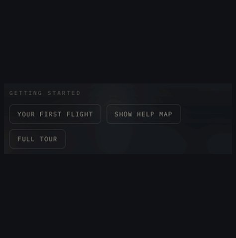
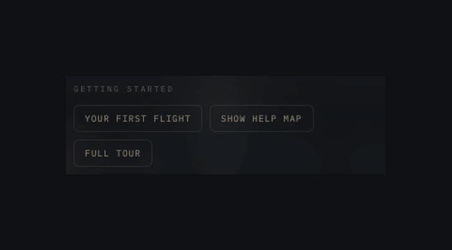

# Open the first-flight guide

Open **Settings → Getting started → Your first flight**. Select a step to see where to go. The checklist updates as you perform each action.

1. **Start an agent**, **Choose your agent**, **Talk to it**. [Launch an agent and send the first task](start-an-agent.md).
2. **Read ORRERY Mail**. [Open incoming mail](read-mail.md), then select **Mark as read**.
3. **Open Telemetry**. [Check status and history](view-telemetry.md).
4. **Explore Planetarium**. [See which agents started others](trace-agent-family.md).
5. **Make it comfortable**. [Adjust color, text size, and Mini Graph](adjust-cockpit.md).

## Help map

Open **Settings → Getting started → Show help map** to see the controls explained in place. Press **Esc** to close it. For **Select** and **Working and waiting**, see [Check and select agents](manage-agents.md). For **Usage left**, see [Check your usage allowance](check-usage.md).

[日本語](../first-flight.md) · [Cockpit map](cockpit-map.md) · [Full tour](FULL_TOUR.md)
