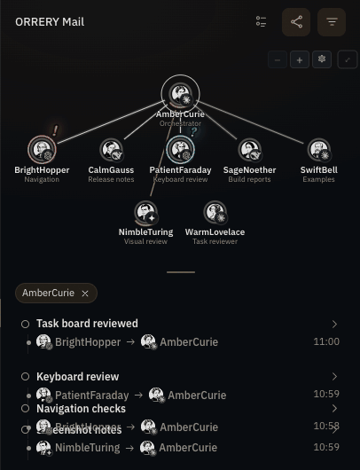
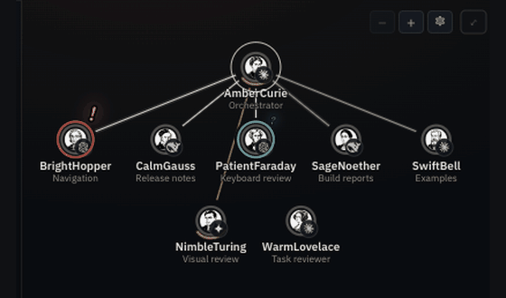

# Inspect an agent or watch it restart in Mini Graph

Hover over a node or move keyboard focus to it. The rail shows the agent name, role, model, harness, working folder, and Computer and Browser permissions. Select the node to open the terminal.

## While an agent restarts

Changing the permissions of a running agent and confirming **Restart** interrupts its work and resumes the same conversation. The node stays visible and shows **Restarting…** in place of its role.

[日本語](../inspect-mini-graph.md) · [Cockpit map](cockpit-map.md) · [Mini Graph reference](usage.md#mini-orrery) · [Watch Mail arrive](read-mail.md)
