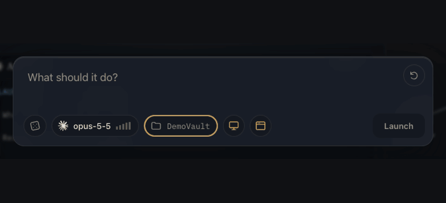

# Launchers and identity



> 日本語版: [launchers.md](../launchers.md)

[Previous: Installation](telemetry-install.md) · [Back to README](../../README.en.md) · [Next: Delegation and child agents](delegation.md)


To change tools in the same conversation, complete EXIT, confirm the child stopped, and use `"${AGENTSTACK_HOME:-$HOME/.agentstack}/bin/agentstack-resume" <NAME> --tools <spec>`. Do not preregister or create another child. See [procedure and limits](delegation.md#resume-a-stopped-child-with-different-tools).

## Launch commands

```bash
export PATH="$HOME/.agentstack/bin:$PATH"

agent-start ~/code/my-project
agent-start-codex ~/code/my-project
```

- `agent-start`: Claude Code
- `agent-start-codex`: Codex CLI

If the directory argument is omitted and `fzf` is available, you can select a directory under `AGENTSTACK_BASE_DIR`. Otherwise, the current directory is used.

```bash
export AGENTSTACK_BASE_DIR="$HOME/Obsidian/MyVault"
agent-start
```

The precedence order is an explicit argument, the `fzf` picker, then the current directory.

## Launch workspace and reservation protection

Namespace selection is unchanged: installed `AGENTSTACK_PROJECT_KEY` still supplies the coordination namespace unless overridden by the existing environment settings. A path-shaped key can coordinate agents in different repositories and does not add that path to protection. Selecting a working directory does not change the namespace.

Top-level and delegated-child launches compute `AGENTSTACK_PROTECTED_ROOTS` from the ordered `AGENTSTACK_EXTRA_PROTECTED_ROOTS`, then the selected physical working directory. Git root discovery does not automatically expand protection: include an ancestor explicitly in extras if needed. Aliases and duplicates are collapsed in order. Resume and persistent-agent re-resolution are follow-up work.

Inherited `GIT_DIR`, `GIT_WORK_TREE`, and `GIT_COMMON_DIR` do not choose the workspace and are removed from the launched process. Broken Git metadata stops the launch rather than selecting another directory. New tmux sessions receive the current workspace context instead of the server's stale roots; the server's global environment is not changed. `AGENTSTACK_VAULT`, Codex sandbox/approval, and OAuth behavior are unchanged.

Install/update automatically migrates the installed legacy protection list once. Ambient shell/tmux `AGENTSTACK_PROTECTED_ROOTS` is never imported; a different nonempty legacy value warns even when extras exist. Before cutover, finish work or release reservations, then restart affected sessions together: managed launches now use physical absolute file paths for reservation identity instead of first-matching-root-relative names. See [automatic protection migration](telemetry-configuration.md#reservation-protection-and-migration).

## Codex and the Node.js PATH

Codex children select and validate the CLI with the shared `hooks/codex-bin.sh` functions, running `codex --version` in the login-shell launch context. Doctor uses the same selection and validation. The search includes nvm bin directories. If executable `node` exists beside the resolved Codex symlink target, that directory is included in the execution PATH. nvm version directories take precedence; shared prefixes retain existing command order and are appended when absent. If the selected node already resolves there, PATH is unchanged. For npm symlinks without adjacent node at the target, the selected shim's bin directory is used when it contains node. Otherwise the login-shell PATH and `~/.local/bin` apply.

The launcher requires its bundled `codex-bin.sh` and stops with reinstall guidance when it is missing or incompatible. Doctor prefers its adjacent helper and reports unavailable checks when it cannot use it.

Dashboard `SPAWN FAILED` reads the current launch interval, showing explicit reasons or the first ordinary error before registration cleanup errors. Candidate rejection details are added only when all candidates fail. If node cannot be found, check Node.js for the selected CLI installation.

Warm-pool selection is unchanged in this PR. The existing `claim-model` contract cannot prove a prestarted provider's cwd or protected roots; ensuring that boundary for warm-pool users and measuring the performance impact remain separate work.

## tmux session

When launched from outside tmux, the launcher creates a new named session and replaces the current terminal tab. From inside tmux, it renames the current session and runs the CLI in place with `exec`.

Matching the session name to the ORRERY Mail identity makes the following associations unambiguous:

- dashboard click-to-jump
- inbox signal delivery target
- transcript / history
- token recovery
- graceful EXIT / RESUME

The shell remains after the terminal process exits so that investigation and scrollback can continue.

## Scientist names

A new identity requested by a top-level launcher has the form `Adjective-Scientist` (hyphenated, for example `Windy-Fermi`). **The read-back from the `register_agent` response is authoritative for the actual registered name**, and some server environments remove the separator or coerce the request to another name. If the requested name differs from the read-back, the launcher explicitly reports the substitution and aligns a not-yet-started top-level session with the read-back name. A reserved / resumed identity that already has a task, token, and inbox attached does not adopt a different name and stops instead.

- adjectives are the 134 words in `bin/lib/agentstack-scientists.sh`
- scientists come from `dashboard/scientist_portraits.json`
- the scientist suffix is the portrait key
- only scientists whose names contain ASCII alphabetic characters are candidates

The 134 words are synchronized word-for-word with ORRERY Mail's canonical `SIMPLE_ADJECTIVES` Round 3 list. Strict ORRERY Mail deployments validate generated names against the canonical list, so do not add a custom word only on the ORRERY Telemetry side.

The launcher, dashboard catalog, suggestion API, and child preregistration share the same adjective and scientist sources. Keeping the naming sources unique prevents drift among portraits, registered names, and server-side validation.

## Name availability and fail-closed behavior

Candidate availability has three states.

| State | Meaning |
| --- | --- |
| `available` | Confirmed that no identity with the same name exists in the project |
| `occupied` | An identity with the same name exists |
| `unknown` | Cannot be checked because of a transport failure, authentication error, timeout, unavailable database, or similar condition |

`unknown` is not treated as an available name. By default, the launcher's availability probe stops after three consecutive `unknown` results. This fail-closed design prevents acquisition of a potentially conflicting identity during a communication failure.

After the dashboard spawn checks availability on the scientist rail, it validates the full name again through `/api/suggest-name`. It normalizes the specified name by removing `-` and rejects it unless its exact status is `available`. See [Dashboard](dashboard.md#new-agent) and [API](https://github.com/gyroid-eth/orrery-telemetry/blob/master/docs/api.en.md#post-apispawn) for details.

## Identity registration

The launcher registers an identity with ORRERY Mail before starting the CLI.

1. Remove stale `AGENT_NAME`, `PARENT_AGENT`, token, and reserved marker values
2. Generate a candidate name
3. Check ORRERY Mail health
4. Register with project key, program, model, and task metadata
5. Compare the requested name with the returned canonical name. On a mismatch, a top-level launch reports it and renames the tmux session to the returned name; a reserved identity stops
6. For Codex CLI, record this launch expectation with the numeric agent ID
7. Update the managed agent list

If `AGENTSTACK_PROJECT_KEY` is unset or ORRERY Mail is unreachable, the CLI itself still starts with the preselected name. Mail, reservations, and project-scoped dashboard features are unavailable, however.

Claude Code hooks also record registration inside the session. For Codex CLI, `agentstack-codex-bootstrap` handles registration and tmux renaming and also creates a fresh `launch_id` before startup. The official SessionStart hook completes the receipt only after validating the runtime `session_id` against the rollout header. Without that receipt, Codex History does not fall back to a guess.

## Registration token

Reregistering an existing identity requires that identity's `registration_token`. A top-level token is stored with mode `0600`.

```text
${AGENTSTACK_RUNTIME_DIR:-$HOME/.agentstack/runtime}/agent_token_<name>
```

A delegated child additionally has child-owned state at:

```text
${AGENTSTACK_RUNTIME_DIR:-$HOME/.agentstack/runtime}/child-agents/<name>.json
```

### Additional harnesses through standard spawn (opt-in)

`spawn_child.sh --harness dsh|hermes --backend deepseek|strata --model <formal-id>` uses the ordinary child identity, registration binding, actual working directory, tmux session and product Mail proxy. Explicit opt-in and a separate plain runtime generation are required. The launcher generates native config and runs the upstream CLI in the pane, with no runtime supervisor, network allowlist, usage requirement or task lifetime. A report does not end the pane. Omitting `--harness` keeps the existing Claude/Codex path.

Private `harness_state_dir` contains the initial prompt, native launch plan and concise native instructions. Their source is `bin/lib/harness_instructions.md`; the existing shared renderer includes common startup and Mail rules. Initial launch and resume of the same ID pass them to dsh's `AGENTS.md` or Hermes's system prompt. They omit ORRERY child-creation procedures, raw authentication recovery and instructions for other runtimes. Shared-edit reservations, the private scratch exception and stop conditions remain. dsh tool-subagent, Hermes auxiliary/delegation settings and skill distribution are unchanged, as are the Claude/Codex instruction bodies.

dsh children also read the personal skills a Claude child reads (`$CLAUDE_CONFIG_DIR/skills`, or `~/.claude/skills` when that variable is unset). In dsh-tui the agent preset owns skill discovery, so the launch plan sets `DSH_AGENTS_HOME` to the Claude configuration directory and dsh searches `$DSH_AGENTS_HOME/skills`. dsh gives priority to a personal skill when its native scanner accepts the declared frontmatter name and that name matches a product skill. The launcher removes an earlier link only when it points to the matching product skill. It checks the directory again immediately before updating the links at each launch and resume. If the directory disappears during the check or the scanner cannot read it, the launcher restores the product links and records the reason in `personal-skills.json` in the child's `harness_state_dir`. The user's settings and skills are never rewritten for this. Because `DSH_AGENTS_HOME` changes, dsh's default `~/.agents` skills and `AGENTS.md` are no longer read; `$CLAUDE_CONFIG_DIR/AGENTS.md` is read instead when it exists. Hermes children keep the product skills as before.

Credential values and parent tokens are not included in the instructions. Additional plain stdio/HTTP MCP selections use the common tool policy. Explicit approvals or filters that the native configuration cannot express stop the launch. Installer defaults apply items that can be represented in native configuration and report any items they omit. Native tool adapters call the existing credential-read, registration and reservation hooks.

New Hermes children use `children/<SHA256 of project key>/<canonical name>` beneath the
generation-external profiles directory as their persistent `HERMES_HOME`. Different names or
projects have different homes. Standard resume for the same project and canonical name checks
the saved HOME pin and exact native session ID, then uses the same home. Normal exit does not
delete it. Native MEMORY/USER enable flags and limits stay unchanged. Shared memory, auth,
`.env`, user configuration, allowlists and personal skills are not read and distributed to new
children. The existing generator configures routes, guards, Mail and product skills in an empty
home. Unspecified settings therefore use native defaults rather than saved shared-profile effort
or other personal settings.

Resume with an old shared-HOME pin stops explicitly with `native_resume_legacy_profile`.
It does not rewrite shared data or pins, migrate conversation databases, or switch silently to
a fresh conversation. Deployment requires explicit operator acceptance of the affected legacy
resume interruption. Missing or mismatched pins and missing homes are rejected before rewriting
resume Mail configuration, prompts or instructions. Resume also checks that HOME/state.db exists
and is readable, returning `native_resume_history_missing` if unavailable; fresh launch does
not require a database. This file check does not read database contents or prove that the
requested session or conversation history exists. Memory restoration still
requires a real CLI exit/resume acceptance check of both stored values and the initial memory
snapshot; matching conversation text alone is insufficient. Managed-setting refusal and notices
remain in place. No automatic GC or purge is added.

Exit uses the same `cleanup-child-agent.sh <name>` as Codex. For all providers, failed release/retire acknowledgments or unavailable retired `whois` confirmation return nonzero and preserve identity state and owner credentials for recovery.

Ordinary Claude/Codex launches that register directly also call this cleanup after a startup failure, once stopping is confirmed. An unacknowledged creation request preserves state, credentials and the worktree without killing a possibly unrelated same-named session or releasing/retiring its identity. Unconfirmed stopping or Mail cleanup also preserves recovery material, and launch exits nonzero. Confirmed retirement after a failed start deletes credentials and state immediately; normal-exit resume retention does not apply. A Codex self-update hands its retained identity to the watch, which removes the worktree only after stopping and common cleanup are confirmed. Otherwise it records unknown cleanup and preserves recovery material. Preregistered startup rollback keeps its existing behavior.

The parent's token is not given to a preregistered child. Dashboard spawn generates a child-specific token and passes it to `spawn_child.sh --pre-registered` through a temporary mode-`0600` token file. For Claude / Codex, it accompanies that token with a non-secret `.binding.json` sidecar containing the formal registration response's numeric ID, name, project, and program. The launcher validates both. Both Claude and Codex validate the incoming receipt’s formal ID, name, project, provider and private token before writing canonical files, and consume the handoff only after startup preparation succeeds. Validation failure leaves the handoff and existing canonical credentials/state untouched. Startup failure removes files created by this attempt and restores replaced canonical material from a private undo record. The token stays out of transcripts, command-line arguments, and dashboard responses.

`agentstack-preregister-child` also saves Claude / Codex's formal registration response in the mode-`0600` canonical token and child state above, rather than only in the temporary handoff. Therefore `spawn_child.sh --pre-registered <name> --codex ...` can omit `--child-token-file` and still create a fresh expectation from the token, numeric ID, name, project, and program that came from the same registration. A complete child state may restore a missing canonical token, but the launcher does not guess from corrupt metadata, a project/name/provider mismatch, or token and state from different registrations. For a child that has never started, rerun `agentstack-preregister-child` for the same project, or pass a temporary token and its matching `.binding.json` through `--child-token-file`. Preregistering a child that has already run registers a different name and leaves two agents in the same role. A Claude child from an earlier version (three-field state) is adopted as described in "Migrating Claude children created by older releases" below. A registered Codex child stops before CLI startup when it cannot persist a fresh expectation. Relaunching with `--pre-registered` a child that has run before first asks ORRERY Mail (`whois`) whether it is retired. If it is, the launcher calls `unretire_agent` with the child's own token before starting it, since Mail refuses messages to a retired agent. Mail decides, not the local state, which says nothing after the dashboard's retire button or for an earlier-version child. If the child cannot be made active it is not started, and a failed start retires it again. When Mail cannot be asked and the state does not say retired, it starts with a warning. A fresh preregistration costs no Mail call.

If a launcher is forcibly interrupted and leaves `child-agents/.<name>.registration-pending.json`, this undo record also contains owner credentials and is private mode-`0600` material. Each attempt has a `generation` nonce; an older launcher cannot finalize or restore a newer attempt. Extract only the `generation` field for the command below; do not print the record containing credentials. After the operator confirms that the target tmux / CLI is no longer running, `python3 ~/.agentstack/hooks/child_resume.py finish-registration --runtime-dir <runtime> --agent-name <name> --generation <generation> --rollback` restores the pre-launch canonical material. Do not run it during startup. Explicit and expired-material purge also remove this undo record.

The default `/delegate` path is `--pre-registered --embed-task --task-file <path>`. The parent writes the complete task to a temporary mode-`0600` file, and the launcher embeds it into the first Claude / Codex prompt together with the child name, parent name, spawn time, project key, and instruction to use `send_message` at completion. There is no registration, reregistration, or `fetch_inbox` startup ritual. When a later notification contains a preview or omits the body, use `fetch_inbox` if you need to read the message. This prompt is the only source of truth, so do not send the same child a separate task mail. `--task-file` takes precedence over the positional task argument and is also the boundary that prevents the shell from interpreting backticks or `$()` in the task.

`CHILD_REGISTRATION_TOKEN` is a historical variable name, but it is also used to reauthenticate top-level identities.

### Migrating Claude children created by older releases (#140)

Claude children created before 2026.09.30.3 may have a state with only `agent_name`, `project_key`, and `registration_token`. Resume accepts this known format only with an existing exact Claude registration and an already registered owner. Roster checks read the private state/canonical-token match without migrating, registering, or unretiring. An explicit resume authenticates the saved token and verifies the returned numeric ID, exact name, Claude provider, and project ID before migrating to schema 1 and regenerating the child Mail proxy. It does not issue another identity/token or claim an unowned row. Failed authentication refuses startup.

The old state has no retirement timestamp, so migration never infers one from mtime. Successful owner authentication starts a one-time grace period of the configured retention days (30 by default); subsequent normal completion follows the usual retention policy. Retention `0` also refuses legacy migration. Polling never extends an expiry. Incomplete modern states, expired material, tombstones, and pending attempts do not qualify as legacy.

Migration uses a private undo record tied to its nonce. Failed startup preparation restores the old state/MCP config bytes, modes, and mtimes and the original Mail/husk state. A stale rollback after purge or another attempt changes nothing. If forced interruption leaves `child-agents/.<name>.legacy-migration.json`, extract only its `generation` field without printing the record containing credentials. After the operator confirms the target tmux/CLI is stopped, restore the old material with `python3 ~/.agentstack/hooks/child_resume.py finish-legacy-migration --runtime-dir <runtime> --agent-name <name> --generation <generation> --rollback`.

Migration authenticates through bundled Mail's `register_agent(existing_agent_id=...)`, checking only the exact existing ID, name, project, program and owner token. Ordinary registration, name generation and profile updates do not run. An unavailable schema refuses with `config_unrestorable` and update/restart guidance; supported Mail rejecting authentication still returns `credential_missing`. A retrieved schema confirming older Mail selects the conversation-only mode below.

`spawn_child.sh --pre-registered <name>` (Claude, without `--child-token-file`) adopts a three-field legacy state the same way: it passes the same `register_agent(existing_agent_id=...)` check first, then launches under the same name. The ID and program it checks come from `whois`. If the check fails, or Mail has no `existing_agent_id`, it stops without changing the state or token. The adopted state has the same five fields as an ordinary preregistration, and a failed start restores the legacy state from the undo record. Codex children have no legacy migration.

Exiting before migration also preserves the private known three-field state and matching canonical token, including their bytes, modes, and mtimes. Generated MCP config is removed as usual. Cleanup does not guess a formal ID, provider, or retention timestamp; later explicit resume authenticates the owner and migrates. No expiry is inferred before that migration. Invalid legacy permissions, name, token match, or pending checks return an error and preserve the state/token instead of deleting them. Retention `0` remains an explicit opt-out that deletes legacy state/token on exit.

### Resuming a Claude conversation when Mail cannot be restored

A normal `install.sh` update adopts the running Mail deployment without switching its build. A legacy child whose retrieved schema confirms the existing-owner option is absent, a Claude agent whose canonical token file is actually missing, or an agent with safely verified expired retention can resume its terminal and conversation. With supported Mail and valid credentials, the full authentication, migration and unretire path remains in use.

Conversation-only resume returns `resume_mode: conversation_only`, `mail_status: unavailable`, a fixed `mail_reason` (`credential_absent` / `retention_expired` / `mail_schema_unsupported`), and `mail_message` stating that this agent cannot send or receive ORRERY Mail. The DECK chip, NETWORK label/details and an initial terminal line show the warning. `resume_capability: ready` verifies conversation-resume prerequisites; it does not prove successful Mail owner authentication. Before resuming, a row's `resume_mode` (`mail` / `conversation_only`) in `/api/agents` / `/api/graph` says which one it will be.

This mode uses an empty `--strict-mcp-config` and `--settings '{"disableAllHooks":true}'` to suppress ordinary user/project/plugin MCP and hooks. Other MCP servers and hooks are also unavailable for this launch. A tmux-session `AGENTSTACK_MAIL_DISABLED=1` prevents product automatic registration, cleanup, reservation hooks and watcher notifications. State/token files are not migrated, removed or overwritten, and Mail registration, claim, unretire and retire do not run. Notification signals remain unread. Ordinary registration is never substituted for existing-owner authentication on older Mail.

Before classifying absence or expiry, existing material is checked for UID, mode, regular-file type, identity, token agreement and pending attempts. Empty/invalid tokens, authentication rejection, mismatch, unsafe files/symlinks, corrupt state/config, another identity, pending attempts and explicit purge refuse startup. A failed schema request is not evidence of older Mail. Resuming an expired conversation does not renew Mail retention. Restoring Mail requires the [Mail update procedure](../agentstack-mail-update.md) or an operator credential-recovery decision; do not substitute registration or enrollment from the conversation.

## Reregistration

```bash
AGENTSTACK_PROJECT_KEY=/path/to/project \
  ~/.agentstack/bin/agentstack-reregister "$AGENT_NAME"
```

In an explicit global context, exit 3 means `observed` without refreshing registration; pass program/model and rerun the helper.

The helper reads the owner token from runtime state and restores the identity with the same name. Do not create a different name when same-name registration fails. A different name separates the inbox, thread, reservations, and audit history.

`agentstack-reregister` consumes an existing token; it does not issue one. For a parentless bot that never passed through a launcher, an initial claim of a `server-null` row, or explicit recovery after the exact `stage=local-token reason=credential-unavailable` diagnostic, an operator—not the model—follows [Persistent-agent enrollment and startup](persistent-agents.md). Ordinary restarts do not repeat enrollment.

## Persistent parentless agents

A bot that reuses the same identity after restart can run through an `agentstack-persistent` profile. The profile keeps provider, parentless status, persistent lifecycle, and interactive/headless mode in separate fields. It `exec`s the command only after matching the saved credential, Mail authority, and numeric row. It never enrolls automatically or creates an alias. Interactive Claude preserves the normal `--channels plugin:...` selector, inspects a finite set of effective configuration sources including `.mcp.json` files from the working directory through the filesystem root, current checkout-local settings for normal/separate-gitdir repositories, main-checkout local settings for linked worktrees, and installed plugins resolved through the effective inventory / marketplace registry / catalog, and replaces only standalone Mail aliases with same-named bound overlays. Unsupported plugin or managed configuration and unreadable effective sources are rejected before startup rather than guessed.

[Persistent-agent enrollment and startup](persistent-agents.md) is the operational source of truth for new bots, migration of existing bots, credential recovery, Claude Channels PTY preservation, headless bridges, and a second Mail instance or machine.

## `CLAUDECODE` guard

The launcher and child spawner set the following in each tmux session's environment:

```text
CLAUDECODE=1
```

This guard prevents an interactive shell's exit hook from cascading into termination of the entire tmux server.

The value is set with `tmux new-session -e` when the session is created, not in the tmux server's global environment, so that identities from other sessions cannot mix.

## Dashboard Claude resume

Normally completed Claude children retain mode-`0600` state and their owner credential for 30 days by default. The dashboard verifies the original project, numeric ID, name, program, credential, expiry, and permissions. It regenerates the child-owned Mail proxy configuration, re-registers the same identity using the saved credential, and calls `unretire_agent` to restore delivery before opening a terminal. A running child resume is protected from expiry purge and runs cleanup again when its CLI exits. Top-level Claude sessions use the same registration and unretire sequence when their existing owner token is available. The resumed session's SessionStart hook re-registers from the shell with the registered model (or `claude-code` when none is registered), handed as `CLAUDE_CHILD_MODEL`, never a model left in the tmux server environment. `AGENTSTACK_CLAUDE_MODEL` is left alone, so agents launched from that session keep their default model. For a top-level session (an owner token without child state) whose registration response confirmed that it was previously retired, a normal CLI exit re-retires it in Mail with the same token (a tmux kill or SIGHUP skips this). Reservations are left to the session's SessionEnd hook. Nothing is retired while the identity is live in another session: a tmux pane other than this one whose pane metadata names it, a running CLI behind a SessionStart lease under `runtime/live-sessions/<name>/<pid>` (the next SessionStart removes leases whose CLI has ended), or a pane list that cannot be read from inside tmux. The token is kept for the next resume, and an originally active identity is not retired.

A session reopened from a terminal with `claude --resume` is unretired only when the SessionStart source is `startup` or `resume`; on `/clear` or compaction a retirement made while the session ran stands, and the session is told it is retired: its SessionStart shell registration authenticates the saved owner credential, and when Mail reports the row retired it unretires only retained child state (within its period, same token, no resume in progress) or an owner token with neither child state nor a tombstone. Legacy three-field state, expired or purged material stays retired, with a one-line note to resume from the dashboard.

DECK can resume Claude with Mail after expiry if the operator subsequently recovers the credential for the same Mail identity and the conversation can resume without its original child-specific tool configuration. See [Resume Claude in DECK after retention expires](persistent-agents.md#resume-claude-in-deck-after-retention-expires) for the requirements and commands. Before recovery the conversation resumes with `mail_reason: retention_expired`. After an explicit purge, resume is refused with `purged`.

Resume never registers an alias or issues a credential. Failed Mail registration, unretire, or child proxy restoration also prevents Claude startup. Startup preparation creates a temporary detached tmux session and gates the CLI with `tmux wait-for`. Only after window opening and session-name replacement succeed does it release the CLI and dispose of the old husk. Failure removes the temporary session, preserves the original shell, and re-retires Mail only when the registration response confirmed that the identity was previously retired. An originally active identity is never retired as compensation. Failures of the restoration itself are explicitly reported in `rollback_errors`.

## Computer use for children

The standard launcher can give Claude, Codex, dsh and Hermes the generated relay by choosing `--tools mcp:orrery-screen` or `--tools screen:read:orrery-screen`. The operator API changes a running child’s permission. [Cua Driver setup and verification (Japanese)](../computer-use.md)

On macOS, use Computer use in NEW AGENT or choose `--tools screen:read` (View), `--tools screen:operate` (Control), or `--tools mcp:orrery-screen` (start in Off). Claude Code, Codex CLI, dsh, Hermes, and Antigravity CLI use Cua Driver through the existing `orrery-screen` relay. The older spelling `screen:operate:cua-driver` selects the same relay. Named MCP selections on Windows and WSL retain their existing behavior.

## Codex-specific startup

`agent-start-codex` performs the following steps.

- source `agentstack-codex-bootstrap` for registration and renaming
- fix the working directory with `codex -C <dir>`
- pass `--sandbox ${AGENTSTACK_CODEX_SANDBOX:-workspace-write}`
- pass `--ask-for-approval ${AGENTSTACK_CODEX_APPROVAL:-on-request}`
- pass `--add-dir` only when `AGENTSTACK_VAULT` exists
- remove `OPENAI_API_KEY` and prefer ChatGPT OAuth

Delegated Codex children use `danger-full-access` by default. The installer option `--child-sandbox on` applies `workspace-write` at launch and resume. `AGENTSTACK_CODEX_CHILD_APPROVAL` controls approvals and defaults to `never`. Selecting **Temporary Chrome** approves the Chrome DevTools tools ORRERY recognizes. [Child sandbox settings](telemetry-configuration.md#child-spawn)

Dashboard Codex resume also always sources the same installer-distributed `agentstack-codex-bootstrap`, re-registers the reserved identity, and creates a fresh resume launch before it execs `codex resume`. It does not depend on a personal wrapper under `~/.codex/bin`; a bootstrap, prepare, or unretire failure prevents resume from starting. Top-level resumes also call unretire.

A fresh Codex child launch records `launch_origin: child` and its selected `codex_mcp_profile` in the launch expectation. Top-level Codex sessions started by `cx` / `agent-start-codex` or the persistent launcher record `launch_origin: standalone` and carry no child profile. After the official `SessionStart` verifies identity and rollout, that non-secret provenance is copied into the bound session receipt with the numeric agent ID, project, and provider. The receipt remains outside private resume state, credentials, and the isolated home, so the dashboard can distinguish a cleaned-up child, a product-launched top-level session, and a session with unknown origin. A receipt created before provenance existed is not assigned an origin from its name or history and cannot resume.

Normal cleanup releases reservations, retires the remote identity, and deletes the child home, proxy runtime, and old MCP configuration. State carrying its schema, `retired_at`, and `resume_expires_at`, plus the canonical credential, is retained for 30 days by default (`AGENTSTACK_CHILD_RESUME_RETENTION_DAYS=0` restores full deletion). Dashboard resume matches the receipt, formal project, numeric agent ID, name, private state / credential, expiry, and permissions, then builds a new child home from the saved `codex_mcp_profile` and current source Codex home. It never reuses an old home or proxy-runtime snapshot.

Resume bootstrap uses the retained credential to re-register the same identity, writes a fresh binding expectation, and only then un-retires the remote identity. Unretire is the last operation before `codex resume`; earlier failures discard generated artifacts while preserving both the credential and retired state. An unretire failure also prevents Codex startup. Cleanup after a resumed run leaves a new provenance-bearing receipt and re-retains private material, so the same child can be resumed repeatedly.

In the interactive TUI of `codex-cli 0.154.0` and `0.156.1`, measurement showed the resume `SessionStart` hook firing after the first submitted user message, not while the composer remained idle. Resume bootstrap compares the dashboard-selected session ID with both the existing receipt and rollout header, then retains that receipt's exact `launch_id` / `receipt_id` as history authority only while the fresh resume expectation is unclaimed and non-conflicted. The same session can therefore be resumed again after exiting without a prompt. After the first submit, the official payload replaces the fallback with a fresh receipt only when its session ID matches both the pinned ID and header; a different ID, a conflict, or the next startup expectation invalidates the fallback. This timing statement is limited to the measured versions and is not a general guarantee for other versions or modes.

The SessionStart recorder writes JSONL timing records for lock acquisition, rollout-header validation, the launch transition, the receipt write, and the final outcome to `$AGENTSTACK_RUNTIME_DIR/codex-session-binding.log`. It does not record session IDs, launch nonces, transcript paths, or credentials. A `started` event without a matching `outcome` distinguishes a hook that was terminated in flight. The SessionStart hook deadline is five seconds so a cold start or brief lock wait does not interrupt receipt creation.

Codex child startup checks first use this launch's verified receipt and rollout. If they record the first task starting, no pane or `ps` observation is needed. In a sandboxed parent, Python's `ps` subprocess can be refused, leaving tmux ownership observation unavailable (`TMUX_TARGET_UNAVAILABLE`). A failed capture / has-session observation, timeout, or permission refusal is not evidence of death: the launcher records the reason code and return codes, reports startup unconfirmed, and preserves the same child identity and recovery state. After target observation becomes unavailable, pane operations stop and only this launch's receipt is checked for task startup until the deadline. Only explicit session absence is treated as death. Unconfirmed startup proves neither readiness nor task completion. The child may have stopped after observation became unavailable; the parent must await its normal Mail report or a verified receipt. CLI `start_unconfirmed` marks this distinction: exit status 0 confirms registration handling only. Check the existing child's normal ORRERY Mail report and verified receipt; do not automatically resend, spawn a replacement, switch transports, or force cleanup. Verify the actual model from the native display or corresponding execution record, rather than treating the registered model name as runtime proof.

Because an API key in the environment can override OAuth, it is removed only from the Codex subprocess.

## Mail watcher and REPL injection

When the mail watcher finds an ORRERY Mail signal, it injects notification text into the corresponding tmux session's Claude / Codex REPL.

Text and submission are separate operations.

```bash
tmux send-keys -t "$session" -l "$text"
sleep 0.2
tmux send-keys -t "$session" C-m
```

Codex may not treat the `Enter` keysym as submission, so the watcher uses `C-m`. It avoids accidental injection into a bare shell and runs tmux calls in workers with timeouts.

## Skills (2) and file reservations

The installer places the following skills in the canonical `~/.agentstack/skills` directory and creates absolute symlinks from Claude Code's standard discovery path, `~/.claude/skills/<name>`, to each canonical copy.

- [`/delegate`](https://github.com/gyroid-eth/orrery-telemetry/blob/master/skills/delegate/SKILL.md): declare and reserve resources, then launch and monitor a Claude / Codex child with an optional model and worktree
- [`/log`](https://github.com/gyroid-eth/orrery-telemetry/blob/master/skills/log/SKILL.md): organize session decisions, changes, verification, and next actions into a reusable Markdown log

A Claude Code session that was open before installation does not discover the newly added skills. Run `/exit` once and relaunch with `agent-start <project>` from a new terminal.

### `/delegate`

`/delegate` is not merely a shortcut that launches a child.

ORRERY Telemetry delegation must be entered with the leading slash as `/delegate ...`. `delegate ...` is an ordinary prompt, not an invocation of this skill. If Claude handles it with a built-in subagent / Agent tool, it may produce an artifact, but it does not create ORRERY Telemetry identity, reservations, a dedicated tmux session, or dashboard telemetry. Do not use the built-in Agent tool in place of `/delegate` when the objective is to create an ORRERY Telemetry-monitored child.

Talking to the child has the same boundary. Claude Code 2.1.224 and later can message other local sessions with the built-in `SendMessage` / `ListAgents`, and an ORRERY child in tmux is one of them, so a message sent that way arrives but leaves no ORRERY Mail record and nothing on the dashboard. The `/delegate` skill description and the managed block both tell Claude to use `send_message`. If you want Claude Code to refuse the built-in route outright, add a deny rule yourself; the installer does not, because the same rule also removes messaging to built-in subagents and agent-team teammates:

```json
{
  "permissions": {
    "deny": ["SendMessage", "ListAgents"]
  }
}
```

| Item | Details |
| --- | --- |
| Trigger | A request to delegate to a child, launch a subagent, or perform parallel work |
| Basic form | `/delegate "<task>" [--dir <path>] [--codex] [--model <model>] [--codex-mcp <inherit\|orrery-only>] [--worktree] [--worktree-base <rev>] [--claude-chrome \| --claude-chrome-device <id>] [--base <default\|mail-only>] [--tools <spec>]...` |
| Required prerequisites | The parent's ORRERY Mail identity and canonical project key. Editing tasks require a resource declaration and reservation |
| Optional prerequisites | `--worktree` requires a Git repository; dashboard annotation requires the dashboard service |

The parent agent does not finish when it hands off the task. It remains responsible for deciding scope and risk, making reservations, monitoring, and verifying the artifact. Use `--codex` for a Codex child, `--model` for an allowed model, and `--dir` to choose the child's working directory.

`--base mail-only` and `--tools browser[:<deviceId>]` / `screen[:read|:operate]` / `screen:<read|operate>:<server>` / `mcp:<server>[:all]` choose the tools a child gets. A child with a selection is not started when the selection cannot be applied ([Choosing the tools a child gets](delegation.md#choosing-the-tools-a-child-gets---base----tools)).

New Claude, Codex, dsh and Hermes launches use the installer's `AGENTSTACK_CHILD_DEFAULT_TOOLS` (empty by default) when base/tools/MCP profile are omitted on the CLI or base/tools are omitted from the standard `/api/spawn`. The launcher reports and omits unavailable default items. Explicit `--base default` suppresses those defaults. Resume restores the recorded selection ([Installer defaults](delegation.md#installer-defaults)).

Codex children default to MCP profile `inherit` for backward compatibility. `/delegate --codex-mcp orrery-only` keeps authenticated ORRERY Mail and the session-binding plugin while disabling other inherited MCP servers and plugins. Do not use it for tasks that require plugin skills or external app tools.

Where the Claude aliases point lives in `dashboard/claude_models.py`; Codex model and effort policy lives in `dashboard/codex_models.py`. For Claude, an omitted model and `opus` / `sonnet` / `haiku` / `fable` resolve to the model the local Claude Code model catalog names as current for that family, falling back to the bundled table (currently `claude-opus-5-5` / `claude-sonnet-5-5` / `claude-haiku-4-5-20251001` / `claude-fable-5-1`); the launcher output and doctor say which was used. Versioned aliases such as `sonnet-5-5` (also `sonnet55`, `Sonnet 5.5`), `sonnet-5` and `opus-5-5` pin a generation and live in `spawn_child.sh`. `claude-opus-5` / `opus-5` remain valid compatibility forms for explicitly requesting the prior generation. Codex family aliases follow the fresh local catalog as described below. Full IDs for older generations remain valid for compatibility, but the warm pool is used only when the requested model is what the `opus` / `sonnet` aliases resolve to and the pool's status names that formal ID in parentheses (for example `opus ready (claude-opus-5-5)`). The claim is `warm_pool.sh claim-model <type> <child-name> <formal ID>`: the pool must atomically claim only a session started with that model and print `<child-name> <formal ID>`, so a pool that changed after the status check cannot hand over another model. A pool without `claim-model`, or one that refuses, gets a cold start; a claim that reports another model is stopped and the launch aborted. The child runs the `claude` path that `hooks/claude-child-bin.sh` finds in the child's login shell (with `~/.local/bin` first), and alias version checks use that same binary. The dashboard runs the same script at startup and before a launch with an omitted model, and the NEW AGENT default follows its answer. If the run before a launch fails (a timeout, for example), the launch stops with an error before registration instead of deciding on the previous answer; launches with an explicit model and dry runs do not run it. Opus 5.5 requires Claude Code 2.1.280 or later.

With no configured default, Codex omission starts from `gpt-6.1-sol` with the selected CLI 0.159.0+, or `gpt-6-sol` on older versions; unknown versions use fresh catalog evidence for the initial decision. If that ID is absent from the selected `CODEX_HOME/models_cache.json`, choose the next cached candidate in order: `gpt-6.1-sol` → `gpt-6-sol` → `gpt-6-luna` → `gpt-5.6-terra` → `gpt-5.6-luna`. Expired snapshots can lower the default, while candidate additions and effort metadata still require a cache fetched within 300 seconds. An older CLI never moves up to GPT-6.1 Sol. Without a usable cache or next candidate, the existing default remains. Explicit formal IDs are never substituted.

`AGENTSTACK_CODEX_DEFAULT_MODEL` and `AGENTSTACK_CODEX_DEFAULT_EFFORT` configure omitted values; explicit requests take priority. The `sol`, `terra`, `luna`, and `astra` aliases follow the latest eligible numeric family version in the fresh catalog, rejecting a missing family in a fresh catalog and using bundled fallback when the catalog is unavailable or stale. See [configuration](telemetry-configuration.md#codex-model-catalog).

Both IDs and the reason are reported in launcher output, doctor, API `model_note`, and NEW AGENT. A stale snapshot also reports `fetched_at` and guidance to start `codex` once to refresh the list. Before registration, `/delegate` uses the shared `resolve` command for the CLI and model, relays its notice to the operator, and uses the returned formal ID for both registration and launch. Cache `identity` is not checked against the current login: a snapshot retained after switching accounts may differ from the new account's access, and neither candidates nor fallback prove authorization. See [Codex model catalog](telemetry-configuration.md#codex-model-catalog).

1. Determine risk and monitoring cadence from the target resources, exclusivity, failure points, and reversibility
2. Create a child-owned token and canonical name with `agentstack-preregister-child`
3. Prepare the file reservation, contact, and mode-`0600` canonical task file
4. Launch Claude / Codex with its model and worktree through `spawn_child.sh --embed-task --task-file` (do not send task mail)
5. Read the ORRERY Mail completion report and `monitor_child_agent.sh`, then verify the artifact yourself
6. Release the reservation before reporting the parent's result

A worktree child's cwd changes to `${AGENTSTACK_WORKTREE_ROOT:-$AGENTSTACK_HOME/worktrees}/<name>` (normally `~/.agentstack/worktrees/<name>`), but its ORRERY Mail project does not change. The task must identify `AGENTSTACK_PROJECT_KEY` / `PROJECT_KEY` as canonical. `--worktree-base <rev>` fixes the baseline for multiple children. Existing `/tmp/cc-worktrees` entries are not migrated; only new spawns use the persistent root.

The monitor's dangerous-command detection is passive by default. When enabled with `AGENTSTACK_MONITOR_DANGER_CHECK=1`, a match causes a soft stop. Repeated stasis with unchanged output escalates through soft stop, `C-c`, process-group freeze, then session kill regardless of that setting. See the skill text for the exit codes.

### `/log`

| Item | Details |
| --- | --- |
| Trigger | A request to create a session log, summarize current work, or save decisions, changes, and verification |
| Basic form | `/log <theme> [project]` |
| Required prerequisites | A theme. Ask only when the project is not obvious and cannot be inferred safely |
| Optional prerequisites | Obsidian mode requires `AGENTSTACK_OBSIDIAN_APP` and an `AGENTSTACK_PROJECT_KEY` inside the vault |

`/log` uses Obsidian mode only when `AGENTSTACK_OBSIDIAN_APP` and `AGENTSTACK_PROJECT_KEY` are both set and the project is inside the vault. It connects to existing project `logs/` and daily-note conventions when present, and does not guess a private directory structure when no convention is found.

Otherwise, it writes to:

```text
<git-root-or-cwd>/logs/LOG_<YYYY-MM-DDTHHmm> <Theme>.md
```

The log is not a transcript. It focuses on Goal, Decisions, Work Performed, Verification, Related Notes, and Next Actions.

After writing the log, the agent passes its path to ORRERY Mail's `show_files`. In an ORRERY-launched session the cockpit's History then shows the log as a file chip that opens a preview drawn as Markdown. The first time on a machine, and only when the log is inside the session's working folder, the agent adds one line about this in the language you are using. Delete `${AGENTSTACK_RUNTIME_DIR:-~/.agentstack/runtime}/hints/log-history-preview` to see it again.

### Hooks and reservation enforcement

Claude Code hard-blocks `Edit` / `Write` through the `check-file-reservation.sh` PreToolUse hook. Codex has no equivalent hook, so the managed `~/.codex/AGENTS.md` instructs reserve / renew / release discipline. The registry is shared, so Claude and Codex reservations are mutually visible.

Writes through `Bash`, scripts, or other tools are not checked or automatically released by Claude's reservation hooks. Release the reserved files yourself immediately after writing: bound proxy `release_reservations`, raw/direct `release_file_reservations`.

See [Hooks and operational helpers](https://github.com/gyroid-eth/orrery-telemetry/blob/master/docs/hooks.en.md) for the trigger timing, caller, block conditions, and cleanup lifecycle of the repository's 11 hooks / helpers.

## Related documentation

- [Hooks and operational helpers](https://github.com/gyroid-eth/orrery-telemetry/blob/master/docs/hooks.en.md)
- [Persistent-agent enrollment and startup](persistent-agents.md)
- [Codex App integration](codex-app.md)
- [Dashboard](dashboard.md)
- [Configuration](telemetry-configuration.md)
- [Troubleshooting](telemetry-troubleshooting.md)
