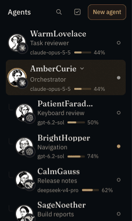
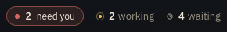

# Check and select agents

1. Select an agent in **Agents** on the left to open its terminal.
2. Turn on **Select** to choose several agents.
3. To exit those agents together, select **Exit**, check the count, and select **Confirm**.

**Working** counts agents doing work. **Waiting** counts agents ready for their next instruction. Select **need you** to filter for agents waiting for an answer or approval.

Select a waiting agent to read its question, then answer in the composer. For supported approvals, [respond from Reader](usage.md#approvals-in-reader). In the embedded [Telemetry dashboard](view-telemetry.md), use **SELECT** for bulk **EXIT**.

## Send one instruction to several agents

1. Turn on **Select** in **Agents**, select the agents, then choose **Message**. You can also type `@` in the composer and add recipients one at a time by searching for the start of their name or role.
2. Check the recipients in the composer. **Unavailable** lists any selected agents that **Message** skipped. The `@` suggestions show a reason, such as an agent being stopped.
3. With **Visible recipients**, a regular message includes the names of the other recipients and explains that they can contact each other through ORRERY Mail. Choose **Hidden recipients** to keep their names private.
4. Write the instruction and send it. The result shows which recipients received it and which still need attention.

[日本語](../manage-agents.md) · [Cockpit map](cockpit-map.md) · [Roster and selection reference](usage.md#roster)
