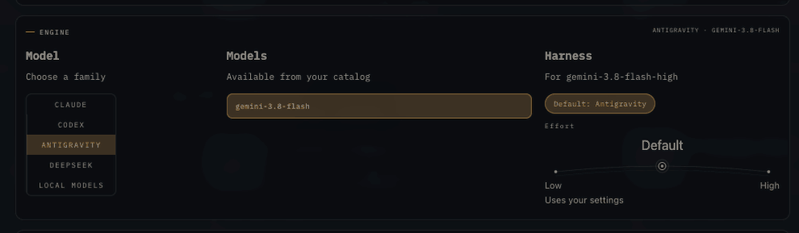

# Set up DeepSeek or Local LLMs



Install dsh or Hermes and set up the connection and credentials. Choose the model and harness in NEW AGENT and verify the launch.

<a id="add-deepseek-or-local-models-to-an-existing-orrery-installation"></a>

> 日本語: [native-setup.md](../native-setup.md)

Use this guide after installing ORRERY's shared components to prepare DeepSeek or Local LLMs. You do not need to install or sign in to Claude Code or Codex first. **An ordinary install or update does not install dsh/Hermes or save a new API key on this computer.** If ORRERY is not installed, first [install it with the cockpit](install.md) or [install Telemetry on its own](getting-started.md#standalone-installation-and-verification), then return here. The preparation below is shared by both interfaces.

The cockpit is the interface for working with terminals. Telemetry tracks agents and handles their launch requests. Prepare the API connection on the Telemetry side; then either NEW AGENT screen can use it. There is currently no API-key field or complete connection-setup wizard in NEW AGENT.

### Local servers: configure URLs once

For dynamic Local connections, give your agent the [one-time migration procedure](https://github.com/gyroid-eth/orrery-telemetry/blob/master/examples/native-harnesses/README.en.md#dynamic-local-connections). Each connection has your chosen label, one or more API URLs and an optional context fallback. Both NEW AGENT screens list model IDs returned by those servers, grouped by connection. A new model on an existing URL needs no per-model ORRERY configuration or reinstall. Existing fixed-model connections continue to work until you choose to migrate them.

This section requires Telemetry API33 or newer and the matching cockpit picker update. Update both before migrating a connection; the older fixed-model instructions below remain compatible.

| Who | Step |
| --- | --- |
| Your agent | Read the procedure; prepare a separate private copy, retain the existing OS credential references and runtime paths, move each Local connection to `model_source: server`, and show the non-secret diff. Run static validation without fetching a key or contacting a server. |
| You | Review the URLs and diff; enroll or unlock credentials through the OS only if needed. Approve using the new manifest. |
| Your agent / you | Follow the ordinary plan/dry-run and install procedure with that manifest; reload both interfaces and choose the intended connection, URL number and model. Coordinate one short real acceptance task separately. |
| Your agent / you | To recover, use the saved old manifest with the same ordinary install procedure. Do not rewrite retained sessions to a different URL or model. |

The product reads the existing protected credential reference for model listing and checks the selected URL once again just before generating a launch/resume command. It does not start or stop server models. `Available` means a returned ID without an explicit unloaded flag; it is not proof that the server has loaded it. A server change after the final lookup, a replacement run with the same ID, or a server that ignores the requested ID is outside that observation. Existing dsh protocol and Hermes HTTPS requirements below still apply.

**If you use an older version, complete the ordinary update first.** This guide requires Telemetry 2026.10.22 or newer. Check the installed version by running `cat "${AGENTSTACK_HOME:-$HOME/.agentstack}/VERSION"` in your terminal. If it is older or you cannot determine the version, consult the [Telemetry update instructions](telemetry-install.md#upgrade). If you also use the cockpit, its [update instructions](install.md#install-or-update-with-one-line) cover updating both applications. Older installers may not recognize the options used below. After updating, continue with installing dsh/Hermes and saving the key. Updating is a prerequisite; the initial API setup is a separate step.

## 1. Choose a provider and a harness

| Choice | What it does | What you need |
| --- | --- | --- |
| DeepSeek | Calls DeepSeek's hosted API | A DeepSeek API key and API balance |
| Local models, such as Strata | Connects to a compatible server you or an administrator runs | A compatible API URL, model ID and its own access key. The current path requires a credential reference |
| dsh | Runs the conversation and tools; short for DeepSeek Harness | Install it through ORRERY; it needs Node.js 24.2 or newer |
| Hermes | An alternative application for running the conversation and tools | Install it through ORRERY |

Pick one provider and one harness, such as DeepSeek + dsh. You can install both harnesses without creating two API keys for the same provider. You do not need a DeepSeek account to use a Local server.

**Check the Local server's protocol before setting it up.** dsh uses the fixed DeepSeek adapter and accepts HTTP/HTTPS URLs for compatible APIs. Hermes requires HTTPS and either `chat_completions` or `anthropic_messages`; you cannot give it an HTTP-only endpoint directly. The legacy Local example uses the connection ID `strata`, but this is not a Strata hostname restriction. Nor does it guarantee that every server advertised as OpenAI-compatible will work.

**A Local configuration that stores and references no key is not currently supported by ORRERY.** Both harness paths require a reference to a key saved in the OS. Do not invent a dummy key for a server without authentication. Obtain a compatible endpoint with authentication before continuing with this guide.

**Verification status:** API launch paths are implemented for macOS and Linux/Ubuntu WSL in legacy mode. Native Windows API launching is outside this scope. Not every DeepSeek/Local × dsh/Hermes combination has been verified from a fresh installation using the standard examples. WSL in particular needs a working keyring, GUI prompts and services using the same user's bus. A visible catalog entry does not prove key storage, API access, Mail delivery, exit or resume.

This is separate from your Claude Code or Codex login. API launching currently supports the [documented combinations](https://github.com/gyroid-eth/orrery-telemetry/blob/master/docs/managed-catalog.en.md) using ORRERY Mail's legacy connection mode. Global mode is a different Mail connection mode and is outside this guide's scope. Ask your agent if you are unsure which is active; do not switch modes merely to follow this guide.

## 2. Install the harnesses

Run commands in your **Mac terminal application** or, on Windows, **inside Ubuntu**. Do not paste Linux commands into PowerShell or Command Prompt.

Open the folder containing ORRERY Telemetry's source code, also called its checkout. It is separate from the cockpit folder. The one-line installer's default location can be opened with:

```bash
cd ~/orrery-telemetry
```

If you get `No such file or directory`, it may be elsewhere. If you cloned it yourself into a folder such as `~/src/orrery-telemetry`, open that folder instead. You can ask your existing agent to locate the source using `repo_root` in the existing `install-state.json`. Do not create another installation without checking.

Only if you have confirmed that the source is no longer available, obtain a fresh checkout. This example requires that `~/orrery-telemetry` does not already exist:

```bash
git clone https://github.com/gyroid-eth/orrery-telemetry.git ~/orrery-telemetry
cd ~/orrery-telemetry
```

To install both harnesses, first check that Node is at least 24.2 and that its executable is reported as an absolute path:

```bash
node --version
command -v node
```

If Node is missing or too old, install a suitable version from the [official Node.js distribution](https://nodejs.org/en/download) before continuing. ORRERY does not download Node itself. Then run this in the **same terminal, inside the Telemetry checkout**:

```bash
./scripts/install.sh --keep-mail --enable-dsh --enable-hermes --dsh-node "$(command -v node)"
```

For dsh only, omit `--enable-hermes`. For Hermes only, omit `--enable-dsh` and `--dsh-node ...`. Previously enabled harnesses are retained during ordinary updates; omitting a flag does not remove one you already installed.

The first download and setup may take several minutes. If the installer shows proposed settings changes and asks yes/no, review them before choosing. The number of prompts depends on your existing settings and the changes needed. `--keep-mail` keeps the running ORRERY Mail build instead of switching it. See the [installation reference](telemetry-install.md) for the full scope of changes.

Keep the `Install complete` output and the path printed after `inactive snapshot (copy and finish setup): ...`. A snapshot is a set of example settings with the installed application paths filled in. If an existing example is retained, the message is `kept snapshot (not revalidated): ...`. You have installed the applications, but have not yet proved that an API connection works.

## 3. Obtain the provider's key

### DeepSeek

1. Open [DeepSeek's API-key page](https://platform.deepseek.com/api_keys) in a browser and sign in to your own account. The [official API guide](https://api-docs.deepseek.com/) links to this page.
2. Create an API key. If you already have one stored on this machine, you can reuse that storage entry rather than issue another key.
3. Check your [API balance](https://platform.deepseek.com/balance) and the [current models and prices](https://api-docs.deepseek.com/quick_start/pricing). Signing in to the browser chat does not configure ORRERY's API connection.
4. Paste the copied key only into the OS storage prompt described below. Do not put it in agent chat, Telegram, configuration JSON or command arguments.

The provider's interface and models can change. The standard example uses `deepseek-flash`, checked against the official guide on 2026-10-22. Confirm the exact model ID before configuring another model.

The bundled DeepSeek settings already contain `https://api.deepseek.com/anthropic` for dsh and `https://api.deepseek.com/v1` for Hermes. You do not need to invent or change these URLs to start with the standard example.

### Local / Strata

Ask the server administrator for its URL, exact model ID, API format and server-specific access key. Its key is separate from a DeepSeek API key. Do not guess that the keys match or that the URL needs a `/v1` suffix. Check the harness-specific requirements above, then use the [Local configuration field table](https://github.com/gyroid-eth/orrery-telemetry/blob/master/examples/native-harnesses/README.en.md#switching-to-local--strata).

## 4. Save the key in this machine's secret store

The bundled DeepSeek example uses service/item name `orrery-dsh-deepseek` and account `api-key`. If you use an existing entry with other names, use those same names in the configuration. **Skip this step if the key is already stored. Saving under the same names may update an existing key.** Do not put a Local server's key into this DeepSeek entry.

### Mac: Keychain Access

1. Search for Keychain Access in Spotlight and open it. This is a macOS application, not an ORRERY screen.
2. Select your login keychain and create a password item with Command-N ([Apple's guide](https://support.apple.com/guide/keychain-access/kyca699a9058/mac)).
3. Use `orrery-dsh-deepseek` as the item name and `api-key` as the account. Paste the **DeepSeek API key** into the password field and save.
4. Tell the agent only that it is saved and give the item/account names, without the key.

If macOS later asks whether an application may access the keychain, read the application details and decide yourself. You do not need to run a lookup command that prints the saved key.

### Windows / Ubuntu WSL: Secret Service

**Saving a key in Ubuntu for the first time? Follow the [WSL keyring and hidden-input guide](wsl-keyring.md).** It covers OS packages, the standard keyring GUI and choosing the correct storage location. After saving, return to [“5. Connect the configuration files” on this page](#5-connect-the-configuration-files); do not repeat the save below. A complete first-time WSL run through that GUI procedure has not yet been verified on a real machine.

The shorter path below is for an existing, usable default keyring. Use Ubuntu's secret store, not a Windows credential entry. This requires Secret Service, a D-Bus session for the same user, an encrypted and unlocked keyring, and `/usr/bin/secret-tool`. Installing `libsecret-tools` or `gnome-keyring` alone does not create a usable keyring or establish working GUI prompts. If these are not ready, prepare the OS using the guide above. Do not start a second daemon to work around it.

In an **interactive Ubuntu terminal**, run the following directly. Do not pipe a key into it or read one from a file:

```bash
test -t 0 && /usr/bin/secret-tool store --label='ORRERY DeepSeek API key' service orrery-dsh-deepseek account api-key
```

`test -t 0` checks that input comes from an interactive terminal. If the command returns without even showing `Password:`, it has not stored a key. Run it in an interactive Ubuntu terminal instead.

At `Password:`, paste the **DeepSeek API key** and press Enter. No characters or asterisks appear; this is expected. Do not submit an empty value; use Ctrl+C to cancel. The hidden interactive input is documented by the [libsecret implementation](https://github.com/GNOME/libsecret/blob/0.21.7/tool/secret-tool.c#L266-L314).

If the OS opens a keyring creation/unlock dialog, it asks for the **keyring password**, which is different from the API key. Give a new keyring a nonempty password and remember it. If no dialog appears, or an error occurs, stop rather than repeat the command. Send the agent only the error text, without the key.

A clean return to the shell only means the save command finished. It does not prove an API or Mail connection. Follow the [Linux credential reference example](https://github.com/gyroid-eth/orrery-telemetry/blob/master/examples/native-harnesses/README.en.md#mac-and-wsl-credential-references); do not also retain the Mac `keychain`/`key_cmd` fields. The dashboard service must be able to use the same D-Bus context as the registration session.

## 5. Connect the configuration files

ORRERY still needs to know which harness, model and stored-key entry to use. **Without an agent, follow the [copy-and-check instructions](https://github.com/gyroid-eth/orrery-telemetry/blob/master/examples/native-harnesses/README.en.md#prepare-a-deepseek-snapshot-without-an-agent).** They cover the three copied-file references, activation, validation and the final install command. If you have an existing agent, the request below lets it prepare only the non-secret settings.

The manifest is a JSON settings file listing the models, harnesses and paths to their configurations. The example below uses an agent to help prepare and validate them. If you have no agent available, follow the bundled example instructions to copy, edit, enable and validate the settings yourself. In either case, you run the final install command once in your terminal.

You can give the agent this request, replacing brackets with your choices but never including the key itself:

```text
Add [DeepSeek / Local] to ORRERY using [dsh / Hermes / both].
Use the installed runtimes (dsh/Hermes) and the example settings (snapshot).
The snapshot's absolute path is [path printed by install].
Prepare non-secret settings in a new private folder, without overwriting existing settings.
Follow the bundled example README; use mode 0700 for the folder and 0600 for the JSON files.
Do not read, display or write the API-key value into configuration JSON.
For DeepSeek, keep the bundled URLs and use deepseek-flash.
For Local, use [administrator-provided URL] and [exact model ID].
I saved the key in [Mac Keychain / Ubuntu Secret Service],
with service [name] and account [name].
Update the three copied-file references and the OS-specific credential settings.
Show me the proposed settings and the absolute path to the copied manifest.
After I review them, enable only that copy and run static validation for each harness.
If validation passes, show me the results and the install command with the absolute path filled in.
I will run install myself. Do not treat a disabled copy as ready to launch.
```

The three references point from the manifest to the two harness configurations, and from dsh to its backend configuration. Use only the relevant entries if you chose one harness. There is no file into which you should paste an API-key value.

If the settings look right, **change `enabled` from `false` to `true` in the copied manifest**. Edit it yourself or ask the agent to enable that reviewed copy. Do not change the distributed examples. Then ask the agent to run static validation for each harness you will use. This checks the configuration format and references, without making an API request. A copy with `enabled: false` stops with `harness_not_enabled` before that validation can proceed.

After reviewing the settings, pass the copied manifest to the existing installer. Replace the following example with the **real absolute path** supplied by the agent:

```bash
./scripts/install.sh --keep-mail --managed-spawn-config /absolute/path/to/private/manifest.json
```

After the runtime paths and credential references have been checked and validation passes, run install as shown above. Wait for `Install complete`, then reload the browser. Static validation does not use the key to test a connection.

## 6. Try one agent from NEW AGENT

1. Open [NEW AGENT in cockpit](usage.md#new-agent), or [NEW AGENT in standalone Telemetry](dashboard.md#native-models-and-harnesses).
2. Choose a scientist, DeepSeek or Local models, your configured model, and dsh or Hermes.
   To keep several Local servers, [configure separate connection IDs and server names](telemetry-configuration.md#native-connections), then choose the row for workstation, EPYC, or your intended server. Equal model IDs still select different connections.
3. Use a new work folder and send one short task. Once you have a model response, continue with the [Mail end-to-end check](getting-started.md#5-play-shiritori-as-an-end-to-end-check).

For example, a Local entry can use a Qwen model on Strata. The internal ID `strata` is not a hostname restriction. Before using another server, check the API, HTTPS and key-reference requirements in step 1.

Seeing a model in the picker, receiving a reply, and using tools, Mail, exit and resume are separate checks. See the [current limitations](https://github.com/gyroid-eth/orrery-telemetry/blob/master/docs/managed-catalog.en.md#current-limitations).

| Where it stops | What to check next |
| --- | --- |
| DeepSeek/Local is missing or cannot be selected | Whether you only installed the runtime; check the manifest path, enabled copy and OS-specific key references |
| `credential_reader_unavailable` | Whether the reader application, such as Ubuntu's secret-tool, is installed |
| `credential_unavailable` / `credential_timeout` | Service/account names, keyring unlock and access to the same D-Bus session; do not print the key |
| Authentication fails | The provider/key combination and API balance; do not confuse Local and DeepSeek keys |
| The key was saved but launch still fails | Matching storage names and configuration, then browser reload; storage success and connection success are different |

This is not a general login flow for arbitrary APIs. Check support before adding a provider or combination not listed here.
