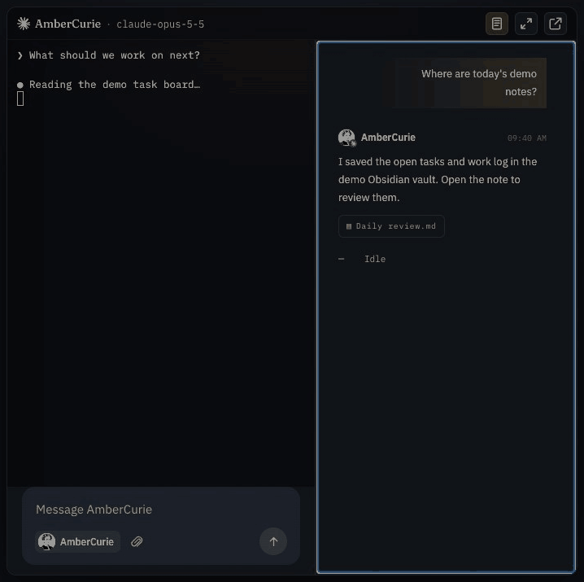

# Using it with Obsidian

The file chip in the reply opens a note from the sample vault inside Reader.

> 日本語版: [obsidian.md](../obsidian.md)

[Back to README](../../README.en.md)

ORRERY Telemetry works without Obsidian. This page shows one useful way to work: using an Obsidian vault as the place where your agents work.

## What you get

- **What agents produce becomes Markdown notes as it is**
  - Work logs from `/log`: what the session decided, changed, and checked
  - Paper notes from [digest-paper](https://github.com/gyroid-eth/orrery-digest-paper) (an ORRERY add-on): written by Claude and checked by Codex against the text and figures
  - Tasks from `/addtodo` and `/adddone`: cards on a Kanban board
- **People only need to read them in Obsidian**
  - The Daily Note uses Dataview to list the day's work logs and finished tasks automatically. When an agent writes a log, a link appears in that day's Daily Note
  - A Kanban board shows how the tasks are going. Checking a card adds the time it was done and moves it to the done column
- **Open them from the cockpit**: in the terminals of [ORRERY cockpit](https://github.com/gyroid-eth/orrery), a note path an agent prints opens in Finder (Explorer on Windows) with a click

## Getting started

### (a) Start from the demo vault

[gyroid-eth/orrery-demo-vault](https://github.com/gyroid-eth/orrery-demo-vault) is a vault where you can try all of the above right away.

- A Daily Note template (today's tasks, done today, and today's work logs, shown with Dataview)
- A Kanban task board (`01_Planning/タスク.md`) and a plugin that records when a task was done (Task Done At)
- Skills for agents: `/log` (work logs in `05_Agents/`), `/addtodo` and `/adddone` (Kanban cards)
- A QuickAdd macro for people: "タスク追加" (add a task)
- `CLAUDE.md` / `AGENTS.md` (the rules agents follow in this vault)
- The PDF conversion plugin that digest-paper uses (pdf-mistral), and one CC BY paper to try it on

Download it, open it in Obsidian, and follow `00_Inbox/はじめに.md` from the top.

### (b) Add it to your own vault

To add this to the vault you already use, copy these from the demo vault.

1. `.claude/skills/log`, `addtodo`, and `adddone` into your vault's `.claude/skills/`
2. `30_Templates/Daily Note.md` into your Daily Note template
3. **Use the same folder names everywhere**: if you use folders other than the demo vault's (logs in `05_Agents/`, Daily Notes in `02_DailyNotes/`, Kanban boards in `01_Planning/`), change these three to the same names
   - The Dataview queries in the Daily Note template (`FROM "05_Agents"`, `FROM "01_Planning"`)
   - The three copied `SKILL.md` files: in `log`, where the log is created, where the Daily Note is, and the link that opens it; in `addtodo` and `adddone`, the folder searched for boards
   - Where logs and tasks go, as written in `CLAUDE.md`

   If any one of them differs, the place the agent writes to and the place the Daily Note reads from no longer match
4. In `CLAUDE.md`, write where logs and tasks go and mention `/addtodo` and `/adddone`. **If you also use Codex**, bring two things from the demo vault's `AGENTS.md` into your `AGENTS.md`, adjusted to your paths: the log format (`05_Agents/LOG_… .md` and its headings), and the instruction to read the `addtodo` / `adddone` `SKILL.md` and follow it when asked to add or finish a task (Codex does not call Claude Code's `/` skills by itself). You do not need to replace your existing rules
5. Install the Obsidian community plugins Dataview, Kanban, and Templater (and Task Done At from the demo vault if you want the done time added automatically)

Start the agent in the vault folder (`cd <vault> && claude`). In the demo vault, the agent follows the vault's `CLAUDE.md` and skills and writes logs to `05_Agents/` (confirmed in the example below). To write into the vault with the `/log` bundled with ORRERY Telemetry instead of the vault's skill, use `AGENTSTACK_OBSIDIAN_APP` in [Configuration: Skill](telemetry-configuration.md#skill).

## Example (2026-09-29, checked on Windows with WSL2)

We put the demo vault in a Windows folder, opened it in Obsidian on Windows, and went through this flow with agents inside WSL2.

1. Convert a paper's PDF to Markdown and figures with pdf-mistral in Obsidian
2. Ask the Claude in WSL to run digest-paper. After the exchange with the Codex reviewer, the note is saved to the vault's `10_Reference/Notes/` with `review_status: checked`
3. Type `/log` to the Claude in WSL. `05_Agents/LOG_<time> <theme>.md` is created and shows up automatically under "today's work logs" in the Daily Note in Obsidian on Windows
4. Add a card with "タスク追加" in Obsidian (or `/addtodo` to the agent), then say `/adddone` to the agent. The card moves to the done column and shows up under "done today" in the Daily Note

## Notes for Mac and Windows (WSL2)

- **Mac**: keep the vault where you usually do (for example `~/Documents/MyVault`) and start agents inside it
- **Windows**: keep the vault in a Windows folder (for example `C:\Users\<you>\Documents\MyVault`) and open it in Obsidian on Windows. Agents inside WSL2 use that folder as `/mnt/c/Users/<you>/Documents/MyVault` (`wslpath -u 'C:\Users\...'` converts it)
- **digest-paper's work in progress** (drafts, reviews) stays by default on the WSL side in `~/.agentstack/addons/digest-paper/runs/`. The vault receives the finished bundle: the note (`note.md`), the figures it uses (`assets/`), and the check record (`evidence/`)
- **The dashboard's Output**: by default, a dashboard card's Output lists the `LOG_*.md` files in the project's `logs/` whose frontmatter `agent:` names that agent. With the demo vault's standard setup (logs in `05_Agents/`, no `agent:`), read logs in the Obsidian Daily Note rather than in Output. To show them in Output too, set the scan roots (`AGENTSTACK_DELIVERABLE_ROOTS`) and add `agent:` to the logs ([Configuration: Output / deliverables](telemetry-configuration.md#output--deliverables))

## Related documents

- [Installation](telemetry-install.md) (Obsidian as an optional dependency)
- [Configuration](telemetry-configuration.md) (`AGENTSTACK_VAULT`, `AGENTSTACK_OBSIDIAN_APP`)
- [Dashboard](dashboard.md) (a card's Output)
