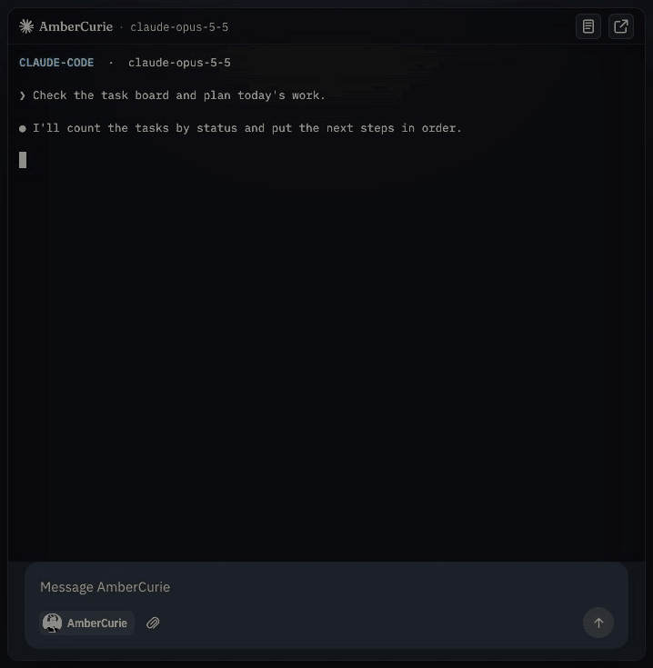

# Follow work and open files in Reader

1. Select an agent and open Reader using the icon in the pane header. It groups messages and tool steps so you can follow the work as it happens.
2. Select a file chip below the reply to see the file's current contents in the same pane.
3. Select **×** in the preview header to return to the reply.

[日本語](../read-a-file.md) · [Cockpit map](cockpit-map.md) · [Reader reference](usage.md#reader)
