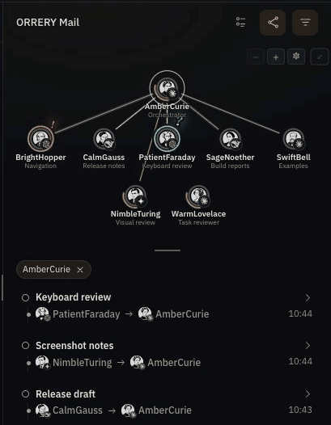

# Read incoming ORRERY Mail

1. Watch the comet fly from sender to recipient in Mini Graph. A ring and the subject appear at the recipient.
2. Select the subject in the **ORRERY Mail** list below the graph to open the message and see who sent it.
3. Select **×** in the message header to return to the list.

The list shows recent Mail from the team. Select an agent in the roster to filter to Mail involving that agent. Select **thread** on a message to read its exchanges in order.

[日本語](../read-mail.md) · [Cockpit map](cockpit-map.md) · [Mail views and filters](usage.md#orrery-mail)
