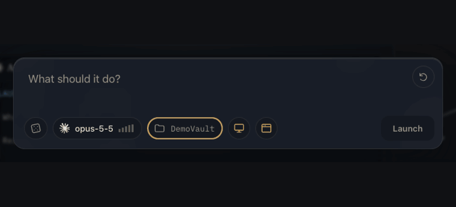

# Start an agent and send a task

1. Open **New agent** in the upper left. Enter a task, pick a model and working folder, and select **Launch**.
2. Select the new agent in the list. Type a request in the composer below the terminal and press **Enter**.
3. Use the Reader icon in the pane header to follow the work as it happens and see the reply.

Choose a scientist’s portrait to set the name. You can change the adjective. For DeepSeek and local models, choose dsh or Hermes under **Harness** after [setting up the connection](install.md#first-time-setup-for-deepseek-dsh-and-hermes). To open the Telemetry launch form, use its own **NEW AGENT** control in the [Telemetry dashboard](view-telemetry.md).

[日本語](../start-an-agent.md) · [Cockpit map](cockpit-map.md) · [New agent settings](usage.md#new-agent)
