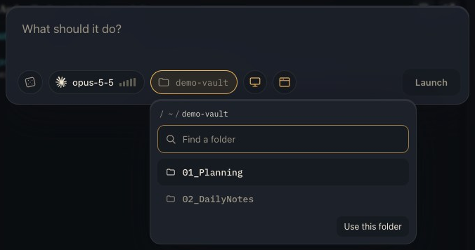

# Configuration



In this example, `demo-vault` is first in `AGENTSTACK_SPAWN_DIRS` and appears as the default folder in New agent.

> 日本語版: [configuration.md](../telemetry-configuration.md)

[Previous: API reference](https://github.com/gyroid-eth/orrery-telemetry/blob/master/docs/api.en.md) · [Back to README](../../README.en.md) · [Next: Troubleshooting](telemetry-troubleshooting.md)

The normal configuration location generated by the installer is:

```text
~/.agentstack/env.sh
```

Its file mode is `0600`. Service environment is written into the launchd plist / systemd unit during installation, so after a change rerun `./scripts/install.sh` or update the service definition too.

On macOS, `~/.agentstack/dashboard/agentctl.sh restart` also renders the selected mode/config into the dashboard plist and reinstalls the job through the same path as `start`, even when settings are unchanged. The supervised-background restart procedure is unchanged.

## Explicit fresh settings (cutover preparation)

This is separate from legacy DB/project settings. Follow the [fresh guide](https://github.com/gyroid-eth/orrery-telemetry/blob/master/docs/fresh-global-update.en.md) for ordering and human steps. Keep the default mode and never invent values to enable it.

| Setting | Explicit fresh use |
|---|---|
| `AGENTSTACK_RUNTIME_MODE=fresh` | Pin only the launched process to fresh |
| `AGENTSTACK_FRESH_CLIENT_CONTEXT` | Exact protected context returned by prepare; do not combine with old `AGENTSTACK_CLIENT_CONFIG`/`AGENTSTACK_GLOBAL_SERVER_CONFIG` |
| `AGENTSTACK_HOME` / `AGENTSTACK_PYTHON` | Matching installation and approved interpreter able to use its Mail module |
| `AGENTSTACK_FRESH_DASHBOARD_SOCKET` | Prepared and verified private tmux socket for dashboard automatic children |
| `AGENTSTACK_SPAWN_ROOTS` / `AGENTSTACK_SPAWN_DIRS` | Allowed work folders; use existing explicit managed-manifest/provider-binary settings |

Cockpit uses the same host/UID/context, a health-derived `ORRERY_FRESH_MAIL_INSTANCE_ID` and fixed `ORRERY_DASHBOARD_URL`. The dashboard's private host IPC must be ready first; no new daemon is created. With prepared context/socket references explicitly selected, the installer saves the same config/I and paths to env.sh, the manifest and dashboard services, preserving that selection on ordinary updates. The watcher removes the client-context key and uses the same config. Mail runs the fresh CLI through the existing owned runner/lock. This does not create a root, register owners, migrate credentials or approve hook trust. The selected Python must already provide the matching Mail module. Default keep requires both ownership and health; explicitly updating fresh Mail requires a normal owned stop before rerunning --update-mail. Real-environment normal-startup acceptance is separate. Use the [shutdown/recovery steps](https://github.com/gyroid-eth/orrery-telemetry/blob/master/docs/fresh-global-update.en.md#8-recover-by-procedure-after-a-failure) for restarts and DB recovery.

### Save prepared fresh references for normal startup

Use the same Python/installation/context/socket already verified in the [fresh guide](https://github.com/gyroid-eth/orrery-telemetry/blob/master/docs/fresh-global-update.en.md). Read the dry run from the source checkout; after the attended installation decision, remove only `--dry-run` from the same arguments. This does not register owners, migrate credentials or approve trust. Ordinary updates retain the saved selection. Stop/restart Mail and dashboard through `agentstack-mailctl`/`dashboard/agentctl.sh` in the same installation. Explicitly updating running fresh Mail requires its normal owned stop first.

```sh
orrery_source='/absolute/path/to/orrery-telemetry-source'
orrery_python='/absolute/path/to/approved/python-with-matching-mail'
orrery_install='/absolute/path/to/matching/orrery-install'
orrery_context='/absolute/path/to/prepared/context.json'
orrery_socket='/absolute/path/to/verified-private-tmux.sock'
env AGENTSTACK_RUNTIME_MODE=fresh AGENTSTACK_CLIENT_CONFIG= AGENTSTACK_GLOBAL_SERVER_CONFIG= \
  AGENTSTACK_HOME="$orrery_install" AGENTSTACK_PYTHON="$orrery_python" \
  AGENTSTACK_FRESH_CLIENT_CONTEXT="$orrery_context" \
  AGENTSTACK_FRESH_DASHBOARD_SOCKET="$orrery_socket" \
  "$orrery_source/scripts/install.sh" --dry-run
```

## Dashboard service logs and restarts

| Environment variable | Default | Purpose |
| --- | --- | --- |
| `AGENTSTACK_DASHBOARD_LOG` | `$AGENTSTACK_RUNTIME_DIR/dashboard.log` | Log path for the dashboard service |
| `AGENTSTACK_DASHBOARD_LOG_MAX_BYTES` | `5242880` (5 MiB) | Log size threshold in bytes before rotation |
| `AGENTSTACK_DASHBOARD_LOG_BACKUPS` | `3` | Number of rotated logs to keep |
| `AGENTSTACK_DASHBOARD_RESTART_DELAY` | `5` | Seconds to wait before restarting the dashboard |

The installer saves and preserves these values across routine updates.

## Dashboard / `server.py`

`server.py` directly reads the following `AGENTSTACK_*` values.

| Environment variable | Default | Meaning |
| --- | --- | --- |
| `AGENTSTACK_PORT` | `8770` | HTTP port |
| `AGENTSTACK_BIND_HOST` | `127.0.0.1` | Bind address |
| `AGENTSTACK_DASHBOARD_ALLOWED_ORIGINS` | empty | Additional fixed HTTP(S) origins allowed by the legacy dashboard, separated by ASCII spaces; see below |
| `AGENTSTACK_MAIL_DB` | `~/.agentstack/mail/storage.sqlite3` | ORRERY Mail SQLite database |
| `AGENTSTACK_MAIL_ENV` | `~/.agentstack/mail/.env` | Compatibility bearer reference for a standalone dashboard. The installer renders it explicitly for services |
| `AGENTSTACK_MAIL_HTTP_BEARER_MODE` | `disabled` | Do not add a legacy Authorization header |
| `AGENTSTACK_PROJECT_KEY` | unset | Human key for the ORRERY Mail project |
| `AGENTSTACK_VAULT` | unset | Fallback when no project key exists, and Obsidian-link hint for Output items inside the vault |
| `AGENTSTACK_DELIVERABLE_ROOTS` | unset | `:`-separated roots recursively scanned for `LOG_*.md`. Defaults to the project's `logs/` |
| `AGENTSTACK_LANG` | browser language | Override the murmur language with `ja` / `en` |
| `AGENTSTACK_MURMUR` | enabled | Set to `off` to disable murmur bubbles |
| `AGENTSTACK_LABEL_PREFIX` | `org.agentstack` | launchd label prefix |
| `AGENTSTACK_TERMINAL` | `auto` | `ghostty / iterm / terminal / none` |
| `AGENTSTACK_HOOKS_DIR` | `~/.agentstack/hooks` | Root for hooks and the default spawn script |
| `AGENTSTACK_RUNTIME_DIR` | `~/.agentstack/runtime` | Tokens, annotations, session index, child / watcher state |
| `AGENTSTACK_MAIL_HOME` | `~/.agentstack/mail` | Signal-data root |
| `AGENTSTACK_SIGNALS_DIR` | `$AGENTSTACK_MAIL_HOME/signals` | Mail signal directory |
| `AGENTSTACK_PORTRAITS_DIR` | unset | Private PNG overlay directory |
| `AGENTSTACK_CUSTOM_PORTRAITS` | unset | Agent-name → portrait-key JSON |
| `AGENTSTACK_SPAWN_SCRIPT` | `$AGENTSTACK_HOOKS_DIR/spawn_child.sh` | NEW AGENT launcher |
| `AGENTSTACK_SPAWN_DIRS` | `~` | `:`-separated spawn-directory presets |
| `AGENTSTACK_SPAWN_ROOTS` | `$HOME` | `:`-separated roots allowed for directory typeahead |
| `AGENTSTACK_CLAUDE_MODELS` | unset | `,`-separated explicit dashboard Claude model override |
| `AGENTSTACK_CODEX_MODELS` | `unset` | `,`-separated dashboard Codex model allowlist |
| `AGENTSTACK_CODEX_DEFAULT_MODEL` | `unset` | Default Codex child model ID or family alias |
| `AGENTSTACK_CODEX_DEFAULT_EFFORT` | `unset` | Default Codex reasoning effort |

Path values expand `~`. An empty string is treated as unset. An invalid integer `AGENTSTACK_PORT` falls back to `8770`.

The murmur language is selected in the order `?lang=ja` / `?lang=en`, `AGENTSTACK_LANG`, then browser `navigator.language` / `navigator.languages`. A Japanese `ja` locale selects Japanese; all others select English. `?murmur=on` / `?murmur=off` overrides the service default for that URL only, while `AGENTSTACK_MURMUR=off` disables bubbles as the service default. A viewer can also switch murmurs on or off from the dashboard's `SETTINGS` › DISPLAY; that choice is stored in the browser (precedence: URL, then the browser's stored choice, then the service default). To apply an environment variable to a resident service, rerun the installer after setting it.

## Host configuration for LAN / VPN access

Dashboard and ORRERY Mail check the Host and browser origin. When using the LAN, allow only the origins you use. Phones have their own pairing flow. [Use ORRERY on a phone](mobile.md) · [Local HTTP trust boundary (Japanese)](https://github.com/gyroid-eth/orrery-telemetry/blob/master/docs/local-http-security.md)

The legacy dashboard checks `Host` on every HTTP method and path. By default, it accepts only `127.0.0.1`, `localhost` and `[::1]` at the actual listening port. Normal local use and a cockpit bridge connecting to a loopback URL need no additional setting.

If the dashboard already listens for LAN / VPN connections, explicitly configure the origins (scheme, host and port) you use before updating. For example, run this from the existing checkout, review the dry run, then repeat it with the same environment variable and without `--dry-run`:

```bash
AGENTSTACK_DASHBOARD_ALLOWED_ORIGINS='http://dashboard.example:8770 https://dashboard.example' \
  ./scripts/install.sh --keep-mail --dry-run
```

The installer saves this value in `env.sh` and the dashboard service definition, and preserves it on reinstall. Set it explicitly to an empty string or use `--reset-settings` to remove additional origins. For a direct `server.py` launch, pass the same environment variable to that process. This setting does not change the bind address; keep your existing listener configuration separately.

Origins cannot contain a path, credentials, query, fragment or wildcard. The installer rejects invalid values, including quotes and newlines, before writing settings or services; the server also refuses to start. Separate entries with ASCII spaces, not tabs or newlines. Host case and IPv6 notation are normalized. An omitted port means `80` for HTTP or `443` for HTTPS; always include other ports such as `8770`.

The dashboard never infers trusted authorities from `AGENTSTACK_BIND_HOST=0.0.0.0`, network interfaces, `Forwarded` or `X-Forwarded-*`. If a proxy terminates HTTPS, explicitly configure the HTTPS origin and make its upstream `Host` and the browser's `Origin` correspond to that same origin. A POST cannot use a different Host's origin even when that origin is separately allowed.

This is not authentication. The dashboard has no login, and anyone able to send an allowed Host can use its controls. Keep access within a trusted LAN / VPN. Isolated global mode retains its capability authentication and public static resource rules.

## Without a project key

The following work even when both `AGENTSTACK_PROJECT_KEY` and `AGENTSTACK_VAULT` are unset.

- DECK tmux state
- terminal open / local capture
- local annotations
- bundled portraits
- Output / deliverables (fall back to `logs/` under cwd or the Git root)

The following do not work.

- launcher shell-side agent registration
- NETWORK mail edges / drawer
- mail history / DIGEST REPLAY
- dashboard spawn
- project-scoped retirement

Only mail features become `NOT CONFIGURED`; local telemetry remains available for diagnosis.

<a id="native-connections"></a>

## Keep multiple DeepSeek or Local connections

With API 27 or later, one private manifest can keep DeepSeek, a Local server on workstation, and a Local server on EPYC. Existing `deepseek`/`strata` entries need no changes. Give each additional connection its own ID and an explicit `kind`. This example shows only the manifest's `backends` section. Replace `<FORMAL_MODEL_ID>` with the actual model ID accepted by that server.

```json
{
  "backends": {
    "deepseek": {"model": "deepseek-flash", "models": ["deepseek-flash"]},
    "strata": {"label": "workstation", "server": "workstation", "model": "<FORMAL_MODEL_ID>", "models": ["<FORMAL_MODEL_ID>"]},
    "strata-epyc": {"kind": "strata", "label": "EPYC", "server": "EPYC", "model": "<FORMAL_MODEL_ID>", "models": ["<FORMAL_MODEL_ID>"]}
  }
}
```

Keep the existing DeepSeek and `strata` settings. In your private copies, add matching entries in these locations:

| Location | Settings for the added connection |
| --- | --- |
| Manifest `backends.strata-epyc` | `kind: "strata"`, actual model IDs, and distinct `label` and `server` names |
| dsh backend file `backends.strata-epyc` | This connection's `base_url`, `model`, and credential reference. Put any `model_definition.id`, `contextWindow`, and `maxTokens` here too |
| Hermes configuration `profiles.strata-epyc` | This connection's `provider` name, `base_url`, `api_mode`, `model`, `context_length`, and credential reference |

dsh and Hermes may require different URL forms; follow the [API requirements in initial setup](native-setup.md#1-choose-a-provider-and-a-harness). On Mac, use the existing keychain service/account and `key_cmd` formats. On WSL, use a separate manifest `credential_ref` for each connection. Keep key values out of JSON. Match context to each server's actual limit and maxTokens to the output limit you need. Equal model IDs do not imply equal server limits or credential references.

Connection IDs match `[a-z][a-z0-9_-]{0,63}`. CLI names and reserved selectors such as `same`, `auto`, `main`, and `custom` cannot be used. New IDs require `kind: "deepseek"` or `kind: "strata"`; legacy IDs cannot change kind. Duplicate IDs, unknown IDs, unknown kinds, and helpers from another connection are rejected. Choose helpers from the same connection's model list.

Enable the manifest, run the standard static validation for each harness you will use, and pass it to the installer as described in [step 5 of initial setup](native-setup.md#5-connect-the-configuration-files). In cockpit, select the Local models row with the intended server name (workstation / EPYC). Standalone Telemetry shows separate tabs with each connection's label. API and CLI calls retain the connection ID, for example `--harness dsh --backend strata-epyc --model <FORMAL_MODEL_ID>`. Resume retains the saved connection ID and native session; it does not move to another connection automatically. Existing global-mode restrictions and limits on real connection acceptance still apply.

## Output / deliverables

The Output index displays up to 25 files where `agent: <name>` near the beginning of a `LOG_*.md` file matches the dashboard agent name.

- When `AGENTSTACK_DELIVERABLE_ROOTS` is set, its `:`-separated roots are recursively scanned. Explicit roots replace the default `logs/`
- When unset, the base is selected in the order absolute `AGENTSTACK_PROJECT_KEY`, absolute `AGENTSTACK_VAULT`, then dashboard cwd / Git root, and the `logs/` immediately below it is scanned
- `AGENTSTACK_VAULT` is not a request to scan a private directory layout. It is only a hint to create an `obsidian://` link when a detected item lies inside that vault
- Items outside the vault are still listed, but appear as non-links rather than invalid Obsidian links

Because custom roots are wired into service environment, rerun the installer after setting them.

```bash
export AGENTSTACK_DELIVERABLE_ROOTS="$HOME/project-a/logs:$HOME/shared logs"
./scripts/install.sh
```

## Installer

| Environment variable | Default | Meaning |
| --- | --- | --- |
| `AGENTSTACK_HOME` | `~/.agentstack` | Install root; also settable with `--install-dir` |
| `AGENTSTACK_MAIL_DIR` | `$AGENTSTACK_HOME/mail-service` | Candidates, immutable renders, runtime logs / pidfiles |
| `AGENTSTACK_MAIL_HOME` | `~/.agentstack/mail` | Canonical database / archive / signals root |
| `AGENTSTACK_MAIL_DB` | `$AGENTSTACK_MAIL_HOME/storage.sqlite3` | ORRERY Mail SQLite read by the dashboard |
| `AGENTSTACK_MAIL_ENV` | derived from render ID | ORRERY Mail service environment |
| `AGENTSTACK_MAIL_STATE_ROOT` | `~/.agentstack/mail` | Canonical database / archive / signals root |
| `AGENTSTACK_MAIL_SERVICE_ROOT` | `$AGENTSTACK_HOME/mail-service` | Candidates, immutable renders, runtime logs / pidfiles |
| `AGENTSTACK_MAIL_SERVICE_VENV` | derived from candidate ID | Path used to explicitly reuse a verified candidate virtual environment |
| `AGENTSTACK_MAIL_ENROLL_BIN` | derived from the adopted Mail deployment | Matching `agentstack-enroll` saved by the installer in `env.sh`; normally not set by hand |
| `AGENTSTACK_MAIL_HTTP_BEARER_MODE` | `disabled` | Do not use the legacy HTTP bearer |
| `AGENTSTACK_PROJECT_KEY` | existing `env.sh` on reinstall; required initially | Human project key. `--project-key` has highest priority |
| `AGENTSTACK_EXTRA_PROTECTED_ROOTS` | process value (including empty) → installed extras (including empty) → installed legacy roots once → empty | Persistent ordered additional reservation roots; see automatic migration below |
| `AGENTSTACK_PROTECTED_ROOTS` | computed at every managed launch | Runtime output: extras, then the actual workspace. Installed legacy value is retained only for direct/unmanaged-hook compatibility |
| `AGENTSTACK_RELEASE_GRACE_SECONDS` | `90` | Debounce seconds before releasing a reservation after successful Edit / Write. Legacy `FILE_RESERVATION_RELEASE_GRACE_SECONDS` is also accepted as a fallback |
| `AGENTSTACK_DELIVERABLE_ROOTS` | unset | `:`-separated Output-index scan roots, saved to env / service / manifest |
| `AGENTSTACK_LANG` | unset | `ja` / `en` murmur override; browser-selected when unset |
| `AGENTSTACK_MURMUR` | unset | Set to `off` to disable murmurs |
| `AGENTSTACK_PORT` | `8770` | Dashboard port |
| `AGENTSTACK_LABEL_PREFIX` | `org.agentstack` | Service-label prefix |
| `AGENTSTACK_TERMINAL` | `auto` | Terminal integration: `ghostty / iterm / terminal / wt / none`. `wt` is Windows Terminal on WSL2 (`auto` picks it when `wt.exe` is reachable inside WSL2) |
| `AGENTSTACK_PYTHON` | resolved `python3` | Installer-version-checked Python for services and the installed persistent launcher. The persistent launcher does not fall back to `python3` from ambient `PATH` |
| `AGENTSTACK_PATH` | Homebrew and system paths | `PATH` passed to services |
| `AGENTSTACK_MCP_URL` | `http://127.0.0.1:18765/mcp` | MCP endpoint for launchers / hooks / dashboard / Bridge |
| `AGENTSTACK_CLAUDE_SETTINGS` | `~/.claude/settings.json` | Settings merge target |
| `AGENTSTACK_CLAUDE_MD_SCOPE` | `global` | User scope only; explicit project/both is refused. [Migration](instruction-migration.md) |

When a healthy ORRERY Mail listener already exists, the installer adopts the deployment metadata recorded with its immutable render without updating or restarting the server. A managed render created before that metadata existed is adopted only when its render ID maps uniquely and deterministically to a candidate directory. The generated `AGENTSTACK_MAIL_ENV` and `AGENTSTACK_MAIL_ENROLL_BIN` in `env.sh` therefore identify the same deployment. If a known legacy render has no enrollment CLI, Mail and its existing autostart remain usable while enrollment is recorded as unavailable.

When a healthy listener uses the expected database but its service environment cannot be identified, an ordinary unpinned reinstall reuses the listener unchanged. In this degraded state deployment and enrollment paths are empty, and the installer updates neither the enrollment connection profile nor Mail autostart. Existing triggers are not deleted or stopped, but the installer cannot guarantee restart at the next login. Installation instead stops explicitly, without switching the listener, when an explicit `AGENTSTACK_MAIL_SERVICE_VENV` / `AGENTSTACK_MAIL_SERVICE_ENV` cannot be matched to the running deployment, known metadata is invalid, or metadata promises an enrollment CLI that is missing.

On a re-install, the settings in the table above that a person chooses (project key, explicit extra protected roots, port, label prefix, terminal, MCP URL, `PATH`, Python, the Mail state / service roots, `LANG` / `MURMUR` / `DELIVERABLE_ROOTS`, and so on) are decided as explicit value → previous `env.sh` → default. The list is `AGENTSTACK_INHERITED_SETTINGS` in `hooks/project-context.sh`; see "What a re-install inherits" under Upgrade in [install.en.md](telemetry-install.md) for how to return to the defaults.

The installer's project-key precedence is `--project-key` / process `AGENTSTACK_PROJECT_KEY` → `PROJECT_KEY` → existing `env.sh` at the install destination. If none exist on first install, it does not guess that the repository checkout is the project; it stops with exit 2 before making changes. `AGENTSTACK_PROJECT_KEY` is recommended for persistent configuration.

At hook and helper runtime the precedence is `AGENTSTACK_PROJECT_KEY` → `PROJECT_KEY` → `${AGENTSTACK_HOME:-$HOME/.agentstack}/env.sh` → current cwd. The shared resolvers read project and extra-root settings from installed `env.sh` literally, without sourcing shell code. Direct/unmanaged hooks may still read the retained legacy `AGENTSTACK_PROTECTED_ROOTS`; managed launches ignore it as configuration. Thus an installed editor started from another directory uses the same project key for reservation and registration without executing arbitrary shell code from `env.sh`.

The installer derives `AGENTSTACK_MAIL_DB`, `AGENTSTACK_MAIL_ENV`, and `AGENTSTACK_SIGNALS_DIR` from state / render and stores the state root together with `AGENTSTACK_MAIL_HTTP_BEARER_MODE=disabled` in `env.sh`.

## Reservation protection and migration

On covered managed `workspace-v1` launch paths, `*`, `?`, `[`, or `\` in the physical paths of the launch directory and `AGENTSTACK_EXTRA_PROTECTED_ROOTS` are rejected. ORRERY Mail interprets the first three characters as glob markers and replaces `\` with `/` when comparing reservation names, which can break self-matching or cause false conflicts with another folder. The error identifies the characters and path. A standalone `]` is allowed.

`AGENTSTACK_EXTRA_PROTECTED_ROOTS` is the persistent setting for additional reservation roots. Use colon-separated absolute or `~/` paths (spaces are supported; colons inside a path are not). Managed launches resolve physical paths, collapse symlink/trailing-slash aliases, and deduplicate without reordering. Top-level and delegated-child launches covered by this change protect their selected physical working directory after the ordered extras. Git root discovery does not automatically extend protection; explicitly include it in `AGENTSTACK_EXTRA_PROTECTED_ROOTS` if wanted. These launches do not reuse a previous runtime `AGENTSTACK_PROTECTED_ROOTS` list. A path-shaped project key and `AGENTSTACK_VAULT` do not add protection by themselves. Namespace selection is unchanged; the installed project key remains in use.

At launch, an explicitly set process extras value (including empty) wins over installed extras, then empty. Only install/update performs the legacy conversion.

Install/update automatically selects and saves extras in this order, using presence rather than non-emptiness:

1. Process `AGENTSTACK_EXTRA_PROTECTED_ROOTS`, including an explicit empty string
2. Installed `env.sh` `AGENTSTACK_EXTRA_PROTECTED_ROOTS`, including an empty string
3. Installed `env.sh` legacy `AGENTSTACK_PROTECTED_ROOTS`, copied exactly once with its literal value and order intact
4. Empty, if none of those settings exists

Migration reads the installed file literally; it does not execute shell expressions, infer which roots were intentional, or import ambient shell/tmux `AGENTSTACK_PROTECTED_ROOTS`. Invalid or ambiguous legacy configuration stops the update before the installed file is overwritten. The installer displays the selected source, value, and destination, including in `--dry-run`. Normal updates perform this migration automatically; no manual copy is needed. The installed file must contain literal export assignments, as generated by the installer; hand-written shell commands, computed variable names, or expanding values require review before update. Unrelated quoted multiline values, such as model lists, remain valid.

Every successful install writes an extras marker, even when empty, to `env.sh`, dashboard service settings, and install-state. That presence prevents the legacy list from being imported again. The installed legacy value is retained only for direct/unmanaged-hook compatibility; managed launches ignore it as configuration. A different nonempty shell/tmux legacy value still triggers a warning even when extras already exist. Reopen stale shells or clear their old variable; do not copy a runtime-root list to silence the warning.

Reinstall and `--reset-settings` keep extras. An explicit `AGENTSTACK_EXTRA_PROTECTED_ROOTS=` clears them while retaining the empty marker and mandatory launch-workspace protection. To preview a deliberate replacement or clearing of extras, use these commands, then rerun without `--dry-run` after reviewing the result:

```bash
AGENTSTACK_EXTRA_PROTECTED_ROOTS="$HOME/shared-vault" ./scripts/install.sh --dry-run
# Or deliberately keep no additional roots:
AGENTSTACK_EXTRA_PROTECTED_ROOTS= ./scripts/install.sh --dry-run
```

Before cutover, finish work or release active reservations. Older relative reservation names depended on the first matching root, but updated managed launches use the physical absolute path as their reservation identity, independent of root order. Existing relative leases cannot be reused as-is. Review the dry run, update, then restart affected sessions together. Existing sessions keep their environments until restart; updating files does not refresh them. Dashboard resume and persistent-agent re-resolution are follow-up work. Existing resume paths may retain older roots and are not guaranteed to implement the new protection boundary in this PR.

## Launcher

| Environment variable | Default | Meaning |
| --- | --- | --- |
| `AGENTSTACK_BASE_DIR` | `$HOME` | `fzf` picker root |
| `AGENTSTACK_CLAUDE_BIN` | `claude` | Claude CLI |
| `AGENTSTACK_CLAUDE_MODEL` | `claude-code` | Claude registration model label. Children and dashboard-resumed sessions use their own model (`CLAUDE_CHILD_MODEL`) first. A new window in a child's tmux session inherits that value, so `unset CLAUDE_CHILD_MODEL` before opening another agent there with `AGENT_NAME=<name> claude --resume`; otherwise it registers with the child's model |
| `AGENTSTACK_CODEX_BIN` | `codex` resolved in the operator's shell at install time that answers `--version` (under WSL, a Windows install under `/mnt/<drive>/` is skipped; `--codex-bin` to override) | Codex CLI. The dashboard runs under launchd / systemd with the minimal PATH, so a codex under nvm / nodebrew / `~/.npm-global` is reachable only through this value |
| `AGENTSTACK_CODEX_MODEL` | launcher / bootstrap default | Codex registration model |
| `AGENTSTACK_CODEX_SANDBOX` | `workspace-write` | Set to `danger-full-access` for Codex CLI Full Access in legacy mode. Applies to `agent-start-codex`, `/delegate`, standalone NEW AGENT, and dashboard resumes. Direct `agent-start-codex` also supports `read-only` |
| `AGENTSTACK_CODEX_APPROVAL` | `on-request` | `--ask-for-approval` for `agent-start-codex`, the user's own interactive session. Spawned children use `AGENTSTACK_CODEX_CHILD_APPROVAL`; see Child spawn |
| `AGENTSTACK_VAULT` | unset | Additional writable `--add-dir` passed to Codex |
| `AGENTSTACK_MCP_URL` | `http://127.0.0.1:18765/mcp` | Registration / hook endpoint |
| `AGENTSTACK_CONTACT_POLICY` | `open` | Contact policy after registration. Set to `skip` for the server default |
| `AGENTSTACK_AGENT_NAME_ATTEMPTS` | implementation default | Maximum name-candidate attempts |
| `AGENTSTACK_NAME_UNKNOWN_LIMIT` | `3` | Stop threshold for consecutive `unknown` results |
| `AGENTSTACK_TCC_GUARD` | enabled | macOS TCC warning; set to `0` to disable |
| `AGENTSTACK_TCC_DIRS` | `$HOME/Desktop:$HOME/Downloads:$HOME/Documents` | `:`-separated TCC probe targets |
| `AGENTSTACK_SCIENTISTS_JSON` | bundled JSON | Scientist vocabulary override |

The launchers (`agent-start`, `agent-start-codex`, `agent-start-gemini`) load `env.sh` at startup but do not overwrite a value from `AGENTSTACK_INHERITED_SETTINGS` that was already set. For example `AGENTSTACK_PROJECT_KEY=/path/to/other ./agent-start` registers under `/path/to/other`; reservation protection still comes from the actual launch workspace plus explicit extras. Without an explicit project key, `env.sh` supplies the namespace. This separation does not change namespace selection or remove the installed project key.

The canonical `AGENTSTACK_TCC_DIRS` syntax is colon-separated so paths may contain spaces. Legacy whitespace-separated values without a colon are also interpreted for compatibility.

To enable Full Access, set `export AGENTSTACK_CODEX_SANDBOX=danger-full-access` in `~/.agentstack/env.sh`. A normal reinstall preserves the setting.
Full Access disables the Codex sandbox and command approvals. Codex can write and delete files anywhere the OS permits and run `git push` to authenticated remotes.

`AGENTSTACK_RESERVED_IDENTITY`, proxy-token paths, child tokens, and similar values are internal values set per session by the spawner. Do not set them manually for a top-level launcher.

## Child spawn

These variables change `spawn_child.sh` and `agentstack-preregister-child` behavior.

| Environment variable | Default | Meaning |
| --- | --- | --- |
| `AGENTSTACK_AUTO_OPEN_CHILD` | `1` | Opens an OS terminal after a Claude / Codex child starts. Set to `0` to stop only the automatic opening. The tmux session and Deck Open tmux remain independent |
| `AGENTSTACK_FOCUS_CHILD` | unset | When automatic opening is enabled, `1` brings the window forward. It does not enable automatic opening on its own |
| `AGENTSTACK_STRICT_AGENT_NAMES` | unset | Set to `1` to make an off-list child name an error instead of a warning |
| `AGENTSTACK_MONITOR_DANGER_CHECK` | `0` | Set to `1` to enable dangerous-command detection in the monitor. Passive by default |
| `AGENTSTACK_CODEX_CHILD_APPROVAL` | `never` | `--ask-for-approval` for parented Codex children under `workspace-write`, persisted by installer `--codex-approval`. Standalone NEW AGENT starts follow Codex configuration. Full Access always uses `never` |
| `AGENTSTACK_CODEX_CHILD_CONFIG_OVERLAY` | unset | Absolute path to a TOML fragment overlaid on every macOS/Linux Codex child's `config.toml`, persisted by installer `--codex-child-overlay <path>` |
| `AGENTSTACK_CODEX_NETWORK` | `on` | Codex child sandbox network (`-c sandbox_workspace_write.network_access=true`). Disable with `--codex-network off` |
| `AGENTSTACK_CHILD_DEFAULT_TOOLS` | empty | Tools for new Claude, Codex, dsh and Hermes launches via CLI or standard `/api/spawn`. The common list can include provider overrides such as `;dsh=`. Explicit base/tools/MCP profiles take precedence. [Installer defaults](delegation.md#installer-defaults) |
| `AGENTSTACK_CODEX_ADD_DIRS` | unset | Additional writable roots for Codex children (`:`-separated), persisted by `--codex-add-dirs` |
| `AGENTSTACK_WORKTREE_ROOT` | `$AGENTSTACK_HOME/worktrees` | Persistent root for new isolated worktrees; override and persist it by setting the variable when running the installer |
| `AGENTSTACK_CLAUDE_CHILD_CHROME` | unset | `1` makes `spawn_child.sh` start Claude children with `--chrome` (Claude in Chrome). Unset or `0` means inherit (the launch command is unchanged). The CLI `--claude-chrome` takes precedence. Ignored for Codex children. [Details](delegation.md#claude-children-and-browser-control-claude-in-chrome) |
| `AGENTSTACK_CLAUDE_CHILD_CHROME_DEVICE` | unset | deviceId of the browser Claude children should use. Setting it implies `AGENTSTACK_CLAUDE_CHILD_CHROME=1`. The CLI `--claude-chrome-device` takes precedence. An instruction to the child, not a technical isolation |
| `AGENTSTACK_CHILD_RESUME_RETENTION_DAYS` | `30` | Days to retain resume state / credentials for normally completed Claude / Codex children. Persist with installer `--child-resume-retention-days DAYS`; `0` restores full deletion during cleanup |
| `AGENTSTACK_WSL_ANCHOR` | `1` | WSL with the legacy dashboard. Holds a hidden `wsl.exe` while an agent runs or starts, or while the dashboard is visible. Releases after 60 idle seconds. Windows configuration is read-only. Set to `0` to disable. Persist with installer `--no-wsl-anchor` / `--wsl-anchor` |

The product assembles Codex child startup flags directly. For parented starts and dashboard resumes without a recorded standalone start, approval defaults to `never`. Network access defaults to on. Writable roots are the project, `AGENTSTACK_SPAWN_DIRS` / `AGENTSTACK_SPAWN_ROOTS`, install directory, `AGENTSTACK_WORKTREE_ROOT`, `~/.claude`, `~/.codex`, child-specific `CODEX_HOME`, and `AGENTSTACK_CODEX_ADD_DIRS`. Only existing directories are included. Set these dashboard service values through the installer. The config overlay applies through `spawn_child.sh` on macOS and Linux, including WSL2.

Every Codex the product launches (children, dashboard resume, `agent-start-codex`, the Windows launcher) gets `-c check_for_update_on_startup=false`. Codex's startup update screen defaults to `npm install -g @openai/codex`, and an unattended child has nobody to decline it; if the child is stopped mid-install, the machine's `codex` is left with neither the old nor the new version usable (#60). Update Codex yourself, for example with `npm install -g @openai/codex@latest`.

To move the worktree root, run the installer with an environment value such as `AGENTSTACK_WORKTREE_ROOT=/srv/agent-worktrees ./scripts/install.sh ...`. Relative paths are rejected. The launcher continues to reject paths containing `Syncthing` or `Obsidian`. The old `/tmp/cc-worktrees` default is neither moved nor deleted; only new spawns use the persistent root. `agentstack-doctor` reports directories under the current root that are neither live nor actively registered, but leaves removal to the operator.

`AGENTSTACK_TERMINAL=auto` selects an available OS terminal and opens the child window in the background. Opening it automatically is the intentional default. It shows users who do not have the dashboard yet, or who work only in a terminal, that a child started; without it a healthy spawn looks as if nothing happened.

If you routinely watch children from the dashboard, set `AGENTSTACK_AUTO_OPEN_CHILD=0` to stop only the automatic opening. Each child still runs in its own detached tmux session, and you can open the one you need with Deck Open tmux. `AGENTSTACK_TERMINAL=none` also disables manual Open tmux, so it is not the switch for stopping automatic opening alone. Headless hosts can still use `none`.

To stop automatic opening, pass `AGENTSTACK_AUTO_OPEN_CHILD=0 ./scripts/install.sh ...` to the installer. It persists the setting in `env.sh`, the Dashboard service and install-state, and preserves it on reinstall. Older installs without the setting get `1`, so their behavior does not change; an explicit `0` / `1` overrides the saved value. `AGENTSTACK_FOCUS_CHILD=1` applies only while automatic opening is enabled. For direct shell launches, export the same variable in the launching shell. The setting is handed to newly spawned child sessions and resumed Claude / Codex sessions, so their children use the same policy. This does not add OS-terminal automatic opening to the separate Gemini launcher.

The child model comes from the spawner's single model catalog and normalization function. For Claude, omitted / `opus` / `sonnet` / `haiku` / `fable` resolve to the model the local Claude Code model catalog names as current for that family (its single `main` row; the bundled table in `dashboard/claude_models.py` when the catalog is missing or unreadable, has no single row for the family, needs a newer Claude Code than the one the child runs, or is stale and names an older generation than the table; currently `claude-opus-5-5` / `claude-sonnet-5-5` / `claude-haiku-4-5-20251001` / `claude-fable-5-1`). Versioned aliases such as `sonnet-5-5`, `sonnet-5` and `opus-5-5` pin a generation. For Codex, omission uses the configured default, or the built-in CLI and catalog policy when unset; family aliases follow eligible fresh catalog entries (see [Codex model catalog](#codex-model-catalog)). Use a formal ID such as `gpt-6-sol` to pin the prior generation. Explicit legacy `claude-opus-5`, `claude-opus-4-8`, `claude-sonnet-4-6`, and `gpt-5.5` remain valid. Generic `opus[1m]` / `sonnet[1m]` are normalized to known legacy 1M models.

Codex reasoning effort comes from `--effort` and is passed into the child session as `AGENTSTACK_CODEX_MODEL` and `AGENTSTACK_CODEX_EFFORT`. The default is `xhigh` when supported, the model default otherwise, or the CLI default when metadata is unavailable. Codex CLI validates compatibility of explicitly requested efforts. These values are set by the spawner, so exporting them manually does not change top-level launcher behavior.

After a Claude / Codex child completes normally, its remote identity remains retired while private state and the canonical owner credential are retained until expiry. Cleanup always removes the isolated home, proxy runtime, and old MCP configuration; Codex resume rebuilds the home from the current source Codex home plus the saved `codex_mcp_profile`, while Claude resume regenerates the child-owned Mail proxy configuration. Maintenance removes expired material while the dashboard is running. `agentstack-doctor` only reports expired material awaiting purge and never deletes it. Use `agentstack-purge-child-resume <agent>` for an early explicit purge, or `agentstack-purge-child-resume --expired` for all expired entries. Neither command deletes transcript history or bound receipts.

Claude / Codex resume also follows `AGENTSTACK_AUTO_OPEN_CHILD`: `0` creates detached tmux without an OS window, and unset / `1` preserves automatic opening. `POST /api/jump` accepts boolean `open`; an explicit value takes precedence. Mail authentication and unretire still complete before Claude launch. You can open the resumed session later from Open tmux or the cockpit.

## Skill

| Environment variable | Default | Meaning |
| --- | --- | --- |
| `AGENTSTACK_OBSIDIAN_APP` | unset | Enable `/log` Obsidian mode. Path to the Obsidian launcher / CLI |

`/log` writes into the vault and links from the daily note only when both `AGENTSTACK_OBSIDIAN_APP` and `AGENTSTACK_PROJECT_KEY` are present. **The installer does not set this.** Even with Obsidian installed, fallback mode (`<git root>/logs/`) remains active when it is unset.

```bash
export AGENTSTACK_OBSIDIAN_APP="/Applications/Obsidian.app/Contents/MacOS/Obsidian"
```

## Advanced helper overrides

Normally, use paths generated by the installer. Change these only when operating a custom layout, multiple installations, or a wrapper.

| Environment variable | Default | Meaning |
| --- | --- | --- |
| `AGENTSTACK_ENV_FILE` | unset | Additional env file read by `agentstack-preregister-child` / `agentstack-reregister` before standard `env.sh` |
| `AGENTSTACK_CLAUDE_JSON` | `~/.claude.json` | Source used to read an existing ORRERY Mail server name when creating Claude-child MCP configuration |
| `AGENTSTACK_MANAGED_AGENTS_FILE` | `$AGENTSTACK_RUNTIME_DIR/managed_agents.txt` | Agent-name list managed by title / spawn / cleanup helpers |
| `AGENTSTACK_MCP_HEALTH_URL` | derived from `AGENTSTACK_MCP_URL` | Liveness endpoint for `session-start-reminder.sh` |
| `AGENTSTACK_MCP_PROXY` | `$AGENTSTACK_HOME/integrations/codex_app/plugin/scripts/run-mcp.sh` | Authenticated stdio proxy runner for each spawned child |
| `AGENTSTACK_PREREGISTER_CHILD` | `$AGENTSTACK_HOME/bin/agentstack-preregister-child` | Helper used by `/delegate` to generate a child-owned token |
| `AGENTSTACK_MAIL_WATCHER_SESSION` | `mail-watcher` | Name of the watcher tmux session started / reused by launchers |
| `AGENTSTACK_MAIL_WATCHER_LOCK_DIR` | `$AGENTSTACK_RUNTIME_DIR/mail-watcher.lock` (per user) | Single-instance lock dir for the watcher. If this, `_PIDFILE`, or `_HEARTBEAT` points at a path owned by another user (the file, or a symlink's target, included), the watcher writes nothing, stops, and logs how to fix it |
| `AGENTSTACK_MAIL_WATCHER_PIDFILE` | `watcher.pid` in the lock dir | Pidfile used by the dashboard to identify the real process of a non-launchd watcher |
| `AGENTSTACK_MAIL_WATCHER_HEARTBEAT` | `heartbeat` in the pidfile directory | Watcher heartbeat used where process commands cannot be obtained |
| `AGENTSTACK_MAIL_NOTIFY_MIN_IMPORTANCE` | `low` (all messages) | Minimum importance that may **interrupt** as a notification: `low` \| `normal` \| `high` \| `urgent` |
| `AGENTSTACK_MAIL_WATCHER_SCAN_INTERVAL` | Linux `2`, macOS `30` | Interval in seconds (a whole number of at least 1) of the watcher's recovery scan of signals. Separate from the 30-second retry interval for the same message |
| `AGENTSTACK_REREGISTER_PROGRAM` | `codex` | Program used when the second `agentstack-reregister` argument is omitted |
| `AGENTSTACK_REREGISTER_MODEL` | per-program default | Model label used when the third `agentstack-reregister` argument is omitted |

Notifications are typed directly into the recipient's input field. With several children running, progress reports can interrupt a conversation between a person and the parent. Setting `AGENTSTACK_MAIL_NOTIFY_MIN_IMPORTANCE=high` prevents `normal` and lower messages from interrupting. **The mail is not deleted.** The signal remains, and the next `fetch_inbox` reads it normally. This removes the right to interrupt, not the right to arrive. To receive completion reports reliably, instruct the child to send them with `importance="high"`; `/delegate` does this by default.

The watcher picks up signals from fswatch events and catches missed ones with a recovery scan. On Linux (WSL included), fswatch adds inotify's recursive watches itself, so a signal written into a recipient folder before that folder's new watch is in place is not reported (a known inotify(7) limitation). The recipient folder is removed after each delivery and recreated by the next message, so on WSL most notifications used to wait for the 30-second scan. On Linux the recovery scan now runs every 2 seconds, so these arrive within seconds; macOS (FSEvents) stays at 30 seconds. The retry interval for the same message stays 30 seconds whatever the scan interval. A half-written signal that does not parse as JSON is neither delivered nor recorded; it is left for the next scan.

If `AGENTSTACK_MCP_PROXY` is missing, spawn itself continues, but the child falls back to the shared endpoint and must provide its owner token explicitly for authentication. Normally, restore the proxy payload by rerunning `./scripts/install.sh` rather than replacing the path.

## Internal values

The installer, spawner, proxy, and tests generate or inject the following. Do not manually export them as public configuration.

- `AGENTSTACK_SKILLS_DIR`, `AGENTSTACK_TEMPLATE_HOME`, `AGENTSTACK_REGISTER_LIB`, `AGENTSTACK_SCIENTISTS_LIB`: install layout and library injection
- `AGENTSTACK_PROXY_AGENT_NAME`, `AGENTSTACK_PROXY_TOKEN_FILE`, `AGENTSTACK_PROXY_PROGRAM`, `AGENTSTACK_RESERVED_IDENTITY`: child-session and owner-credential binding
- `AGENTSTACK_HOME_DIR`: shell-internal value derived by `spawn_child.sh` from `AGENTSTACK_HOME`
- `AGENTSTACK_PYTEST`, `AGENTSTACK_RUN_AGENT_MAIL_INTEGRATION`, `AGENTSTACK_RUN_CODEX_INTEGRATION`, `AGENTSTACK_RUN_CODEX_WAKE_INTEGRATION`, `AGENTSTACK_CODEX_WAKE_SESSION_ID`: opt-ins and executable injection for tests / export

Strings surrounded by `__`, such as `__AGENTSTACK_HOME__`, `__AGENTSTACK_HOOKS_DIR__`, and `__AGENTSTACK_PROJECT_KEY__`, are replacement tokens for managed documents, not environment variables. See [Codex App integration](codex-app.md#configuration) for generated and tuning values specific to the Codex Desktop Bridge.

## MCP endpoint notes

`AGENTSTACK_MCP_URL` is the launcher / hook destination.

Dashboard `POST /api/spawn` uses the same value from generated `env.sh`. The default is:

```text
http://127.0.0.1:18765/mcp
```

Because the installer simultaneously sets the transport selector to `disabled`, the launcher, hooks, dashboard spawn, and Codex App Bridge see the same authority. If you override the endpoint manually, do not configure these separately.

## Spawn directory

Two values determine the NEW AGENT launch directory. Because the dashboard runs under launchd / systemd or supervised background, **a shell `export` does not reach it**. Pass values to the installer to persist them in `env.sh`, the service definition, and `install-state.json`.

```bash
# 初回でも再インストールでも同じ。`:` 区切り、各要素は絶対パスか `~` 始まり
./scripts/install.sh \
  --spawn-dirs "$HOME/code:$HOME/Obsidian/MyVault:/tmp" \
  --spawn-roots "$HOME/code:$HOME/Obsidian"
```

Running the installer with environment variables `AGENTSTACK_SPAWN_DIRS` / `AGENTSTACK_SPAWN_ROOTS` is equivalent. Precedence is command line > environment variables > existing `env.sh` at the install destination, and a reinstall with no new value retains the previous one. A nonexistent directory is accepted with a warning so a future checkout can be registered before cloning. A relative path is an error and stops installation.

- `SPAWN_DIRS` means “quick-select chips shown first.” `GET /api/spawn-names` returns the `:`-split values in order. When unset it is the project key followed by `~` (`[project key, "~"]`), so the project folder is the default. The API preserves `~` symbolically and expands it only during actual spawn
- `SPAWN_ROOTS` means “scope visible through typeahead.” `GET /api/fs/dirs` returns only child directories inside these roots. The default sole root is `$HOME`. The server validates the boundary with `realpath` and rejects `..`, paths outside roots, hidden directories, and symlinks outside roots

`SPAWN_ROOTS` is not derived automatically from `SPAWN_DIRS`. A chip outside the roots can be entered as an exact path, but suggestions below it are not shown. In most cases the default `$HOME` contains the chips, so setting only `SPAWN_DIRS` is sufficient.

## Claude model catalog

`NEW AGENT` uses an explicit `AGENTSTACK_CLAUDE_MODELS` allow-list when configured. Otherwise it keeps the bundled candidates and adds models from Claude Code's fresh local catalog, without reordering or removing the bundled entries. Missing, expired, unknown-schema or malformed caches leave the bundled candidates intact.

Discovery reads fresh v2 / `surface=cc` entries under `CLAUDE_CONFIG_DIR/cache/model-catalog`, or `~/.claude/cache/model-catalog/` when that variable is unset or empty. It selects the valid file with the newest fetch time without merging account files. It does not verify whether that cache belongs to the currently logged-in account. `CLAUDE_CONFIG_DIR` is only a read-only discovery input here: this feature does not persist it, change installer hook/skill locations, or switch the profile used by children. Supporting a different installed Claude profile is a separate concern.

This is an internal format observed in Claude Code 2.1.283, not a stable public API. Reads are bounded to 64 directory entries, 1 MiB per file and 128 models per source. Discovery never opens credential files, queries Keychain or the network, or scrapes running panes.

To restrict candidates, pass an override to the installer; a shell export alone does not reach a running service.

```bash
AGENTSTACK_CLAUDE_MODELS="claude-sonnet-5-5,claude-opus-5-5" ./scripts/install.sh
```

Duplicates, empty entries and surrounding whitespace are removed. Invalid explicit IDs disable Claude launch rather than silently broadening the allow-list. NEW AGENT retains the Claude tab and shows a configuration error; Codex and Gemini remain selectable. An omitted value on reinstall preserves the previous model setting; explicit `AGENTSTACK_CLAUDE_MODELS=""` restores discovery.

The default is the current Opus from the same resolution (currently `claude-opus-5-5`), independently of catalog order. If an explicit override excludes that ID, the picker requires a model selection rather than choosing the first entry. Omitting the model in an API request requests that default (the same resolution), which that override rejects. An explicitly selected permitted ID is passed unchanged.

Without an explicit override, launch validation accepts well-formed formal Claude IDs independently of cache membership or expiry. The local catalog adds picker choices (fresh catalogs only) and decides where the aliases and the default point (stale catalogs too); it is not launch authorization. What the aliases launch stays a picker choice after the catalog goes stale, so the picker default and the launcher default agree. An override remains a strict allow-list, and malformed or other-provider IDs are rejected. A displayed candidate expiring before launch does not block that ID or substitute another model.

Alias resolution has limits. It uses the newest catalog in the profile (`CLAUDE_CONFIG_DIR`, default `~/.claude`) without checking that it belongs to the account currently signed in. A stale catalog is not always newer than the bundled table, so a stale catalog naming an older generation than the table is not used. Claude Code's own alias resolution also depends on provider settings and model overrides, so it may differ from Orrery's; check the running model with `/model` in Claude Code.

Discovery does not prove account authorization. Orrery passes the selected full ID to the CLI. The `fable` shorthand still tracks the current version, while explicit `claude-fable-5` is preserved. Claude Code's own authorization and automatic fallback behavior are unchanged; a candidate or a ready tmux session is not proof of an authorized API request. See [Claude Code's model configuration](https://code.claude.com/docs/en/model-config) for the CLI's own policy.

## Codex model catalog

Without an override, bundled candidates are augmented from the local Codex CLI catalog at `CODEX_HOME/models_cache.json`, or `~/.codex/models_cache.json` when unset. Dashboard and child launcher share ID normalization and effort metadata in `dashboard/codex_models.py`.

```bash
# Set this only to restrict new launches to these exact formal IDs.
AGENTSTACK_CODEX_MODELS="gpt-6.1-sol,gpt-6-luna" ./scripts/install.sh
```

An explicit override is a strict allowlist with precedence over cache discovery. Empty entries, surrounding whitespace and duplicates are removed. Invalid IDs keep the Codex tab visible with a configuration error and block launch; they never silently select another provider or fall back to bundled candidates. Persistence uses the existing installer path; shell exports do not reach a running service.

**With no configured default, omission prefers `gpt-6.1-sol` when the selected CLI is 0.159.0 or later; older versions start from `gpt-6-sol`, and unknown versions use fresh catalog evidence for that initial decision.** If that default is absent from the selected `CODEX_HOME` cache, choose the next cached candidate in this fixed order: `gpt-6.1-sol` → `gpt-6-sol` → `gpt-6-luna` → `gpt-5.6-terra` → `gpt-5.6-luna`. A CLI older than 0.159.0 never moves up to GPT-6.1 Sol. This is product preference, independent of cache or allowlist order. Expired caches can also lower the default: choosing a lower model from an older list is preferable to stopping the child on its first request to an unavailable higher model. Adding candidates and using effort metadata still require a cache fetched within 300 seconds. Missing, corrupt, unreadable or future-dated caches, and snapshots without a next candidate, preserve the existing CLI-based default.

A changed default is reported with both model IDs and the reason in spawn output and logs, API `model_note`, and NEW AGENT's model section. A stale-cache fallback also reports `fetched_at` and asks the user to start `codex` once to refresh the list. Doctor uses the same decision for its note. Explicit formal IDs such as `gpt-6.1-sol` or `gpt-6-sol` are passed through even when absent from the cache. If the allowlist excludes the resolved default, the UI requires an explicit model selection and the API rejects an omitted model. For family aliases and configuration, see below. Use a formal ID to pin a generation. Formal `gpt-*` IDs, including `gpt-6` and `gpt-5.6`, are never rewritten as aliases.

Set defaults during installation, for example `AGENTSTACK_CODEX_DEFAULT_MODEL=terra AGENTSTACK_CODEX_DEFAULT_EFFORT=high ./scripts/install.sh`. They persist in `env.sh` and the service. Installer precedence is the current environment, then the previous `env.sh`, then the existing built-in policy. Explicit `--model` and `--effort` override these defaults independently. An empty setting leaves the existing default policy in effect; unknown-model effort remains omitted when no policy exists. The installer rejects invalid values during preflight; invalid values later written into env.sh fail when used.

`sol`, `terra`, `luna`, and `astra` select the highest numeric version of that family in the fresh (at most 300 seconds old), listed catalog entries with valid effort metadata, independent of row order; an allowlist restricts these candidates. For example a catalog containing `gpt-9-sol` and `gpt-10.1-sol` selects the latter. This is an illustration, not a claim that those models exist. A fresh catalog without an eligible family entry rejects that alias; a missing, invalid or expired catalog uses the bundled family mapping; `sol` retains the known 0.159.0 CLI compatibility guard. The guard does not predict compatibility of future model versions. Expired, invalid or missing catalogs cannot advance an alias. A refreshed catalog can change an alias without an Orrery release. Full model IDs pin the requested version and remain unchanged. Neither catalog presence nor this selection proves account authorization.

The reader uses the observed `fetched_at` timestamp and `models[].slug`, `visibility`, `supported_reasoning_levels[].effort`, and `default_reasoning_level` schema. Its 300-second lifetime for candidate additions and effort metadata matches Codex CLI 0.154.0. Default candidate presence uses `slug`, independently of picker visibility or effort metadata availability. Reads accept regular files or the canonical `models_cache.json` symlink that the launcher creates in a child `CODEX_HOME`, and remain bounded to 2 MiB, 256 models and 128-character IDs; hidden models are not added. Missing, corrupt, unsupported, empty or expired caches fall back to bundled candidates; GPT-6.1 Sol remains included with a known CLI 0.159.0+, otherwise it is omitted. Conflicting duplicate effort metadata also invalidates the snapshot.

Codex can load a local catalog via `model_catalog_json`, which takes precedence over remote catalog fetching. ORRERY resolves aliases from `CODEX_HOME/models_cache.json`, so its view can differ from Codex's effective catalog. If a model remains missing after an update, inspect the effective override or profile and its contents. See the [Codex catalog guide](https://learn.chatgpt.com/docs/model-catalogs).

Bundled candidates are `gpt-6.1-sol` (with CLI 0.159.0+ or, if its version is unknown, fresh catalog evidence), `gpt-6-sol`, `gpt-5.6-sol`, `gpt-6-astra`, `gpt-5.6-terra`, `gpt-5.6-luna`, and `gpt-6-luna`. Cache disappearance alone never prohibits a formal ID's direct launch. Membership is restricted only by an explicit allowlist. Catalog reading uses no CLI or network requests and reads no credentials, API keys, tokens or Keychain entries. Default selection shares the spawner's resolver: environment `AGENTSTACK_CODEX_BIN` → saved `env.sh` → usable PATH candidate. Version probes run `--version` under the same child login shell, PATH with `~/.local/bin` prepended, and guard variables. Each candidate has the same 10-second timeout as the actual spawner, all candidates share its 15-second budget, and the entire read-only helper including cleanup is capped at 18 seconds. Keeping the existing spawner budget accommodates busy login shells without changing which CLI is usable. Successes and failures are cached in memory for 60 seconds; changes to environment, saved configuration, or the selected executable's target/stat invalidate it. The API and delegate pass the selected CLI and formal model ID together to the launch. A readable version sets the compatibility ceiling: old running sessions can overwrite the shared cache with an older model list, so a different cache `client_version` alone does not disqualify the snapshot. Failed CLI resolution or an unreadable version uses fresh catalog evidence instead. Cache `identity` is not checked against the current login. After switching accounts, a retained snapshot may therefore differ from the new account's access. Neither a displayed candidate nor a default fallback proves account authorization. Codex's own refresh and authorization behavior is unchanged.

To reproduce NEW AGENT's decision, run this in a shell with the same environment variables and PATH as the dashboard service (for delegate, use the shell that runs the launcher). It returns JSON with `model`, `codex_bin`, `cli_version`, and `default_source` (`cli_version` / `local_catalog`). A request whose default changes also includes `model_note`. `default_source` identifies the input to the CLI compatibility decision; cache evidence can then lower the final default. Replace `""` with `sol` or a formal ID to inspect that request.

```bash
python3 "$AGENTSTACK_HOME/dashboard/codex_models.py" resolve ""
```


The UI uses per-model effort metadata for candidate display and omitted-effort defaults. Fresh cache metadata takes precedence, and IDs without metadata receive no invented override. An explicitly requested known effort is not rejected merely because cache metadata is stale or narrower; it is passed through to Codex CLI for the final compatibility decision.

`AGENTSTACK_CODEX_DEFAULT_MODEL` and `AGENTSTACK_CODEX_DEFAULT_EFFORT` apply when a new Codex child omits those values. Dashboard resume does not reapply them; it passes the original session ID to Codex. The resulting model and effort depend on Codex version, configuration and explicit overrides. [Codex CLI resume](https://learn.chatgpt.com/docs/developer-commands?surface=cli) accepts model overrides. Persistent restart replays the saved command/config. Installing into alternate profiles or persisting `CODEX_HOME` in service configuration is outside this feature's scope.

Verified implementation: [Codex CLI 0.154.0 models manager](https://github.com/openai/codex/blob/rust-v0.154.0/codex-rs/models-manager/src/manager.rs) and [file cache](https://github.com/openai/codex/blob/rust-v0.154.0/codex-rs/models-manager/src/cache.rs). The CLI fetches and stores the model endpoint response and renews freshness on ETag checks. Orrery only reads the result.

## Portrait overlay

```bash
AGENTSTACK_PORTRAITS_DIR="$HOME/.agentstack/portraits" \
AGENTSTACK_CUSTOM_PORTRAITS="$HOME/.agentstack/custom_portraits.json" \
./scripts/install.sh
```

Like `AGENTSTACK_SPAWN_DIRS`, pass these to the installer for persistence. Because the dashboard is a service, shell exports do not reach it; reinstall retains previous values.

Simply place `MyBot.png` in the overlay directory to use it for registered names `MyBot` or `mybot`; stem matching is case-insensitive. Only when the registered name differs from the filename should a custom map associate the registered name, as a lowercase key, with a portrait stem.

```json
{
  "mybot":"mybot",
  "windyfermi":"Fermi"
}
```

Resolution order:

1. Private overlay
2. Bundled high-resolution portrait
3. Bundled 64px portrait
4. Fallback SVG for a safe name

See [`examples/custom_portraits.example.json`](https://github.com/gyroid-eth/orrery-telemetry/blob/master/examples/custom_portraits.example.json) for a sample. Private assets can remain outside the repository and separate from distribution assets.

## Annotations

The canonical annotation location is:

```text
$AGENTSTACK_RUNTIME_DIR/annotations.json
```

When `AGENTSTACK_RUNTIME_DIR` is unset, it becomes `~/.agentstack/runtime/annotations.json`.

An existing installation's `dashboard/annotations.json` is migrated automatically.

- If the new path exists, always read it
- If the new path is absent and only the old path exists, read the old store and write all agents to the new path on the next annotation update. This lazy migration leaves the old file
- On reinstall, move the old store into runtime before copying payloads. Failure to remove the old file after migration is only a warning; installation and annotations are preserved
- Annotations are user state, retained by a normal uninstall and removed with the runtime directory only by `--purge-data`

Input limits and retention rules for role / emoji / group are:

- role: at most 40 characters
- emoji: at most 8 characters
- group: at most 24 characters

An entry is retained when any of role / emoji / group is present. It is removed only when all three are empty, so a group-only annotation is saved. Dashboard spawn passes role / group and leaves emoji empty.

## Security boundary

The dashboard is local-first and has no authentication layer.

- Default bind is `127.0.0.1`
- `0.0.0.0` also exposes control endpoints, mail bodies, and the terminal bridge
- A local proxy reads owner tokens from per-agent private files
- Tokens are not written to `env.sh`, API responses, or spawn logs
- Private portraits and vaults can remain outside the repository

Use an SSH tunnel, trusted VPN, or separate authentication proxy for remote access.

## Related documentation

- [Installation](telemetry-install.md)
- [Launchers and identity](launchers.md)
- [Hooks and operational helpers](https://github.com/gyroid-eth/orrery-telemetry/blob/master/docs/hooks.en.md)
- [Codex App integration](codex-app.md)
- [API reference](https://github.com/gyroid-eth/orrery-telemetry/blob/master/docs/api.en.md)
- [Troubleshooting](telemetry-troubleshooting.md)

## `AGENTSTACK_MAIL_LAUNCHD_LABEL`

The label of the launchd job operated by `agentstack-mailctl`. Because it **determines which job may be stopped or started**, the installation value is also recorded in the `install-state.json` manifest.

- An explicit value is used and not overwritten by the installer
- An installation that does not specify it but changes `AGENTSTACK_LABEL_PREFIX` from the default uses `<prefix>.mail-service`
- With neither, it remains empty and `agentstack-mailctl` uses its built-in default, `org.orrery.mail`

Under pytest, **when resolution would produce the built-in default, `agentstack-mailctl` refuses to operate** because a test once stopped a production job. Tests must specify their own label.
