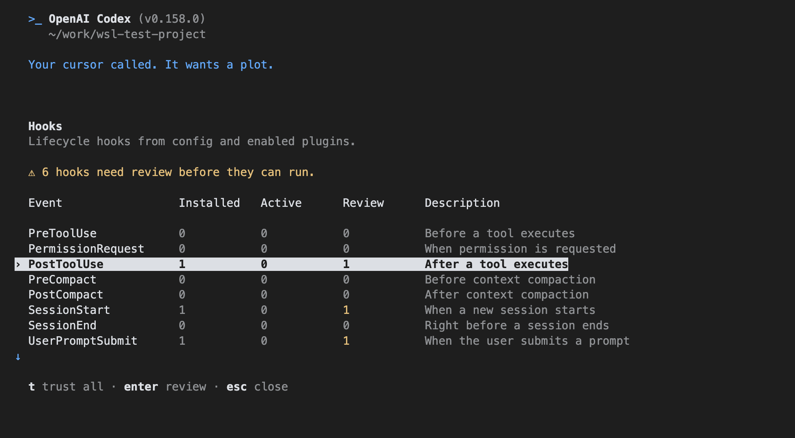
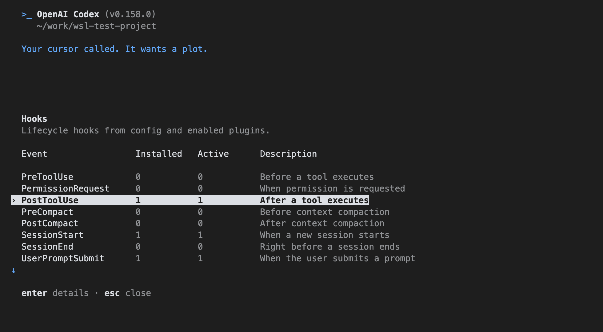

# Installation


> 日本語版: [install.md](../telemetry-install.md)

The standard `scripts/install.sh` also installs and updates the Gemini integration files. To use Gemini, install and sign in to Antigravity CLI yourself. [Gemini setup guide](antigravity.md)

## Optional dsh / Hermes installation

**Already using Claude Code or Codex?** Start with [Add DeepSeek or Local models](native-setup.md). An ordinary update does not install a new harness or register an API key for you. The sections below are the detailed configuration reference.

### Prepare settings from bundled examples

Installation distributes [instructions and four inactive examples](https://github.com/gyroid-eth/orrery-telemetry/blob/master/examples/native-harnesses/README.en.md) under `examples/native-harnesses/`. For installed runtimes it validates owned receipts/current references and reports an inactive `resolved/<snapshot-id>/` snapshot (B). For missing runtimes, model changes or adjustments, an existing agent can help with non-secret settings (A). Adjust the three peer-file absolute references after copying, then confirm the destination and backend. Secret input and activation require the person. Examples always have `enabled: false`; existing examples/private settings are not overwritten or automatically enabled.

The guide separates Mac Keychain references from Linux Secret Service `credential_ref`. Static Linux preparation does not establish real WSL secret retrieval, connectivity, Mail, exit or resume acceptance. Uninstall/purge removes only recorded, unchanged examples; edited/unrecorded files and private copies are retained.

### Ubuntu WSL Secret Service references (real-machine acceptance pending)

Linux catalog admission requires an explicit non-secret `backends.<id>.credential_ref` in the manifest:
`{"store":"secret-service","attributes":{"service":"example-service","account":"example-account"}}`.
Never put a key value in this reference. Attribute names start with an ASCII letter and use letters, digits,
`_`, `.`, or `-`; values are nonempty strings. Control characters, leading option-like `-` values and unknown stores are rejected.

dsh, Hermes and DeepSeek balance use this same reference through an internal reader.
Combining it with the existing dsh `keychain` or Hermes `key_cmd` produces `credential_reference_conflict`.
Mac configurations without the new reference retain their existing behavior.
The reader only performs `/usr/bin/secret-tool lookup`; it does not register, unlock, persist a key or fall back to another credential.
Do not run this internal reader to display a key as a verification step.

Secret Service, the same user's session D-Bus and an unlocked collection must be prepared separately.
`DBUS_SESSION_BUS_ADDRESS` and `XDG_RUNTIME_DIR` are non-secret connection context forwarded only to the relevant lookup process.
`credential_reader_unavailable` means a missing executable, `credential_unavailable` a failed lookup and
`credential_timeout` a lookup timeout. Static catalog checks do not look up keys or verify unlock state.
Balance availability remains separate from conversation success.

Checks use synthetic stores, generators and guards. Real WSL version/architecture/services, Linux runtime dependencies,
authentication, Mail, exit and resume remain unaccepted. This is not a verified Secret Service/D-Bus setup guide.
Windows bridging, a public login CLI and automatic configuration migration are outside this change.

### Existing installation and configuration

For Claude Code / Codex CLI, start with the common installation and each CLI's login below. For an API model through dsh / Hermes, first check the [supported combinations and limitations (Japanese)](https://github.com/gyroid-eth/orrery-telemetry/blob/master/docs/managed-catalog.md). The real-machine checks currently cover macOS in legacy mode; the common WSL2 / Linux installation alone does not enable it.

Before launching, prepare the optional harness, backend URL and formal model IDs, credential references, the private manifest and harness configuration connecting them, a work folder, and a choice of parent or standalone. The installer does not create backends or logins; common provider login is in design. Preparing these settings is a separate step from installing a runtime.

`install.sh --enable-dsh --dsh-node /absolute/node` installs dsh 0.2.1-rc.2 / TUI 0.16.1 and its native hook adapter for standard spawning. `--enable-hermes` installs Hermes commit d923a5eb487a17c0a68801bba9ef0f56c81040a8. Each lives in `harnesses/{dsh,hermes}/<generation>`. Supply both enable flags for both harnesses. Neither is acquired by default; updates preserve each saved enabled choice. For dsh, supply an existing Node >=24.2 by absolute path; that external Node is not downloaded. Acquisition uses npm/GitHub and the distributions required by Hermes PM. `--harness-cache PATH` supplies dsh tarballs/npm offline cache and local Hermes source; Hermes PM may still acquire its dependencies. `--dry-run` downloads and writes nothing.

Hermes uses the pinned Node/npm already acquired by its PM and the official `scripts/build/node-deps.mjs` and `tui.mjs` from the same pinned source. It prepares the locked `ui-tui` and `apps/shared` workspace dependencies and builds `tui-product/` within the generation. It does not run web/desktop builds or general setup. The generation ID includes the TUI recipe; updates create a new generation and retain old `exa1` runtimes and profiles. Python alone is insufficient: a missing TUI or failed build prevents publication and leaves the previous `current.json` intact. Receipts bind source, lock, PM Node/npm and output hashes, including on `keep`. The external Node selected for dsh is not used for Hermes. Hermes dependency acquisition and the TUI build need network access and additional disk space.

For Hermes source, an explicit `--harness-cache` takes priority. Without it, the installer checks ownership records, paths and the pinned commit before making an independent copy of an existing managed Git repository. It retains that repository's history and tags; uncommitted changes are not copied. If no usable managed source is available, it clones from the official GitHub repository as before. A cache or selected-source failure stops acquisition rather than silently trying another source. The pinned commit, CA changes and PM dependencies retain their existing checks. This improves updates that can reuse managed source; it does not promise smaller or faster fresh installs. PM dependency downloads may still need network access.

The absolute Node path is saved as `AGENTSTACK_DSH_NODE` in env.sh and preserved on ordinary updates. Older installs recover an unsaved path from dsh’s `current.json`. `--managed-spawn-config /absolute/manifest.json` saves only the private manifest reference used by the standard DeepSeek/Local catalog and launcher as `AGENTSTACK_MANAGED_SPAWN_CONFIG` and passes it to dashboard launchd/systemd/background services. It survives restarts, subsequent logins and ordinary updates; the manifest and credentials are not copied. Explicit options/environment override saved values.

When a standard catalog manifest is configured, dsh installation/update extracts effort levels and defaults from the pinned runtime without credentials or network requests and stores a capability cache inside that generation. Stale model/runtime metadata is not reused; an unavailable cache leaves the picker unknown. It never falls back to handwritten low/high choices. Launching without an effort uses the harness default.

`--disable-dsh` / `--disable-hermes` disable the selection and retain installed files. Normal uninstall removes receipt-owned runtime generations and adapters, retaining memories/skills in `harnesses/<harness>/profiles`. Manual `hermes-managed` and Hermes homes are neither read nor modified. External Node and supplied caches remain untouched. Credentials and logins are never installed or migrated. Each harness's `current.json` records its runtime references. Configure backend URL/model and Keychain service/account separately; startup performs static configuration validation. Installation alone does not make the catalog available.

After setup, select the model and an available harness (dsh or Hermes) in the bundled dashboard's NEW AGENT form or in the cockpit. The bundled dashboard sends the selected harness in its spawn request. See the [Mail round-trip check](getting-started.md#5-play-shiritori-as-an-end-to-end-check) and the [API reference](https://github.com/gyroid-eth/orrery-telemetry/blob/master/docs/api.en.md).

New Hermes children use a stable, separate HOME for each project and canonical name. Standard resume checks the saved pin and exact native session ID and reuses that HOME. Old shared-HOME pins stop with `native_resume_legacy_profile`; old data and pins are not migrated automatically. Real CLI checks with a synthetic provider confirmed storage, same-HOME/ID restoration and separation between children. Resume does not reinject the latest memory into the initial system prompt, and real-provider/full-Mail end-to-end acceptance remains incomplete. A common Telegram entry point is in design, and manual Local effort has not passed real Local server acceptance. See [current limitations (Japanese)](https://github.com/gyroid-eth/orrery-telemetry/blob/master/docs/managed-catalog.md#現在の制限).

[Back to README](../../README.en.md) · [Next: Launchers and identity](launchers.md)

This document is for people installing ORRERY Telemetry (this repository) for the first time. It takes three commands to install, two to verify, and one to start the first agent. Migration instructions for previous users of the third-party MCP Agent Mail are collected in the [appendix](#appendix-for-previous-mcp-agent-mail-users) at the end.


The installer also installs `bin/agentstack-resume`, used by the [stopped-child tool change procedure](delegation.md#resume-a-stopped-child-with-different-tools).

Run the installer from a complete repository checkout or source archive. `packages/agentstack_mail/src/agentstack_mail/schema_contract.py` and `packages/agentstack_mail/fixtures/global-server-s2a.json` are canonical inputs installed beside the runtime client, including dashboard-only installs. Missing inputs stop installation before deployment with `missing runtime client contract` and the missing file. Normal clones, the one-line installer and WSL installation obtain the whole repository.

## Supported environment

macOS is the primary target. The launchers and hooks are implemented to work with the system Bash 3.2 on macOS.

Required:

- Python 3.11 or newer (`python3`). The full suite has been measured on 3.12 / 3.13 / 3.14. There is no upper bound (CI runs 3.11, 3.12, and 3.14 every time, so incompatibility with a newer Python will fail there)
- `tmux`
- `git`
- `uv` (used to create the Python environment for the bundled ORRERY Mail)
- `lsof` for identifying which process owns a running dashboard port, `curl`, and `xz` for extracting Node tarballs
- Claude Code or Codex CLI. Keep Codex CLI current (`npm install -g @openai/codex@latest`). An old release (seen with 0.153.4) has GPT-6 models rejected for a ChatGPT account with `model is not supported when using Codex with a ChatGPT account` (0.158.0 worked). `agentstack-doctor` prints a note for releases older than 0.157

Optional:

- `fswatch`: mail watcher. Falls back to polling every two seconds when absent; notifications still arrive. The watcher itself is registered by the installer as a launchd / systemd service, so notifications are delivered no matter where an agent was started from
- `fzf`: directory picker for a launcher without arguments. The current directory is used when absent
- Ghostty: click-to-jump and window titles. Falls back to iTerm2, Terminal.app, or `none`. Only Ghostty can raise an existing window; iTerm2 and Terminal.app open a new window for every jump
- Obsidian: vault / Daily Note integration for `/log` and links that open Output items inside a vault. `/log`'s Obsidian mode is enabled only when `AGENTSTACK_OBSIDIAN_APP` is set; the installer does not set it. Without it, `/log` writes to local `logs/`, and the dashboard displays a generic project log as a non-link item

On macOS, the resident-service path is chosen by the actual result of bootstrapping into launchd's `gui/$UID` domain. If bootstrap is unavailable while the display sleeps, in an SSH-only environment, or for another reason, installation automatically switches to supervised-background mode, which detects and restarts an exited dashboard server. On Linux, the implementation uses a systemd user service or the same supervised-background mode when unavailable, but it is unverified on a plain Linux host; CI only tests unit generation with a stubbed `systemctl`. On WSL2 (Ubuntu 26.04 / WSL 2.7) the install, Mail, dashboard, `agent-start`, `/delegate` children, and dashboard jump (attach / resume in a Windows Terminal tab) have been checked on a real machine. For automatic hold and manual shutdown, see the WSL2 section of [troubleshooting](telemetry-troubleshooting.md). Native Windows is unsupported.

An explicitly specified `AGENTSTACK_PYTHON` is also checked for Python 3.11 or newer. When unspecified, the installer checks `python3` on PATH, then also searches versioned commands, `/opt/homebrew/bin/python3`, and `/usr/local/bin/python3` if needed. If no compatible interpreter exists, it reports the inspected versions and paths and stops before generating service files.

## Installation

```bash
git clone https://github.com/gyroid-eth/orrery-telemetry.git
cd orrery-telemetry
./scripts/install.sh --project-key /absolute/path/to/your-project
```

Pass the absolute path of the project where agents will work to `--project-key`, not the checkout of this repository. It is required on first install, and the installer stops without writing anything if it is omitted. Later installations inherit the previous value from `~/.agentstack/env.sh`, so it can be omitted.

When changes are needed, the installer has up to four confirmation points: Claude MCP registration and settings, Codex user instructions, and Claude user instructions. The instruction files are `$CODEX_HOME/AGENTS.md` and `$CLAUDE_CONFIG_DIR/CLAUDE.md` (defaults `~/.codex/AGENTS.md` and `~/.claude/CLAUDE.md`). Text outside the markers is preserved and changed files are backed up. See the [consent contract](instruction-migration.md#consent) for interactive and non-interactive behavior, and [Using ORRERY Mail from Claude Code](#using-orrery-mail-from-claude-code) to add skipped settings later.

The installer places:

- the dashboard, launchers, hooks, skills, bundled ORRERY Mail, `env.sh`, `VERSION`, and `install-state.json` under `~/.agentstack/`
- `~/.claude/skills/{delegate,log}` and `${CODEX_HOME:-~/.codex}/skills/{delegate,log}`, as symlinks into `~/.agentstack/skills/`
- The default resident components are the dashboard (port 8770), the ORRERY Mail autostart (fresh-install default `http://127.0.0.1:18765/mcp`), and the Mail watcher. The installer uses launchd on macOS or a systemd user manager on Linux when available. The dashboard uses supervised background mode if registration is unavailable. If the installer reuses an existing Mail service, the listener can differ from the default autostart job. See [ORRERY Mail service](#orrery-mail-service-handling).

`env.sh` uses mode `0600` and contains no token. Shell dotfiles are not changed.

### Verification

```bash
~/.agentstack/bin/agentstack-doctor
~/.agentstack/bin/agentstack-selftest
open http://127.0.0.1:8770/
```

`agentstack-doctor` reports separately whether required files and settings are present, whether the dashboard's `/api/version` actually responds, and whether launchd / systemd registration and execution state are healthy. When the endpoint responds but the manager is not running it, the result is `unmanaged-background`.

`agentstack-selftest` registers two real agents, exchanges messages, holds a file reservation, and confirms that the dashboard reads the result from the same database. Run it at least once after installation.

### Starting the first agent

A Claude Code session opened before installation does not rescan newly installed skills. Run `/exit` in the existing session, then start a new terminal and launch with the project path.

```bash
export PATH="$HOME/.agentstack/bin:$PATH"
agent-start /path/to/your-project
# Codex CLI なら
agent-start-codex /path/to/your-project
```

`agent-start` creates a tmux session with the same name as the ORRERY Mail identity. Dashboard jumps, mail notifications, and token recovery are joined by this name. In the launched Claude Code session, invoke skills with a leading slash, as in `/delegate`. In Codex, invoke `$delegate` (or `$log` for logs), or select the skill with `/skills`. See [Skills and file reservations](launchers.md#skills-2-and-file-reservations) for the first child launch.

## Installing on Windows (WSL2)

On Windows, install inside a WSL2 Ubuntu. Inside Ubuntu it is Linux, so the steps above apply unchanged. This is the order that worked on Windows 11 with Ubuntu 26.04 / WSL 2.7.

1. **Install WSL2 and Ubuntu** (PowerShell, once).
   ```powershell
   wsl --update
   wsl --install -d Ubuntu
   ```
   It ends by asking for a username and password. If it stops with an error such as `Wsl/Service/E_UNEXPECTED`, run `wsl --update` first and retry `wsl --install`.
2. **Enter Ubuntu.** Every command below is typed at the Ubuntu prompt (`user@PC:~$`). Typed at the PowerShell prompt (`PS C:\...>`) it fails at the first `&&`.
   ```powershell
   wsl -d Ubuntu
   ```
3. **Install the prerequisites** (inside Ubuntu).
   ```bash
   sudo apt update && sudo apt install -y ca-certificates curl git tmux python3 python3-venv lsof xz-utils
   curl -LsSf https://astral.sh/uv/install.sh | sh
   export PATH="$HOME/.local/bin:$PATH"
   uv --version
   ```
   If you plan to use Hermes, also run `sudo apt install libatomic1`.
   `fswatch` is optional. Without it the mail watcher falls back to polling every 2 seconds and notifications still arrive.
4. **Clone and run the installer** (inside Ubuntu). Keep the project on the WSL side (`~/work/...`): `/mnt/c` is slow and handles permissions differently.
   ```bash
   git clone https://github.com/gyroid-eth/orrery-telemetry.git
   cd orrery-telemetry
   ./scripts/install.sh --project-key ~/work/your-project
   ```
   Review and approve the changes shown in the interactive previews. `dashboard healthy` means the dashboard responds. Continue with the doctor and selftest in [Verification](#verification).
5. **Open the dashboard.** In a Windows browser open `http://127.0.0.1:8770/`. WSL2 forwards localhost to Windows, so it just works.
6. **Install Claude Code or the Codex CLI inside Ubuntu and log in.** A copy installed on the Windows side is not used: agents run inside Ubuntu's tmux.
   ```bash
   # Claude Code (native installer; lands in ~/.local/bin)
   curl -fsSL https://claude.ai/install.sh | bash
   # Codex CLI (needs Node.js; keep the global prefix under home to avoid sudo)
   sudo apt install -y nodejs npm
   npm config set prefix ~/.npm-global
   echo 'export PATH="$HOME/.npm-global/bin:$HOME/.local/bin:$PATH"' >> ~/.bashrc && source ~/.bashrc
   npm install -g @openai/codex@latest
   ```
   Log in with `claude` (then `/login`) and `codex login`. Open the URL each prints in a Windows browser to authorize.
   If Codex is also installed on the Windows side, Ubuntu's PATH shows that Windows `codex` (`/mnt/c/...`) too, and it cannot run inside Ubuntu. The installer skips it and chooses the `codex` installed inside Ubuntu (one that answers `--version`); an agent starting a Codex child with `/delegate` follows the same rules and, when its shell has no `AGENTSTACK_CODEX_BIN`, uses the value the installer saved in `~/.agentstack/env.sh`; re-running it also replaces a Windows `codex` saved by an earlier install. If `agentstack-doctor` prints `warn: Codex launcher binary ... cannot start Codex`, install Codex inside Ubuntu and re-run the installer. The reason comes in two forms. `exited with status N after 0s: …` means `codex --version` ended at once with an error, and the line that follows is that error (with `Missing optional dependency …`, the node on that shell's PATH is not the one Codex was installed with: run the installer from a login shell such as `zsh -lc`, or pass `--codex-bin`). `did not finish within 10s and was stopped` means it did not answer in time.
   If Codex was already installed in Ubuntu, update it too with `npm install -g @openai/codex@latest`: with an old release, a child started on a GPT-6 model is rejected by the API (on WSL, 0.153.4 was rejected and 0.158.0 answered).
   If you will use Codex children, after the installer [install the history binding and approve it once in `/hooks`](#using-codex-install-the-history-binding-and-approve-it-once-in-hooks). Without it, starting a Codex child can wait up to about 90 seconds.
7. **Start an agent** (inside Ubuntu). Use the same commands as in "Starting the first agent" above. The dashboard's jump opens a new Windows Terminal (`wt.exe`, preinstalled on Windows 11) tab attached to the tmux session. If Windows Terminal is missing, install it from the Microsoft Store.

**The legacy dashboard enables automatic WSL hold by default.** It holds a hidden `wsl.exe` while an agent runs or starts, or while the dashboard is visible. It releases after 60 idle seconds. Other Windows programs can keep WSL running. See [WSL2 troubleshooting](telemetry-troubleshooting.md#on-wsl2-closing-the-ubuntu-windows) for the status display and manual recovery.

On WSL, the installer enables the dashboard user unit when `systemctl --user` is available and lingering is enabled. Run `loginctl enable-linger "$USER"` inside Ubuntu before installing to start the dashboard at distro boot. The installer uses supervised background mode when it cannot confirm lingering. The Windows client handles automatic WSL retention.

## Non-interactive installation (`--assume-yes`)

See the [consent contract](instruction-migration.md#consent) for confirmation conditions and non-interactive behavior. Use the following option only after the user personally reviewed the repository and preview and granted approval in advance.

```bash
./scripts/install.sh --project-key /absolute/path/to/your-project --assume-yes
```

`--assume-yes` (short form `-y`; environment variable `AGENTSTACK_ASSUME_YES=1` is equivalent) grants approvals in advance; it is not `--force`. Python older than 3.11, a dashboard-port conflict, multiple or absent existing ORRERY Mail database candidates, disagreement with the running server, and automatic-setup failure still stop installation. Every automatically approved item is printed separately as an `assume-yes:` line. Agents and automation must not add this option “for convenience” without the user's explicit choice. The command-line option takes precedence over the environment variable and is not persisted in generated `env.sh`.

## Installation tiers and options

| Invocation | Tier | Behavior |
| --- | --- | --- |
| `./scripts/install.sh` | Tier 1 / default | Install all payloads and Claude / Codex skill links. Merge hooks, permissions, and Codex / Claude managed blocks only when approved after preview |
| `./scripts/install.sh --dashboard-only` | Tier 0 | Dashboard and helpers only. Do not install hooks, skills, or Codex / Claude templates |
| `./scripts/install.sh --scoped` | Tier 2 placeholder | Install payloads but do not change user settings / managed documents |
| `./scripts/install.sh --dry-run` | preview | Display planned changes without changing files or services |

`--dashboard-only` and `--scoped` are mutually exclusive. An unknown option or missing value stops before any changes.

```text
--install-dir PATH      default: ~/.agentstack
--project-key PATH      first install: required / re-install: existing env.sh
--port PORT             default: existing env.sh, else 8770
--label-prefix PREFIX   default: existing env.sh, else org.agentstack
--terminal MODE         auto | ghostty | iterm | terminal | none (default: existing env.sh, else auto)
--reset-settings        do not inherit settings from the existing env.sh (see Upgrade)
--spawn-dirs PATHS      NEW AGENT launch-directory presets (`:`-separated)
--spawn-roots PATHS     roots the directory typeahead may browse (`:`-separated)
--child-sandbox MODE    Sandbox for delegated children (on | off; default off)
--codex-approval MODE   Codex child `--ask-for-approval` (never | on-request | on-failure | untrusted; default never)
--codex-network MODE    Codex child sandbox network (on | off; default on)
--child-default-tools SPEC  Default child tools (e.g. 'mcp:cua-driver;dsh=' clears defaults for dsh)
--codex-add-dirs PATHS  extra writable roots for Codex children (`:`-separated)
--retire-legacy-mail    see the appendix (retire a previous MCP Agent Mail)
--mail auto|update|keep what to do with a running ORRERY Mail (default keep; --update-mail / --keep-mail are aliases)
--update-mail           always replace the running ORRERY Mail with this checkout's build (exit 1 if it cannot; docs/agentstack-mail-update.en.md)
--keep-mail             keep the running ORRERY Mail build (the default; AGENTSTACK_MAIL_UPDATE=auto switches only when it safely can)
--print-mail-plan       print one line saying what would happen to ORRERY Mail, then exit (reads only)
-y, --assume-yes        approval prompts only; validation errors remain fatal
```

An explicit `--project-key` always has highest priority, followed by environment variables `AGENTSTACK_PROJECT_KEY` / `PROJECT_KEY`, then an existing `env.sh` at the install destination. `--spawn-dirs` / `--spawn-roots` follow the same precedence and retain their previous values on reinstall; see “Spawn directory” in [configuration](telemetry-configuration.md). `--bin-dir` is not a public option. The installer calls `agentstack-merge-settings --bin-dir "$INSTALL_DIR/bin"` internally to expand `__AGENTSTACK_BIN_DIR__` in the permissions template.

## Merging settings, permissions, and Claude skills

The Tier 1 merge uses the JSON parser in `scripts/lib/merge_settings.py`.

- Preserve existing hooks, permissions, and other user settings
- Append only ORRERY Telemetry values, without duplicates
- Save a pre-merge settings backup in `~/.agentstack/backups`
- Record added entries and the change result in the manifest
- Idempotently update only content between managed-block markers
- Treat `install-state.json` as canonical for uninstall scope

Permission `deny` entries for ORRERY Mail tools are limited to **irreversible operations with no recovery mechanism**. Even destructive operations are left out of both allow and deny when they are recoverable, leaving them to runtime human approval. An operation is also not added to deny when the same state can be reached through another allowed tool, because doing so would provide no safety. The current three denied ORRERY Mail tools are `hard_delete_agent`, `hard_delete_project`, and `purge_old_messages`. Separately, one `Edit` on the skills directory below is denied.

The skills the installer places (`~/.agentstack/skills` and the `~/.claude/skills/<name>` symlinks that point into it) go into `additionalDirectories`, so an agent can read them without being asked even though they are outside its working directory. Without this, a parent agent in a fresh environment stops at Claude Code's question about reading outside the working directory the moment it reads the `/delegate` SKILL.md. To keep this to reading, `Edit` on the same location is added to deny. That deny stops Claude Code's file tools (Edit, Write and the like) and Bash writes it can recognise; it does not stop an indirect write through Python or Node running without a sandbox. A skill of the same name that the user placed themselves is not included.

The installer parses and merges structure rather than performing simple string replacement so that reinstall and uninstall do not sweep up user settings.

`skillsDirectories` is not a Claude Code setting, and the installer does not add a new value. Canonical skill payloads remain in `~/.agentstack/skills/<name>`, with absolute symlinks from Claude Code's standard path at `~/.claude/skills/<name>` and Codex's `${CODEX_HOME:-$HOME/.codex}/skills/<name>`.

```text
~/.claude/skills/delegate -> ~/.agentstack/skills/delegate
~/.claude/skills/log      -> ~/.agentstack/skills/log
~/.codex/skills/delegate  -> ~/.agentstack/skills/delegate
~/.codex/skills/log       -> ~/.agentstack/skills/log
```

An existing symlink to the same ORRERY Telemetry payload is reused and recorded as owned in the manifest. Because the link becomes invalid with the payload, it is removed on uninstall. An existing same-name file, directory, or symlink to another target is preserved with a warning and is not recorded as owned. Uninstall compares the manifest path with the actual symlink target and removes only an owned symlink that points to the ORRERY Telemetry payload. A path replaced by the user with a file or directory, or a retargeted symlink, remains.

The Codex examples above assume `CODEX_HOME` is unset. When set, links go into its `skills` directory. Reuse, conflict preservation, manifest recording, and uninstall rules apply to both hosts. In Codex, invoke `$delegate` or `$log`, or select them with `/skills`. The invocation hint in the managed block is applied through the usual `agentstack-codex-setup` preview and approval flow.

On systems where an old installer added `~/.agentstack/skills` to `skillsDirectories`, a reinstall with the Tier 1 settings merge approved removes only that old ORRERY Telemetry entry. Other user values in the same array and all other settings are preserved.

The installer leaves shell dotfiles alone. It writes the managed Claude instructions between markers in `$CLAUDE_CONFIG_DIR/CLAUDE.md` (default `~/.claude/CLAUDE.md`). See [instruction migration](instruction-migration.md#legacy-blocks) for older project blocks. The Claude Code user settings default to `~/.claude/settings.json` and can be changed with `AGENTSTACK_CLAUDE_SETTINGS`.

## Using ORRERY Mail from Claude Code

The `/delegate` skill allows `mcp__orrery-mail__*` tools, and the Claude Code user-scope MCP server name is fixed as **`orrery-mail`**.

The Tier 1 installer parses `mcpServers` in `AGENTSTACK_CLAUDE_JSON` (default `~/.claude.json`) as structure and adds or updates only the following entry, preserving all other servers and project settings.

```json
{
  "mcpServers": {
    "orrery-mail": {
      "type": "http",
      "url": "http://127.0.0.1:18765/mcp"
    }
  }
}
```

The diff preview replaces bearer tokens with `<redacted>`. Only an interactive `yes` or a user-explicit `--assume-yes` authorizes an atomic mode-`0600` write, with the original file saved in `~/.agentstack/backups`. A non-interactive unapproved run does not write; the installer and `agentstack-doctor` show safe preview / apply commands. `agentstack-selftest` checks this fixed name, endpoint, and authorization registration in addition to the HTTP server itself.

If registration is absent or you answered `no` during installation, follow the doctor's output to preview it.

```bash
~/.agentstack/bin/agentstack-doctor
```

For Codex children, the launcher automatically generates a child-scoped MCP proxy configuration. To use top-level Codex CLI through `agent-start-codex`, add the following once to `$CODEX_HOME/config.toml`. The bootstrap reads `MCP_AGENT_MAIL_TOKEN` into process environment, so the token itself does not need to be stored in TOML.

```toml
[mcp_servers.orrery-mail]
url = "http://127.0.0.1:18765/mcp"
```

The key is fixed as `[mcp_servers.orrery-mail]`.

### Using Codex: install the history binding and approve it once in `/hooks`

When a Codex child starts, the launcher confirms that the child began its first task from that launch's Codex record (rollout). This needs the receipt that the Codex history binding (an optional plugin) leaves at startup. **Without it, starting a Codex child can wait up to about 90 seconds** (a short reply on screen may end the wait early, but that is not the receipt's confirmation of the start, and a long reply can still wait the full 90 seconds). With the receipt in place, both short and long tasks were confirmed in about 7 seconds on a real WSL machine.

The steps are the same on macOS and on WSL (inside Ubuntu).

1. Install the integration (from the repository checkout).

   ```bash
   . "$HOME/.agentstack/env.sh"
   ./scripts/install-codex-app-integration.sh \
     --project-key "$AGENTSTACK_PROJECT_KEY" \
     --agent-mail-url "$AGENTSTACK_MCP_URL"
   ```

   It uses the codex the core installer saved in `~/.agentstack/env.sh` (on WSL it never picks the Windows `codex`). Outside macOS it does not install the resident Bridge service and prints `Bridge service: not installed`; the history binding for Codex children does not need that service.
2. Start Codex with the codex the installer chose, and open `/hooks`. At the end the installer prints the command for this on the line after `Next: start Codex with the codex this installer used:`. Normally it is:

   ```bash
   "$AGENTSTACK_CODEX_BIN" -C "$AGENTSTACK_PROJECT_KEY"
   ```

   Do not use a bare `codex`: on WSL the first `codex` on PATH is often the Windows install, which cannot run inside Ubuntu. `/hooks` lists the hooks that need review, with the review count for the installed plugin.

   

3. Check them, then approve (`t` trusts all). The approved hooks appear as active.

   

4. Quit that `codex`. The approval applies to Codex processes started afterwards, not to Codex children already running.

`agentstack-doctor` shows whether the history binding plugin is installed and enabled. It cannot read whether the hooks are approved, so check that in `/hooks`. For details see [Codex App integration](codex-app.md).

### Managed instruction helper

The helpers used by Tier 1 to preview / merge can also run independently.

```bash
~/.agentstack/bin/agentstack-codex-setup --print
~/.agentstack/bin/agentstack-claude-setup --print
```

`--print` only displays the target and the block with placeholders resolved; it makes no changes. With no arguments, the helper backs up the existing file and installs / updates only the ORRERY Telemetry block between markers.

```bash
~/.agentstack/bin/agentstack-codex-setup
~/.agentstack/bin/agentstack-claude-setup
```

`--check` compares the block already in each target with the block the installed template renders now, and changes nothing. It reports `ok` only when the text between the markers matches; otherwise it says whether the block differs (older instructions, or edited by hand), is missing, or has broken markers, and prints the exact command that updates it, with the resolved `CODEX_HOME` / scope. Text outside the markers is not compared. `agentstack-doctor` and the end of the installer use this same check. When you skip the managed setup, the installer ends with `Runtime updated; managed instructions differ` and those commands: agents started after that still read the old block until you run them.

```bash
~/.agentstack/bin/agentstack-codex-setup --check
~/.agentstack/bin/agentstack-claude-setup --check
```

Claude uses the user `$CLAUDE_CONFIG_DIR/CLAUDE.md`; Codex uses `$CODEX_HOME/AGENTS.md`. `--uninstall` removes only recorded markers and retains full-file backups. See [instruction migration](instruction-migration.md) for legacy blocks, interrupted work, shared repositories and purge.

## ORRERY Mail service handling

The bundled ORRERY Mail runs with `AGENTSTACK_MAIL_AGENT_NAME_ENFORCEMENT_MODE=passthrough`, which registers exactly the identity requested by a launcher. Its default endpoint is `http://127.0.0.1:18765/mcp`, and its state root is `~/.agentstack/mail`. It does not use an HTTP bearer; each agent's owner token is handled through a tool argument / local proxy.

If something already responds at the endpoint, the installer reuses it only when it is ORRERY Mail returning the same database. A listener returning another database is not reused, and installation stops before the first write. In a fresh environment, the installer places the bundled package's virtual environment under a candidate ID, initializes empty state, and continues only after confirming that the health response returns the configured database; see the [agentstack-mail document](https://github.com/gyroid-eth/orrery-telemetry/blob/master/docs/agentstack-mail.en.md) for the internal structure.

The following controller operates the service. The runner restarts itself five seconds after a crash, while the controller checks the PID file, endpoint, and database and refuses duplicate startup or stopping an unrelated process.

```bash
~/.agentstack/bin/agentstack-mailctl start
~/.agentstack/bin/agentstack-mailctl status
~/.agentstack/bin/agentstack-mailctl stop
~/.agentstack/bin/agentstack-mailctl restart
```

Even if dashboard service registration or a health check fails, payload generation, approved managed blocks, and `install-state.json` still complete; the installer finishes by showing a warning and the manual command for supervised background. If mail-service provisioning or database health fails, installation stops. Check the actual dashboard residency mode with `~/.agentstack/dashboard/agentctl.sh status` and `agentstack-doctor`.

## VERSION

The repository-root `VERSION` is canonical. The installer copies it into the install root.

`GET /api/version` resolves the version in this order:

1. `VERSION` adjacent to the installed artifact
2. Repository `VERSION`
3. `git describe --tags --always --dirty`
4. `unknown`

Do not copy only the dashboard HTML; update `VERSION` through the installer as well. This keeps the distributed artifact and displayed version consistent.

## macOS TCC / Full Disk Access

`~/Desktop`, `~/Documents`, and `~/Downloads` are protected by macOS TCC. If a root agent starts from a terminal without Full Disk Access, that terminal identity propagates to tmux and its descendants, and only a child agent may encounter `EPERM`.

Remedies:

1. Start the root agent from a terminal with Full Disk Access
2. Or move the project outside protected locations
3. After changing context, recreate the existing tmux server / session

The launcher warns about this state. If needed:

```bash
export AGENTSTACK_TCC_GUARD=0
export AGENTSTACK_TCC_DIRS="$HOME/Desktop:$HOME/Documents:$HOME/Downloads"
```

The canonical `AGENTSTACK_TCC_DIRS` syntax is colon-separated. Legacy whitespace-separated values without a colon remain accepted for compatibility.

Do not attempt to repair these permission errors only with `chmod`. The deciding identity is the originating application, not the file mode.

## Upgrade

Finish work or release active file reservations before updating protection settings; restart affected sessions together after the update. Preview the selected roots first.

```bash
git pull
./scripts/install.sh --dry-run
./scripts/install.sh
~/.agentstack/bin/agentstack-doctor
```

The installer updates payloads and `VERSION`, reregisters services, and previews managed merges again. It validates and reuses the bundled ORRERY Mail candidate and state.

After updating, restart running agents (Claude Code, Codex, dsh, Hermes, including persistent bots). Managed block instructions and the ORRERY Mail tool list (such as `show_files`) are loaded when a session starts, so a session keeps the pre-update versions until it restarts. If you decline the managed merge preview, the instructions are not updated either.

### Reservation protection migration

Top-level and delegated-child launches protect their selected physical working directory, preceded by ordered `AGENTSTACK_EXTRA_PROTECTED_ROOTS`. Git root discovery does not automatically enlarge protection. Namespace selection and the installed project key are unchanged. Install/update automatically selects process extras (including empty), installed extras (including empty), then the installed legacy `AGENTSTACK_PROTECTED_ROOTS` literal value and order exactly once, then empty. It never imports ambient shell/tmux legacy roots. The installer shows the source, value, and destination in `--dry-run` and stops before overwrite if legacy configuration is invalid or ambiguous.

An empty extras marker is persisted, so an old list cannot be imported again. The old installed field is retained only for direct/unmanaged-hook compatibility; managed launches ignore it. A different nonempty shell/tmux legacy value still warns even when extras exist. `--reset-settings` keeps extras; `AGENTSTACK_EXTRA_PROTECTED_ROOTS=` deliberately clears them. Finish work or release active reservations before cutover, then restart affected sessions together after updating: relative reservation names use the first matching root. See [configuration and migration](telemetry-configuration.md#reservation-protection-and-migration).

### What a re-install inherits

After updating, newly launched or resumed delegated children run with the sandbox off by default. Pass `--child-sandbox on` to the installer to enable it. The saved setting carries over to later updates. [Provider settings](telemetry-configuration.md#child-spawn)

A re-install decides each setting in this order:

1. an explicit value (an option, or an environment variable set when the installer runs)
2. the value the previous install wrote to `~/.agentstack/env.sh`
3. the default

A setting you changed from its default therefore survives `./scripts/install.sh` in a new terminal without the environment variable. This covers the project key and explicit extra protected roots, the dashboard port (`AGENTSTACK_PORT`), the label prefix (`AGENTSTACK_LABEL_PREFIX`) and the ORRERY Mail launchd label derived from it, the terminal, the MCP URL, the service `PATH`, Python, the ORRERY Mail state root (where the database lives), service root and management socket, `AGENTSTACK_LANG` / `AGENTSTACK_MURMUR` / `AGENTSTACK_DELIVERABLE_ROOTS`, `AGENTSTACK_VAULT`, `AGENTSTACK_MANAGED_AGENTS_FILE`, the dashboard log and restart settings (`AGENTSTACK_DASHBOARD_LOG` / `_LOG_MAX_BYTES` / `_LOG_BACKUPS` / `_RESTART_DELAY`), spawn dirs / roots, the worktree root, the Codex child settings, `AGENTSTACK_CODEX_BIN`, portraits and the model catalogs. The canonical list is `AGENTSTACK_INHERITED_SETTINGS` in `hooks/project-context.sh`.

- **Saved values that differ from the current defaults are preserved.** This also applies when `AGENTSTACK_CHOSEN_SETTINGS` is missing or does not list the setting. Settings such as child terminal auto-open and the portrait folder are added to that list for subsequent updates. This includes `PATH` and Python. A setting already listed is inherited even when its value matches the current default. `AGENTSTACK_CODEX_BIN` also inherits the location the installer found (and searches again when it no longer runs). Protection extras are selected separately by the presence-aware migration order described above, regardless of `AGENTSTACK_CHOSEN_SETTINGS`.
- To change a previous value, give that option or environment variable explicitly (for example `./scripts/install.sh --port 8771`).
- **To put just one setting back to its default, give it explicitly empty** (for example `AGENTSTACK_VAULT= ./scripts/install.sh` or `./scripts/install.sh --codex-add-dirs ""`). Removing that setting's value line from `env.sh` also restores the default unless you pass a value for this run. Removing only its name from `AGENTSTACK_CHOSEN_SETTINGS` still preserves a saved nondefault value.
- To put every chosen value back to its default, pass `--reset-settings` (or `AGENTSTACK_RESET_SETTINGS=1`). Where the data lives, and what the services running on it are called, are inherited even then: the project key, explicitly configured extra protected roots, the ORRERY Mail state root, service root and management socket, the label prefix, the ORRERY Mail launchd label and the MCP URL. Resetting those would leave the previous service registered while a second ORRERY Mail, under another name, started on the same database. Give them explicitly to change them (and stop the previous service yourself). Explicit extra protected roots stay protected after reset; pass `AGENTSTACK_EXTRA_PROTECTED_ROOTS=` to clear them deliberately.
- An environment variable equal to the value `env.sh` recorded is taken to come from a shell that sourced `env.sh`, or from ORRERY cockpit's update script, not as a new choice: the inheritance rules above apply, and `--reset-settings` resets it. A value passed as an option is always explicit. Against an `env.sh` from an earlier release, which has no record of choices, an equal value is still explicit, so a value you have always passed is not reset.
- If the Python recorded last time is gone or too old, the installer says so and searches again (an explicit `AGENTSTACK_PYTHON` that cannot be used still stops the install).
- `AGENTSTACK_CLAUDE_JSON` is not inherited. It is an override for installing into a sandbox; the next ordinary install writes `~/.claude.json`.
- The ORRERY Mail service env (`AGENTSTACK_MAIL_ENV`) and database path (`AGENTSTACK_MAIL_DB`) are not inherited settings; they are derived again from the state root and render each time (below).

The start of a dry-run prints the resolved project key, port, label prefix, terminal and MCP URL. When `AGENTSTACK_AUTO_OPEN_CHILD` or `AGENTSTACK_PORTRAITS_DIR` actually changes, it also shows the old → new value, including resets (an empty value appears as `(empty)`).

If your shell sources `env.sh` at startup, its `AGENTSTACK_*` values count as explicit. After re-installing from another shell, open a new shell or source `env.sh` again before using a launcher or the installer.

The running ORRERY Mail build stays in use; when it differs from this checkout's build, a `notice:` says so. To replace the build too, add `--update-mail`: the candidate is verified and the database backed up while Mail keeps serving, then the build is switched, and the previous build is put back if the new one does not answer. `AGENTSTACK_MAIL_UPDATE=auto` (opt-in) switches only when it safely can, and otherwise keeps the running build and lets the install succeed. The final `mail-result:` line reports the outcome ([agentstack-mail-update.en.md](agentstack-mail-update.md#replacing-the-build-with---update-mail)).

**Keep the ORRERY Mail server running during an in-place upgrade.** The real database path resolved from the running listener takes precedence over filesystem candidate discovery. Stopping ORRERY Mail first falls back to candidate discovery, and the installer stops rather than risk choosing incorrectly in an environment with several databases.

`AGENTSTACK_MAIL_ENV` is a runtime value the installer writes into `env.sh`, which shells read at startup. A render path is derived from the source id and a hash of venv, endpoint and state, so **the value one install writes does not match what the next upgrade expects**. The installer treats an inherited value as unset, and resolves the current render, only when it both **matches the value read out of `env.sh` and sits in this installation's managed render layout** (`<native service root>/renders/<one directory>/service.env`). The waiver prints one line when it applies.

**Equal values cannot prove who set the variable.** To pin a native path across upgrades, set `AGENTSTACK_MAIL_SERVICE_ENV` explicitly: it takes precedence and is never waived. A path outside the managed render layout still stops the installer as before.

If a long-lived shell holds a render from before another shell updated `env.sh`, re-source the installed `env.sh`, or scope the unset to that one command: `env -u AGENTSTACK_MAIL_ENV ./scripts/install.sh`.

If the dashboard port is held by a process under the current ORRERY Telemetry launchd job or supervised-background pidfile, the installer verifies ownership and replaces that dashboard with the new payload. It still stops if an unrelated process holds the same port.

Service environment is written into plist / unit files during installation. Changing only `~/.agentstack/env.sh` does not affect an existing service, so rerun the installer or update the service definition too.

## Uninstall

```bash
~/.agentstack/bin/agentstack-uninstall --dry-run
~/.agentstack/bin/agentstack-uninstall
```

The uninstaller targets only files, services, and settings changes recorded in `install-state.json`.

- Structurally remove merged Claude settings entries
- Remove ORRERY Telemetry-owned files
- Remove only owned directories that become empty
- Preserve ORRERY Mail state / database and the runtime directory (annotations, tokens, session state / logs) by default

Legacy `dashboard/annotations.json` is not included among payload-owned files because it is user state. During upgrade, the installer automatically migrates it to `$AGENTSTACK_RUNTIME_DIR/annotations.json` before copying payloads. It remains in the runtime directory after a normal uninstall.

To remove retained data too:

```bash
~/.agentstack/bin/agentstack-uninstall --purge-data
```

`--purge-data` also targets only exact paths recorded in the manifest; it does not remove a home directory or an unrecorded path. The runtime directory is a purge path, so this option also removes annotations.

## Appendix: for previous MCP Agent Mail users

This section does not apply to first-time users. It is for people who ran the third-party [MCP Agent Mail](https://github.com/gyroid-eth/orrery-telemetry/blob/master/docs/third-party.md), on which the bundled ORRERY Mail is based, as their own launchd job.

### Retiring the legacy launchd mail service

When a legacy `mcp_agent_mail` launchd job holds the endpoint, run the installer with explicit `--retire-legacy-mail`. **Before** checking whether it can reuse the existing listener as ORRERY Mail, the installer compares known legacy labels with plist executables, boots out the matching job, and parks its plist in `~/.agentstack/parked-launchd/`. Without the flag, it does not stop the service; it reports the detected label and required flag, then stops.

`--dry-run --retire-legacy-mail` does not actually stop the job, but first displays the retirement plan and then shows the bundled ORRERY Mail provisioning plan under the assumption that the listener will be retired. Repeated legacy scans within the same installer process do not boot out or park the job twice.

If Claude Code's old `mcp-agent-mail` key points to the same endpoint, an approved settings merge moves it to the `orrery-mail` key. An old key pointing to another endpoint remains as an unrelated entry.

### Manual migration of the legacy database

To retain old state (database, archive, and signals), first stop the old writer and confirm all three paths. The installer does not migrate automatically. With the destination still absent, manually run the migration CLI's `copy` and `verify` from the repository checkout, then run the installer.

```bash
LEGACY_DB="/absolute/path/to/the-stopped-legacy-database"
LEGACY_ARCHIVE="/absolute/path/to/the-stopped-legacy-archive"
LEGACY_SIGNALS="/absolute/path/to/the-stopped-legacy-signals"
DESTINATION="$HOME/.agentstack/mail"

uv run --project packages/agentstack_mail agentstack-mail-migrate copy \
  --source-db "$LEGACY_DB" \
  --source-archive "$LEGACY_ARCHIVE" \
  --source-signals "$LEGACY_SIGNALS" \
  --destination-root "$DESTINATION"

uv run --project packages/agentstack_mail agentstack-mail-migrate verify \
  --source-db "$LEGACY_DB" \
  --source-archive "$LEGACY_ARCHIVE" \
  --source-signals "$LEGACY_SIGNALS" \
  --destination-root "$DESTINATION"

./scripts/install.sh
```

The migration helper and service controller reject configurations that share a source and destination database / archive. At the 2026-08-12 cutover, this procedure actually transferred and verified about 60,000 database and archive records in total. Keep the old writer stopped from copy through verify.

### Rollback

The installer does not automatically switch back to the third-party version. If necessary, stop ORRERY Mail and recover manually with the migration and settings backups.

## Optional mobile reader

Normal installation and updates leave the mobile reader off and do not start a listener or Serve. To configure a dedicated, view-only route for the owner’s designated phone, follow [mobile setup](mobile.md). It uses legacy Telemetry API 30 or later; global mode is unsupported. Mail content opens only after authentication and a tap on one event. Device policy, real Serve and phone acceptance are separate operator steps.

## Related documentation

- [Launchers and identity](launchers.md)
- [Hooks and operational helpers](https://github.com/gyroid-eth/orrery-telemetry/blob/master/docs/hooks.en.md)
- [Codex App integration](codex-app.md)
- [Configuration](telemetry-configuration.md)
- [Troubleshooting](telemetry-troubleshooting.md)
- [Third-party components](https://github.com/gyroid-eth/orrery-telemetry/blob/master/docs/third-party.md)

## Local deterministic daemon helper

[Dedicated bindings and notifications](https://github.com/gyroid-eth/orrery-telemetry/blob/master/docs/daemon-agents.en.md) use a fixed local source release, not a newly installed general launcher. They require a Mail build advertising its UUID in HTTP health. Do not impersonate a Claude/Codex profile; live Mail updates, identity creation and deployment require separate operator approval.

For explicit isolated launch, delivery and operator recovery, see [global delivery client](https://github.com/gyroid-eth/orrery-telemetry/blob/master/docs/global-delivery-client.en.md). Legacy remains the default.
