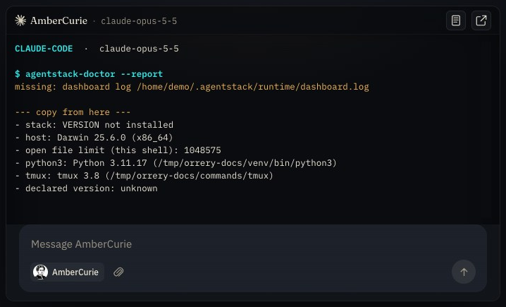

# Troubleshooting



This isolated example has no dashboard log. Use `agentstack-doctor --report` to check the error and collect environment details.

> 日本語版: [troubleshooting.md](../telemetry-troubleshooting.md)

[Previous: Configuration](telemetry-configuration.md) · [Back to README](../../README.en.md) · [Next: Third-party components](https://github.com/gyroid-eth/orrery-telemetry/blob/master/docs/third-party.md)

Start with:

```bash
~/.agentstack/bin/agentstack-doctor
git -C /path/to/orrery-telemetry status --short
```

The core doctor checks the install footprint, required commands, managed blocks (not only that the markers exist, but that the text matches the installed template; if not, it prints the command that updates it), managed agent names, tmux mouse support, tmux global identity environment, dashboard endpoint, and service-manager state. Use `git status` to inspect repository-side changes.

The dashboard treats a correct JSON response from `/api/version` as canonical evidence of what is actually being served and reports it separately from launchd / systemd registration and execution. If the endpoint responds but the manager is not running it, the mode is `unmanaged-background`. Check mail-watcher health separately at `/api/mail-watcher-health`.

## Reporting a bug

```bash
~/.agentstack/bin/agentstack-doctor --report
```

Paste the output verbatim from `--- copy from here ---` through `--- copy to here ---`.

**Every defect found so far came from a difference between the reporter's environment and the development machine**, and locating that difference took several exchanges each time. This output contains only the questions actually asked in those exchanges.

| Item | What it reveals |
|---|---|
| ORRERY Mail commit and distance ahead of origin | Which code is actually running |
| `AGENT_NAME_ENFORCEMENT_MODE` | Whether the requested name passes through unchanged |
| presence of the passthrough patch | Whether that mode is accepted by the installed version |
| requested-name handling | Final decision combining #140 / passthrough / legacy behavior. `unknown` means undetermined |
| presence of the `agents.retired_at` column | Whether dashboard queries can execute |
| open-file limit | Whether the process can exhaust descriptors and exit |
| availability and versions of tmux / python3 / uv / claude / codex | Whether prerequisites are present |

**No tokens or Authorization headers are included.** Values are intentionally omitted and tests lock this behavior so the report can be pasted directly into chat. Add “what you did,” “what you expected,” and “what happened” in the final field. Pasting error text verbatim is fastest.

## `MCP tool call requires approval, but approval policy is never`

A Codex child called an inherited MCP server without an explicit allow rule for that server or tool. For example, save this TOML fragment at an absolute path and rerun the installer:

```toml
[mcp_servers.chrome-devtools]
default_tools_approval_mode = "approve"
```

```bash
./scripts/install.sh --codex-child-overlay /absolute/path/to/overlay.toml
```

To allow only one tool, use `approval_mode = "approve"` under `[mcp_servers.chrome-devtools.tools.take_screenshot]`. See [Delegation and child agents](delegation.md#codex-children-and-mcp-approvals) for details and an endpoint override example.

## Windows Mail archives exceed MAX_PATH

A long canonical project path and message subject can make an archive path
exceed Windows MAX_PATH and fail with `WinError 206`. Archive filesystem access
uses extended-length paths, while Git staging uses Git with `core.longpaths=true`
in the archive repository's local configuration. Project identities, slugs and
filenames are preserved; global Git configuration is not changed.

The Windows regression exercises message persistence, Git staging and startup
recovery beyond 260 characters. It does not establish native Windows installer,
service supervision or Codex Desktop Bridge support. UNC conversion is included
but has not been exercised against a network share.

## `NOT CONFIGURED`

The dashboard service has neither `AGENTSTACK_PROJECT_KEY` nor `AGENTSTACK_VAULT`.

Check:

1. `~/.agentstack/env.sh`
2. environment in the launchd plist / systemd unit
3. `/api/graph` after restarting the service

Repair:

```bash
export AGENTSTACK_PROJECT_KEY=/absolute/project/path
./scripts/install.sh
```

DECK tmux state remains visible without this configuration. It is an intentional degraded mode where only mail edges, history / replay, and spawn are unavailable. Output still searches the cwd / Git-root `logs/` fallback.

## Output is empty or not linked

Output files must be named `LOG_*.md`, and frontmatter `agent:` must match the dashboard's canonical agent name.

1. If `AGENTSTACK_DELIVERABLE_ROOTS` is set, confirm the service process can read each `:`-separated directory
2. Otherwise check `AGENTSTACK_PROJECT_KEY/logs/`, then the vault and cwd / Git-root fallbacks
3. If only `env.sh` changed, rerun the installer to update launchd / systemd environment
4. A non-link item is correct outside `AGENTSTACK_VAULT`; only items inside the vault receive `obsidian://` links

## launchd does not start

```bash
label=org.agentstack.agentdashboard
plist="$HOME/Library/LaunchAgents/$label.plist"
target="gui/$(id -u)/$label"

launchctl enable "$target"
launchctl bootout "$target" 2>/dev/null || true
while launchctl print "$target" >/dev/null 2>&1; do sleep 0.1; done
launchctl bootstrap "gui/$(id -u)" "$plist"
tail -f ~/.agentstack/dashboard/dashboard.log
```

Run `enable` before `bootstrap`. Bootstrapping a disabled label first can produce macOS `Input/output error`. Because `bootout` is asynchronous, wait until `launchctl print` no longer sees the job before registering it again. The installer and `agentctl.sh start` perform this order automatically, with the existing supervised-background fallback when the GUI domain itself is unavailable.

Common causes:

- another process uses port `8770`
- the plist has stale Python / PATH values
- `~/.agentstack` was moved
- only `env.sh` changed after installation
- dashboard files were copied incompletely

To change the port:

```bash
AGENTSTACK_PORT=8771 ./scripts/install.sh --port 8771
```

When the installer detects an occupied port, it stops before service registration.

## No service on Linux / WSL

**Plain Linux is unverified; WSL2 has been checked on a real machine.** The systemd user path and supervised-background fallback are implemented, but registration and timer startup have not been exercised on a plain Linux host. CI on ubuntu-latest stubs `systemctl` and checks only unit generation and call order. On WSL2 (Ubuntu 26.04 / WSL 2.7) the Mail timer start, the dashboard, agent launch, and jump have all been run. If it fails, report the environment and output in an issue.

When a systemd user session is available:

```bash
systemctl --user status org.agentstack.agentdashboard.service
systemctl --user daemon-reload
```

The installer enables the dashboard's systemd user unit on WSL2 when the user manager is available and lingering is enabled. It uses `nohup` plus a pidfile when the user manager is unavailable or it cannot confirm lingering on WSL2. The localhost dashboard and browser terminal can work. On WSL2 the dashboard's jump opens a new Windows Terminal (`wt.exe`) tab that attaches to tmux through `wsl.exe -d <distro>` (`AGENTSTACK_TERMINAL=auto` picks `wt`); on plain Linux jump stays unsupported.

### On WSL2, closing the Ubuntu windows

**The legacy dashboard keeps WSL running automatically while agents work.** It uses WMI to create a hidden `wsl.exe` independently of the originating Windows connection and releases it after 60 idle seconds. `agentstack-doctor` reads the Windows `.wslconfig` without modifying it.

- A Claude, Codex or Antigravity process running in tmux keeps the hold, including while waiting for approval or a reply.
- NEW AGENT in the dashboard and `agent-start` / `agent-start-codex` reserve a hold before launching. If they cannot confirm the hold, the launch continues and the NEW AGENT notification or the shell's `WSL hold: ...` line explains why. Leftover reservations expire after three minutes.
- A visible dashboard page also keeps the hold. Hiding or closing the page drops that reason. The dashboard service, Mail, watcher and tmux recorder connections do not count on their own.
- The header shows the reason as `WSL kept · 2 agents` or the countdown as `WSL hold ends in 42s`. Run `agentstack-doctor` for reasons, the Windows PID and status freshness.
- If tmux or the process list cannot be read, the hold stays for the agents last seen and the header shows `WSL kept · state unknown`. After more than 30 seconds without an update, the header shows `WSL status stale`.
- If the hidden `wsl.exe` exits early, the dashboard tries to restart it. After three consecutive failures it waits five minutes before retrying. If the dashboard itself exits, the hold continues while the last observed agents are alive.

**If automatic hold is unavailable, keep one Ubuntu window open on Windows while agents work.** Use this fallback if the header shows `WSL not kept` or if you disabled the hold. Install with `--no-wsl-anchor` or `AGENTSTACK_WSL_ANCHOR=0` to disable it, and `--wsl-anchor` to restore it. The installer saves the choice in `env.sh`.

Programs started from a desktop window such as Windows Terminal can leave a Windows `wslhost.exe` running after the last window closes (observed for more than 90 seconds on WSL 2.7.13). When programs are started through the Windows SSH server, that `wslhost.exe` goes away when the connection closes. With no automatic hold or other Windows client, WSL stopped about 15 seconds after the last connection closed on WSL 2.7.13. Connecting directly to an sshd inside WSL has not been checked.

If WSL stays running after the hold ends and you want to stop it immediately, run the following in PowerShell. It stops **every distro and the WSL VM immediately**. Save and close the agents' work and anything else running in WSL, including other distros, first.

```powershell
wsl --shutdown
```

The next time Ubuntu opens, the enabled systemd user unit starts the dashboard and the Mail timer attempts to start Mail about one minute later. If the dashboard uses supervised background mode, start it with `agentctl.sh start`.

- To start the systemd user manager at distro boot and keep the dashboard, the Mail timer and the watcher running after logout, run `loginctl enable-linger "$USER"` inside WSL before running the installer.
- In `.wslconfig`, `[general] instanceIdleTimeout=-1` keeps distros running and `[wsl2] vmIdleTimeout=-1` keeps the VM running after distros stop. After verifying that automatic hold survives disconnecting in your usual setup, you can remove these settings. Follow the guidance from `agentstack-doctor` and run `wsl --shutdown` once with the precautions above.

If the native Windows helper (`scripts/windows/`) also runs on the same PC: WSL2 forwards 8770 to the Windows localhost, so a leftover native dashboard on the same port answers the browser instead and the WSL agents never appear. Change one of the ports, or stop the native side before opening the page.

## `EPERM` on macOS

Suspect TCC under Desktop / Documents / Downloads.

1. Start the root agent from a terminal with Full Disk Access
2. End the existing tmux server / session
3. Recreate it from the same terminal
4. Or move the project outside protected locations

`chmod` may not repair this because the originating application identity, not file mode, is evaluated. See [Installation](telemetry-install.md#macos-tcc--full-disk-access) for details.

## Notification text enters Codex but is not submitted

Do not combine text and submit in one `send-keys` call.

```bash
tmux send-keys -t "$session" -l "$text"
sleep 0.2
tmux send-keys -t "$session" C-m
```

Use `C-m` because the `Enter` keysym does not always submit in the Codex REPL.

Additional checks:

- whether the target pane is a Codex / Claude REPL rather than a bare shell
- backlog under `AGENTSTACK_SIGNALS_DIR`
- `watcher_running` from `/api/mail-watcher-health`
- `last_success_age_s` and `recent_results`

## Mail watcher is yellow / red

Signals older than 24 hours with a confirmed absent tmux recipient are reported as `orphan_signal_count` and excluded from health backlog. The watcher now removes a notification signal once a successful session inventory confirms the recipient is absent, without changing the Mail message or inbox. Leftovers from older watchers or uncertain tmux lookups can still remain; retained signals alone do not prove a delivery failure. Live recipients, recent signals, headless runtime manifests and unknown tmux measurements remain actionable. Doctor warns with the orphan count and cleanup instructions; this warning alone does not fail a green health check.

Preview candidates after loading the installed environment. Add `--prune` to recheck session absence immediately before deleting only old regular signal files beneath signals. The helper never opens the Mail DB or modifies inboxes or notify-state, follows no symlinks, and refuses deletion when tmux cannot be measured. Resume a recipient first if it should receive the retained notification.

```sh
source ~/.agentstack/env.sh
"${AGENTSTACK_PYTHON:-python3}" ~/.agentstack/dashboard/mail_signals.py
"${AGENTSTACK_PYTHON:-python3}" ~/.agentstack/dashboard/mail_signals.py --prune
```

```bash
curl -s http://127.0.0.1:8770/api/mail-watcher-health
```

- no watcher process
- signals remain and the most recent success is old
- invalid ORRERY Mail endpoint / bearer token
- target tmux session is missing

The installer registers the watcher as a service (launchd `org.agentstack.mail-watcher` on macOS, the systemd user unit `org.agentstack.mail-watcher.service` on Linux / WSL2; `watcher_mode` tells you which one is running). `watcher_running: false` with signals piling up means either an older install without that unit (before 2026-09-07 only `agent-start` started the watcher, as a tmux session, so a host whose agents were all spawned from the dashboard had nothing delivering) or a failed registration. Re-running `bash scripts/install.sh` registers it again. To check by hand:

```bash
launchctl print gui/$(id -u)/org.agentstack.mail-watcher   # macOS
systemctl --user status org.agentstack.mail-watcher.service   # Linux / WSL2
tail ~/.agentstack/runtime/mail-watcher.log
```

Confirm that `AGENTSTACK_MAIL_HOME` and `AGENTSTACK_SIGNALS_DIR` match between service and launcher.

**If mail reaches inboxes but nothing is injected into tmux, and the log repeats `Stale watcher lock detected; taking ownership` followed by `mkdir: ... File exists` every few seconds**, the watcher is failing to take over its lock and the service manager keeps restarting it. A previous watcher that died without running its EXIT trap (SIGKILL, a host crash, a deploy that replaced the process) leaves its heartbeat inside the lock dir, and watchers before 2026-09-12 could not clear it. A `runs` count in the thousands under `launchctl print` is the tell. Recovery is removing the lock dir; keepalive picks it up on the next start:

```bash
rm -rf ~/.agentstack/runtime/mail-watcher.lock   # or your AGENTSTACK_MAIL_WATCHER_LOCK_DIR
tail -3 ~/.agentstack/runtime/mail-watcher.log
```

Update the repo and re-run `bash scripts/install.sh`; from then on takeover succeeds regardless of leftovers.

**If a second account on the same Mac has a watcher that never runs, with the log alternating `Permission denied` and `Stale watcher lock detected` every few seconds**, the lock dir is shared with another user's watcher (before 2026-10-05 the default was the shared `/tmp/orrery-mail-watcher.lock`, so a second account on the same Mac could never take the first account's lock and retried forever). The default is now per user (`$AGENTSTACK_RUNTIME_DIR/mail-watcher.lock`); update the repo and re-run `bash scripts/install.sh`. If you pointed `AGENTSTACK_MAIL_WATCHER_LOCK_DIR`, `_PIDFILE`, or `_HEARTBEAT` at another account's path (somewhere shared under `/tmp`, say), the watcher **writes nothing and does not switch to another location**: it stops and logs once that the path belongs to another user and that you should remove the override or use your own path. Remove the setting (or point it somewhere only you can write) and it starts. If your own old watcher from before 2026-10-05 is still running on the old default, the new watcher also refuses to start, to avoid delivering mail twice, and tells you to stop the old one (a pid that is not a watcher process is treated as stale). `agentstack-doctor` also warns when the watcher is not running, its status is red or yellow, or its heartbeat is stale.

## Dashboard spawn disappears immediately

1. Read the end of `dashboard/logs/spawn.log`
2. Check `tmux has-session -t '<child-name>'`
3. Check that `~/.local/bin/claude`, `codex`, or the selected CLI is visible from the service's `PATH`
4. Check `AGENTSTACK_SPAWN_SCRIPT` and working directory
5. Check `AGENTSTACK_PROJECT_KEY` / `AGENTSTACK_VAULT`
6. Check `HTTP_BEARER_TOKEN` in `AGENTSTACK_MAIL_ENV`
7. Check token state with `agentstack-reregister '<child-name>'`

The dashboard waits up to 120 seconds for the launcher's own readiness / early-death verdict, then probes the exact tmux session after the launcher succeeds. A launchd-minimal PATH often lacks `~/.local/bin`, so the spawn path prepends it.

For Codex, also check `AGENTSTACK_CODEX_MODELS` against the requested model and the effort allowlist.

## A Claude child stops during startup (readiness)

A Claude child gets its task only once its screen accepts input. On any other screen the launcher stops without entering the task. It records the reason and the screen (up to 40 non-blank lines) on stderr and in `AGENTSTACK_RUNTIME_DIR/spawn_incidents.log`. While it waits, it reports progress on stderr every 10 seconds.

- **`one-time question about Claude in Chrome`**: Claude Code shows "Claude in Chrome extension detected" and asks the user for the default browser setting (for example, on the first start after installing the extension). The answer may become the default for every later Claude session (whether it is saved has not been confirmed). The launcher therefore stops at once without pressing a key. Open `claude` once in a normal terminal and answer it yourself, or choose with `/chrome`, then launch the child again.
- **`one-time question (<heading>)`** appears when Claude Code shows a startup dialog with an Enter/Esc footer, such as the “Claude in Chrome” notice. Open `claude` once in a normal terminal, respond to the dialog, then launch the child again. If the child has already answered its first prompt, the dialog stays open in its pane for you.
- **`choice screen ORRERY does not recognise`**: an unknown choice screen stayed up for 10 seconds. No key was sent. Check the screen in the incidents log; if it is expected, answer it once in a normal `claude` session, then launch the child again.
- **`Claude readiness timeout (60s)`**: the screen did not accept input within 60 seconds. Use the screen in the incidents log and the progress lines to tell a slow start from a screen the launcher does not recognise.
- The launcher presses keys only to accept the trust dialog.

## Whether a Codex child's first task started is unknown

A Codex child's first task is passed as its launch argument, `codex -- "<task>"`, not pasted into the screen (on Codex 0.158 a task pasted during startup sometimes never started a turn; a race with the startup screens is the leading hypothesis). The task is never resent.

Whether the task started is read from this launch's Codex record (its rollout), not from the screen. That is possible only when the Codex history binding (the optional plugin's SessionStart hook) has left a receipt naming this launch's session and record.

- Confirmed: `spawn_incidents.log` shows `task started (<name>, …; recorded in this launch's rollout)`
- No binding, or it did not run: after watching for up to 90 seconds it records `Codex started (<name>); first-task confirmation unknown`. This is not a failure and the child keeps working, but the launcher and `/api/spawn` (or `/api/spawn-status` for async) settle only after those 90 seconds
- Binding present but no task record yet: it records `WARNING: first task not yet recorded` and leaves the child running

While watching, the launcher sends keys only to a trust screen of a layout seen on a real screen (`Trust this folder?`, `1. Trust and continue` / `2. Quit` with the selection cursor, and `enter continue · esc quit` as the last line). It does not answer model or sign-in screens, or the same wording appearing in the conversation; if the child stops at such a screen, answer it by hand.

1. Look at the screen with `tmux capture-pane -t '<child-name>' -p -S -1000`. If Codex is working, the task arrived
2. If it is stopped at a startup screen, answer that screen
3. Send the task by hand only once you have confirmed it did not arrive

The task is one command-line argument, so a task over 120000 bytes fails before launch. Send long details by ORRERY Mail.

## Spawn name is rejected

After removing hyphens, an explicit name must be a 2–64-character alphabetic name beginning with an ASCII letter.

- `occupied`: existing identity
- `unknown`: database / auth / transport failure
- `available`: usable

`unknown` cannot be used. Repair ORRERY Mail and the project key before attempting another name, preserving identity continuity.

## Registered under a different name than requested

ORRERY Mail rejected the name and replaced it with a generated one. The agent continues working, so this can remain unnoticed until another agent cannot address it.

```bash
~/.agentstack/bin/agentstack-doctor --report \
  | grep -E 'passthrough patch|requested-name handling'
```

`requested-name handling: replaced` is known legacy behavior that rejects requested names. The installer also warns in advance that a generated name will replace the requested one. `unknown` means the source is unreadable or naming behavior is unrecognized, so it does not infer either support or lack of support. Do not decide from the patch line alone: `passthrough patch: absent` can still be `honored` when #140's `validate_explicit_agent_id` exists.

The installation-time decision and evidence remain in `install-state.json` under `agent_mail.requested_name_honoring`. Bundled ORRERY Mail starts configured to accept requested names. If a legacy service still responds, stop it with `--retire-legacy-mail`, rerun the installer, and switch to the bundled service.

When `unsupported database URL` occurs on a machine whose legacy service returns a relative database URL such as `sqlite+aiosqlite:///./storage.sqlite3`, use `./scripts/install.sh --retire-legacy-mail ...` if a known legacy launchd label is loaded. After verifying that the label and plist really refer to the mail service, the installer retires it before listener-reuse checks. Without the flag, the error displays the detected label. If no label appears, it is another listener; do not guess the database path, and identify its owner with `agentstack-doctor --report`.

### Consequences of registration under another name

The agent itself works normally. Only its **addressable name** breaks.

| | |
|---|---|
| What works | Sending, receiving, file reservations, tmux session, dashboard display |
| What breaks | **The name used as a destination by parents and other agents.** `send_message` to the requested name does not arrive |
| Portrait | **Absent.** A fallback name such as `GreenLake` does not end in a scientist name, so the dashboard cannot select a face |

The missing portrait is not a defect; it is **the only visual clue for recognizing this state**. Portraits are therefore not assigned mechanically by a hash or similar method, because doing so would make a failed registration indistinguishable from a successful one.

Because expecting people to infer the problem from a missing face is too weak, **the requested name itself appears on screen**.

- **DECK**: `↯ asked for <requested name>` below the name
- **NETWORK**: the agent's name label turns amber, and hover says `requested <requested name>, registered as <actual name>`

The record is `$AGENTSTACK_RUNTIME_DIR/name-substitutions.json` and is written only when registration substitutes a name.

To recover, configure a server that accepts the name and **restart the agent**. An already registered identity cannot be renamed later.

## Registration / inbox authentication fails

Without creating another name, run:

```bash
AGENTSTACK_PROJECT_KEY=/absolute/project/path \
  ~/.agentstack/bin/agentstack-reregister "$AGENT_NAME"
```

In an explicit global context, exit 3 means `observed` without refreshing registration; pass program/model and rerun the helper.

On failure, stderr contains a fixed, secret-free diagnostic. For example,
`stage=ensure_project reason=transport-failed curl_exit=7` identifies the first
transport step; `stage=register_agent reason=http-rejected http_status=403`
identifies an HTTP rejection; and `stage=response-parse reason=invalid-response`
identifies an unexpected response shape. `rpc-error` and `tool-error` identify
the JSON-RPC and tool layers respectively. `identity-check
reason=identity-changed` means a reserved identity was replaced by another name,
so the helper stopped fail-closed. `credential_source` reports only whether the
owner credential came from `child-state`, `inherited`, or `runtime-file`; it
never reports the value.

Do not infer a stale or wrong-owner token from HTTP 401 or 403 alone. Only when
the diagnostic says `stage=local-token reason=credential-unavailable`, first
inspect these owner-credential locations:

```text
$AGENTSTACK_RUNTIME_DIR/agent_token_<name>
$AGENTSTACK_RUNTIME_DIR/child-agents/<name>.json
```

If the token is missing / stale / owned by another identity, report it to the parent or operator. Do not paste a token into chat, logs, or process arguments.
When a persistent bot never passed through a launcher and therefore never had a local token, or that token was lost, an operator starts with `inspect` in [Persistent-agent enrollment and startup](persistent-agents.md). Do not have the model run `claim` / `recover`, and do not infer a missing credential from a generic registration failure.
Responses and curl stderr discarded before these diagnostics existed cannot be
reconstructed retroactively from the new output.

## Persistent Claude Channels stops during config inspection

`agentstack-persistent run` preserves the normal `--channels plugin:...` selector and interactive PTY while suppressing raw Mail with a same-named bound overlay. It therefore inspects the effective Claude configuration fail-closed before startup.

- `claude-project-root-unsupported`: the profile `working_directory` is a symlink or an ancestor contains `.mcp.json` / `.claude/settings*.json` (except the `settings.json` that exactly matches the effective user config); point the profile at Claude's actual project root rather than a subdirectory
- `claude-managed-configuration-unsupported`: a managed MCP/settings file exists on macOS; v1 rejects its presence, so consult the administrator rather than changing one definition as a bypass
- `claude-plugin-mail-conflict`: a plugin Mail server cannot be replaced by the standalone overlay; the operator can disable the plugin or remove `--plugin-dir` after accounting for the channels/features that will be lost
- `claude-settings-flag-unsupported`: remove `--settings`, `--setting-sources`, or `--safe-mode` from the profile and place the configuration within the [finite persistent-agent source contract](persistent-agents.md#interactive)
- `claude-config-unreadable`, `claude-project-config-unreadable`, `claude-settings-unreadable`, `claude-plugin-inventory-unreadable`, `claude-plugin-definition-unreadable`, or `claude-plugin-unavailable`: repair the named effective config, inventory, or plugin; the wrapper does not guess another source and continue

The wrapper never rewrites plugins or managed files, and errors do not include config bodies, URL queries, or tokens. `AGENTSTACK_PERSISTENT_MAIL_MCP_NAMES` contains the emitted bound namespaces; if the only existing alias is `agent-mail`, guidance also names `agent-mail`. The source table and precise boundary in [Persistent-agent enrollment and startup](persistent-agents.md#interactive) are authoritative.

## Hook blocks with `AGENT NOT REGISTERED`

Claude Code's `check-agent-registered.sh` blocks Edit / Write / Bash until successful `register_agent` is recorded for the current `session_id`. After `/clear`, resume, or compact, read the SessionStart-hook reminder and reregister an existing identity without creating a different name.

**First distinguish which situation you are in.**

Having `AGENT_NAME` does not bypass every check. The guard evaluates **identity conflict → invalid endpoint → stopped service (outage policy) → `AGENT_NAME` exemption → flag**. `AGENT_NAME` exempts only the **flag requirement**. If there is no `AGENT_NAME`, read the next section rather than using the recovery command below.

Preferred recovery (**only for a session with the mail MCP**):

```bash
AGENTSTACK_PROJECT_KEY=/absolute/project/path \
  ~/.agentstack/bin/agentstack-reregister "$AGENT_NAME"
```

This command repairs remote registration but **does not write the flag file**. Only PostToolUse for the `register_agent` MCP tool (`mark-agent-registered.sh`) can write the flag. Therefore, clearing the block requires calling that MCP tool from inside the session.

After success, run your own `fetch_inbox`. If the tmux session remains `pending-*`, registration read-back and rename did not complete. Use the canonical name returned by the server, and do not automatically kill an existing same-name tmux session.

## First Edit/Write/Bash is blocked (client bypassed launcher / service stopped)

First check **whether the mail service responds**. The branch differs here.

```bash
# endpoint はインストールごとに違います。install が使っている値を見てから叩きます。
grep AGENTSTACK_MCP_URL ~/.agentstack/env.sh
~/.agentstack/bin/agentstack-doctor --report
```

`agentstack-mailctl` may be absent in some environments; it was absent on this repository's development machine for a period. **Use only commands that actually exist.**

### When the service does not respond

**Registration is impossible in principle.** Only PostToolUse for `register_agent` writes the flag, and that call cannot pass through an unresponsive endpoint. The same is true inside tmux. `agentstack-reregister` does not write the flag and is not a recovery path either.

With the default `AGENTSTACK_MAIL_OUTAGE_POLICY=warn-open`, editing in this state **continues with a warning**. Because reservations are unavailable, collisions with other agents sharing the project cannot be detected. A record remains in `~/.agentstack/runtime/logs/unmanaged_sessions.jsonl`.

Recovery is on the service side.

```bash
# 実在するものだけを絶対パスで叩きます（hook の案内も同じ基準です）
[ -x ~/.agentstack/bin/agentstack-mailctl ] && ~/.agentstack/bin/agentstack-mailctl start
[ -x ~/.agentstack/bin/agentstack-doctor ] && ~/.agentstack/bin/agentstack-doctor --report
```

With `AGENTSTACK_MAIL_OUTAGE_POLICY=block`, editing itself is rejected in this state, choosing not to permit writes when coordination is unavailable.

### When the service responds

Registration is possible, so the guard requires it. If the client has the mail MCP, calling `register_agent` clears the block; successful registration from an IDE agent panel has been observed.

If an MCP-less client is deliberately used outside coordination, set this explicitly in that client's environment.

```bash
export AGENTSTACK_UNMANAGED_SESSION_POLICY=warn-open
```

**The default is block.** Without this setting, a session with no identity must register.

## A removed hook returns after rerunning the installer

It does not return, as of 2026-08-22. The installer records its entries in `<runtime>/settings-installed-entries.json`, and **if one is absent from settings on the next run, it treats the removal as intentional and does not re-add it**. The merge output reports this in `respected_removals`.

Only when intentionally restoring it, pass:

```bash
agentstack-merge-settings ... --restore-removed
```

Without a record, as on first install or after deleting the record file, every template entry is installed as before. Absence proves intentional removal **only when there is a record that this installer previously added it**.

## Hook blocks with `FILE RESERVATION REQUIRED`

For Edit / Write under a protected root, the hook establishes exact identity and checks an existing reservation under both relative and absolute paths with renew-only semantics. It never auto-acquires. When blocked:

1. Confirm `AGENTSTACK_PROJECT_KEY` / `PROJECT_KEY` matches the project where the reservation was made
2. Confirm `AGENT_NAME`, or the tmux session explicitly selected by `TMUX_PANE`, refers to the canonical identity. A pane-metadata mismatch is `AGENT IDENTITY CONFLICT` and must be repaired first. A client outside tmux resolves identity from the session index after `register_agent`. Multiple identities tied to one session are also `AGENT IDENTITY CONFLICT`; decide which remains and reregister
3. Reserve the exact path or smallest glob with `file_reservation_paths`
4. If a conflict is returned, contact the holder through ORRERY Mail and wait for release or expiry

The owner `registration_token` is not sent in this hook's tool arguments and is separate from the legacy HTTP bearer. `isError` succeeds only when omitted or boolean `false`. After exact identity and protected scope are established, only transport unreachability on the first query fails open. HTTP/MCP/schema rejection, malformed response, and transport failure after definitive zero block. A missing path or path outside protected roots is outside enforcement and exits 0.

Deploy the strict version only after every client is restarted/rebound at cutover C5. Raw non-tmux Claude resolves identity when `register_agent` creates a self binding in the session index. Clients that cannot register because their startup path lacks the mail MCP, and old sessions without an identity source, follow `AGENTSTACK_UNMANAGED_SESSION_POLICY`; restart through `agent-start` when coordination is required. Do not disable the guard or adopt an untargeted tmux session or stale metadata as identity.

## Spawned child cannot read its own inbox

Run the core doctor.

```bash
~/.agentstack/bin/agentstack-doctor
```

If it warns `child MCP proxy missing` or about an incomplete source tree, rerun `./scripts/install.sh`. A child with a proxy does not load its owner token into model context; the child-scoped stdio connection authenticates on its behalf. Do not mix proxy and fallback-to-shared-endpoint states.

## Codex App Bridge / cold wake does not work

Codex Desktop integration has its own doctor, runtime state, and failure classifications separate from the core doctor. See [Common failures in Codex App integration](codex-app.md#common-failures). A Codex CLI session's absence from the Bridge is an intentional surface filter.

## Agent appears twice on the dashboard

Check whether the tmux session name matches the ORRERY Mail identity.

```bash
tmux list-sessions
printf '%s\n' "$AGENT_NAME"
```

If stale top-level environment may have been inherited, relaunch from a new terminal with `agent-start` / `agent-start-codex`. The launcher removes `AGENT_NAME`, `PARENT_AGENT`, tokens, and reserved markers before registration.

## History cannot be found

`/api/history` selects the transcript format from the agent program in ORRERY Mail. If the program is missing, unknown, or unreadable, the provider is unconfirmed and no transcript resolver runs. For Codex CLI, it opens history only when the session index for the current project's numeric agent ID agrees with the session ID in the rollout header. A missing or malformed index, or a project / provider / ID mismatch, is reported as unconfirmed; the reader does not scan by time or cwd, reuse an old cache entry, or fall back to a Claude transcript.

- whether ORRERY Mail program is correct
- for Codex, whether `runtime/session_index/<agent_id>.json` identifies the current project and agent
- whether the transcript remains on disk
- whether the index session ID matches the metadata ID at the start of the transcript
- whether child and parent transcripts were confused

An agent with no transcript may show only its mail timeline.

## Resume is refused after a reboot or a forced shutdown

A `/delegate` child's state says "running" while it runs; a normal exit retires it, and it can then be resumed for the retention period. When the computer goes down (forced off, power loss, or an OS restart that skips the exit), the child is never retired, and both the dashboard's RESUME and a terminal `claude --resume` refuse it with "This child did not end normally …". A resume cut off right after it launched is refused with "A resume of this child started and did not finish …".

When the dashboard starts (and hourly after that), it makes resumable again any "running" state, and any unfinished resume, **last written before this machine booted**. It changes nothing while a tmux session of that name exists, while a live-session lease written since the boot names a live process, when the tmux state cannot be read, while a registration or legacy migration is pending, or when the owner credential does not match the state. With the dashboard running after a reboot, no manual retire is needed. If a resume is still refused, check whether a tmux session of that child is still there.

A live-session lease (`runtime/live-sessions/<name>/<pid>`) written before the boot does not count as alive: a reboot may have given that PID to an unrelated process.

## Terminal does not open

- check `AGENTSTACK_TERMINAL`
- check Ghostty / iTerm2 / Terminal.app installation paths
- `tmux has-session -t '<name>'`

`AGENTSTACK_TERMINAL=none` performs no OS-terminal open.

## tmux scrollback does not work

In `~/.tmux.conf`:

```tmux
set -g mouse on
set -g history-limit 50000
```

Or enter copy mode with `Ctrl+b [`. `agentstack-doctor` also checks mouse mode.

## Uninstall stops

`install-state.json` is required.

```bash
ls -l ~/.agentstack/install-state.json
~/.agentstack/bin/agentstack-uninstall --dry-run
```

Without a manifest, it does not guess what to delete, preventing accidental removal of settings or mail data.

## Related documentation

- [Installation](telemetry-install.md)
- [Launchers and identity](launchers.md)
- [Persistent-agent enrollment and startup](persistent-agents.md)
- [Hooks and operational helpers](https://github.com/gyroid-eth/orrery-telemetry/blob/master/docs/hooks.en.md)
- [Codex App integration](codex-app.md)
- [Dashboard](dashboard.md)
- [Configuration](telemetry-configuration.md)
