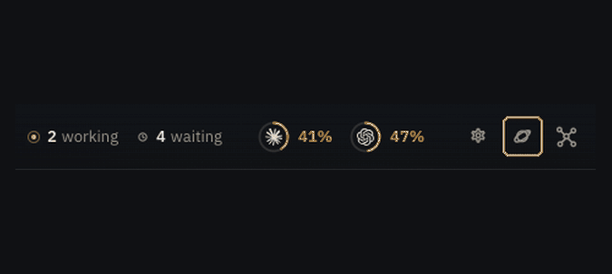

# Explore the agent family tree

1. Select the planet-shaped **Planetarium** icon in the header.
2. Follow the lines to see which agents started others.
3. Select an agent to open its terminal. Press **Esc** to return to the terminal you were already using.

[日本語](../trace-agent-family.md) · [Cockpit map](cockpit-map.md) · [Planetarium reference](usage.md#planetarium)
