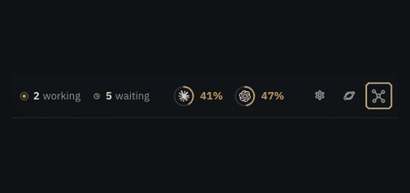

# Check agent status and history in Telemetry

1. Select the connected-dots **Telemetry** icon in the cockpit header.
2. In **DECK** or **NETWORK**, select an agent to see its activity and history.
3. A running agent has **EXIT**. An agent that can be resumed has **RESUME**. Choose **OPEN IN COCKPIT** to return to its terminal.

**DECK** shows agent cards. **NETWORK** maps their connections and lets you select several agents for **EXIT**, **RESUME**, or **Replay**. The selected agent’s **History** shows messages and tool activity. **Output** lists their work logs. Replay shows spawns and Mail subjects in order. Adjust the speed or select a time on the timeline to jump there.

[日本語](../view-telemetry.md) · [Cockpit map](cockpit-map.md) · [Telemetry reference](usage.md#telemetry)
