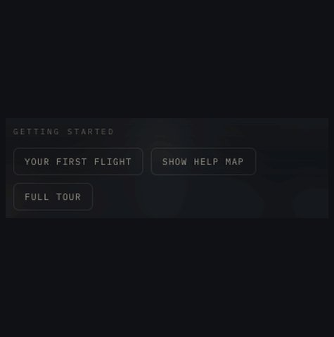
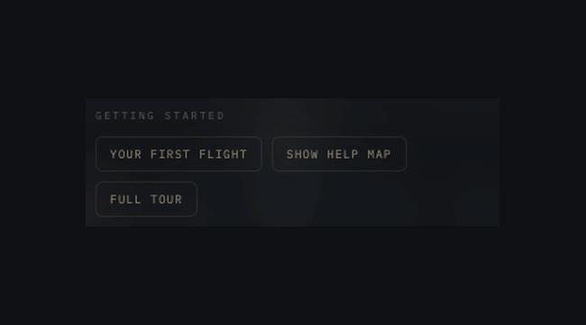

# 最初のガイドを開く

**Settings → Getting started → Your first flight** を開きます。項目を押すと次に見る場所を選べます。チェックは画面上で操作すると付きます。

1. **Start an agent**、**Choose your agent**、**Talk to it**　[agent を起動して最初の依頼を送る](start-an-agent.md)。
2. **Read ORRERY Mail**　[届いた Mail を読む](read-mail.md)。読んだら **Mark as read** を押します。
3. **Open Telemetry**　[状態と履歴を確認する](view-telemetry.md)。
4. **Explore Planetarium**　[agent の親子関係を見る](trace-agent-family.md)。
5. **Make it comfortable**　[色や文字サイズ、Mini Graph を調整する](adjust-cockpit.md)。

## Help map

**Settings → Getting started → Show help map** で、操作する場所に説明が出ます。**Esc** または画面のクリックで閉じます。**Select** と **Working and waiting** は [agent 一覧の見方](manage-agents.md)、**Usage left** は [利用枠を見る](check-usage.md) から確認できます。

続けて試すには **Settings → Getting started → Full tour** を開きます。全 16 段で、最初のガイドとは別に進行を保存します。子とのしりとり、ターミナルの配置、Telemetry の **EXIT** と **RESUME**、**NETWORK** や **REPLAY** から端末への移動を試せます。しりとりはチェックが付いても 3 往復まで続けます。どちらのガイドで起動した agent にも、選んだ CLI や API の通常の利用枠と料金が適用されます。

[English](en/first-flight.md) · [画面一覧](cockpit-map.md) · [Full tour](FULL_TOUR.md)
