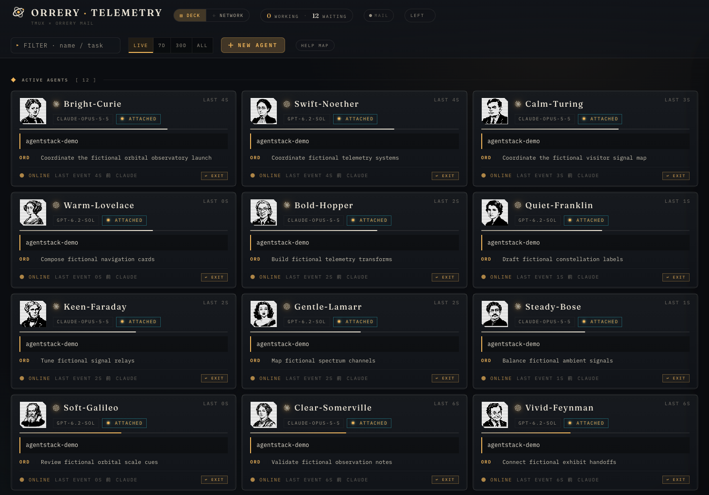

# Telemetry 単独で使い始める



Telemetry 単体で始めるには、共通 installer で導入し、使う provider を準備して DECK に agent が現れることを確認します。

[English](en/getting-started.md) · [目的別索引](README.md) · [README](../README.md)

普段の入口は [ORRERY cockpit のクイックスタート](install.md#1-行で入れる更新する)です。1行で cockpit と Telemetry を入れ、Your first flight → help map → Full tour を画面内で試します。ここは Telemetry だけを入れる人向けの手順と、背景・用語の参照です。

## 誰のためのものか

- **対象は coding agent を使う人**。Claude Code・Codex・Gemini・DeepSeek・Local LLM で、コードを書き、ファイルを変え、コマンドを実行する agent を使いたい人向けです。これから最初の agent を準備する人も使えます。
- **向いている人**: agent を複数動かしていて、その連携を人間が仲介している人。Codex の出力を Claude Code に貼り直す、アプリやタブを行き来して各 agent の様子を確かめる、といった手作業をなくし、全体を一枚の画面で俯瞰したい人
- **向いていない人**: agent は 1 体で足りている人。このツールの価値は複数 agent の協調と、その観測にあります
- **対応する agent**。Claude Code と Codex は各 CLI、Gemini は Google Antigravity CLI（`agy`）、DeepSeek と Local LLM は dsh または Hermes で動きます。
- **Codex Desktop の task と subagent** は optional provider として同じ dashboard に載せられます。

## 目的から選ぶ

まず下の[単独導入と確認](#telemetry-単独の導入と確認)で共通部分を入れ、使う系統の準備へ進みます。

| 使う系統 | 共通導入後の準備 |
| --- | --- |
| Claude Code / Codex | 使うCLIを入れてログインし、下の[最初のagentを起動する手順](#3-最初の-agent-を起動しdashboard-で見る)へ |
| Gemini（Antigravity） | 共通導入に連携ファイルが含まれます。Antigravity CLI を導入してサインインし、NEW AGENT から起動します。[Gemini の導入ガイド](antigravity.md) |
| DeepSeek / Local LLM | [APIの初期設定ガイド](native-setup.md)でdsh/Hermes・キー・接続設定を準備し、NEW AGENTから起動。Claude/Codexのログインは不要 |

準備済みのagentを観測するときはDECK / NETWORKを開きます。agent同士を連携させるなら、[Mailの通し確認](#5-しりとりで通しの確認をする)へ進みます。APIの[対応組合せと制限](https://github.com/gyroid-eth/orrery-telemetry/blob/master/docs/managed-catalog.md)も確認してください。

<a id="provider-model-harness"></a>
## provider・model・harness

| 選ぶもの | 意味と現在の例 |
| --- | --- |
| provider / backend | 接続先と資格の設定。`claude` / `codex` / `gemini` は各 CLI のログイン、`deepseek` と `strata`（画面では Local）は設定済みの API 接続を使います |
| model | 接続先で使う正式な model ID。同じ backend の設定済み候補から選びます |
| harness | 会話と tool の実行を担う CLI。DeepSeek / Local の API 接続では `dsh` または `hermes` を明示します。Claude Code、Codex CLI、Antigravity CLI はそれぞれ自身の harness を使います |

model の作り手と API の接続先は同じとは限りません。Local に置いた DeepSeek model でも接続先は Local です。agent の名前（identity）、親子関係、作業 project、Mail の宛先は、この3つとは別です。model や harness を選んだだけでは親や連絡先は決まりません。

API 起動は legacy mode です。macOS の Keychain と Linux の明示した Secret Service 参照を扱い、backend・runtime・資格の設定が別途必要です。任意 API × 任意 harness の対応は保証しません。Hermes の新しい子は project と正式名ごとの独立 HOME を使います。共通ログインと Telegram 入口は設計中、Local の手動 effort の実サーバー受け入れは未完です（[現在の制限](https://github.com/gyroid-eth/orrery-telemetry/blob/master/docs/managed-catalog.md#現在の制限)）。[Model / Harness の画面例と操作 GIF](dashboard.md#native-models-and-harnesses)も参照してください。


## 言葉の説明

以下の 6 語だけ覚えれば、この単独導入の手順と参照文書を読めます。

| 言葉 | 意味 |
| --- | --- |
| agent | Claude Code / Codex CLI、dsh / Hermes などで動く1セッション。それぞれに科学者の名前が付きます |
| child | ある agent が「この作業をやって」と頼んで起動した別の agent。頼んだ側が親です。親が `/delegate` を使うと child が生まれ、child は終わると親に報告します（[完了後の見え方](dashboard.md#child-完了後の表示)も参照） |
| ORRERY Mail | agent 同士がメッセージを送り合い、名前と file の予約を管理する同梱の小さなサーバー |
| dashboard | ブラウザで開く画面。全 agent の状態、親子関係、メッセージの往来を表示します |
| project key | agent たちに作業させる project フォルダの絶対パス。「どの project の agent か」を区別する鍵です |
| skill | agent に「こういう頼まれ方をしたらこの手順で動け」と教える手順書。`/delegate` のように先頭に slash を付けて呼びます。このツールは `/delegate` と `/log` の 2 つを同梱します（[手順の説明](launchers.md#skills2件と-file-reservation)） |


## Telemetry 単独の導入と確認

Python 3.11 以上と `git`・`tmux`・`uv` が必要です。[OS ごとの前提](install.md#動作環境)で `curl`・`lsof`・`xz` も確認します。macOS では `brew install uv` で uv を追加できます。公式スクリプトで入れた場合は `export PATH="$HOME/.local/bin:$PATH"` を同じシェルで実行して、`uv --version` で確認します。

**Windows の人へ**。WSL2 の Ubuntu を開きます。以下のコマンドは Ubuntu で実行し、dashboard は Windows のブラウザで開きます。[WSL2 の準備](telemetry-install.md#windowswsl2で入れる)のあと、使う系統に合わせて Claude／Codex の CLI へのログイン、[Gemini の導入](antigravity.md)、または DeepSeek／Local の [API の初期設定](native-setup.md)へ進みます。

### 1. 入れる

```bash
git clone https://github.com/gyroid-eth/orrery-telemetry.git
cd orrery-telemetry
./scripts/install.sh --project-key /absolute/path/to/your-project
```

`--project-key` には、agent に作業させたい project フォルダの絶対パスを渡します。この repository 自体のパスではありません。

installer の確認条件は [同意の契約](instruction-migration.md#consent) にまとめています。既存の設定は保持し、変更前の backup を `~/.agentstack/backups` に置きます。変更内容だけを見るには `--dry-run` を付けます。

**成功**: 最後に `Install complete: http://127.0.0.1:8770/` と出て、`~/.agentstack/` ができています。

### 2. 動くか確かめる

```bash
export PATH="$HOME/.agentstack/bin:$PATH"
agentstack-doctor
agentstack-selftest
```

**成功**: `agentstack-doctor` の必須の確認が `ok:` になり、`missing:` が出ないこと。`warn:` は内容と表示された対処を確認します（補足の `note:` や `mail-features:` 行も通常の出力です）。`agentstack-selftest` が `self-test passed: two agents registered, exchanged messages, ...` で終わります。どこかで止まったら[トラブルシューティング](telemetry-troubleshooting.md)の該当節へ進んでください。

### 3. 最初の agent を起動し、dashboard で見る

**Gemini の場合**は、上の `install.sh` で連携ファイルが入ります。[Gemini の導入ガイド](antigravity.md)に沿って Antigravity CLI を導入し、サインインします。NEW AGENT で **Antigravity** と model を選んで起動し、DECK にカードが現れることを確認します。

**DeepSeek / Local LLMの場合**: [APIの初期設定ガイド](native-setup.md)を終え、`http://127.0.0.1:8770/`のNEW AGENTで準備したModelとHarnessを選んで起動します。DECKに科学者名付きのカードが現れたら、ガイドの短い会話確認と下の[Mail確認](#5-しりとりで通しの確認をする)へ進みます。

**Claude Code / Codexの場合**: 同じOS環境で使うCLIにログインしてから、次を実行します。

```bash
agent-start ~/code/my-project          # Codex CLI なら agent-start-codex ~/code/my-project
```

macOS では別の terminal で dashboard を開きます。Windows では同じ URL を Windows のブラウザに貼ります。

```bash
open http://127.0.0.1:8770/
```

**Claude/Codexの成功確認**: 選んだCLIが起動し、dashboardのDECKに科学者名の付いたカードが現れます。カードにはmodelとcontext残量が表示されます。

### 4. child を 1 体作る

ここはClaude Code / Codexから委任する例です。DeepSeek/Localから始めた人は、APIガイドの起動確認と[次のMail確認](#5-しりとりで通しの確認をする)を使えます。

起動した agent の中で、次のように頼みます。Claude Code でも Codex でも同じです。

```text
/delegate child agent を作って、自分の名前と今日の日付を答えさせて
```

**成功**: dashboard に 2 枚目のカードが現れ、親から child へ線が引かれます。child が終わると、親の terminal に「完了しました」というメッセージが届きます。NETWORK タブを開くと、2 体の間のメッセージの往来が見えます。

child の OS terminal は既定で背面に自動で開きます。dashboard から child を見る場合は、`AGENTSTACK_AUTO_OPEN_CHILD=0` にすると窓が増えず、必要な child だけ Deck の Open tmux で開けます（[設定](telemetry-configuration.md#child-spawn)）。

### 5. しりとりで通しの確認をする

dsh / Hermesの接続先が未設定なら、先に[APIの初期設定](native-setup.md)を済ませます。agentなしで設定する手順もあります。まずNEW AGENTから1体を起動し、短い依頼への応答を確認してください。以下のMail往復は2体の準備後に行う追加の確認で、Claude/Codexの導入やcockpitの追加が必須という意味ではありません。

Claude CodeとCodexを両方使う環境では、次の例でしりとりをさせられます。名前の登録、ORRERY Mailの往復、通知の差し込み、dashboardの描画をまとめて確認します。

```text
/delegate Codex の child を 1 体作り、その child としりとりをしてください。子の作成はインストール済み ORRERY の /delegate、やりとりは ORRERY Mail (send_message) を使い、同じ道具の指定を子にも渡してください。組み込みの Agent / SendMessage は使わないでください。1 ターンごとに単語を送り合い、10 往復したら結果を報告してください
```

この単独確認例は10往復です。[workshop のしりとり](https://github.com/gyroid-eth/orrery-workshop/blob/master/play/shiritori.md)と Full tour は3往復で、講演ではその短い版を使います。

Codex から始めるなら child は Claude Code にします。どちらから始めても、2 社の agent の間でしりとりが回ることを確かめるのが目的です。

DeepSeek・Local の子でも、同じしりとりで通しの確認ができます。この確認は、設定済みの provider と harness を持つ cockpit を追加した環境向けです。cockpit の New Agent で[設定済みの provider](telemetry-install.md)（DeepSeek または Local）と Harness（dsh または Hermes）を選び、Lineage で相手にする Claude Code または Codex の agent を親に選んで子を立て、3往復します。

Telemetry 単独で入れた場合も、同梱 dashboard の NEW AGENT で catalog が available と示す provider・model と Harness（dsh または Hermes）を選べます。画面を使わずに立てる場合は [API reference](https://github.com/gyroid-eth/orrery-telemetry/blob/master/docs/api.md) の `POST /api/spawn` を、親（parent または standalone）と認証を含む契約どおりに使い、`harness` を必ず指定します。

親から ORRERY Mail の `send_message` で「ORRERY Mail でしりとりを3往復し、各 Mail の件名にそのターンの単語を入れて」と子に頼んで始めます。成功の見え方は同じで、NETWORK に往復の線が流れ、DECK の両カードの最後の指示が最新の Mail の件名（そのターンの単語）に更新されます。dsh・Hermes はそれぞれ確認してください。片方だけの成功では、もう片方の確認にはなりません。

**成功**: NETWORK に 2 体の間を往復する線が流れ続け、DECK の両カードの最後の指示が単語ごとに更新されます。作者の環境では 1 人あたり 1 ターン 5〜6 秒で回りました（[動画つきの投稿](https://x.com/i/status/2095650715008168255)、倍速再生）。

ここまで通れば、あとは普段どおり agent を使うだけです。詳しい設定は[インストール](telemetry-install.md)と[設定](telemetry-configuration.md)、child の仕組みは[委任と child agent](delegation.md)を参照してください。


## 同梱する skill と画面の参照

`/delegate` は child に作業を頼み、完了報告を受け取る手順です。組み込み subagent との違いは[委任と child agent](delegation.md)、登録・予約・起動の流れは[Launcher の skill 節](launchers.md#skills2件と-file-reservation)を参照してください。Claude は標準 skill path から見つけ、Codex は管理下の `~/.codex/AGENTS.md` から同じ手順書の場所を知ります。

`/log` は決定・変更・検証・次の作業を Markdown の `logs/` に残します。[Launcher の log 節](launchers.md#log)と[Obsidian の設定](obsidian.md)に、保存場所と Daily Note のつなぎ方があります。画面の Output に並ぶのがこの log です。

DECK、NETWORK、DIGEST REPLAY、NEW AGENT の詳しい操作と画像は [Dashboard](dashboard.md)にあります。ターミナルと同じ画面に置く [ORRERY cockpit](https://github.com/gyroid-eth/orrery) の操作は、cockpit の画面内ガイドから始めてください。[Obsidian と一緒に使う](obsidian.md)には公開 demo vault への案内があります。

## 裏で動いているもの

- **ORRERY Mail**: agent の名前、inbox、file の予約を一つに管理します。dashboard を落としてもここに正本が残ります
- **launcher**: `agent-start` が名前の登録、tmux session の作成、CLI の起動を一続きで行い、dashboard からの jump や通知の宛先が一意に決まるようにします
- **hook**: Claude event hook 9件が、登録なしの session や予約なしの書き込みを止め、届いたメッセージを agent の入力欄に差し込みます

これらの仕組みと API の詳細は [Hooks](https://github.com/gyroid-eth/orrery-telemetry/blob/master/docs/hooks.md)、[Launcher](launchers.md)、[API reference](https://github.com/gyroid-eth/orrery-telemetry/blob/master/docs/api.md) にあります。dashboard の表示・操作はすべて local HTTP API から使えます。


## 仕組み

```text
Claude Code / Codex CLI / dsh / Hermes
        │ launcher + hooks
        ▼
tmux session ── telemetry ──► dashboard
        │                         ▲
        │                         │ sanitized snapshot
        │                  Codex App Bridge ◄── plugin hooks ── Codex Desktop
        │                         │
        └──────── ORRERY Mail ◄────┘
                  identity / inbox / reservations
```

同梱の ORRERY Mail を正本にし、その上に launcher、運用 guard、可視化、control plane を重ねます。dashboard が落ちても identity・mail・reservation の正本は失われません。


## 対応環境

| 環境 | サポート |
| --- | --- |
| macOS | 対応 |
| Windows（WSL2） | 対応。Windows 11 + Ubuntu 26.04 / WSL 2.7 で、install から child の起動、dashboard からの terminal jump まで実機確認済み。手順は[インストールの WSL2 節](telemetry-install.md#windowswsl2で入れる) |
| Linux | 利用報告あり。Ubuntu 24.04 / tmux 3.4 で install、dashboard、Codex agent が動いたという実機報告を受け、そこで見つかった 2 件（[#26](https://github.com/gyroid-eth/orrery-telemetry/issues/26)、[#27](https://github.com/gyroid-eth/orrery-telemetry/issues/27)）は修正済みです。`systemd --user` での常駐登録は作者側で未検証なので、結果は issue で報告してください |
| Windows native（WSL2 なし） | 正式対応は WSL2 経由ですが、community の貢献で PowerShell から Mail と dashboard を起動する helper と、Codex child の native 起動が実験的に動きます（[起動 helper](windows-local.md)、[Codex launcher](https://github.com/gyroid-eth/orrery-telemetry/blob/master/docs/windows-codex-launcher.md)）。方針は [#3](https://github.com/gyroid-eth/orrery-telemetry/issues/3) |

上の表は共通基盤と既存 CLI 経路の対応環境です。DeepSeek / Local × dsh / Hermes は別途 backend・runtime・OS の資格参照を設定する legacy mode の経路です。画面の候補表示は実接続の成功を保証しないため、設定した組合せごとに起動と Mail の往復を確認してください。

Python 3.11 以上、`git`、`tmux`、`uv` が必須です。上の CLI 起動手順にはログイン済みの Claude Code か Codex CLI が要り、API 起動には別途 dsh / Hermes と backend の設定が要ります。installer は共通の依存を書き込む前に検査して、足りなければ何も変えずに止まります。検査の詳細と任意の依存（`fswatch`、`fzf`、Ghostty、Obsidian）は[インストールの動作環境](telemetry-install.md#動作環境)を参照してください。


## install 前に見るデモ

[公開デモ](https://agentstack-demo.pages.dev/)は、dashboard を台本データで動かす4分のループです。字幕で流れを追えますが、自分の CLI・Mail・委任の成功を確かめるものではありません。[紹介動画「Orrery」](https://youtu.be/JXoa93TQolU)（約90秒・日本語）は考え方の図解で、実画面の録画ではありません。
