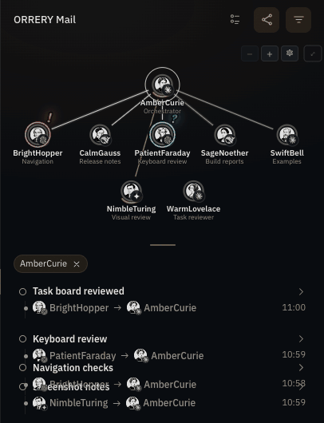
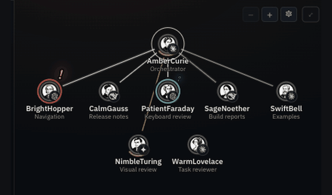

# Mini Graph で agent の詳細と再起動を見る

ノードにカーソルを置くか、キーボードでフォーカスします。グラフの直下に agent 名、役割、モデル、harness、作業場所、Computer と Browser の権限が出ます。ノードを押すと端末が開きます。

## 起こし直し中の表示

稼働中の agent の権限を変えて **Restart** を確定すると、作業はいったん止まり、同じ会話で再開します。再起動中もノードは残り、役割の位置に **Restarting…** と出ます。

[English](en/inspect-mini-graph.md) · [画面一覧](cockpit-map.md) · [Mini Graph の詳しい使い方](usage.md#mini-orrery) · [Mail の到着を見る](read-mail.md)
