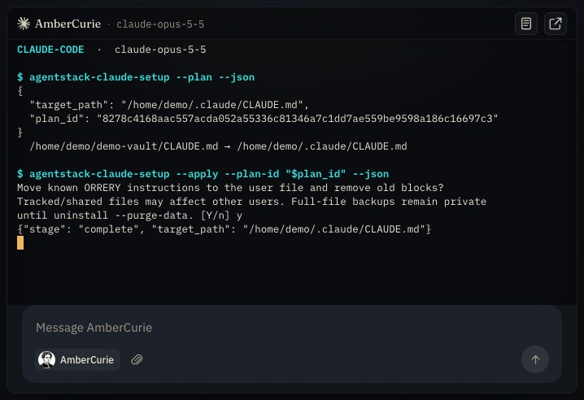

# 利用者単位の ORRERY 指示への移行



サンプルの指示ファイルで、計画表示、利用者の確認、移行完了の順に進めた例です。

[English](en/instruction-migration.md)

<a id="what-changes"></a>
## 変わること

Claude の指示は `$CLAUDE_CONFIG_DIR/CLAUDE.md`（未指定なら `~/.claude/CLAUDE.md`）、Codex は `$CODEX_HOME/AGENTS.md`（未指定なら `~/.codex/AGENTS.md`）に置きます。Mail の切替は行わず、既定は旧 mode・activation=false です。追加の参加 flag はありません。

block は ORRERY Mail tool があるときだけ従います。参加材料は既存 identity / session-bound binding の解決結果だけです。identity の無い bare session は Mail へ自動登録せず通知も行いません。編集の guard は別で、`AGENTSTACK_UNMANAGED_SESSION_POLICY` の既定 block と明示 warn-open を保ちます。登録済み flag だけ残る場合や Desktop の登録途中・retry/degraded は「非参加」ではなく未解決です。同じ identity を復旧し、別名を登録しません。

| 以前 | 今 |
|---|---|
| Claude の既定は project の CLAUDE.md | 利用者の CLAUDE.md。明示 project/both は `INSTRUCTION_SCOPE_REQUIRES_MIGRATION` で拒否 |
| identity 無しの model が raw 登録する route 5 | `agent-start <workdir>` / `agent-start-codex <workdir>` で起動。個人の `cc` が pending-* を作る場合もこの launcher へ置換 |
| CLAUDE_HOME で書込先を決める | 実読込み先 CLAUDE_CONFIG_DIR。CLAUDE_HOME が異なる場合 `INSTRUCTION_HOME_CONFLICT`。起動環境を自動変更しない |
| 全文を awk で再構成 | marker 間だけ変更、外側の byte 列・改行・BOM を保持 |
| hardlink へ write-through | 移行対象の nlink>1 は `INSTRUCTION_HARDLINK_REQUIRES_MANUAL_COPY`。symlink は同所有者の固定解決先へ CAS、link 自体を保持 |

正規 launcher は既存 identity を起動前に解決します。候補選択も登録も名前を返さない場合は `LAUNCH_IDENTITY_UNAVAILABLE` で停止します。Codex Desktop の正規 lifecycle hook は既存 binding を保存してから登録する順序を維持します。cockpit の pane 分割は shell を作るだけで、agent 登録を意味しません。外部 warm-pool の起動実装や個人 shell 設定は自動変更しません。

<a id="legacy-blocks"></a>
## 古い block が残っているとき

異なる版の block を二重に読むと指示が食い違うことがあります。検出は cwd から親の CLAUDE.md / AGENTS.md に限定し、sibling や HOME 全体を探しません。doctor は残数・file・hash・片付ける command を表示します。SessionStart は件数と人向け doctor の案内だけです。global dashboard はこのページの日英両方へリンクします。cockpit の案内は後続です。

更新時は、更新前の `env.sh` の project key と現在の key のフォルダも候補にします。新しい指示は現在の key で描画し、旧 block の一致証明には実際に一致した旧 key を記録します。過去に使った全フォルダの一覧は保存していないため、自動の広域探索はしません。それらの作業フォルダで doctor を実行するか、明示 `--path` で確認してください。

```sh
agentstack-claude-setup --check
agentstack-codex-setup --check
agentstack-claude-setup --plan --json
```

`--plan` は lock や file を作りません。出力の `apply_argv` は同じ source 選択と plan ID を含み、別 process で再計算して一致したときだけ実行できます。ID だけから source を復元する仕組みはありません。

<a id="consent"></a>

## 同意

installer には最大4つの確認箇所（settings merge、MCP entry、Codex と Claude の block）があります。settings/MCP は変更がある場合に `yes` を要求します。block の確認条件は以下の1契約です。非対話の installer は事前承認が無ければこれらの setup を警告付きでスキップします。直接 setup CLI の新規設置は下記のとおり同意不要です。稼働中 Mail の再利用に追加の承認はありません。

既存 file の内容を変えず、新しい利用者 file を作るだけなら同意は不要です。既存 file の書換え・元 block の削除には確認が必要です。

対話では「利用者側へ移し、既知の元 block を消すか」を一度確認します（`[Y/n]`、Enter は消す）。共有 repo の影響と全文 backup の保持を説明します。明示 `--assume-yes` でも、Git 追跡中・Git 状態不明の source は消さず警告します。編集済み・版不明・壊れた marker は保持し、利用者が local diff を確認して marker 間だけを片付けます。自動 force はありません。利用者側への設置を検証してから元 block を消します。

```sh
agentstack-claude-setup --remove-legacy-block --path /work/repo/CLAUDE.md --dry-run
agentstack-claude-setup --remove-legacy-block --path /work/repo/CLAUDE.md
```

祖先の AGENTS.md は検出だけで、通常の移行で自動削除しません。明示 `--path` だけがその source を選択できます。symlink は固定した chain と解決先を再照合します。hardlink は全 alias の内容を自分で退避し、用途を確認して、希望する target を独立した regular copy にしてから再 plan してください。engine は alias の探索や link の切断をしません。

同じ install の協調 engine は固定した解決先 path の mutex で直列化します。同 UID の非協調な書込みには最終照合と rename の間の競合窓があります。照合で変更を見つけた場合は停止し、backup を保持します。

<a id="interrupted-migration"></a>
## 中断したとき

receipt は `<install>/backups/instruction-migration/<provider>/<target hash>/receipt.json` の一つです。install-state は参照だけを記録します。target と source ごとの元全文は `backups/<plan ID>/<resolved path hash>.before` に置き、複数 source は上書きしません。

| 段階 | 再実行 |
|---|---|
| plan / 承認前 | 何も保存していない。再 plan |
| planned / backed_up | 同 ID の `--resume --plan-id ID`。一致する backup のみ再利用 |
| writing / rename 後 | before または after の bytes と metadata を照合。不明な変更は停止 |
| target_verified / sources_pending | target を毎回確認してから未完了 source だけ処理 |
| complete | 同内容なら no-op。新 template は新 plan / history |
| 未知 bytes / HOME 変更 | 勝手に続行せず環境を戻すか明示 replan |

`--replan --expected-plan-id OLD --json` は read-only です。表示された `--apply --plan-id NEW --supersede-plan-id OLD ...` を同じ選択で実行して人が承認します。pending の上書きに assume-yes は使えません。古い receipt と backup は history に残ります。marker 外の追加は次世代の更新や uninstall を妨げません。

<a id="custom-provider-home"></a>
## 子と専用 provider HOME

旧 Codex 子の AGENTS symlink は元 user file を読むだけで、子から書き換えません。global の固定 provider HOME は明示 operator configure が共通 renderer で marker を設置します。通常 launch は読むだけで、不足・古い版は `INSTRUCTION_PROVIDER_CONFIG_REQUIRED` です。

```sh
agentstack-runtime-client instruction-configure operator claude
agentstack-runtime-client instruction-configure operator codex
```

この生成物は user file の移行 receipt を持ちません。Claude settings や Codex trust の設定はそれぞれ既存の明示 configure を使います。Codex の trust 承認をこの操作で省略できません。HOME を変えた未完了 receipt は `INSTRUCTION_HOME_CHANGED` で止めます。元の HOME に戻して resume してください。

<a id="uninstall"></a>
## 撤去と backup

setup の `--uninstall`、通常の uninstaller は記録済み marker だけを除去します。変更済みの block は警告して残し、利用者 file 自体は owned_files にしません。全文を含む private backup・receipt・history は残ります。

`agentstack-uninstall --purge-data` は削除前に未完了・編集済み・保持 source を検査し、残っていれば `INSTRUCTION_BACKUP_PURGE_BLOCKED` で停止します。人が保持 marker を削除済みなら現状を再確認して解消できます。全て解消したときだけ固定 ledger と全文 backup も削除します。独自の自動 GC はありません。

`--remove-legacy-block --path X` は X だけを片付けます。利用者側の現行 block が未設置・変更済みなら `INSTRUCTION_TARGET_REQUIRES_SETUP` で止まり、先に setup を案内します。別の source や利用者 target は書き換えません。編集済み・未知の source には cleanup command を出さず、local diff と手動で marker 間だけを消す手順を案内します。

purge は current と history の全 receipt に記録した source を照合します。古い世代の marker が残る間も backup を保持します。通常の uninstall は symlink の変更や hardlink 等で安全に除去できない file を保持して警告し、残りを続けます。purge はその異常で止まります。

自動検出した marker の無い file は移行 source ではないため、hardlink でも変更せず飛ばします。target と明示 `--path`、marker を含む source の hardlink 拒否は維持します。

purge は current/history を同じ receipt reader で schema・kind・canonical plan hash まで検証します。不一致は `INSTRUCTION_PLAN_CHANGED` で削除前に停止し、ledger と backup を保持します。検証済みの receipt を復元してから再試行してください。hash を手で書き換えて回避しないでください。

隔離 global dashboard の案内は、同じ検出 engine と finding を使います。固定 provider HOME と session record の cwd が確認できない場合は unknown と表示し、dashboard の利用者 HOME から推測しません。起動時に記録するのは候補の path・block hash・版だけです。現在の disk が片付いていても、以前の候補が変わった session には再起動を案内します。実際の指示の読込みを証明する表示ではありません。[画面での確認と Dismiss](dashboard.md#global-mail-view)を参照してください。

検出結果の cleanup command は `env HOME=... CLAUDE_CONFIG_DIR=... CODEX_HOME=... AGENTSTACK_HOME=...` などを含み、検出と同じ利用者 target と ledger を使います。隔離 provider の案内を通常の terminal へ貼るときも、この env を省かないでください。対象の現行 block が未設置なら、別 HOME の block で代用せず `INSTRUCTION_TARGET_REQUIRES_SETUP` で拒否します。
