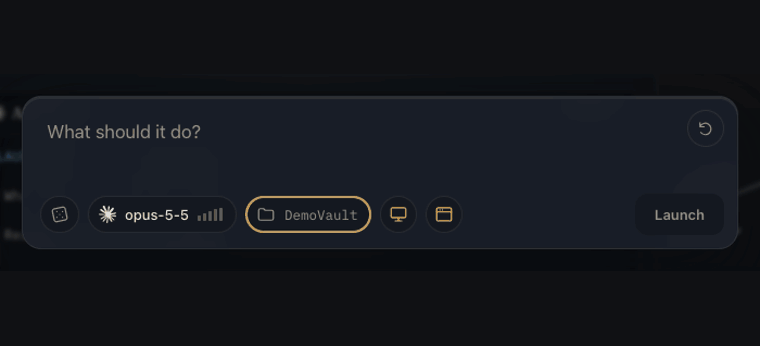

# Launcher と identity



> English version: [launchers.en.md](en/launchers.md)

[前: インストール](telemetry-install.md) · [README に戻る](../README.md) · [次: 委任と child agent](delegation.md)


同じ会話の道具を変更する場合は、EXIT 後に停止を確認し、`"${AGENTSTACK_HOME:-$HOME/.agentstack}/bin/agentstack-resume" <NAME> --tools <spec>` を使います。再登録や新しい子の作成はしません。[手順と制限](delegation.md#停止した子の道具を変更して-resume-する)。

## 起動コマンド

```bash
export PATH="$HOME/.agentstack/bin:$PATH"

agent-start ~/code/my-project
agent-start-codex ~/code/my-project
```

- `agent-start`: Claude Code
- `agent-start-codex`: Codex CLI

directory 引数を省略すると、`fzf` があれば `AGENTSTACK_BASE_DIR` 以下を選択できます。なければ現在 directory を使います。

```bash
export AGENTSTACK_BASE_DIR="$HOME/Obsidian/MyVault"
agent-start
```

優先順位は明示引数、`fzf` picker、現在 directory の順です。

## 起動 workspace と reservation の保護範囲

namespace の選択は変えません。既存の環境設定で上書きしなければ、installed `AGENTSTACK_PROJECT_KEY` を協調 namespace として使います。path 形式の key でも異なる repository の agent をまとめられ、その path 自体は保護に追加しません。作業 directory の選択で namespace は変わりません。

top-level と delegated child 起動では、設定順の `AGENTSTACK_EXTRA_PROTECTED_ROOTS` の後へ、実際に起動する物理作業 directory を足して `AGENTSTACK_PROTECTED_ROOTS` を計算します。Git root は検出しますが保護を自動的には拡張しません。上位 root が必要なら extras に明示します。別名と重複は順序を変えずにまとめます。resume・persistent の再解決は後続PRで扱います。

継承した `GIT_DIR`、`GIT_WORK_TREE`、`GIT_COMMON_DIR` は workspace の判定に使わず、起動 process から取り除きます。Git metadata が壊れていれば別 directory へ切り替えず起動を停止します。新しい tmux session には server に残った旧 root ではなく現在の workspace context を渡し、server の global environment は変えません。`AGENTSTACK_VAULT`、Codex の sandbox/approval、OAuth の扱いは変えません。

install/update は installed の旧保護 list を一度だけ自動移行します。ambient shell/tmux の `AGENTSTACK_PROTECTED_ROOTS` は取り込まず、非空で installed と異なる旧値は extras があっても警告します。従来の相対予約名から、managed 起動では root に依存しない物理絶対 path の予約名へ変わるため、cutover 前に作業を完了するか予約を解放し、更新後に影響する session をまとめて再起動してください。[保護設定の自動移行](telemetry-configuration.md#reservation-の保護範囲と移行)を参照してください。

## Codex と Node.js の PATH

Codex の子は `hooks/codex-bin.sh` の共通処理で CLI を選び、login shell 内で `codex --version` を確認してから起動します。doctor も同じ選択・確認処理を使います。nvm の bin は探索対象です。選んだ Codex の symlink を解決した先の directory に実行可能な `node` があれば、その directory を実行時の PATH に追加します。nvm の version directory は先頭に置き、共有 prefix は既存の順序を保って後ろに追加します。既にその node が見えている場合は変更しません。npm の symlink の先に node がない場合は、選んだ shim と同じ bin の node を使います。どちらにも node がなければ、login shell の PATH と `~/.local/bin` を使います。

launcher は同梱の `codex-bin.sh` を必須とし、欠落・互換性不足なら再 install の案内付きで停止します。doctor は自身と同じ配置の helper を優先し、利用できなければ未確認と表示します。

dashboard の `SPAWN FAILED` は、今回の起動区間の launcher の原因を登録の後始末のエラーより先に表示します。明示 reason、通常の Error の順で確認し、全候補失敗の場合だけ候補の拒否理由を添えます。node が見つからない場合は、CLI の置き場所に対応する Node.js が使えるかを確認してください。実際の WSL 環境の確認手順は [トラブルシューティング](telemetry-troubleshooting.md#nvm-の-codex-で-node-が見つからない) を参照してください。

warm pool の再利用判定は今回変更しません。既存 `claim-model` は事前起動済み process の cwd・保護 root を保証しないため、pool を使う環境での保護範囲保証と速度影響は後続の確認事項です。

## tmux session

tmux 外から起動すると、新しい named session を作って現在の terminal tab を置き換えます。tmux 内からは current session を rename し、その場で CLI を `exec` します。

session 名を ORRERY Mail identity と一致させることで、次の照合が一意になります。

- dashboard の click-to-jump
- inbox signal の配送先
- transcript / history
- token recovery
- graceful EXIT / RESUME

terminal process が終了した後も shell を残すため、調査や scrollback を続けられます。

## 科学者名

top-level launcher の新規 identity は要求時 `Adjective-Scientist`（ハイフン形、たとえば `Windy-Fermi`）です。**実際の登録名は `register_agent` 応答の read-back が正**で、サーバーが separator を除去したり別名へ coerce する環境もあります。要求名と read-back が違う場合、launcher は差し替えを明示的に報告し、まだ起動前の top-level session は read-back 名へ揃えます。既に task・token・inbox が結び付いた reserved / resumed identity は別名を採用せず停止します。

- adjective は `bin/lib/agentstack-scientists.sh` の134語
- scientist は `dashboard/scientist_portraits.json`
- scientist suffix が portrait key
- ASCII alphabetic の scientist だけを候補にする

134語は ORRERY Mail の正典 `SIMPLE_ADJECTIVES` Round 3 と逐語同期しています。strict ORRERY Mail deployment は正典で生成名を検証するため、ORRERY Telemetry 側だけへ独自語を追加してはいけません。

launcher、dashboard catalog、suggestion API、child preregistration は同じ adjective / scientist source を共有します。命名 source を重複させないことで、portrait、登録名、server-side validation の drift を防ぎます。

## Name availability と fail-closed

候補の利用可否は三値です。

| 状態 | 意味 |
| --- | --- |
| `available` | project 内に同名 identity がないと確認済み |
| `occupied` | 同名 identity が存在 |
| `unknown` | transport failure、auth error、timeout、DB unavailable などで確認不能 |

`unknown` は空き名として扱いません。launcher の availability probe は既定で `unknown` が3回続くと停止します。通信障害時に衝突しうる identity を取得しない fail-closed 設計です。

dashboard spawn は scientist rail の空き判定後、`/api/suggest-name` で完全名を再検証します。指定名から `-` を除いて正規化し、exact status が `available` でない場合は拒否します。詳しくは [Dashboard](dashboard.md#new-agent) と [API](https://github.com/gyroid-eth/orrery-telemetry/blob/master/docs/api.md#post-apispawn) を参照してください。

## Identity 登録

launcher は CLI を起動する前に ORRERY Mail へ identity を登録します。

1. stale な `AGENT_NAME`、`PARENT_AGENT`、token、reserved marker を削除
2. candidate name を生成
3. ORRERY Mail health を確認
4. project key、program、model、task metadata で登録
5. 要求名と返された canonical name を比較。不一致なら top-level は明示して tmux session を返却名へ rename、reserved identity は停止
6. Codex CLI では数値 agent ID を含む今回の launch expectation を記録
7. managed agent list を更新

`AGENTSTACK_PROJECT_KEY` が未設定、または ORRERY Mail が到達不能でも CLI 自体は preselected name で起動します。ただし mail、reservation、project-scoped dashboard 機能は使えません。

Claude Code hook は session 内登録も記録します。Codex CLI は `agentstack-codex-bootstrap` が起動前の登録と tmux rename に加えて fresh `launch_id` を作り、公式 SessionStart hook が runtime の `session_id` と rollout header を確認して receipt を完成させます。receipt が無ければ Codex History は推測へ fallback しません。

## Registration token

既存 identity を再登録するには、その identity の `registration_token` が必要です。top-level token は mode `0600` で保存されます。

```text
${AGENTSTACK_RUNTIME_DIR:-$HOME/.agentstack/runtime}/agent_token_<name>
```

delegated child はさらに:

```text
${AGENTSTACK_RUNTIME_DIR:-$HOME/.agentstack/runtime}/child-agents/<name>.json
```

に child-owned state を持ちます。

### 標準 spawn の追加 harness（opt-in）

`spawn_child.sh --harness dsh|hermes --backend deepseek|strata --model <正式ID>` は、名前・登録応答の binding・実際の作業場所・tmux session・Mail proxy を標準の子と同じ経路で用意します。明示 opt-in と、patch を当てない別の導入世代が必要です。launcher は native config を生成し、上流 CLI を pane でそのまま動かします。専用 supervisor・通信先の制限・usage 必須・task の寿命は加えません。報告後も pane は生存し、`--harness` を指定しない Claude / Codex は従来どおりです。

private な `harness_state_dir` に初期 prompt・native launch plan・native 専用の短い指示を保存します。指示の正本は `bin/lib/harness_instructions.md` で、既存の共通 renderer が起動・Mail 等の共通規則を取り込みます。初回起動と同じ ID の再開で、dsh の `AGENTS.md` / Hermes の system prompt へ渡します。ORRERY の子作成・raw 認証回復・他 runtime 専用の手順は載せません。共有編集の予約と自己専用 scratch の区別、停止条件は保持します。dsh の tool-subagent や Hermes の auxiliary/delegation 設定、skills の配布は変えません。Claude / Codex の指示本文も不変です。

dsh の子は、Claude の子と同じ利用者の skill（`$CLAUDE_CONFIG_DIR/skills`、未設定なら `~/.claude/skills`）も読みます。dsh-tui では skill の探索を agent preset が持つので、起動計画の環境に `DSH_AGENTS_HOME` として Claude の設定 dir を渡し、`$DSH_AGENTS_HOME/skills` として探させます。dsh が有効と認めた個人 skill の frontmatter の名前が製品 skill と一致するときは、個人 skill を優先します。過去の link を外す対象は、行き先が同じ製品 skill のものに限ります。起動と再開のたびに、link を変える直前に読み直します。個人 skill のディレクトリが検査中に消えた場合や、アクセスできない場合は、製品の skill を link して起動し、理由を子の `harness_state_dir` の `personal-skills.json` に残します。個人 skill のために利用者の設定や skill を書き換えることはありません。`DSH_AGENTS_HOME` を変えるので、dsh 既定の `~/.agents` の skill と `AGENTS.md` は読まれなくなり、代わりに `$CLAUDE_CONFIG_DIR/AGENTS.md` があれば読まれます。Hermes の子の skill は従来どおり製品の skill です。

鍵や親 token の値は指示に含めません。追加の stdio/HTTP MCP は共通の tool 選択からコピーし、明示指定の承認や filter を native config に写せない場合は起動を止めます。installer の既定に含まれる項目は、native config に写せるものを適用し、使えない項目を通知して外します。native tool の adapter は、既存の鍵読取・登録・予約 hook の判定を呼びます。

Hermes の新しい子は、世代の外にある profiles 実体の
`children/<project key の SHA256>/<canonical name>` を永続的な `HERMES_HOME` として使います。
別名・別 project は別 HOME で、同じ project と canonical 名の標準 resume は保存 pin と
exact native session ID を照合して同じ HOME を使います。通常の exit でその HOME は消しません。
組込み MEMORY/USER の有効 flag と上限は native のままです。共通 MEMORY/USER、auth、`.env`、
利用者 config、allowlist、個人 skills は読み出して配布せず、新しい子は空の HOME から
既存の route・guard・Mail・製品 skills を構成します。共通 profile の保存 effort や個人設定を
引き継がないため、新しい子の未指定設定は native の既定に従います。

旧共有 HOME の pin を持つ resume は `native_resume_legacy_profile` で明示して停止し、
共通データや pin の書換え・会話 DB の移行・空の新規会話への切替は行いません。
この方式の導入には、旧 resume を中断する対象への operator の明示了承が必要です。
pin 不一致・欠落・HOME 欠落も、resume の Mail/prompt/指示の更新より前に拒否します。
resume 時は HOME 内の `state.db` の存在と読取可も確認し、欠落は
`native_resume_history_missing` で停止します。初回起動には DB を要求しません。
この検査は DB 内容を読まず、該当 session や会話履歴の存在を保証するものではありません。
新方式の memory 復帰は、同じ HOME の保存値と初期 memory snapshot を実 CLI の exit/resume で
別途確認します。会話履歴に同じ文字があることだけでは memory 復帰の証拠にしません。
managed 設定の保存拒否や通知は維持します。自動 GC・purge は追加しません。

終了は Codex と同じ `cleanup-child-agent.sh <name>` を使います。すべての provider で、予約の解放・retire の応答・`whois` の retired 確認に失敗したら、identity の state と owner credential を保持して非0を返します。

通常の Claude・Codex の直接登録による起動も、登録後に失敗したら停止を確認してから同じ cleanup を呼びます。作成要求の応答が未確認なら、同名の別 session を止めないため kill・予約解放・retire をせず、state・credential・worktree を残します。停止や Mail の確認ができない場合も保持し、起動は非0で終わります。失敗した起動は確認付き retire 後に資格と state を即削除し、正常終了の再開用 retention は適用しません。Codex が自身を更新中なら watch に資格を引き継ぎ、停止と共通 cleanup の確認後だけ worktree を片付けます。未確認ならその旨を記録して保持します。pre-registered の起動 rollback は従来どおりです。

pre-registered child へ親 token は渡しません。dashboard spawn は child 専用 token を生成し、mode `0600` の一時 token file 経由で `spawn_child.sh --pre-registered` へ渡します。Claude / Codex では正式な登録応答の数値 ID・name・project・program を非秘密の `.binding.json` sidecar に添えます。launcher は token と sidecar を検証します。Claude / Codex とも incoming receipt の正式 ID・name・project・provider と token の安全性を保存前に検証し、CLI の起動準備が成功してから一時 handoff を消費します。検証失敗では handoff と既存 canonical state / credential を変更しません。起動失敗では今回作ったファイルだけを片付け、置き換えた既存の canonical material を private undo record から戻します。token を transcript、command-line argument、dashboard response に表示しません。

`agentstack-preregister-child` は Claude / Codex の正式な登録応答を、一時 handoff だけでなく上記の canonical token と child state にも mode `0600` で保存します。そのため `spawn_child.sh --pre-registered <name> --codex ...` は `--child-token-file` を省略しても、同じ登録に由来する token・数値 ID・name・project・program から fresh expectation を作れます。canonical token が無くても完全な child state からは復元できますが、破損 metadata、project/name/provider の不一致、token と state の世代不一致は推測で補いません。まだ起動していない子なら、`agentstack-preregister-child` を同じ project で再実行するか、一時 token と対応する `.binding.json` を `--child-token-file` で渡します。一度動いた子を preregister し直すと別の名前が登録され、元の子と同じ役割の体が二重になります。以前の版の Claude の子（3項目の state）は、下の「以前の版で作った Claude child の移行」の手順で引き継ぎます。登録済み Codex child は fresh expectation を永続化できなければ CLI 起動前に停止します。以前に動いた子を `--pre-registered` で起動し直すときは、起動前に `whois` で ORRERY Mail の retired を確かめます。retired なら、子自身の token で `unretire_agent` を呼びます（Mail は retired の agent への送信を拒否するため）。判断するのは Mail で、手元の state ではありません（dashboard の retire ボタンや以前の版の子では、state は何も言わないため）。active に戻せなければ起動せず、起動に失敗したら retire し直します。Mail に問い合わせられず、state も retired と言っていないときは、警告を出して起動します。新しく preregister した子では Mail を呼びません。

launcher が強制終了され、`child-agents/.<name>.registration-pending.json` が残った場合、この undo record も owner credential を含む mode `0600` の private material です。起動ごとの `generation` (nonce) を照合し、旧 launcher の cleanup は新しい試行の material を操作しません。`generation` は undo record の同名 field だけを取り出し、credential を含む全体の内容を表示しないでください。対象の tmux / CLI が動いていないことを operator が確認してから、`python3 ~/.agentstack/hooks/child_resume.py finish-registration --runtime-dir <runtime> --agent-name <name> --generation <generation> --rollback` で起動前の canonical material を復元できます。起動中には実行しません。明示 purge / 期限切れ purge は、この undo record も対象にします。

`/delegate` の既定経路は `--pre-registered --embed-task --task-file <path>` です。親が mode `0600` の一時ファイルへタスク全文を書き、launcher が child 名、親名、spawn 時刻、project key、完了時の `send_message` 指示とともに Claude / Codex の最初の prompt へ埋め込みます。登録・再登録・`fetch_inbox` の起動儀式は不要です。後から届いた通知に本文の続きがある場合や本文がない場合は、必要に応じて `fetch_inbox` で読みます。この prompt が唯一の正本なので、同じ child へ task mail を別送してはいけません。`--task-file` は位置引数の task より優先し、backtick や `$()` を shell に解釈させず渡すための境界でもあります。

`CHILD_REGISTRATION_TOKEN` は歴史的な変数名ですが、top-level identity の再認証でも使われます。

### 以前の版で作った Claude child の移行（#140）

2026.09.30.3 より前の Claude child に残る `agent_name`・`project_key`・`registration_token` の3項目だけの state も、同じ正式 Claude 登録と既存 owner が確認できれば resume できます。表示時は private state と canonical token の一致を読み取りだけで検査し、移行・再登録・unretire はしません。明示 resume 時に既存 token で認証し、返った正式 ID・名前・Claude provider・project ID の一致を確認してから schema 1 に移行し、子専用 Mail proxy を再生成します。新しい identity、owner token の発行、owner 未登録 row の claim は行いません。認証失敗では起動しません。

旧 state には終了時刻がないため mtime は使いません。認証した移行時点から設定した保持日数（既定30日）を1回だけ適用し、以後の正常終了は通常の保持 policy に従います。保持設定が `0` のときは旧形式の移行も拒否し、表示の polling で期限を延ばすことはありません。破損した新形式、期限切れ、purge、pending を旧形式として救済しません。

移行は nonce で結び付けた private undo を持ち、起動準備に失敗した場合は旧 state / MCP config の内容・mode・mtime と元の Mail / husk 状態を戻します。purge 後や別の起動世代への古い rollback は無変更です。強制終了で `child-agents/.<name>.legacy-migration.json` が残った場合は内容全体を表示せず `generation` field だけを取り出し、operator が対象 tmux / CLI の停止を確認してから `python3 ~/.agentstack/hooks/child_resume.py finish-legacy-migration --runtime-dir <runtime> --agent-name <name> --generation <generation> --rollback` で旧 material を復元できます。

移行の認証は bundled Mail の `register_agent(existing_agent_id=...)` を使い、指定した既存 ID・名前・project・program と owner token だけを照合します。通常の登録・名前の自動生成・profile 更新へは進みません。schema が取得できない場合は `config_unrestorable` と更新・再起動の案内で拒否します。対応済み Mail の認証拒否は `credential_missing` のままです。取得済み schema が旧版だと確認できた場合は、以下の会話だけの再開を使います。

`spawn_child.sh --pre-registered <name>`（`--child-token-file` なし・Claude）も、3項目の旧 state を同じ `register_agent(existing_agent_id=...)` の照合を通してから新形式に移し、同じ名前で起動します。照合に使う ID と program は `whois` で得た登録の値で、照合に通らない場合・Mail が `existing_agent_id` を持たない場合は state と token を変えずに停止します。移行後の state は通常の preregister と同じ5項目で、起動に失敗すると undo record から旧 state をそのまま戻します。Codex の子には旧形式の移行はありません。

旧形式のまま exit しても、cleanup は private な既知3項目 state と一致する canonical token の内容・mode・mtime をそのまま保持します。生成した MCP config は通常どおり削除します。exit では正式 ID・provider・保持時刻を推測して追加せず、後の明示 resume で owner を認証して移行します。その前には保持期限を自動で推測しません。旧 material の権限・名前・token の一致や pending 検査に失敗した場合も、削除に進まずエラーを返して state/token を残します。保持設定 `0` は明示的な opt-out として exit 時に旧 state/token も削除します。

### Mail を復帰できない Claude の会話再開

通常の `install.sh` は稼働中の Mail を採用し、Mail の build は切り替えません。既存 owner 認証 option が無いことを取得済み schema で確認できた旧形式の子、canonical token が実際に無い Claude、検証済み保持期限切れの Claude は、端末と会話だけを再開できます。対応した Mail と有効な credential がある場合は、従来の認証・移行・unretire を完了してから再開します。

会話だけの再開は `resume_mode: conversation_only`、`mail_status: unavailable`、固定 `mail_reason`（`credential_absent` / `retention_expired` / `mail_schema_unsupported`）と「この agent は ORRERY Mail を送受信できない」旨の `mail_message` を返します。DECK の chip と NETWORK のラベル・詳細にも表示し、起動端末にも1行出します。`resume_capability: ready` は会話再開の検査結果であり、Mail の owner 認証成功を意味しません。resume の前にどちらになるかは、`/api/agents` / `/api/graph` の row の `resume_mode`（`mail` / `conversation_only`）で分かります。

この mode は空の `--strict-mcp-config` と `--settings '{"disableAllHooks":true}'` を使い、通常の user/project/plugin の MCP と hook を止めます。他の MCP と hook もこの起動では使えません。専用 `AGENTSTACK_MAIL_DISABLED=1` を tmux session に設定し、製品の自動登録・cleanup・reservation hook と watcher 通知を止めます。state/token は移行・削除・上書きせず、Mail の登録、claim、unretire、retire を行いません。通知 signal は既読化せず残します。古い Mail で普通の登録を代用して本人確認することもありません。

欠落・期限切れに先立ち、存在する material の UID・mode・regular file・identity・token 一致と pending を検査します。空/不正 token、認証拒否、不一致、unsafe/symlink、破損 state/config、別 identity、pending、明示 purge は起動を拒否します。schema を取得できない通信失敗も「古い Mail」とは扱いません。保持切れ後に会話を再開しても Mail の保持期限は延びません。Mail の復帰は [Mail の更新手順](agentstack-mail-update.md) または operator の credential 復旧判断が必要です。会話内で登録や enrollment を代用しないでください。

## 再登録

```bash
AGENTSTACK_PROJECT_KEY=/path/to/project \
  ~/.agentstack/bin/agentstack-reregister "$AGENT_NAME"
```

明示 global context の exit 3 は `observed`（登録は未更新）です。program/model を指定して helper を再実行してください。

helper は owner token を runtime state から読み、同名 identity を復元します。同名登録に失敗しても別名を作らないでください。別名は inbox、thread、reservation、監査履歴を分断します。

`agentstack-reregister` は既存 token を使う helper であり、token を新規発行しません。launcher を一度も通らない parentless bot、`server-null` row の初回 claim、または exact `stage=local-token reason=credential-unavailable` からの明示 recovery は、モデルではなく operator が [常駐 agent の enrollment と起動](persistent-agents.md) に従って行います。通常の再起動では enrollment を繰り返しません。

## 常駐 parentless agent

同じ identity を restart 後も使う bot は `agentstack-persistent` profile で起動できます。profile は provider、parentless、persistent lifecycle、interactive / headless を別 field にし、保存済み credential と Mail authority、数値 row を照合してからだけ command を `exec` します。自動 enrollment や alias 作成は行いません。interactive Claude は通常の `--channels plugin:...` を保持し、working directory から filesystem root までの `.mcp.json`、通常 / separate gitdir の checkout root local、linked worktree の main-checkout local、実効 inventory / marketplace registry / catalog から解決した installed plugin を含む有限な実効 config を検査して、standalone Mail alias だけを同名 bound overlay へ置き換えます。plugin / managed の非対応 config や読めない実効 source は推測せず起動前に拒否します。

新しい bot、既存 bot の移行、credential recovery、Claude Channels の PTY、headless bridge、別 Mail / 別の機体の手順は [常駐 agent の enrollment と起動](persistent-agents.md) を正本とします。

## `CLAUDECODE` guard

launcher と child spawner は tmux session ごとの environment に:

```text
CLAUDECODE=1
```

を設定します。interactive shell の exit hook が tmux server 全体を連鎖 kill する事故を防ぐ guard です。

値は session 作成時の `tmux new-session -e` で設定し、他 session の identity と混ざらないよう tmux server global environment には置きません。

## dashboard からの Claude resume

Claude の子も正常終了後、state と owner credential を既定30日、mode `0600` で保持します。dashboard は元の project・数値 ID・name・program と credential の一致、保持期限・権限を検証します。子専用 Mail proxy config を再生成し、保存済み credential 付きで同じ identity を再登録、`unretire_agent` で受信を復帰させてから端末を起動します。子では resume 中の保持状態を期限切れ purge から保護し、CLI の終了時に再び cleanup します。top-level も既存 owner token があれば同じ再登録・unretire を行います。resume した session の SessionStart hook が shell から再登録するときも、登録済みの model（無ければ `claude-code`）を `CLAUDE_CHILD_MODEL` で渡し、tmux server の環境に残った別の model で上書きしません。`AGENTSTACK_CLAUDE_MODEL` は変えないので、その session から起動する agent の既定の model には影響しません。top-level（子の state が無く owner token だけを持つ体）では、元が retired と確認できた場合だけ、CLI が正常に終了した後に同じ token で Mail を再 retire します（tmux の kill や SIGHUP で終わった場合は走りません）。reservation はその session の SessionEnd hook が解放するので、ここでは解放しません。同じ identity が別の session で生きている場合（自分以外の tmux pane の pane metadata がその名前を指す、または SessionStart が `runtime/live-sessions/<name>/<pid>` に残した lease の CLI が動いている（CLI が終わった lease は次の SessionStart が片付けます）、または tmux の中で pane 一覧を読めない）は、retire もしません。token は削除せず、次の resume に残します。元から active の identity は retire しません。

端末から `claude --resume` で開き直した場合も（SessionStart の source が `startup` か `resume` のときだけ。`/clear` と compaction では、動いている間に意図して retire した状態を戻さず、retired であることを1行出すだけにします）、SessionStart の shell 登録が保存した owner credential で本人を確かめ、Mail が retired と返したときは 次の条件で unretire します。子の state が retained（保持期間内・同じ token・resume 中でない）であるか、子の state も tombstone も無く owner token だけを持つことです。旧3項目形式の state、期限切れ、purge 済みでは retired のままにし、dashboard から resume するよう1行出します。

期限切れの記録があっても、operator がその後に同じ Mail identity の credential を復旧し、元の子専用の道具設定を必要としない Claude は DECK から Mail 付きで再開できます。コマンドと適用条件は [期限切れの Claude を DECK で再開する](persistent-agents.md#期限切れの-claude-を-deck-で再開する) にまとめています。復旧前は `mail_reason: retention_expired` で会話だけを再開し、明示 purge 後は `purged` で再開を拒否します。

別名への登録や credential の自動発行は行いません。Mail の再登録・unretire、子専用 proxy の復元に失敗しても Claude は起動しません。起動準備では detached tmux の一時 session を作り、CLI を `tmux wait-for` で待機させます。窓表示と session 名の置換が成功してから CLI を解放し、元の husk を片付けます。途中の失敗では一時 session を除去して元の shell を残し、再登録応答で元が retired と確認できた場合だけ Mail を再 retire します。元から active の identity は retire しません。復元処理自体が失敗した場合は応答の `rollback_errors` に明示します。

## 子の computer use

Claude、Codex、dsh、Hermes の標準 launcher で `--tools mcp:orrery-screen` または `--tools screen:read:orrery-screen` を選べます。実行中の権限を変える場合は operator API を使います。 [Cua Driver の準備、権限と確認手順](computer-use.md)

macOS の子は NEW AGENT の Computer use、または `--tools screen:read`（View）、`--tools screen:operate`（Control）、`--tools mcp:orrery-screen`（Off で待機）を使います。Claude Code、Codex CLI、dsh、Hermes、Antigravity CLI のいずれも既存の `orrery-screen` から Cua Driver を呼びます。従来の `screen:operate:cua-driver` も同じ relay を選びます。Windows／WSL の名前付き MCP 指定は従来どおりです。

## Codex 固有の起動

`agent-start-codex` は次を行います。

- `agentstack-codex-bootstrap` を source して登録と rename
- `codex -C <dir>` で working directory を固定
- `--sandbox ${AGENTSTACK_CODEX_SANDBOX:-workspace-write}`
- `--ask-for-approval ${AGENTSTACK_CODEX_APPROVAL:-on-request}`
- `AGENTSTACK_VAULT` が存在するときだけ `--add-dir`
- `OPENAI_API_KEY` を除去し、ChatGPT OAuth を優先

dashboard の Codex resume も installer が配る同じ `agentstack-codex-bootstrap` を必ず source し、reserved identity を再登録して fresh resume launch を作ってから `codex resume` を exec します。個人用 `~/.codex/bin` wrapper には依存せず、bootstrap / prepare が失敗すれば resume 自体を開始しません。

Codex child の新規起動と dashboard からの resume は、ログインシェルが設定した PATH を使い、初期化後に子の runtime・project key・ORRERY Mail の URL を再設定します。別 install の設定を `~/.zshenv` から読み込む環境でも、子は起動元の ORRERY に接続します。

Codex child の fresh launch は、`launch_origin: child` と選択した `codex_mcp_profile` を launch expectation に記録します。`cx` / `agent-start-codex` と persistent launcher の top-level Codex は `launch_origin: standalone` を記録し、child profile は持ちません。公式 `SessionStart` が identity と rollout を検証した後、その非秘密 provenance は数値 agent ID・project・provider とともに bound session receipt へコピーされます。receipt は private resume state・credential・専用 home の外に残るため、dashboard は cleanup 済み child、製品起動の top-level session、origin 不明の session を区別できます。provenance 導入前の receipt は名前や履歴から origin を推測せず resume 不可にします。

正常 cleanup は reservation release と remote retire を行い、child home、proxy runtime、旧 MCP config を削除します。一方、schema・`retired_at`・`resume_expires_at` 付き state と canonical credential は既定30日保持します（`AGENTSTACK_CHILD_RESUME_RETENTION_DAYS=0` は全削除）。dashboard resume は receipt、正式な project・数値 agent ID・name、private state / credential、期限、permission を照合し、保存した `codex_mcp_profile` と現在の source Codex home から新しい child home を作ります。古い home や proxy runtime の snapshot は再利用しません。

resume bootstrap は retained credential で同じ identity を再登録し、fresh binding expectation を保存してから remote identity を unretire します。unretire は `codex resume` の直前に行い、それ以前の失敗では生成物だけを捨てて credential と retired 状態を保ちます。unretire の失敗でも Codex は起動しません。再開後の cleanup は provenance を保持した新しい receipt と private material を再び期限付きで残すため、同じ child を複数回 resume できます。

`codex-cli 0.154.0` と `0.156.1` の interactive TUI では、resume の `SessionStart` hook は composer を開いて idle の間ではなく、最初の user message を submit した後に発火することを実測しています。resume bootstrap は dashboard が選んだ session ID を既存 receipt と rollout header の両方で照合し、fresh resume expectation が未 claim・非 conflict の間だけ、その receipt の exact `launch_id` / `receipt_id` を history の根拠として保持します。prompt を送らず終了しても同じ session を再び resume できます。最初の submit 後は公式 payload の session ID も固定済み ID と header に一致するときだけ fresh receipt に置き換わり、別 ID・競合・次の startup expectation は fallback を無効にします。この発火時点は上記 version の実測範囲であり、他 version / mode の一般保証ではありません。

SessionStart recorder は lock 待ち、rollout header 検査、launch transition、receipt write、最終 outcome の所要時間を `$AGENTSTACK_RUNTIME_DIR/codex-session-binding.log` に JSONL で残します。session ID、launch nonce、transcript path、credential は記録しません。`started` の後に `outcome` が無ければ hook が途中で打ち切られたことを区別できます。SessionStart の hook deadline は、cold start や短い lock 待ちで receipt 作成が途切れないよう5秒です。

Codex child の起動確認は、まずその launch の検証済み receipt と rollout を確認します。そこに最初の task の開始が記録されていれば、pane や `ps` の再観測は不要です。sandbox 内の親では Python からの `ps` が拒否され、tmux の所有確認が `TMUX_TARGET_UNAVAILABLE` になる場合があります。capture / has-session の取得失敗、timeout、権限拒否は死亡の証拠にせず、理由 code と rc を残して「起動未確認」とし、同じ子の identity と復旧情報を保持します。観測不能になった後は pane 系の処理を止め、期限までその launch の receipt だけで task 開始を確認します。明示的な session 不在だけを死亡として扱います。起動未確認は task 完了や ready の証明ではありません。期限後も子の生死は不明な場合があり、親は正規 Mail の報告または検証済み receipt を待って判断します。CLI の `start_unconfirmed` はこの区分を示し、終了値 0 は登録処理の完了だけを意味します。既存の子の正規 ORRERY Mail の報告と検証済み receipt を確認し、自動再送・重複 spawn・別 transport・強制 cleanup は行いません。runtime の実モデルは native 表示または対応する正規実行記録で確認し、登録時の model 名だけを実行証拠にしません。

API key が環境にあると OAuth を上書きすることがあるため、Codex subprocess だけから除去します。

## Mail watcher と REPL 注入

mail watcher は ORRERY Mail signal を見つけると、対応する tmux session の Claude / Codex REPL へ通知文を注入します。

text と submit は別操作です。

```bash
tmux send-keys -t "$session" -l "$text"
sleep 0.2
tmux send-keys -t "$session" C-m
```

Codex では `Enter` keysym が submit にならない場合があるため `C-m` を使います。watcher は bare shell への誤注入を避け、tmux call を timeout 付き worker で実行します。

## Skills（2件）と file reservation

installer は次の skill を正本の `~/.agentstack/skills` へ配置し、Claude Code の標準 discovery path `~/.claude/skills/<name>` から各正本への絶対 symlink を作ります。

- [`/delegate`](https://github.com/gyroid-eth/orrery-telemetry/blob/master/skills/delegate/SKILL.md): resource を宣言・予約し、Claude / Codex child、任意 model、worktree を起動して監視
- [`/log`](https://github.com/gyroid-eth/orrery-telemetry/blob/master/skills/log/SKILL.md): session の決定、変更、検証、次 action を再利用できる Markdown log に整理

install 前から開いていた Claude Code session は追加された skill を認識しません。一度 `/exit` し、新しい terminal から `agent-start <project>` で起動し直してください。

### `/delegate`

`/delegate` は child を起動するだけの shortcut ではありません。

ORRERY Telemetry の委譲は、必ず先頭の slash を付けて `/delegate ...` と入力します。`delegate ...` は通常の prompt であり、この skill の呼び出しではありません。Claude が組み込み subagent / Agent tool で処理した場合、成果物ができても ORRERY Telemetry の identity、reservation、専用 tmux session、dashboard telemetry には載りません。ORRERY Telemetry で監視する child を作る目的では、組み込み Agent tool を `/delegate` の代わりに使わないでください。

child とのやりとりにも同じ境界があります。Claude Code 2.1.224 以降は組み込みの `SendMessage` / `ListAgents` で同じ machine の他 session に送れて、tmux の ORRERY child もその対象です。そのため、その経路で送ると届きはしますが、ORRERY Mail に記録が残らず dashboard にも出ません。`/delegate` skill の description と managed block は、どちらも `send_message` を使うよう指示しています。組み込みの経路を Claude Code に断らせたい場合は、deny rule を自分で足してください。同じ rule で組み込み subagent や agent team の teammate への送信も消えるため、installer は入れません:

```json
{
  "permissions": {
    "deny": ["SendMessage", "ListAgents"]
  }
}
```

| 項目 | 内容 |
| --- | --- |
| トリガー | child への委譲、subagent 起動、並列作業を依頼されたとき |
| 基本形 | `/delegate "<task>" [--dir <path>] [--codex] [--model <model>] [--codex-mcp <inherit\|orrery-only>] [--worktree] [--worktree-base <rev>] [--claude-chrome \| --claude-chrome-device <id>] [--base <default\|mail-only>] [--tools <spec>]...` |
| 必須前提 | 親の ORRERY Mail identity と正本 project key。編集 task では対象 resource 宣言と reservation |
| 任意前提 | `--worktree` には git repository、dashboard annotation には dashboard service |

親 agent は task を渡して終了せず、scope と risk の決定、reservation、monitoring、成果物の検証に責任を持ちます。`--codex` で Codex child、`--model` で許可済み model、`--dir` で child の cwd を選びます。

`--base mail-only` と `--tools browser[:<deviceId>]` / `screen[:read|:operate]` / `screen:<read|operate>:<server>` / `mcp:<server>[:all]` で、child に渡す道具を選べます。選択がある child は、指定どおりにできなければ起動しません（[子に渡す道具を選ぶ](delegation.md#子に渡す道具を選ぶ--base----tools)）。

Claude・Codex・dsh・Hermes の新規起動では、CLI で base/tools/MCP profile を、標準の `/api/spawn` で base/tools を省略すると、installer の `AGENTSTACK_CHILD_DEFAULT_TOOLS`（既定は空）を使います。使えない既定項目だけを通知して外します。`--base default` の明示で既定を抑止できます。resume は記録済みの選択を復元します（[既定の道具](delegation.md#installer-の既定の道具)）。

Codex child の MCP は既定で `inherit`（従来互換）です。`/delegate --codex-mcp orrery-only` は認証済み ORRERY Mail と session-binding plugin を残して、他の継承 MCP/plugin を無効化します。plugin skill や外部 app tool が必要な task では使いません。

Claude の別名の行き先は `dashboard/claude_models.py`、Codex のモデル・effort規則は `dashboard/codex_models.py` が正本です。Claude の無指定 / `opus` / `sonnet` / `haiku` / `fable` は、Claude Code のローカル model catalog がその系統の現行として示すモデルに解決し、catalog が使えないときは同梱の表（今は `claude-opus-5-5` / `claude-sonnet-5-5` / `claude-haiku-4-5-20251001` / `claude-fable-5-1`）を使います。どちらを使ったかは launcher の出力と doctor に出ます。`sonnet-5-5`（`sonnet55`・`Sonnet 5.5` も可）・`sonnet-5`・`opus-5-5` のような版つきの別名は世代を固定し、`spawn_child.sh` にあります。`claude-opus-5` / `opus-5` は旧世代を明示指定する互換形として有効です。Codex の系統別 alias は下記の新鮮な catalog に追従します。旧世代の正式 ID は互換性のため有効なままですが、warm pool を使うのは、要求モデルが `opus` / `sonnet` の別名の解決結果で、pool の status がその正式 ID を括弧で示す（例 `opus ready (claude-opus-5-5)`）ときだけです。claim は `warm_pool.sh claim-model <種類> <子の名前> <正式 ID>` で行い、pool はそのモデルで事前起動した session だけを不可分に claim して `<子の名前> <正式 ID>` を出力する必要があります（status を見た後に pool が入れ替わっても、別のモデルを渡さないため）。`claim-model` の無い pool や、拒否した pool は cold start になります。別のモデルを報告した claim は、その session を止めて起動を中止します。子は、`hooks/claude-child-bin.sh` が子の login shell（`~/.local/bin` を先頭）で見つけた `claude` の path を実行し、別名の版の確認もその binary で行います。dashboard も、モデル省略の起動の前と起動時に同じ script を実行し、NEW AGENT の既定もその結果で決めます。起動の前の実行が失敗した（timeout など）ときは、前の答えで決めずに、登録の前にエラーで止めます。モデルを明示した起動と dry run はこの実行をしません。Opus 5.5 には Claude Code 2.1.280 以上が必要です。

Codex は既定設定がない場合、モデル省略時に、選択された CLI が 0.159.0 以上なら `gpt-6.1-sol`、それ未満なら `gpt-6-sol` を初期候補とし、版不明なら新鮮な catalog で初期判定します。その ID が選択された `CODEX_HOME/models_cache.json` の一覧に無ければ、`gpt-6.1-sol` → `gpt-6-sol` → `gpt-6-luna` → `gpt-5.6-terra` → `gpt-5.6-luna` の順で次の掲載候補へ下げます。既定を下げる判断には期限切れの cache も使いますが、候補追加・effort metadata は取得から300秒以内に限り、古い CLI を GPT-6.1 Sol へ上げません。使える cache や次の候補が無ければ従来の既定を維持します。正式 ID の明示指定は置き換えません。

`AGENTSTACK_CODEX_DEFAULT_MODEL` と `AGENTSTACK_CODEX_DEFAULT_EFFORT` で省略時の値を設定でき、明示指定が優先します。`sol` / `terra` / `luna` / `astra` は新鮮な catalog の同系統で最大の数値版に追従し、新鮮な catalog に該当がなければ拒否し、未取得・期限切れでは同梱値を使います。詳細は [設定](telemetry-configuration.md#codex-model-catalog)。

変更前後の ID と理由は launcher の出力、doctor、API の `model_note`、NEW AGENT に通知します。期限切れの場合は `fetched_at` と、`codex` を一度起動して一覧を更新する案内も出します。`/delegate` は登録前に共通の `resolve` で CLI とモデルを解決し、出力された通知を利用者へ伝え、返された正式 ID を登録と起動の両方に使います。cache の `identity` は現在のログインと照合していないため、アカウントを切り替えた後は古い一覧が残っている可能性があり、候補や fallback は利用権限の証明ではありません。詳細は [Codex model catalog](telemetry-configuration.md#codex-model-catalog) を参照してください。

1. 対象 resource、排他性、失敗点、可逆性から risk と監視頻度を決める
2. `agentstack-preregister-child` で child-owned token と canonical name を作る
3. file reservation、contact、mode `0600` の正本 task file を準備する
4. `spawn_child.sh --embed-task --task-file` で Claude / Codex、model、worktree を起動する（task mail は送らない）
5. ORRERY Mail の完了報告と `monitor_child_agent.sh` を読み、自分で成果物を検証する
6. reservation を release してから親の結果として報告する

worktree child の cwd は `${AGENTSTACK_WORKTREE_ROOT:-$AGENTSTACK_HOME/worktrees}/<name>`（通常は `~/.agentstack/worktrees/<name>`）に変わりますが、ORRERY Mail project は変わりません。task には必ず `AGENTSTACK_PROJECT_KEY` / `PROJECT_KEY` を正本として明記します。`--worktree-base <rev>` を使うと複数 child の baseline を固定できます。旧 `/tmp/cc-worktrees` は移行せず、新規 spawn だけが永続 root を使います。

monitor の danger command 検知は既定では passive です。`AGENTSTACK_MONITOR_DANGER_CHECK=1` で有効にすると一致時に soft stop します。出力が変わらない stasis の反復時は設定にかかわらず soft stop、`C-c`、process group freeze、session kill の順に段階化します。exit code の意味は skill 本文を参照してください。

### `/log`

| 項目 | 内容 |
| --- | --- |
| トリガー | session log の作成、現在作業の要約、決定・変更・検証の保存を依頼されたとき |
| 基本形 | `/log <theme> [project]` |
| 必須前提 | theme。project が自明でなく、安全に推定できない場合だけ確認 |
| 任意前提 | Obsidian mode には `AGENTSTACK_OBSIDIAN_APP` と vault 内を指す `AGENTSTACK_PROJECT_KEY` |

`/log` は `AGENTSTACK_OBSIDIAN_APP` と `AGENTSTACK_PROJECT_KEY` が揃い、project が vault 内にある場合だけ Obsidian mode を使います。既存の project `logs/` と daily note 規約があればそこへ接続し、規約が見つからなければ private な directory 構成を推測しません。

それ以外は:

```text
<git-root-or-cwd>/logs/LOG_<YYYY-MM-DDTHHmm> <Theme>.md
```

へ書きます。log は transcript ではなく、Goal、Decisions、Work Performed、Verification、Related Notes、Next Actions を中心にします。

ログを書いた後、agent は ORRERY Mail の `show_files` にログの path を渡します。ORRERY で起動した session なら、cockpit の History にログの file chip が出て、Markdown として描いた preview で開けます。ログが session の作業 folder の中にあるときだけ、その機械で初回に一度、利用者が使っている言葉でそのことを一行添えます。もう一度出したいときは `${AGENTSTACK_RUNTIME_DIR:-~/.agentstack/runtime}/hints/log-history-preview` を消します。

### Hook と reservation enforcement

Claude Code は `check-file-reservation.sh` の PreToolUse hook で `Edit` / `Write` を hard block します。Codex には同等 hook がないため、managed `~/.codex/AGENTS.md` が reserve / renew / release discipline を指示します。registry は共通なので、Claude と Codex の reservation は相互に見えます。

`Bash`・script・別 tool で書く場合は Claude の予約 hook による確認・自動解放が無いため、書き終えた直後に自分で解放します（bound proxy は `release_reservations`、raw/direct は `release_file_reservations`）。

repository にある11件の hook / helper の発火タイミング、caller、block 条件、cleanup lifecycle は [Hooks と運用 helper](https://github.com/gyroid-eth/orrery-telemetry/blob/master/docs/hooks.md)を参照してください。

## 関連文書

- [Hooks と運用 helper](https://github.com/gyroid-eth/orrery-telemetry/blob/master/docs/hooks.md)
- [常駐 agent の enrollment と起動](persistent-agents.md)
- [Codex App 統合](codex-app.md)
- [Dashboard](dashboard.md)
- [設定](telemetry-configuration.md)
- [トラブルシューティング](telemetry-troubleshooting.md)
