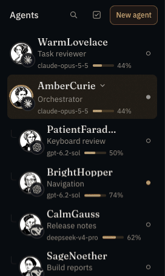
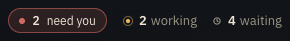

# agent の状態を見てまとめて選ぶ

1. 左の **Agents** で agent を押すと、その端末が開きます。
2. **Select** アイコンを押して、対象を複数選びます。
3. 一緒に終了するには **Exit** を押し、対象数を確認してから **Confirm** を押します。

上部の **working** は作業中、**waiting** は次の指示を待つ agent の数です。**need you** を押すと、質問や承認を待っている agent に絞れます。

待っている agent を開いて質問を読み、入力欄から答えます。対応する承認は [Reader から操作](usage.md#reader-で承認する)できます。[Telemetry の dashboard](view-telemetry.md) 内でまとめて終了する場合は **SELECT** から **EXIT** を使います。

## 複数の agent に同じ指示を送る

1. **Agents** の **Select** で対象を選び、**Message** を押します。入力欄に `@` を打ち、名前や役割の先頭で検索して宛先を一人ずつ追加することもできます。
2. 入力欄で宛先を確認します。**Message** で送れない agent が外れたときは **Unavailable** に名前が出ます。`@` の候補では、停止中などの理由を確認できます。
3. **Visible recipients** で通常のメッセージを送ると、各 agent にほかの宛先名と ORRERY Mail で連絡できる案内が付きます。宛先名を伏せる場合は **Hidden recipients** を選びます。
4. 指示を入力して送信します。送信後の表示で、届いた宛先と確認が必要な宛先を確かめられます。

[English](en/manage-agents.md) · [画面一覧](cockpit-map.md) · [一覧と選択の詳細](usage.md#roster)
