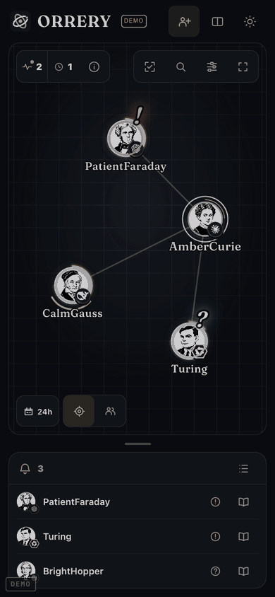
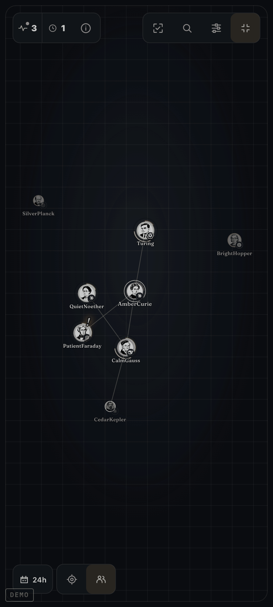
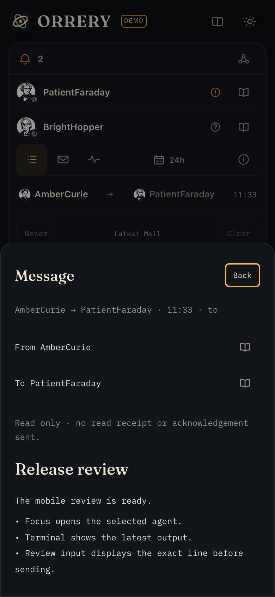

# スマホで状況を見る



スマホをペアリングすると、ブラウザーの一覧から agent の作業や Mail を確認できます。

> English: [mobile.en.md](en/mobile.md)

[README](../README.md) · [インストール](telemetry-install.md)

スマホ用の閲覧画面です。英語・dark表示で、要確認のagent、Mailの時間軸、NETWORKを見られます。**既定はオフ**です。通常のinstallや更新では待受もTailscale Serveも開始しません。同じコンピューターのlegacy Telemetry（API 30以上）へ接続します。global modeには未対応です。

ORRERYのcockpitがあれば、**Settings → Phone**からオン・オフできます（[次節](#cockpitのsettingsからオンにする)）。その下の表と[手動で有効にする](#手動で有効にする)は、cockpitを使わずに手で設定する場合の手順です。

WindowsのWSL2を使う場合は、[WSL2でPhone accessを使う](#wsl2でphone-accessを使う)に沿ってServeの設定とサービスの確認を進めます。

## スマホへ通知する（Android Chrome・任意）

通知は既定でオフです。Phone accessの本人確認とpolicy確認を済ませた後、正規installerでoptional依存を用意します。まず `bash scripts/install.sh --with-mobile-push --dry-run` で計画を確認し、同じinstall先への `--with-mobile-push` 付きinstallを通常の承認手順で実行します。通常のinstallにはこの依存を追加しません。productionのPythonへ手でpipを実行しないでください。

既にPhone accessを使っている場合は、`printf '%s\n' '{"access":true}' | agentstack-mobile apply` で同じ設定を再適用します。これにより管理対象の通知用Pythonをphone jobが選びます。依存だけを用意しても、通知の許可や購読は作られません。手動でrelayを起動する場合は、optional依存の入ったPythonと `--enable-push`、確認済みのhistory設定が必要です。

スマホのReaderの上の**ベル**を押し、**Enable on this phone**を押してChromeの許可を与えます。許可を求めるのはこの操作だけです。設定は端末ごとに保存します。

- **Reply needed**: 全agentの質問・承認待ち。既存Readerと同じask/questionを観測します。
- **Work finished**: このagentだけ。新しい作業の後に待機となり、新しいassistantの返答が記録された「ターンの終わり」です。タスク全体の達成やプロセス終了を表しません。オンにしたagentのベルに印が付きます。
- **Message previews**: 端末ごとに1つ、既定はオフです。オフならagent名と種類だけ。オンなら質問や最終返答の先頭を最大600文字まで表示します。コード・画像・token等の疑いがある本文・絶対pathを含む本文はpreviewを隠します。承認の具体文や検証済みの新しい質問文が取れない場合は、種類だけを表示します。

Demo mode中も通知を送りますが、端末の設定にかかわらず本文のプレビューは送信直前に隠し、種類だけを表示します。名前はスマホ画面と同じ規則で、ホスト名や追加の伏せる単語に一致した部分だけを隠します。ベルでは有効化と通知種類の変更ができ、**Message previews**は一時的にオフ表示で操作できません。保存済みの値は変えず、Demoを切ると元に戻ります。Demoのオン・オフだけではbaselineや送信待ちを捨てません。

**Disable on this phone**はサーバーの購読を消してからブラウザの購読を解除します。再有効化には同じベルを使います。Chromeで拒否した場合はChromeのsite settingsでORRERYの通知を許可し直します。最初の対象はAndroid Chromeです。iOS/Safariはこの版の対象外です。

送信はMacからGoogleのPush serviceへの外向きHTTPSで行います。本文は標準Web Pushの暗号化を使いますが、Googleには配送先と時刻等のmetadata、およびVAPIDの連絡先として設定済みowner loginのメールアドレスが渡ります（メール形式のloginが必要です）。Funnelや公開の着信口は追加しません。通知を押すと同じoriginを開き、Readerの起動完了と最新名簿を待って、そのagentを開きます。Freshでは名簿のMail identityも入力先へ渡します。本文を受け取るたびにTailscale内の会話を取得する仕組みではありません。Reader閲覧にはTailscaleと起きているMacが必要です。

鍵・購読・送信済みの印は `~/.agentstack/runtime/mobile-push/` に0700/0600で保存し、VAPID鍵は有効化時に1回だけ作ります。endpointと鍵はログへ出しません。Demo状態が不明・未対応の場合や、切断・unknownでは送信せず、初回起動や30秒を超える観測中断からの復帰はbaselineだけを取り直します。取得や送信の途中で30秒を超えて中断した場合も、その観測と未送信の通知を捨てます。Macのsleep中は新しい通知を送れません。履歴は1巡8件まで取得し、作業開始・完了確認・質問previewを共通の最終取得試行時刻が古い順に回します。取得の失敗も時刻を更新し、取り切れなかった作業開始の履歴は作業中の次巡へ持ち越します。画面を閉じてもrelayが5秒間隔で観測しますが、観測間の短い作業や、記録が取れないターンの完了通知は届かないことがあります。

連打を抑えるため返事待ちを2回の観測で確定し、同じ状態を繰り返し通知しません。購読8端末・完了の選択は端末ごと128agent・pending64件・1巡4送信・最大3試行・120秒の期限を設けます。配送中に設定を切っても、既に受理された通知を取り消せるとは限りません。HTTP受理と端末表示は別で、OSの省電力・通知制限等による遅延や欠落があり、exactly-onceは保証しません。

## cockpitのSettingsからオンにする

cockpitの**Settings**に**Phone**の節があり、スイッチは2つです。

- **Phone access**: スマホで読めるものすべて（agentの一覧・Graph・Mail・会話の記録・file・画像のpreview）。会話だけを別に切るスイッチはありません。
- **Send from phone**: paneへ確認付きの1行を送る（[Terminal](#スマホからpaneを確認して送る)）。既定はオンですが、下の4の確認までは働きません。

**demo modeのままでは設定できません。** demo modeではloginとaddressを画面に出さないため、手順2の入力欄が出ません。最初の1回だけ、Settingsの**Demo mode**を切って、下の手順を4まで済ませます（URLの`?demo=0`はそのpageだけに効き、開き直すとdemo modeに戻ります）。設定した後は、demo modeに戻してかまいません（[demo modeのとき](#demo-modeのとき)）。

以下の画面の名前とaddressは架空の例です。実際には、自分のTailscaleの値が入ります。

### 始める前に（本人・1回）

cockpitの画面からは変えられない前提が2つあります。どちらも[エージェントに設定を頼む](#エージェントに設定を頼む)の表の段2・4と同じです。

- **スマホにTailscaleを入れ、コンピューターと同じアカウントでsign inする。** 確かめる: スマホのTailscaleの一覧にこのコンピューターが出る（コンピューターの`tailscale status`にもスマホが出る）。
- **Tailscaleの管理画面のDNSで、MagicDNSとHTTPS Certificatesを有効にする。** 手順3のServe（HTTPS）に要ります。確かめる: 管理画面のDNSのpageで両方が有効になっている。またはコンピューターで`tailscale status --json`の`CertDomains`が空でない。

### 最初の画面

**Phone**の横のbadgeは**OFF**です。**Phone access**のスイッチを押します。

### 手順1・2: Tailscaleとowner・address（本人・1回）

初めて押したときは、**スイッチはまだオフのまま**です。スイッチのすぐ下に「Not on yet: check the owner and address in step 2 below, then press Confirm and turn on.」と出て、その下に**Setup**の手順が開き、手順2の入力欄へ移ります。

- 手順1はTailscaleにsign inしているかを自動で読みます。✓が付いていれば何もしません。付いていないときは、スイッチの下に「sign in to Tailscale」（Tailscaleが入っていなければ「Tailscale was not found」）と出ます。このコンピューターでTailscaleを入れてsign inしてから、もう一度**Phone access**を押します。
- 手順2の**Owner (Tailscale login)**は、readerが通す唯一のloginです。**Address on the phone**は、スマホで開くaddress（`https://<このコンピューターのTailscale名>:9443`）です。どちらも`tailscale status`から埋めてあるので、確かめて**Confirm and turn on**を押します。ここで初めてPhone accessがオンになります。
- **確かめる:** badgeが**SETUP**になり、手順2に✓が付く。

### 手順3: Serve 9443 → reader（本人・terminal）

macOSでは手順3に出ている`tailscale serve --https=9443 http://127.0.0.1:8781`を**Copy**し、terminalで1回実行してから**Check again**を押します。WSL2では[TelemetryのSettings](#wsl2でphone-accessを使う)で変更内容を見てから確定します。

**確かめる:** **Check again**で手順3に✓が付く。付かないときは、`tailscale serve`の出力を読みます。HTTPS Certificatesが無効なら、ここで有効にするよう求められます（[始める前に](#始める前に本人1回)）。

### 手順4: Who can reach it（本人・管理画面）

手順3に✓が付いたら、Tailscaleの管理画面で、tcp:9443に届く人と端末を確かめます（[下の端末制限](#公開前に本人とスマホを別々に制限する)など）。済んだら**I reviewed the policy**を押します。押した日時が残るだけで、ORRERYはpolicyを確かめられません。

**4を押すまでは、会話とSendは止まっています。** スマホで読めるのは一覧・Graph・Mailだけです（readerは`policy_not_reviewed`と答える）。この間は、スイッチのすぐ下に「On, but Conversation and Send from phone stay off until step 4 below」と出ます。

**確かめる:** ORRERYはpolicyを確かめられないので、自分で確かめます。どの場合も、管理画面で、許してよい人と端末だけがtcp:9443に届くことを見ます。端末を制限した場合は、除外した端末から開けないことも[実スマホで確認してから使う](#実スマホで確認してから使う)の手順で確かめます。

### オンの状態

badgeが**ON**になり、Setupの手順は消えます。**自分で確かめる:** Statusが4行とも緑であることを見ます（reader・Serve・Funnel off・policy）。loginやaddressを変えるときは**Change owner or address**を使います。

### スマホで作業を見る

Claude・Codex の会話には、PC の Reader と同じ **Agent steps** を表示します。発言、Mail、システム通知を挟むと、その前後の作業は別のカードに分かれます。記録された完了操作を段で追加し、作業中は **Working…** と経過時間、終了後は **Worked for … · N steps** に畳みます。押すと開き、過去のターンは最初は畳んで表示します。明示された失敗だけを **Failed**、結果が記録されないものを **Observed** とします。Codex の実行途中の内側の操作は推測せず、完了記録が届いてから追加します。狭い画面では対象の要約を1行に省略します。

旧運用の dashboard と更新済みの cockpit を使う場合、Claude Code・Codex CLI・dsh・Hermes の Reader で圧縮中に **Compacting context…** を表示します。端末に経過が出ていれば一緒に表示し、履歴に記録されると **Context compacted** が 1 行残ります。

段になった道具のラベルは重ねず、ファイル・画像・Mail と未対応の道具のまとまりは残します。古いページで Claude の対応する要求が見つからない場合は **Load earlier** の説明を表示します。段に必要な短い道具名・対象の要約・時刻・状態・opaque ID とターン区切りだけを中継し、生の引数や出力、path、cockpit の参照 ID は追加しません。ページ数・bytes 上限は同じです。Demo でも動作し、対象は他の本文と同じ既存の規則で伏せます。背景化で動き・時計を止め、Close で解除します。OS の reduced motion に従います。動きは [kokonutUI AI Loading](https://kokonutui.com/)（MIT）の PC 版を流用し、ライセンスを source に保持しています。

スマホで、手順2の**Address on the phone**（`https://…:9443/`）を開き、agentを開きます。最初のHTTPSは、証明書の発行で数秒かかることがあります。**Conversation** タブで[agent の作業を Reader で追えます](#スマホの-reader-で-agent-の作業を見る)。


### demo modeのとき

更新済みのcockpitで**Demo mode**を有効にすると、スマホも自動でユーザー名・機械名・追加した語を伏せます。画面を再読み込みせず約4秒以内（前面で接続できるとき）に追従し、書きかけの文章と画像を保持します。**Settings**のスイッチを切るとスマホ側も解除します。デスクトップを閉じても最後の状態を保持し、URLの`?demo=0`だけではスマホを解除しません。コピーや送信は伏せる前の値を使います。

最初の表示前にもDemo状態を確認します。通信エラーでは画面を隠して**Retry**を出します。同じブラウザにDemo状態が残っている間は、cockpitの停止や旧版への切替だけでは実名表示に戻りません。cockpit未導入・未起動、または未対応の旧版で、Demoを受け取った履歴もない場合は従来の閲覧表示を続けます。両方を更新して、Demo中のデスクトップとスマホを一度再読み込みしてください。

loginとaddressをまだ設定していない状態でdemo modeのまま**Phone access**を押すと、スイッチのすぐ下に「Turn off demo mode to set up phone access (once). After that you can switch it on and off in demo mode.」と出ます。**Turn off demo mode**を押すと、demo modeを切ってpageを開き直します。Settingsは閉じるので、もう一度**Settings**を開いて**Phone access**を押し、上の手順を進めます。

設定した後は、demo modeに戻しても、スイッチはそのまま使えます。loginとaddressは「hidden in demo mode」と表示され、画面には出ません。変更するときだけdemo modeを切ります。

### 裏で動くもの

裏ではTelemetryの`~/.agentstack/bin/agentstack-mobile`が動きます。cockpitはこのcommandを呼ぶだけで、Telemetryのfileを直接は書きません。

- 設定は`~/.agentstack/mobile.json`（mode 0600）に置きます。keyは`access`・`send`・`owner_login`・`public_origin`・`policy_reviewed_at`と3つのportで、鍵やtokenは入りません。
- readerは`mobile_relay.py --config ~/.agentstack/mobile.json`で動きます。macOSではlaunchdのjob `org.agentstack.mobile-relay`で、logは`~/.agentstack/logs/mobile-relay.log`です。WSL2ではsystemdのuser unit `org.agentstack.mobile-relay.service`で、logはjournalに入ります。設定を変更すると再起動します。Phone accessを切るかuninstallすると、管理しているサービスを停止して削除します。installはcommandを置くだけです。
- 手で起動したreaderが8781を使っている間は、badgeが**MANUAL**になり、Statusに**A reader not started from Settings is running on 127.0.0.1:8781**と出ます。スマホからはそのreaderを今も読めます。Settingsのスイッチはそのreaderを動かせないので、押せなくなり、`agentstack-mobile apply`も`port_in_use`で何も変えません。Settingsへ移るには、そのreaderを起動したterminalで止め（Ctrl-C）、**Phone access**を入れます。手のflagは次のように置き換わります: `--enable-terminal`は**Send from phone**、`--phone-policy-reviewed`は4の**I reviewed the policy**、Historyは**Phone access**に含まれます。
- **Send from phone**は、cockpit側の受け口もその場で切り替わり、`~/.orrery/config.json`の`enable_mobile_terminal`に保存されます。backendの再起動はいりません。terminalで`agentstack-mobile off`などを実行した場合は、次にSettingsを開いたときに揃います。手で起動したreaderが動いている間と、Settingsを一度も使っていない間は、`enable_mobile_terminal`を今の値のまま変えません。
- loginかaddressを変えると、4の確認は取り消され、会話とSendは確認し直すまで止まります。確認を自分で取り消すには`echo '{"policy_reviewed": false}' | agentstack-mobile apply`を実行します。
- launchdがreaderを起動できなかったときは、Phone accessをオフに戻し、jobもplistも残しません（次のloginで勝手に起動しないように）。
- jobは、オンにしたときのPythonでreaderを動かします。そのPython（venvやHomebrewの古い版）を消すと、Statusに**The Python this reader was set up with is gone**と出ます。Phone accessを一度切って入れ直すと、今のPythonで作り直します。
- cockpitのdemo modeでは、Phoneの節はlogin・address・ServeのURLを画面に出しません（demo modeが隠すのはユーザー名と機械名だけなので）。設定と変更はdemo modeを切って行います（[demo modeのとき](#demo-modeのとき)）。
- PhoneのスイッチはServeとFunnelの状態を読み取ります。WSL2のServeの追加・削除は別の操作です。policyとFunnelはTailscaleで管理します。

cockpitなしで同じことをするには、`agentstack-mobile status`で状態を見て、`echo '{"access": true, "owner_login": "owner@example.com", "public_origin": "https://computer.example.ts.net:9443", "policy_reviewed": true}' | agentstack-mobile apply`で入れ、`agentstack-mobile off`で切ります。

## WSL2でPhone accessを使う

systemdを有効にした最新のWSL2ディストリビューションが必要です。WSL内の`systemctl --user show-environment`が成功することを確かめます。スマホから使う間はディストリビューションを動かしておきます。systemdのサービスだけではWSLを起動し続けたり、Windowsへのサインイン時にWSLを起動したりできません。[MicrosoftのWSL systemdガイド](https://learn.microsoft.com/windows/wsl/systemd)

1. Tailscaleにサインインし、上の手順でMagicDNSとHTTPS Certificatesを有効にします。WSL内に`tailscale`があればそれを使います。無ければPATHまたはWindowsのProgram Filesにある`tailscale.exe`を使います。Windows側を使う場合はWSL interopとWindowsからWSLへのlocalhost転送が必要です。`agentstack-mobile status`でサインインと候補のアドレスを確かめます。[WSL interop](https://learn.microsoft.com/windows/wsl/filesystems#run-windows-tools-from-linux)、[WSLのネットワーク](https://learn.microsoft.com/windows/wsl/networking)
2. Cockpitの**Settings → Phone**で本人のloginとアドレスを確かめ、**Confirm and turn on**を押します。WSL内の`systemctl --user status org.agentstack.mobile-relay.service`と`journalctl --user -u org.agentstack.mobile-relay.service`で起動を確かめます。Windows側のTailscaleを使う場合は、Windows PowerShellで`curl.exe -i http://127.0.0.1:8781/`を実行します。`403`と`request_denied`が返れば、転送がリレーに届き、Serveの本人情報が必要なことを確認できます。
3. Windows PowerShellの`tailscale.exe serve status --json`（Linux版の場合はWSL内の`tailscale serve status --json`）で現在のServe設定を保存します。ローカルのTelemetry dashboardを直接開き、**Network → Settings → Phone access → Review Serve**を押します。**HTTPS 9443 → http://127.0.0.1:8781**を確認して**Add Serve**を押します。取り消す場合は**Cancel**です。HTTPS 9443が空いている場合だけ追加でき、443や8443などの既存の待受は対象外です。確定中は別の画面でTailscaleの9443を編集しないでください。
4. Cockpitに戻り**Check again**を押し、上の手順4でtailnetのpolicyを確認してからスマホで候補のアドレスを開きます。変更に失敗した場合は、Serveの状態、HTTPS Certificates、CLIの権限を確認します。[Tailscale Serve CLI](https://tailscale.com/docs/reference/tailscale-cli/serve)

戻す場合は、再び**Review Serve**を押して、プレビューを確認し**Remove Serve**を押します。Telemetryで追加し、そのままの設定が残っている専用のServeだけを削除できます。残ったServe設定を手順3で保存した内容と比較してください。Cockpitで**Phone access**を切るか`agentstack-mobile off`を実行し、user unitが消えたことを確かめます。Phone accessを切る場合もuninstallする場合も、Serveの削除には別途確認ボタンを使います。

## エージェントに設定を頼む

Telemetryを動かしているコンピューターのClaude CodeやCodexのagentに、このページを渡して設定させられます。たとえば次のように頼みます。

> docs/mobile.md を読んで、私のスマホ用にmobile readerを設定して。コマンドは自分で実行し、「本人」の段では止まって、私がやることを具体的に教えて。

**本人**と書いた段では、Tailscaleの管理画面やスマホ自体を操作します。それ以外はagentが進められます。Terminalも使いたい場合は、閲覧設定の後に[別の有効化手順](#スマホからpaneを確認して送る)を続けます。

| 段 | 誰が | 何をする |
|---|---|---|
| 1 | agent | `curl -s http://127.0.0.1:8770/api/version` がAPI 30以上かを確かめる |
| 2 | **本人** | スマホにTailscaleを入れ、コンピューターと同じアカウントでログインする |
| 3 | agent | 値を調べる。コンピューターのServe名とIPは`tailscale status --json`の`Self.DNSName`（末尾の`.`は除く）と`Self.TailscaleIPs[0]`、本人のloginは`User[Self.UserID].LoginName`、スマホのIPは`tailscale status`。`tailscale whois <スマホのIP>`でスマホがそのloginのものか確かめる |
| 4 | **本人** | 管理画面のDNSで、MagicDNSとHTTPS Certificatesが無効なら有効にする。それまでは`tailscale status --json`の`CertDomains`が空になる |
| 5 | **本人** | アクセスを許す範囲を確認する。操作に使う自分の端末だけへの制限を推奨（スマホ・タブレット複数可）。採用する場合は、次節のgrantと既存の広い許可を管理画面で整理する |
| 6 | agent | [手動で有効にする](#手動で有効にする)の2〜5を実行する |
| 7 | **本人** | スマホで`https://<Serve名>:9443/`を開く。最初のHTTPSは証明書の発行で数秒かかることがある |
| 8 | agent＋**本人** | 使いたい各端末で表示を確認し、端末制限を採用した場合は除外した端末が拒否されることも確かめる（[実スマホで確認してから使う](#実スマホで確認してから使う)） |

macOSで`tailscale`がPATHに無いときは、CLIは通常`/Applications/Tailscale.app/Contents/MacOS/Tailscale`です。手で起動したreaderは前面で動きます。常駐させるならcockpitのSettings（または`agentstack-mobile apply`）を使ってください。launchdのjobで動きます。

## ホーム画面にインストールする

Tailscaleを接続し、Android ChromeでreaderのHTTPSのServeアドレスを開きます。Chromeのメニューから **アプリをインストール**（版によっては **ホーム画面に追加** の中）を選び、インストールします。古いブラウザのショートカットは消して入れ直してください。新しい **ORRERY** のアイコンから開くとURLバーなしで表示されます。通常のブラウザのタブでアドレスを開いた場合はURLバーが出ます。iOSではSafariの **ホーム画面に追加** を使います。

コンピューターごとのServeアドレスから追加すると、アプリ名は **ORRERY · コンピューター名** になります。ホーム画面では短いコンピューター名が表示される場合があります。

インストール後も、本人のアクセス条件と接続は必要です。記録のoffline保存やservice workerは追加しません。Android Chromeのメニューからのインストールにservice workerは不要です（[Chrome公式の条件](https://developer.chrome.com/blog/update-install-criteria)）。操作は端末のsafe-area内に収めます。更新後のインストールと背景からの復帰は実機でも確かめてください。

同梱のアイコンは `dashboard/assets/orbit.svg` から `python3 scripts/mobile_pwa_icons.py` で再生成します（開発用に `rsvg-convert` が必要）。

## 画面で分かること

Graphの左上に稼働中・待機中の数をアイコンで表示します。件数をタップすると該当するエージェントの肖像と名前が並び、選ぶとReading Viewを開けます。要確認のエージェントがいると稼働中のアイコンに印が付き、一覧の先頭にレビュー待ち（`!`）や質問（`?`）が並びます。情報アイコンから観測時刻、期間、取得状態を確認できます。スマホではGraphの下に要確認のagentが並び、その右の一覧アイコンでActivityを開きます。iPadなど幅の広い画面ではGraphと要確認・Activityを左右に並べます。Activityの情報アイコンからもデータの取得状態を確認できます。

複数のエージェントは、Graphの選択アイコン、ヘッダーのペインアイコン、またはReading Viewの追加アイコンから選びます。Graphとペインの境目をドラッグして広さを調整し、端で放すと片方だけを表示できます。ヘッダーから元の配置に戻れます。スマホのホームでは、Graphと要確認欄の間の仕切りも動かせます。

複数表示でも各ペインはReading Viewから始まります。ペンのアイコンで広い入力欄を開き、別のペインに切り替えてもそのペインの下書きが残ります。添付アイコンからJPEG、PNG、WebPの画像や、任意の形式のファイルを選べます。

初回はダーク表示です。右上の太陽・月アイコンでライト・ダークを切り替えられます。選択はそのブラウザに保存されます。

- **Activity**: 一覧は差出人、宛先、時刻を表示します。To/Ccは操作のラベルとMail詳細に含まれます。Mailを1件タップすると、その件名と本文を開きます。taskや私有パスを別途取得しませんが、Mail本文に書かれた内容は表示されます。Statusは、このreaderを起動した後に観測した変化です。実際に変化した時刻とは区別します。
- **Graph**: 既定は直近24時間に活動が確認されたagentです。Focusはその中の選択agentと関連の強い最大5体、Allは選択期間内の全体です。虫眼鏡の**Find an agent**で名前またはRoleを検索できます。結果の名前を押すとReaderが開き、横の**Focus**はそのagentを中心にGraphを絞ります。Focus表示では周りのagentをタップすると中心を切り替えてFitし、中心のagentをタップするとReaderが開きます。All表示ではどのagentもタップでReaderが開きます。Enter・Spaceも同じ動きです。Roleは既存の注釈に登録された短い表示名だけを名前の下に表示し、未設定なら補いません。ピンチで拡大・縮小し、背景をドラッグするとGraph全体を移動できます。エージェントをドラッグすると、そのノードが指に追従し、接続先と線が強調されます。大きなgraphで全名前を同時に読めることは保証しません。
- Graphのagentや検索結果の名前から開いたReaderを**×**や**Back**で閉じると、最後に読んでいたagentと関連の強い最大5体をFocusで表示してFitします。Activityなどから開いた場合は元の画面へ戻ります。
- Focus・Allとも、75%以上の拡大率では全agentの肖像の下に名前、その下に登録済みのRoleを表示します。選択中の名前は従来の大きさを保ち、それ以外は小さく表示します。75%未満では名前とRoleを隠します。
- 線の太さと矢印の大きさは選択期間のMail件数に対応します。件数は方向・To/Ccごとの**宛先行数**で、未読数や一意の送信数ではありません。親子の破線はMailとは別です。
- 文脈残量弧とWorkingの動きはPCと共通です。文脈の取得時刻は不明なまま扱い、未知値には弧を描きません。アカウント利用枠はUnavailableで、更新要求もしません。
- **Tune graph**の6設定とActivityの絞込は、このブラウザ内の表示調整だけです。会話の記録は下のpolicyの確認の後に、ターミナルの表示と送信はさらにその設定を有効にした場合だけ使えます。
- **New agent**は **Send from phone** が有効なときにGraph上部から開けます。タスクを入力し、1行の操作欄からモデルと設定済みの作業フォルダを選びます。モデルの札を開き、プロバイダーのアイコンを選ぶと、その一覧でモデルを検索できます。Local のモデルには接続先が表示されます。モデルを選んだ後で、複数ある場合はハーネス、対応するEffortのスライダー、既存モードのRoleを指定できます。選んだEffortはモデルの札の目盛りに反映されます。既存モードでは、フォルダの隣の画面アイコンから Off、View、Control を選べます。View は画面の確認、Control は操作も許可します。Browser アイコンをタップすると Off、Temporary Chrome、My Chrome から選べます。対応する場合の既定は My Chrome です。Temporary Chrome は一時プロファイル、My Chrome は普段の Chrome を使います。My Chrome の初回接続で Mac の Chrome に許可を求める画面が出たら、Mac の前で応答するまでブラウザ操作が待機します。**Review launch**で作業フォルダのパス、タスク、モデル、設定を確認してから起動します。起動に失敗すると次の操作が表示されます。結果が不明ならGraphで確認し、同じ起動を自動で繰り返しません。

前面では約10秒ごとに取得し、背景ではpollを止めます。取得に失敗した値は「Last known」として残し、失敗を正常な0件や待機状態には変えません。SnapshotはHTTPで観測した時刻です。Mailは1ページ200宛先行までで、**Older / Newer**で差し替えます。古いページを見ている間もGraphは更新されますが、一覧が勝手に先頭へ戻ることはありません。Statusは最新ページだけに表示します。graphは最大10,000集約リンクまでで、切詰めは画面に明示します。ブラウザにはテーマと6つのグラフ設定を保存します。sessionStorageには開いているagent名・Conversation/Terminalのタブと、選択時に得たMailのinstance/agentのID（ある場合）を保存します。記録や下書きのoffline保存やservice workerはありません。

GraphのMail線をタップすると、その2体間の選択期間の一覧が開きます。初期表示は**Both**（両方向）で、差出人→宛先のボタンで方向を絞れます。親子線はMail一覧を開きません。一覧の1件をタップして本文を開き、**Back**で一覧、**Done**でGraphへ戻ります。選択と拡大率は保持します。

Graphを前面で見ている間は、約10秒ごとのsnapshotでMailの線の件数が増えると、差出人から宛先へ光が飛び、増加分を**+N**で示します。同じ2体へのTo/Ccはまとめます。光のタップでも既存の2体間の一覧が開き、件名・本文は1件を選んだときだけ取得します。初回、期間変更、背景からの復帰、取得の中断後には過去分を流しません。表示範囲外の線は対象外で、件数が上限で欠けているsnapshotでは出しません。同時表示は最大12本です。期間内の件数の差なので、その間に古いMailが期間外へ出ると、新着数と一致しないことがあります。動きを減らす設定では、飛ぶ光の代わりに線の中央へ静止した印を出します。

Contextや状態・Roleだけが変わった場合は該当ノードの表示だけを更新し、位置・手動の拡大率と他ノードの肖像を保持します。ノードや線、Focus対象が変わった場合は通常どおり配置を計算します。ロゴ・書体・グラフの描画は既存のものを使います。

Graph右上の**Expand**でGraphを画面いっぱいに広げます。ブラウザの全画面機能が使えない場合も、同じページ内で全面表示します。Find・Focus/All・Fit・ピンチ・ドラッグ、Mail線の一覧やTerminal sheetはそのまま使えます。**Close**で通常表示へ戻ります。戻る／Escapeは手前のsheetを先に閉じ、次にGraphの全画面表示を終了します。OSやブラウザが全画面を終了した場合は通常表示へ戻り、開いていたsheetも閉じます。縦横の切替に追従し、選択と手動の拡大率を保ちます。実スマホでの全画面・戻るジェスチャー・キーボード動作は別途確認してください。



件名は512文字、本文はUTF-8で64KiBまでで、超過は明示します。HTMLやMarkdownは文字として表示し、リンク・画像・添付を実行しません。read/ACKや返信も送りません。閉じる、別のMail、期間・画面の切替、背景移行で表示中の本文を消し、遅れた応答で復活させません。取得不能・削除・変更・期限切れはエラー表示し、前の本文で埋めません。



Mac readerは本人認証後のsnapshot取得をきっかけに、固定の直近24時間をメモリに準備します。最大2000通の一意なmessage、本文と対応metadataの合計32MiB（JSONの論理byte量で、RSSの保証ではありません）です。To/Ccが複数でも本文は1通分です。上限・時間・読取失敗時は**partial / unavailable**で、全件準備済みにはしません。タップ時はcache内でも現在の宛先と改訂を再照合します。24時間より古い表示済みMailは1件ずつ取得でき、cacheには残しません。reader停止で全cacheが消えます。件名・本文をスマホへまとめて送ることはありません。

ページ位置は10分で失効し、ホスト側で最大256、発行済みeventは最大2000です。ブラウザは最大20位置まで戻れます。失効した場合は明示エラーとなり、無言で先頭に戻しません。期間変更でページと本文をリセットします。

Graph下端、またはスマホのActivityにある小さな期間表示から**Time range**を開きます。スライダーは15分〜30日を15分刻みで調整できます。初期値は24時間で、全履歴は別の**All history**を押した場合だけ表示します。GraphのAllとは別です。最後の入力から約200ms後に適用します。期間はagentの活動、Mailのイベントと件数、Statusの観測時刻に適用します。Statusはreader開始後の最新200変化まで保持し、その中から選択期間・表示agentに該当するものを表示します。

活動時刻は名簿の最終活動とMailの時刻を使います。直近に活動した退役済みagentも含み、起動中という理由だけで古い活動を現在扱いにはしません。時刻不明のagentは有限期間から除外して件数を表示し、All historyでは含めます。取得・投影には上限があり、ホスト側の大きな全履歴取得が必ず時間内に終わることは保証しません。

専用アイコンは表示対象のagent名からPCの既存設定を使って解決し、科学者の肖像、イニシャルの順に補います。画像の対応表や私有パスはスマホへ送りません。PNG画像にも本人認証を適用し、取得・読込に失敗した場合はイニシャルを表示します。

## 公開前に、本人とスマホを別々に制限する

この機能は**tailnet内のTailscale Serve専用**です。Funnelやfull dashboard/cockpitの公開には使いません。relayは`127.0.0.1`だけで待ち受け、外側のHTTPS Hostと本人の`Tailscale-User-Login`を照合します。[Serveは受信したidentity headerを除去して本人情報を付与します](https://tailscale.com/docs/features/tailscale-serve)。同じコンピューター内の別processはこのheaderを偽装できるため、信頼できないlocal processから守る仕組みではありません。

**本人アカウントの一致だけでは端末を限定できません。** 操作に使う自分の端末だけを許可することを推奨します。スマホ・タブレットを複数使って構いません。同じアカウントの常時稼働・外部公開サーバーまで許可すると、そのサーバーからもターミナルに到達でき、侵害時の影響が広がるため、アクセス対象から除くことを強く推奨します。これは推奨設定で、製品に単一端末の強制やpolicy自動検証はありません。

この推奨を採用する場合は、管理者が操作用端末のTailscale IPから専用HTTPSポートだけを許可します。以下は既存policyへ組み込む例です。使わない端末は`src`から除き、placeholderを実際の値に置き換えます。policy全体をこの例で上書きしないでください。

```json
{
  "grants": [{
    "src": ["<PHONE_TAILSCALE_IP>", "<TABLET_TAILSCALE_IP>"],
    "dst": ["<SERVER_TAILSCALE_IP>"],
    "ip": ["tcp:9443"]
  }]
}
```

[grantsは複数ルール・同じ配列の条件を合算します](https://tailscale.com/docs/reference/syntax/grants)。既存の全端末向け許可がこのポートを含むなら、上の狭いルールを追加しても制限できません。広い許可の方も整理する必要があります。`src`へ本人とスマホIPを並べる方法もAND条件にはなりません。[IPの指定方法](https://tailscale.com/docs/reference/targets-and-selectors)を確認してください。端末名やUser-Agentでの判定は行いません。本人のスマホにtagを付けて代用するとuser identityが変わるため、この手順では使いません。

除外したい端末からこのホストへ適用される**すべてのgrantとACL**を確認し、別の広い許可にも`tcp:9443`が残らないようにします。たとえば、ある広いgrantの`ip`からTCP 9443だけを除き、ほかのTCP・UDP・ICMPを許す形は次のとおりです。

```json
["tcp:1-9442", "tcp:9444-65535", "udp:*", "icmp:*"]
```

これは[protocol/port指定](https://tailscale.com/docs/reference/syntax/grants#network-layer-capabilities)の説明用で、policy全体や任意の`["*"]`をそのまま置き換えるものではありません。ほかのprotocolや宛先への必要な許可は残し、管理者が変更部分を確認します。agentはpolicyを自動で書き換えません。

## 手動で有効にする

**更新する前に:** これまで`--phone-policy-reviewed`を付け、`--enable-history`を付けずに手で起動していたreaderは、更新後に再起動すると会話の記録とfile・画像のpreviewもスマホに出すようになります。出したくなければ、再起動の前に`--disable-history`を足してください。起動時にも、この変更を1行で知らせます。

1. TelemetryをAPI 30以上に更新し、同じコンピューターの通常画面で観測できることを確認します。既存のサービス・provider設定はそのまま使います。
2. 現在のアクセス範囲を確認し、推奨の端末制限を採用する場合は上のpolicy変更を終えます。`tailscale serve status --json`で現在の設定を保存し、例のHTTPS `9443`が未使用でFunnelにもなっていないことを確認します。既存設定があるポートには重ねません。
3. 下の設定確認を行います。`owner@example.com`は本人の正確なServe login、`computer.example.ts.net`はこのコンピューターの実際のServe名です。URLは末尾の`/`なしで指定します。custom install先ではscriptのpathも置き換えてください。Pythonは3.11以上が必要です。

```sh
python3 "$HOME/.agentstack/dashboard/mobile_relay.py" --check \
  --owner-login 'owner@example.com' \
  --public-origin 'https://computer.example.ts.net:9443' \
  --listen-port 8781 --upstream-port 8770
```

`--check`は入力の形式だけを検査します。通信、待受、policy変更は行わず、本人スマホの制限を検証した結果でもありません。設定不足なら修正してから先へ進みます。

4. 一つのターミナルでreaderを前面起動します。

```sh
python3 "$HOME/.agentstack/dashboard/mobile_relay.py" --enable \
  --owner-login 'owner@example.com' \
  --public-origin 'https://computer.example.ts.net:9443' \
  --listen-port 8781 --upstream-port 8770
```

5. 別のターミナルで専用ポートをreaderへ接続します。8770やcockpitへ直接接続しないでください。

```sh
tailscale serve --https=9443 http://127.0.0.1:8781
```

[Serve CLI](https://tailscale.com/docs/reference/tailscale-cli/serve)の前面実行例です。既存Serveをresetしません。ターミナルを閉じてもServeを残すには`--bg`を付けます。外すときは下の「止める・戻す」のコマンドを使います。relayへ直接アクセスして403になるのは、本人headerがない場合の期待動作です。Host/Originで拒否された場合もガードを緩めず、実際のServe名・ポート・対応するTailscale版を確認してください。

## 実スマホで確認してから使う

操作に使う各スマホ・タブレットで`https://computer.example.ts.net:9443/`を開き、本人情報で画面とsnapshotが取得できることを確認します。別アカウントが拒否されることも確認します。端末制限を採用した場合は、同じ本人アカウントの**除外した端末**から接続できないことを別に確かめます。本人header照合と端末policyは別の確認です。除外側が未確認なら「操作用端末だけに制限済み」とは扱いません。

リポジトリの隔離HTTP試験・合成画面確認は、この実Serve/端末受入の代わりにはなりません。実際のTailscale版、policy、本人スマホでの配備確認は運用者が行います。

## スマホからpaneを確認して送る

**Terminalは別途有効にする機能です。手で起動するreaderでは既定で画面取得も送信も行いません。** 閲覧用readerを動かしただけでは使えません。cockpitのSettingsでは**Send from phone**がこれにあたり、既定はオンですが、policyの確認までは働きません。端末制限は上の任意の推奨で、複数の操作用端末を許可できます。既存の`--phone-policy-reviewed`は、現在のアクセスpolicyを運用者が確認したという申告として引き続き必要です。製品がpolicyを検証したり、端末を1台に限定したりするflagではありません。

この節もagentへ渡せます。本人の段では止まり、既存の設定を残して進めます。

| 段 | 誰が | 何をする |
|---|---|---|
| 1 | agent | TelemetryがlegacyではAPI31以上、freshではAPI34の対応版であることと、ORRERYのpane adapter版・現在のbackendの起動方法/管理元を確認する |
| 2 | **本人** | アクセス範囲を確認する。推奨の端末制限を採用した場合は、使う端末の許可と除外端末の拒否を確認する。再起動で一時的に接続が切れることを了承する |
| 3 | agent | 下のJSON項目だけを既存`~/.orrery/config.json`へ追加・更新し、ほかの項目を残す。file modeは`0600`を推奨 |
| 4 | agent | 同定した通常の手順でbackendを停止・再起動する。稼働中の再利用だけでは反映されない。二重起動・一括killをせず、管理元が不明なら止まって報告する |
| 5 | agent | 下のcapability確認でlegacyは`api:31`、freshは`api:34`、本人opt-in後の`enabled:true`を確かめる。この操作はpane取得や入力送信をしない |
| 6 | agent | readerの既存起動例へ`--enable-terminal --phone-policy-reviewed --cockpit-port 8791`を足す。先に同じflagで`--check`し、既存readerをその管理手順で再起動する |
| 7 | **本人** | スマホ・タブレットでTerminalを開き、対象paneと表示を確認する。試す入力は毎回Reviewで全文を確認してから送る |

共有設定の追加項目は次のとおりです。設定file全体を置き換える例ではありません。

```json
{"enable_mobile_terminal": true}
```

`scripts/start-cockpit.sh`、`get.sh`からのsetup、ORRERY.appの新規backend起動が同じ設定を読みます。独自の起動commandでは既存の`--enable-mobile-terminal`も使えます。**ORRERY.appを閉じてもbackendは残ります。** appを開き直すだけで反映されない場合は、元の管理手順でbackendを再起動します。

次は入力を送らない確認です。`owner@example.com`はreaderと同じ本人loginに置き換えます。custom install先では最初のpathも変更してください。

```sh
python3 - "$HOME/.agentstack/dashboard" <<'PY'
import sys
sys.path.insert(0, sys.argv[1])
from mobile_input import InputClient
capability = InputClient(8791, 'owner@example.com').call('capability')
print({key: capability[key] for key in ('api', 'enabled')})
raise SystemExit(0 if capability['enabled'] else 1)
PY
```

`enabled:false`やエラーの場合は有効化済みとせず、版・設定・管理元を確認します。readerの`--check`は形式検査だけで、policyや実端末の受入ではありません。どちらかの有効化が無い、版が合わない、既存target guardやOS確認が失敗した場合はUnavailableになります。

Graphのagent、検索結果の名前、ActivityのStatus行・要確認行・Mail詳細のFrom/ToにあるReaderアイコンから同じsheetを開きます。Graphの下に選択agent用の別カードは出しません。Mail本文を開く操作はそのままです。複数paneなら自分で選び、不明な対応を名前から補いません。legacyの対象はPCの既存managerが扱う同じtransport内で、既存保護が許すpaneです。agentの種類や現在の表示期間は起動許可には使わず、別socket/global対象へ迂回しません。paneのsessionは現在のmetadata project外にある場合もあります。freshは下の明示I/Aの手順を使います。

選択paneの末尾120行、UTF-8で12KiBまでを文字として表示します。Conversationも有効な画面では、端末本文を全面の下端へ寄せ、長い行は折り返し、続きの行にも元の字下げを残します（深い字下げは画面幅の40%まで）。罫線だけの行は折らず、幅で切ります。枠は出さず、取得上限・更新間隔・Shownの時刻を本文の下の小さな1行に出します。切詰め・制御文字の除去や読み返しの停止は必要なときだけ下に示します。更新の印は小さな点で、読み返しによる停止と取得失敗は画面上に残します。前面で開いている1paneだけ約3秒ごとに更新し、失敗時は6、12、最大24秒へ間隔を延ばします。制御文字の除去・表示の切詰めを明示し、画像、HTML、リンクを実行しません。既存recorderや復元history全体は送りません。検証済みの記録を整理して表示する [Reader の Conversation](#スマホの-reader-で-agent-の作業を見る)は別です。**画面にはキーや私的文章が含まれ得ます。** 誰かへ見せる前に内容を確かめてください。

端末の拡張previewは`X-ORRERY-Mobile-Preview: 120/12288`をloopback側で要求したときだけ有効です。新旧どちらかが古い場合は40行・6KiBを使い、新しいreaderは応答が宣言した上限で検証します。拡張時もJSON全体は16KiBまでで、引用符のescape等で収まらない場合は末尾をさらに短くします。relayはUTF-8で応答し、非ASCII文字を`\uXXXX`へ膨らませません。

Conversationの本文で左へ、Terminalの本文で右へ、はっきり横にスワイプすると切り替わります。画面端の24pxから始まる操作はOSに任せます。縦スクロール・文字選択・横スクロールが必要な表やコードの上、入力にfocusがある間、下書き・確認・送信中は切り替えません。空でfocusのない常設欄は本文のスワイプを妨げません。上の帯のボタンでも切り替えられます。

上へスクロールして読み返している間は、本文・**Shown**の時刻・切詰めと制御文字除去の注記を同じsnapshotに固定し、取得は続けます。新しい出力が届くと**New output · paused**と表示します。下端へ戻すと最新の末尾へ切り替わり、追従を再開します。全出力を蓄積する機能ではなく、保留中に120行・12KiBを超える出力があった場合、旧表示と最新の末尾の間は表示できないことがあります。実機では、流れる出力のpaneで上へ戻し、3秒以上待っても読んでいる行・Shownの時刻が変わらないことと、下端へ戻すと最新へ切り替わることを確認してください。keyboardの開閉や画面の回転後も、追従中は下端を保ち、読み返し中は本文を保持することを確かめます。

正常に取得した空のsnapshotも、読み返し中は保留し、下端へ戻した時に空の表示へ切り替えます。取得に失敗した場合は例外で、本文とShown・注記を消し、復旧後は最新の末尾から始まります。寸法変更だけで表示が下端へ寄せられても保留は解除せず、もう一度下端へ向けてスクロールすると最新へ切り替わります。

操作中に向きを反転した時は、最後の動きの向きで再開を判断します。上向きへ戻す・2本指にする・touch操作がキャンセルされる場合は保留を続け、再び下向きへ動かして下端にいる時に再開します。

安全に試せる専用paneで、別paneへの切替とClose後の開き直しが新しい末尾から始まること、**Review input**→**Edit**で入力が保たれ、確認するpaneと文面が正しいことを確認します。送信を試す場合は、受け手が分かり、副作用のない短いテスト入力を明示的に受け入れるpaneだけを使い、宛先・全文・Enterを確認して**Send once**を1回押し、応答と受理表示を確認してください。実行中のagentや用途不明のshellにはテスト文字を送らないでください。背景では取得が止まり、開いているagent・タブ・読む位置・メモリ内の下書きが残ることも確かめます。復帰時はpaneのrevisionを再確認し、変化・消失した場合は選び直しと再確認が必要です。期限切れの確認は編集へ戻ります。結果不明の送信は再送せず **Check receipt** を残します。

ConversationとTerminalの下には丸い入力欄があります。送り先の肖像と名前はReaderの見出しにあります。複数のReaderを並べて入力欄を開いたときは、入力シートの見出しで送り先を確認できます。UTF-8で4KiB以内の1行を書き、**↑（Review input）**で同じ欄を確認へ切り替えます。宛先agent、まだ送信していないこと、全文と続くEnterを確認し、**Send once**を1回押します。**Edit**で文面を保持して入力に戻れます。確認は30秒で失効し、出力更新で本文や宛先・期限を差し替えません。端末の取得が1回失敗しても、直前に確認した表示と入力を保ちます。取得失敗が続くと自動で再接続してpaneを確認し直します。接続先やpaneが変わった場合は、送信前に再確認が必要になることがあります。送信後も前面で開いていれば同じpaneの応答を見られます。cockpitはpaneの入力欄が空なのを確認して貼り付け、同じ文面が表示されてからEnterを送ります。**Received by terminal**はEnterの後に入力欄が空になるか、指定したコマンドの画面が開くと表示されます。**Outcome unknown**では一部だけ届いた可能性があり、自動再送しません。**Check receipt**は受理状態の照会だけです。

入力の末尾にある連続したCR/LFは送信文から除き、Reviewと送信には同じ1行を使います。途中の改行・4096 bytes超・使えない文字があるときは入力欄の近くに理由を表示します。

**画像の添付:** 選んだpaneの作業folderを検証でき、bridgeにPillowがあるときだけ、クリップから写真のアイコンを押すと画像を選べます。JPEG・PNG・静止WebPを複数選択でき、他の添付と合わせて入力ごとに10件まで追加できます。1枚ごとの上限は10MiB・2400万画素です。thumbnail一覧で各画像の**×**を押すと、その画像だけを外し、確認用の全文にもそのpathを含めなくなります。一覧は高さを抑えてスクロールできます。HEIC・動画やアニメーション画像は対象外です。uploadは選んだ順に1枚ずつ行い、それだけでは入力を送りません。途中で保存に失敗したら残りのuploadを止め、保存して添付できた画像と文面を残します。確認画面で添付内容を確かめてから送信してください。bridgeは向きを直し、EXIF/GPS等の元のメタデータを含めず画素を描き直して、agentの作業folderの`.orrery-input-images/<乱数>.jpg|png`へ保存します。編集欄には利用者の文とthumbnail一覧を出し、↑で文に各画像の`[image: '<絶対path>']`を足した全文を組み立てます。普段と同じReview input・Send onceでその全文を確認し、Editでは文と添付一覧を保持して編集へ戻ります。bytes表示と4KiBの上限は、すべてのpathを含む全文で数えます。agentはnativeの画像toolでそのpathを開くため、modelも画像入力に対応している必要があります。dashboardのAPIや、文字だけの送信経路は変えません。

**ファイルの添付**では、クリップからファイルアイコンを開きます。アップロードはファイル1件50 MiB、画像1件10 MiBで、画像と合わせて入力ごとに10件までです。選んだ時点で bridge が内容をそのまま、検証した作業フォルダの `.orrery-input-files` にランダムな名前で保存します。元のファイル名は入力欄と確認画面に出ます。**Review input** で送り先と `[file: '<絶対path>']` を含む入力を確かめ、**Send once** で確定します。**Edit** で戻り、**×** でその添付を確認文から外せます。保存先には50件まで保持し、7日を過ぎた保存ファイルは次の添付のときに片付けます。

専用folderに`*`だけの`.gitignore`を置きます。次の画像を保存するときに7日より古い生成画像を掃除し、folderあたり現在の画像を50枚まで保持します。thumbnailの削除・取消・Closeでは保存物をすぐ消さず、古い会話に残ったpathは掃除後に読めなくなることがあります。同期・backupは作業folderの方針のままです。MacとWindowsの**WSL2**で同じ実装を使い、relay・bridge・ローカルのharnessが同じLinux/POSIXのpathを読みます。WSLのLinux側の作業folderを推奨します。`/mnt/c/...`もWSLのpathのまま扱いますが、WindowsのACL・DrvFSの設定によっては指定した`0700`/`0600`が効かず、Windowsから共有されたfolderを非公開にする保証にはなりません。同じpathを読めないWindows nativeのprocess・remote/containerのharnessは対象外です。Pillow・使える作業folder・新しいbridgeが無ければ＋を出さず、文字だけの送信は引き続き使えます。


これは人が画面を見て送るターミナル操作です。同じpane内でprogramが変わったりshellへ戻ったりすることは検出保証しません。文章がshellコマンドとして解釈されること、既存の入力bufferや別writerと混ざること、確認後に画面が変わることは残ります。送信のためにbufferを消去・interruptしません。

Close、別paneへの切替、ページの離脱でpollを止め、表示・下書き・未送信の確認を消します。遅れた応答で復活させません。背景では取得だけ止め、画面と下書きをメモリに残し、復帰時にpaneを再確認してから入力を有効にします。確認の期限は30秒のままです。Androidがページを破棄して再読込みした場合はsessionStorageのagent名とタブを戻し、記録は取り直し、下書きは空になります。Mailのinstance/agentのIDが保存にある場合は、今の送信のON/OFFやlegacyへの切替に関係なく、現在の名簿と両方一致するときだけ戻します。名簿にIDが無い・違う場合は一覧のまま選び直します。IDの無い旧保存は名前で戻します。内容をURL・log・browser storage・serverのpreview cacheへ残しません。既存PC recorderやOSの記録・撮影まで消す保証はありません。実Android keyboard、実Serve/phone policyと実paneの受入は、隔離HTTP/CDP試験とは別に確認してください。

Terminalだけを戻す場合は共有設定を`false`にするか項目を除き、独自のbackend起動に`--enable-mobile-terminal`があればそれも外します。readerの上記3flagも外し、両方を各既存手順で再起動します。稼働中のprocessを残しただけでは無効化されません。通常の閲覧設定や無関係なServe設定を変更する必要はありません。

<a id="スマホでagentの会話の記録を読む"></a>

## スマホの Reader で agent の作業を見る

**Conversation** を開くと、発言、ツール操作、表などの結果が作業の流れに沿って並びます。ツール操作はまとまりごとに畳まれ、ファイルはチップからプレビューを開けます。前のやり取りを確認したいときは **Show older** を押します。

発言者は肖像（無ければ頭文字）と小さなproviderのロゴ、agent名、時刻で示します。Mailの相手にも同じ肖像とロゴを使い、送り手の名前を優先して残します。複数の宛先は全員の丸と名前が入れば並べ、幅が足りなければ丸を重ねた列と残りの人数`+N`に切り替えます。全員の名前はtitle・ariaに残します。名簿にいない相手は名前だけとし、丸だけの列では`+N`に数えます。装飾の丸と頭文字は本文をまたぐ選択に含めません。high・urgentは件名前の小さな点で示します。compactの要約は人の発言にせず、短い活動の1行のままです。

**HistoryはPhone accessに含まれ、policyの確認（`--phone-policy-reviewed`、SettingsではI reviewed the policy）があれば既定でオンです。** **更新する前に:** これまで`--phone-policy-reviewed`を付け、`--enable-history`を付けずに手で起動していたreaderは、更新後に再起動すると会話の記録とfile・画像のpreviewもスマホに出すようになります。出したくなければ、再起動の前に`--disable-history`を足してください。起動時にも、この変更を1行で知らせます。 確認がなければオフのままreaderが起動し、`/view/history`は`policy_not_reviewed`を返します。cockpitがそのagent自身の記録だと確認できた会話（Codex・Claude Code・dsh・Hermes）を、読み取り専用で表示します。「全履歴はスマホに送らない」の例外になるのは、Historyがオンの間だけです。出したくない場合は、手で起動するreaderに`--disable-history`を付けます。Settingsには会話だけを切るスイッチはなく、Phone accessごと切ります。Historyがオンなら、会話のtoolの呼び出しに出てきた、agentの作業folderの中のfileと画像の今の中身もスマホで開けます（下記のpreview）。これだけを別に切り替える設定はありません。**名前で隠したり中身を伏せたりはしません。** 何を出してよいかは本人が決めます（下記）。下の手順はagentに頼めます。先にアクセスできる人と端末を確認してください。

| 段 | 誰が | 何をする |
|---|---|---|
| 1 | agent | Telemetry API 35以上であること、同じコンピューターでORRERYのcockpit backendが動いていること（既定port 8791）を確認する。記録を読むのはcockpitで、readerは読まない |
| 2 | **本人** | Terminalと同じく、readerを開ける人と端末を確認する。Historyを有効にすると、readerを開ける端末はどれも、端末の末尾120行だけでなく過去の会話を遡って読め、会話に出てきた、agentの作業folderの中のfileや、本文に貼られた画像の今の中身も開ける。会話・fileの文字・画像は伏せずにそのまま届くので、キーや私的な文章も含まれ得る |
| 3 | agent | readerの起動コマンドに`--phone-policy-reviewed`（8791以外なら`--cockpit-port`も）があることを確かめる。先に同じflagで`--check`し（`conversation history and previews are on`と出る）、今の管理方法でreaderを再起動する。以前の`--enable-history`もそのまま使える |
| 4 | **本人** | スマホでagentを開き、**Conversation** tabを確認する。末尾に**›**の付いたfileのchipを押してpreviewが開き、**Close**で消えることを確かめる |

有効にすると上部に**History enabled**（Terminalも有効なら**History · Terminal**）と出て、入口が**History**になります。agentを開くと**Conversationが全画面**になり、上の細い帯に顔・名前・状態・Conversation／Terminal・**×**が並び、各ボタンは44px四方以上のtap領域を持ちます。Terminalが有効なら入力欄が下に常設されます。開いた直後に入力へfocusを移したり、キーボードを開いたりしません。説明はこのガイドにまとめ、未確認・通信断・送信失敗は画面上に残します。送り先を確認できない間は入力と↑が無効になり、**Refresh panes** から確認をやり直せます。**×**で閉じ、Back／Escapeはpreview、次に入力のfocusを外し、非入力時は画面を閉じます。常設欄だけで戻る操作を妨げません。末尾の**Working**は、記録に作業の経過があるときだけ**Working · 2m05s**のように出し、無いときは**Working**だけです。返事待ちは赤い短い行で出します。


- スマホが送るのは、表示中の名簿にあるagentの名前と、**Show older**のときにreaderが発行したpageの印（10分有効。最新のpageを更新している間は延びる）と、fileを開くときにreaderが発行した参照のID（同じ条件）だけです。スマホからfileのpathは送りません。記録のcursorとcockpitの参照IDはPC側に留まります。readerは固定のloopbackのcockpitのroute `GET /telemetry/conversation`だけを呼びます。dashboardのboundの記録はcockpitが自分で引き、読んだ後にも確かめ直します。中身は伏せません（下記）。
- 表示するのは**bound**の記録だけです。unbound・stale・未確認のagentは、短い説明と`binding_missing`などの理由のcodeだけを出し、記録の本文は出しません。
- 1 pageは最大40件・512 KiBです。発言1件とMailの本文1通はそれぞれ16 KiBで切り、切ったことを示します。pageに収まらなかった発言は飛ばさず、次の**Show older**で出します。1件だけでpageに収まらない発言は、さらに短く切って切ったことを示します。それでも出せないものがあれば、その位置に**Some messages are omitted here**と出します。toolの呼び出しは名前の1行だけで、toolの出力は送りません。fileと画像は名前のchipで出ます（下記のpreview）。発言から端末の行へ移る機能はスマホにはありません。
- Claude Code と Codex の Edit・Write では追加・削除の行数が出ます。押すとその操作の記録だけを取得し、段の直下に差分を文字として表示します。最初のページには行数だけが入り、差分には 400 行と 64 KiB の上限があります。Demo mode では既存の規則で path と本文を伏せます。
- Claude Code の Bash と Codex の Shell は、押すと記録されたコマンドと出力が段の直下に開きます。分かっている非ゼロの終了コードは段を開く前から表示します。本文は押したときにその操作分だけ取得します。コマンドは 8 KiB、出力は 400 行または 64 KiB までです。最初は出力の 8 行を表示し、残りは **Show N more lines** で開けます。制御文字を除いたテキストを描き、Demo mode では既存の規則で伏せます。
- 開けるfileのchipは押せる形（末尾に**›**）で、押すとConversationの上にpreviewを出します。readerはcockpitの固定のroute `GET /telemetry/conversation/preview`をloopbackで呼び、cockpitがそのたびに、記録とbindingが変わっていないこと、agentの作業folder（またはPCで指定したroot）の中であること、symlinkでない本来のpathであること、種類と大きさ・画素数を確かめます。fileの名前では断りません。テキストは先頭32 KiBまでを表示し、切ったときは**Showing the start of the file**と出します。Markdownは会話本文と同じ描画器で表示し、幅の広い表は横にスクロールできます。ソースのアイコンで原文の編集に切り替えられます。生のHTMLやSVGは文字として表示します。画像はcockpitがスマホのプレビュー上限に合わせて必要なときに縮小し、画素だけをPNGに描き直します。readerがさらに確かめます（IHDR・IDAT・IENDだけのPNG、1辺8192 px・合計8 Mpx・4 MiBまで）。元画像の読取上限を超える場合、開けない種類、範囲外のfileは理由だけを出します。表示するのは**今のfile**で、記録した時点の中身と違うことがあり、previewの下にそう出します。previewを表示できたときだけ上に**Save**が出ます。押すと、テキストは表示した範囲（Markdownを編集した場合は編集後の原文）、画像は描き直したPNGを端末にダウンロードします。HTML・SVG・XMLは文字のfileとして、名前の末尾に`.txt`を足します。新しく読みに行くことはありません。Android・iOSとも、browserのdownloadとしてDownloadsやFilesに入ります。iOSで画像を写真に入れたいときは、画像を長押しして保存します。保存したfileは端末に残り、Closeでは消えません。通常のfile chipにはtoolの呼び出しから取り出した参照を使います。範囲外・previewしない種類のfileには、cockpitが参照を付けないので、名前だけの押せないchipになります。
- assistantの本文は太字・見出し・リスト・表・コードを描き、コードと表に**COPY**を付けます。生のHTMLは文字として表示します。HTTP(S)／mailtoのリンクは別tabで開けます。`!`の記録は**SHELL**のコマンドと出力にまとめ、それぞれコピーできます。長い出力は畳んで開けます。自動通知は短い活動の要約だけを出し、task IDや出力fileのpathなどのsystemの詳細は渡しません。記録中のORRERY Mailはcardから本文を開けますが、既読・ACK・返信はしません。描画器の出典と同期確認は[同梱ソースの説明](https://github.com/gyroid-eth/orrery-telemetry/blob/master/dashboard/mobile/MARKDOWN_SOURCE.md)にあります。
- コンピューターの負荷が高いと、cockpitが記録とbindingを確かめるのに数秒かかり、最初の表示まで**Loading the record…**が数秒続くことがあります。readerは15秒まで待ち、それでも返らなければ**Taking longer than usual**と**Retry**を出します。待つか押せば読み直し、表示中の発言は消しません。
- tabが前面の間は約5秒ごとに最新のpageを更新します。上へscrollして読んでいる間は新しい発言で表示が動きません。読み返している間は新しい発言の追従を止め、下端へ戻すと再開します。保持は最大200件で、そこに達すると**Show older**は止まります。pageの印が切れたら最新のpageを読み直します。
- 送信は既存のTerminal経路のままです。Terminalが有効でpaneを選んだら、両タブ共通の常設欄で**↑（Review input）→ Send once**の確認・上限・受領を使います。Reviewは現在のタブの入力欄内で行い、送り先・送る文面・その後のEnterを確認します。確認欄に端末の末尾は出しません。legacy接続で同じagentに複数のtmux paneがある場合は、windowとpaneの番号を表示し、宛先を選べます。選び直すと元の確認と下書きは破棄します。端末の取得が1回失敗しても、下書きと直前に確認した表示を保ちます。失敗が続くと自動で再接続します。**Pane changed**と出た場合は、**Refresh panes**から選び直し、送信前に再確認してください。Terminalから入力を始めた場合も、送信後はConversationへ戻って送った文の吹き出しを末尾に出します。送信成功時の受領表示は約3秒で消えます。結果不明時はCheck receiptで照会できます。送信・準備中と結果不明時は、宛先の変更や新しい入力で受領情報を捨てません。**Received by terminal**の後の仮の行は、送信後の記録に同じ文が届けば消え、**Dismiss**で閉じるか、最長3分で消えます。`!`は対応するSHELLの記録と照合します。この行は画面内だけの表示で、agentの受領の証明ではありません。
- ORRERY Mail の `show_files` で明示した画像は、tool の折りたたみの外にも小さく表示します。元の chip は折りたたみの中に残ります。小さい画像をタップすると既存の拡大 preview が開き、閉じると元の画像へ focus が戻ります。画像以外は名前だけを表示します。画像の取得には、PC が記録から発行した参照を使います。
- 発言や記録された Mail 本文の Markdown 画像（絶対パスまたは `~/` の PNG・JPEG・GIF・WebP）は、cockpit が参照を付けると本文内に表示し、タップで拡大します。この画像は作業フォルダの外にあっても取得でき、cockpit は解決済みのパスを no-follow で開き、サイズと画素数の上限を確認して PNG に描き直します。参照がないか取得できない場合は説明とパスを表示します。外部の HTTP(S) 画像はリンクとして表示し、タップしたときだけ外部のページを開きます。
- agent の返事に PNG・JPEG・GIF・WebP の絶対パスが単独の行で書かれていると、cockpit が同じ画像の規則で参照を付けます。その行をタップするとプレビューが開き、そのときに画像を取得します。
- 一覧の画像は画面付近だけを同時に2枚まで取得します。reader に Pillow があれば最大320pxの PNG へ縮小し、無ければ既存の PNG を使います。拡大時は通常の preview を取得します。スクロール中に保持する縮小画像は原則24枚までで、画面外の古いものから解放します。背景では取得を止め、復帰時は中断したものを取り直し、Close・別agent・ページの離脱では画像と遅れた応答を破棄します。
- **Reply with reference:** 本文を長押しで選択すると、選択範囲の下にボタンを表示します。1つの発言の本文だけを対象にし、発言をまたぐ選択は参照にしません。押すと入力欄の上に発言者・時刻・引用のカードを置き、**×**で外しても書いた返信は残します。選択中はタブをスワイプで切り替えず、通常の履歴更新でも本文の選択を保ちます。Reviewには `Reference: <agent> · <role> · <ts> | Recorded message: <id> | Quote: "<引用>" | Reply: <返信>` の1行を表示します。引用の改行は JSON のエスケープで保ちます。記録された返信は、スマホの1行形式とデスクトップの複数行形式の両方を Reader の参照カードで表示します。4096 bytesは参照・返信・画像のpathを含む合計です。上限を超えたら理由を出してReviewを無効にし、引用を黙って切りません。宛先agent・paneの選択やReaderのmount/resetが変わった参照では送らず、外して選び直す必要があります。Claudeの本文全体が同じidの単独`pasted_content`で包まれていた場合は中身を表示・照合し、id不一致や混在した本文はそのままにします。
- Close・別agentへの切替・ページの離脱で更新を止め、スマホから記録・pageの印・参照のID・開いていたpreview（画像のdataを含む）・仮の行を消します。遅れた応答で復活させません。背景では取得を止め、画面と読む位置をメモリに残します。読み込み中に中断したpreviewは復帰時に同じ参照で取り直し、表示済みのpreviewはそのまま残します。再読込み用にagent名・タブと選択時に得たMailの識別IDだけをsessionStorageに残し、記録の本文・下書き・previewはURL・log・browser storageへ残しません。reader側で発行済みの印は期限まで残りますが、本文を含まず、同じagentにしか使えません。

**伏せる処理はありません。** 名前で隠したり、中身を伏せたりはしません。表示は記録とfileのままで、何を出してよいかは持ち主が判断します。会話の本文・Mailの本文・fileのtext・画像の中の鍵、promptに貼った秘密、私的な文章は、書かれたままスマホに届きます。名前が秘密らしいfile（`credentials.yaml`・`api_key.md`など）も、作業folderの中で種類と大きさが合えば開けます（拡張子の無い`.env`や鍵のfileなど、previewする種類に無いものは開けません）。toolの出力は送りませんが、agentがそこから書き写したものは届きます。それでよいagentと端末に限ってHistoryを有効にしてください。

Historyだけを止めるには、手で起動するreaderに`--disable-history`を付け（`--enable-history`があれば外し）、今の手順でreaderを再起動します。Terminalと閲覧の設定はそのまま残ります。

## 止める・戻す

WSL2のSettingsで設定した場合は[上の戻し方](#wsl2でphone-accessを使う)に従います。macOSではCockpitの**Phone access**を切るか`agentstack-mobile off`を実行することで、launchdのjobとplistが消えます。手で起動した場合は、readerを実行したターミナルでCtrl-Cを押します。手で追加したServeは、元の設定に対応するコマンドで外します。

```sh
tailscale serve --https=9443 off
```

上の例以外のflagを付けた場合は、[元と同じflagでoff](https://tailscale.com/docs/reference/tailscale-cli/serve)を実行してください。`serve reset`は他の設定も消すため使いません。現在のServe設定を保存しておいた内容と比較し、この手順で追加した専用設定だけが消えたことを確認します。policyを戻す必要がある場合も今回の変更部分だけを管理者が戻し、無関係な許可を上書きしません。reader停止でメモリ内のsnapshotと観測Status履歴は消えます。通常のTelemetryとMailは停止しません。

認証・経路・取得fieldの詳細は[API](https://github.com/gyroid-eth/orrery-telemetry/blob/master/docs/api.md#スマホ閲覧用api-30)を参照してください。

### 明示freshで使う場合

[fresh手順](https://github.com/gyroid-eth/orrery-telemetry/blob/master/docs/fresh-global-update.md)で同じhost/UID/contextと新Iを確認し、dashboardを先に、対応Cockpit backendを後に起動します。通常service/Finderは保存済みfresh参照の共通loaderを使いますが、実環境での起動・表示受入は別段です。API34の表示だけで本番切替しません。本人opt-inは同じく既定offです。

freshでは選択したI/Aから現在のnative/socket/paneへ解決し、PC managerが既に管理する同じbridgeだけを使います。表示名、最後のpane、旧project/DBへfallbackしません。choice→preview→確認→一回送信→statusまで同じI/Aと対象を保持します。previewは3秒、送信の確認は5秒の有限待機で、timeout/unknownを自動再送しません。通常の30秒確認期限・4KiB本文上限とread/ACK分離は維持します。実スマホ・実provider/trust・導入の受入は別に残ります。
