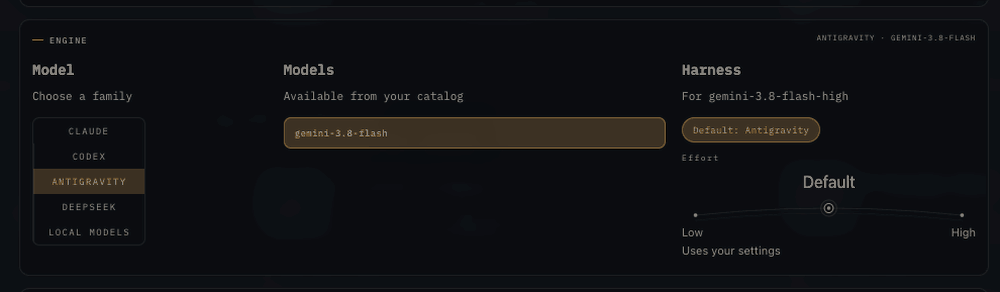

# DeepSeek・Local LLMの初期設定



dsh または Hermes を入れ、接続先と鍵を準備します。NEW AGENT でモデルと harness を選び、起動を確かめます。

<a id="すでにorreryを使っている人がdeepseeklocalを追加する"></a>

> English: [native-setup.en.md](en/native-setup.md)

ORRERYの共通部分を入れたあと、DeepSeekまたはLocal LLMを使うための初期設定です。Claude CodeやCodexの導入・ログインは前提ではありません。**通常の導入・更新だけでは、dsh・Hermesの追加やAPIキーの登録は完了しません。** ORRERYがまだ入っていなければ、先に[cockpitと共通導入](install.md)か[Telemetry単独の導入](getting-started.md#telemetry-単独の導入と確認)を済ませてから戻ってください。ここからの準備は、どちらの画面を使う場合も共通です。

cockpitはターミナルを並べて操作する画面、Telemetryはagentの状態を表示し、起動を受け付ける側です。API接続の準備はTelemetry側で行い、準備が終わればどちらのNEW AGENTからも選べます。現在、NEW AGENTにAPIキーを入力する欄や、接続設定を一括で済ませるウィザードはありません。

### Local serverはURLを一度設定する

動的Local接続は、既存agentへ[一度の移行手順](https://github.com/gyroid-eth/orrery-telemetry/blob/master/examples/native-harnesses/README.md#dynamic-local-connections)を読ませて設定します。接続ごとに任意の表示名、1本以上のAPI URL、任意のcontext fallbackを持ちます。両NEW AGENTはserverが返すmodel IDを接続見出しの下へ列挙します。同じURLに新しいmodelが現れたとき、modelごとのORRERY設定・再installは不要です。従来の固定model接続は、移行するまで引き続き使えます。

この節はTelemetry API33以降と対応するcockpit picker更新が必要です。接続の移行前に両方を更新します。以下の従来の固定model手順は互換を維持します。

| 担当 | 手順 |
| --- | --- |
| 利用者のagent | 手順を読み、別の私有copyを準備。既存OS資格参照・runtime pathを保持し、対象Localをそれぞれ `model_source: server` へ変更して非秘密diffを提示。鍵取得・server通信なしの静的検査を実行する |
| 本人 | URLとdiffを確認。必要な鍵登録・unlockはOSの画面だけで行い、新manifestの利用を承認する |
| agent／本人 | 既存のplan/dry-run・install手順へ新manifestを渡す。両画面をreloadし、接続名・URL番号・modelを選択。実機の短い1課題は別途調整する |
| agent／本人 | 復旧時は保存した旧manifestを同じ通常install手順へ渡す。保持sessionのURLやmodelを別のものへ書き換えない |

製品は既存の保護された資格参照でmodel一覧を取得し、起動・再開のcommand生成直前に選択URLだけをもう1回照合します。serverのmodel起動・停止は行いません。`Available` は、返却IDに明示的unloadedがないという意味で、ロード済みの証明ではありません。最終照合後の変更、同名IDのrun交換、指定IDを無視するserverはこの観測の保証外です。以下のdsh protocolとHermes HTTPSの条件は維持します。

**古い版を使っている場合は、先に通常の更新を済ませます。** このガイドはTelemetry 2026.10.22以降が対象です。インストール先の版は、ターミナルで `cat "${AGENTSTACK_HOME:-$HOME/.agentstack}/VERSION"` を実行して確認できます。それより古い場合や版を確認できない場合は、[Telemetryの更新手順](telemetry-install.md#upgrade)を確認してください。cockpitも使う場合は、[cockpitの更新手順](install.md#1-行で入れる更新する)で両方を更新できます。古いinstallerでは、この後の追加オプションを受け付けない場合があります。通常の更新が終わってから、以下のdsh・Hermesの追加とキーの保存へ進みます。更新は準備の前提で、初回のAPI設定とは別の工程です。

## 1. 最初に使う組合せを選ぶ

| 選ぶもの | 意味 | 自分で用意するもの |
| --- | --- | --- |
| DeepSeek | DeepSeekが運営するAPIを使う | DeepSeekのAPIキーとAPI利用残高 |
| Local models（Strataなど） | 自分や管理者が動かしている対応LLMサーバーを使う | 対応するAPIのURL・model ID・サーバー専用のキー。現在の経路は資格参照が必須 |
| dsh | モデルとの会話や道具の実行を担当するアプリ。DeepSeek Harnessの略称 | ORRERYのinstallerから追加する。Node.js 24.2以上が必要 |
| Hermes | dshとは別の、会話や道具を動かすアプリ | ORRERYのinstallerから追加する |

「DeepSeek＋dsh」「DeepSeek＋Hermes」のように、接続先と動かすアプリを1つずつ選びます。dshとHermesを両方入れても、接続先が同じならAPIキーを2本発行する必要はありません。Localを使うためにDeepSeekのアカウントを作る必要もありません。

**Localは接続先の仕様を先に確認します。** dshは固定DeepSeek adapterと互換のAPIを使い、HTTP/HTTPSのURLを受け付けます。HermesはHTTPSが必須で、API形式は`chat_completions`か`anthropic_messages`です。HTTPだけのサーバーをHermesへそのまま指定できません。従来のLocal設定例の接続IDは`strata`ですが、Strataのホストに限定するものではありません。任意の「OpenAI互換」サーバーが動くという保証でもありません。

**キーを保存・参照せずに使うLocal構成は、現在のORRERYでは非対応です。** 両harnessともOSに保存したキーへの参照が必要です。キー不要のサーバーへ仮のキーを設定して済ませず、対応する認証付きの接続先を用意してから、このガイドへ進んでください。

**動作確認の範囲：** API起動はmacOSとLinux/Ubuntu WSLのlegacy modeに実装されています。WindowsネイティブのAPI起動は対象外です。全DeepSeek/Local×dsh/Hermesの組合せを、標準設定例から新規導入して通し確認したものではありません。とくにWSLでは鍵束・表示・サービスの同ユーザー接続をOS側で準備する必要があります。候補が表示されることと、キー保存・実接続・Mail・終了/再開が成功することは別です。

Claude Code/Codexの既存ログインとは別の設定です。API起動は現在、ORRERY Mailの接続方式がlegacy modeの[対応組合せ](https://github.com/gyroid-eth/orrery-telemetry/blob/master/docs/managed-catalog.md)に限られます。global modeは別のMail接続方式で、このガイドの対象外です。どちらか不明ならagentに確認し、設定を無断で切り替えないでください。

## 2. dsh・Hermesを追加する

コマンドは**Macで使っているターミナルアプリ**で実行します。Windowsでは**Ubuntuを開いた画面**で実行してください。PowerShellやWindowsのコマンドプロンプトにLinux用コマンドを貼る手順ではありません。

まず、ORRERY Telemetryのソースを置いたフォルダー（checkout）へ移動します。cockpitのフォルダーとは別です。1行installerの既定の場所なら次のように開けます。

```bash
cd ~/orrery-telemetry
```

`No such file or directory`なら、別の場所に入っている可能性があります。自分で`~/src/orrery-telemetry`などへcloneした場合は、そちらを開きます。場所が分からなければ、普段のagentに「既存のinstall-state.jsonのrepo_rootから、Telemetryを入れた場所を確認して」と頼めます。既存環境を調べず別の場所へ入れ直さないでください。

ソースが残っていないと確認できた場合だけ、新たに取得します。次は`~/orrery-telemetry`がまだ存在しない場合の例です。

```bash
git clone https://github.com/gyroid-eth/orrery-telemetry.git ~/orrery-telemetry
cd ~/orrery-telemetry
```

両方を追加する例です。先に次の2行で、Nodeの版が24.2以上、表示される実行ファイルの場所が絶対パスであることを確認します。

```bash
node --version
command -v node
```

`node: command not found`や古い版が出た場合は、[Node.js公式配布](https://nodejs.org/en/download)から必要な版を用意してから続けます。ORRERYのinstallerはNode本体を取得しません。既存Nodeを使う準備ができたら、**同じターミナルのTelemetryフォルダー内**で実行します。

```bash
./scripts/install.sh --keep-mail --enable-dsh --enable-hermes --dsh-node "$(command -v node)"
```

dshだけなら`--enable-hermes`を、Hermesだけなら`--enable-dsh`と`--dsh-node ...`を省けます。すでに追加済みの選択は通常更新でも引き継がれます。フラグを省いても、すでに追加したもう一方は削除されません。

初回は取得・準備に数分かかる場合があります。途中で設定の変更案とyes/noの確認が出たら、内容を見て選びます。確認の数は既存設定や差分によって変わります。`--keep-mail`は稼働中のORRERY Mailを切り替えず使う指定です。詳しい変更範囲は[共通導入の説明](telemetry-install.md)を参照してください。

完了時の`Install complete`と`inactive snapshot (copy and finish setup): ...`の場所をメモします。snapshotは、導入したアプリの場所を埋めた設定例のセットです。既存の設定例が保持された場合は`kept snapshot (not revalidated): ...`と表示されます。この時点ではアプリが入っただけで、まだAPIへ接続できるとは限りません。

## 3. 接続先のキーを用意する

### DeepSeekを使う場合

1. ブラウザで[DeepSeekのAPI管理画面](https://platform.deepseek.com/api_keys)を開き、本人のアカウントでログインします。[公式API案内](https://api-docs.deepseek.com/)にもこの発行先へのリンクがあります。
2. API keysの画面で新しいAPIキーを作ります。すでにキーチェーンなどに自分のキーを保存してあるなら、新しく発行せず、その項目を使えます。
3. [API利用残高](https://platform.deepseek.com/balance)を確認します。APIの料金と利用可能なmodelは[公式料金表](https://api-docs.deepseek.com/quick_start/pricing)で確認してください。ブラウザのチャットへログインしただけでは、ORRERYのAPI設定は済みません。
4. コピーしたキーは次のOS保存画面に入力します。agentとの会話、Telegram、設定JSON、コマンドの引数には貼りません。

公式のAPIと画面名は変更されることがあります。2026-10-22に確認した標準例のmodel IDは`deepseek-flash`です。別modelを使う場合は、接続先が受け付ける正式IDを確認して設定します。

DeepSeekの同梱例には、dsh用の`https://api.deepseek.com/anthropic`とHermes用の`https://api.deepseek.com/v1`が入っています。標準例で始める場合、このURLを自分で考えて書き換える必要はありません。

### Local / Strataを使う場合

サーバー管理者から、接続URL、正式なmodel ID、API形式、サーバー専用の接続キーを受け取ります。DeepSeekのAPIキーとは別物です。キーが同じか、URLに`/v1`などを付けるかを推測しないでください。上のharnessごとの対応条件を確認し、[設定例の変更表](https://github.com/gyroid-eth/orrery-telemetry/blob/master/examples/native-harnesses/README.md#local--strataへ変更する場合)を使います。

## 4. APIキーをOSの安全な保存先へ登録する

以下は同梱のDeepSeek設定例を使う場合です。保存先の名前は`orrery-dsh-deepseek`、アカウントは`api-key`です。別の既存保存先を使うなら、後の設定例も同じ名前に合わせます。**登録済みならこの工程を飛ばします。同じ名前への保存は既存キーを更新し得ます。** Local用のキーをこのDeepSeek用項目へ入れないでください。

### Mac：キーチェーンアクセス

1. Spotlightで「キーチェーンアクセス」を検索して開きます。ORRERYの画面ではなく、macOSのアプリです。
2. 自分のログインキーチェーンを選び、新規パスワード項目を作ります（Command＋N。[Appleの案内](https://support.apple.com/guide/keychain-access/kyca699a9058/mac)）。
3. 項目名を`orrery-dsh-deepseek`、アカウントを`api-key`にし、パスワード欄へ**DeepSeek APIキー**を貼り、保存します。
4. agentにはキーを見せず、「保存済み。名前はorrery-dsh-deepseek、アカウントはapi-key」と伝えます。

後でmacOSがキーチェーンへのアクセスを確認した場合は、ダイアログに出ているアプリ名を見て、許可するか決めます。保存したキーを画面に表示するlookupコマンドで確認する必要はありません。

### Windows / Ubuntu WSL：Secret Service

**初めてUbuntuへキーを保存する場合は、[WSLの鍵束準備・非表示登録ガイド](wsl-keyring.md)へ進みます。** OSアプリの導入、標準GUIでの鍵束作成、保存先の確認まで掲載しています。登録後は、このページの[「5. 設定例をコピーして、接続先をつなぐ」](#5-設定例をコピーして接続先をつなぐ)へ戻り、以下の保存を重ねて実行しません。新規WSLでこのGUI手順を最後まで通した実機確認はまだ完了していません。

以下は、すでに使える既定の鍵束がある人向けです。Windowsの資格情報マネージャーではなく、Ubuntu側の保存先を使います。Secret Service、同じユーザーのD-Bus session、暗号化された鍵束とそのロック解除、`/usr/bin/secret-tool`が必要です。`libsecret-tools`や`gnome-keyring`のインストールだけでは鍵束作成やGUI表示は完了しません。未準備なら上のガイドでOS側を準備し、別のdaemonを重ねて起動しないでください。

鍵束が使えるUbuntuの**対話画面**で、次を実行します。パイプやファイルからキーを渡さず、標準の非表示入力を使います。

```bash
test -t 0 && /usr/bin/secret-tool store --label='ORRERY DeepSeek API key' service orrery-dsh-deepseek account api-key
```

先頭の`test -t 0`は、対話入力できるターミナルかどうかの検査です。`Password:`も出ず何も表示されないまま戻ったら、キーは登録されていません。対話できるUbuntuの画面で実行し直してください。

`Password:`には**DeepSeek APIキー**を貼り、Enterを押します。文字も`*`も表示されないのが正常です。空のままEnterを押さず、やめる場合はCtrl＋Cで中止します。この入力が非表示になることは[libsecretの実装](https://github.com/GNOME/libsecret/blob/0.21.7/tool/secret-tool.c#L266-L314)で確認できます。

OSが鍵束の作成・unlock画面を出した場合、そこで求められるのは**鍵束のパスワード**で、APIキーとは別です。新しく作る鍵束には空でないパスワードを設定し、後でunlockできるよう覚えておきます。画面が出ない、またはエラーになったら繰り返さず止め、キーを含まないエラー文だけをagentへ伝えます。

エラーなくコマンド入力に戻った場合も、確認できたのは保存コマンドの完了だけです。接続やMailの成功は次の工程で確認します。Linuxの設定は[Secret Service参照の例](https://github.com/gyroid-eth/orrery-telemetry/blob/master/examples/native-harnesses/README.md#macとwslの資格参照)に合わせ、Macの`keychain`/`key_cmd`を併記しません。キー登録時に使えたD-Busの環境が、dashboardのサービスにも届く必要があります。

## 5. 設定例をコピーして、接続先をつなぐ

APIキーを保存しても、ORRERYには「どのアプリ・model・保存先を使うか」を渡す必要があります。**agentを使わない人は、[設定例をコピーして検査する手順](https://github.com/gyroid-eth/orrery-telemetry/blob/master/examples/native-harnesses/README.md#agentを使わずにdeepseekの設定例を準備する)へ進みます。** コピー先の3参照を合わせるコマンド、有効化、検査、最後のinstallまで掲載しています。既存agentを使う場合は、以下の依頼文で秘密を含まない設定だけを準備させられます。

設定ファイル（manifest）は、使うmodelとアプリ、各設定ファイルの場所をまとめたJSONです。以下はagentに準備と検査を手伝わせる例です。利用できるagentがなくても、同梱設定例の手順に従って自分でコピー・編集・有効化・検査を行えます。どちらの場合も、最後のinstallコマンドは利用者がターミナルで1回実行します。

agentへ渡す依頼文の例です。角括弧の部分は自分の選択に置き換え、キー自体は書きません。

```text
ORRERYに[DeepSeek / Local]を[dsh / Hermes / 両方]で追加したいです。
このPCに導入したアプリ（runtime）と、設定例のセット（snapshot）から、
非秘密設定を新しい私有フォルダーへ準備してください。
同梱設定例のREADMEに従い、フォルダーは0700、設定JSONは0600にしてください。
snapshotの場所は[installが表示したsnapshotの絶対パス]です。
APIキー自体は読まず、表示せず、設定JSONへ書かないでください。
DeepSeekなら同梱例のURLとdeepseek-flashを使ってください。
Localなら接続先は[管理者から受け取ったURL]、modelは[正式ID]です。
キーは[Mac Keychain / Ubuntu Secret Service]へ本人が保存済みで、
serviceは[保存先名]、accountは[アカウント名]です。
既存設定を上書きせず、コピー先3参照とOS別の保存先設定を合わせ、
設定の変更案と、コピーしたmanifestの絶対パスを提示してください。
私が確認したら、そのコピーだけを有効化してharnessごとに静的validateを行い、
成功したら検査結果と、その絶対パスを埋めたinstallコマンドを提示してください。
installは私が実行します。未有効の間は有効な起動設定とは扱わないでください。
```

agentが合わせるのは、manifestからdsh/Hermesの設定を指す2箇所と、dshからbackend設定を指す1箇所です。片方だけ使う場合はその設定だけを使います。APIキーを入力するファイルはありません。

内容に問題がなければ、**コピー先のmanifestの`enabled`を`false`から`true`へ変更**します。自分で編集するか、agentに「確認したコピーのmanifestを有効化して」と頼めます。配布元の例は変更しません。有効化後、agentに使うharnessごとの静的validateを依頼します。これは、設定ファイルの形式や参照先が整っているかを調べる検査です。まだ`enabled: false`なら`harness_not_enabled`で止まり、有効な設定の検査に進めません。

内容を確認したら、コピーのmanifestを指定して既存installerを実行します。次のパスは例なので、agentが提示した**実在する絶対パスへ置き換えてから**使います。

```bash
./scripts/install.sh --keep-mail --managed-spawn-config /absolute/path/to/private/manifest.json
```

キーの保存先とアプリの場所を確認し、設定ファイルの検査が通ったら、上のinstallを実行します。`Install complete`を確認した後、ブラウザを再読み込みして次へ進みます。この検査（静的validate）はAPIキーを使った接続試験ではありません。

## 6. NEW AGENTから1体だけ試す

1. cockpitなら[画面内の＋NEW AGENT](usage.md#new-agent)、Telemetry単体なら[NEW AGENT](dashboard.md#native-models-and-harnesses)を開きます。
2. 科学者、DeepSeekまたはLocal models、設定済みmodel、dshまたはHermesを選びます。
   Localを複数残す場合は、[複数接続の設定](telemetry-configuration.md#native-connections)で別IDとserver名を付け、workstation / EPYCなどの表示を見て選びます。同じmodel IDでも接続先は別です。
3. 新しい作業フォルダーを指定し、まず短い依頼を1つ送ります。modelの応答を確認してから、[Mailの通し確認](getting-started.md#5-しりとりで通しの確認をする)へ進みます。

画像のLocalはStrata上のQwenモデルを設定した例です。内部IDの`strata`は接続先ホストの制限ではありません。別のサーバーには、手順1のAPI・HTTPS・キー参照の条件を確認してから接続します。

候補が見えること、応答が返ること、道具・Mail・終了・会話再開が使えることは、それぞれ別の確認です。[対応範囲](https://github.com/gyroid-eth/orrery-telemetry/blob/master/docs/managed-catalog.md#現在の制限)も参照してください。

| 止まった場所 | 次に確認すること |
| --- | --- |
| DeepSeek/Localの候補が出ない、選べない | runtime追加だけで終わっていないか、manifestの指定・有効化・OS別の保存先設定が済んだか |
| `credential_reader_unavailable` | Ubuntuのsecret-toolなど、保存先を読むためのアプリがあるか |
| `credential_unavailable` / `credential_timeout` | service/account、鍵束のunlock、同じD-Bus sessionへ接続できるか。キーの値は表示しない |
| 認証エラー | 接続先とキーの組合せ、API利用残高。LocalキーとDeepSeekキーを混同していないか |
| キーを保存したのに使えない | 保存先の名前と設定が同じか、ブラウザを再読込したか。保存成功と接続成功は別 |

任意のAPIを追加する共通ログイン機能ではありません。新しい接続先をこの表にない組合せで使う場合は、先に対応を確認してください。
