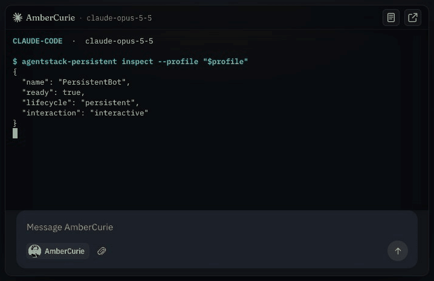

# 常駐 agent の enrollment と起動



合成の provider を使った起動例です。profile の確認、起動、プロセス終了の順に表示しています。

> English version: [persistent-agents.en.md](en/persistent-agents.md)

[Launcher と identity](launchers.md) · [トラブルシューティング](telemetry-troubleshooting.md) · [README に戻る](../README.md)

常駐 agent は、再起動をまたいで同じ ORRERY Mail identity を使う parentless bot です。Claude Channels のように人が tmux の REPL へも入力する `interactive` と、専用 bridge が通知を bot へ渡す `headless` を別の軸として扱います。

通常の `agent-start` / `agent-start-codex` や child launcher を通る一時的な agent は、従来の登録経路を使います。この文書の enrollment は、launcher を一度も通らなかった既存 bot、または local credential を失った同じ数値 row を移行するための operator 手順です。

## fresh の Claude Channels

`runtime_mode=fresh` では、先に [fresh の登録と準備](https://github.com/gyroid-eth/orrery-telemetry/blob/master/docs/fresh-global-update.md) を行い、
本人が prepared Claude HOME のログイン・hook・Channels plugin を準備します。
`AGENTSTACK_PYTHON` には、通常の fresh 起動と同じ確認済みの Mail package を import できる Python を指定します。
旧 enrollment や旧 Mail token を移す操作は行いません。owner 限定の JSON profile を作ります。

```json
{
  "kind": "orrery-fresh-persistent-v1",
  "context": "/path/to/prepared/context.json",
  "provider": "claude",
  "working_directory": "/path/to/workspace",
  "channels": ["plugin:telegram@claude-plugins-official"],
  "model": "sonnet",
  "environment": {"TELEGRAM_STATE_DIR": "/path/to/channel-state"}
}
```

```bash
chmod 600 /path/to/bot.json
agentstack-persistent inspect --profile /path/to/bot.json
agentstack-persistent run --profile /path/to/bot.json
```

profile は明示的な fresh 分岐で通常の launch へ渡ります。登録、prepare、service 登録を
自動で行いません。Channels の設定 source の検査と Mail alias の置換は従来の interactive
と共用し、Channels を残したまま bound Mail と通常の予約 hook を使います。
待機中の Mail は既存の fresh watcher が同じ tmux の入力面へ届けます。

起動元の環境と profile に鍵の値を入れず、Channels の既存 state の読取を使います。
公式 plugin が起動後に自分の process 内で `.env` を読む挙動は変更しません。
旧 raw Mail token は引き継ぎません。モデルが使う Bash へ鍵を渡しません。

停止は **pane を kill せず、この launcher process へ SIGTERM** を送って完了を待ちます。
launcher が provider の終了を確認して `ended.json` を記録した後、同じ profile で再起動します。
異常終了・強制 kill・停止 timeout は unknown で止まり、次の run を起動しません。
会話は 1 起動につき 1 つです。`/clear` などで session が変わるとその run を停止し、
`FRESH_BOT_RESTART_REQUIRED` を表示します。旧会話の自動復元や無停止の切替は行いません。
本番と同じ Telegram token の新旧 poller を並走させず、旧 poller の終了も確認してください。

Mac の bot process の再起動と機体再起動は別です。Mac／WSL の機体再起動・自動 unlock は
未受入で、この手順だけで対応済みとはしません。通常の旧 profile は次の enrollment 手順を使います。

## fresh の Hermes Telegram（interactive）

Hermes も準備済みの同じ登録を使います。本物の `hermes chat --tui` に同梱の
`orrery-telegram` plugin を載せ、Telegram の受信を生きた TUI へ入れます。
返信は `telegram_reply` tool、Mail は bound proxy と標準 watcher、端末からの入力は同じ TUI です。
独自の gateway や headless bridge は起動しません。

管理 installer が完成・検証した世代内の TUI product を使います。Telegram の起動計画は管理 receipt と選択済み runtime を照合し、`HERMES_TUI_DIR` と `HERMES_NODE` に検証済みの path だけを渡します。欠落・改ざんがあれば profile を書く前に `invalid_runtime` で停止します。起動時に npm 取得や build は行わず、Python PM workspace に `ui-tui` をコピーしません。この2つの env は通常の子／CLI の起動計画には追加しません。旧世代への手動コピーではなく、installer で新世代を取得してください。TUI の準備だけでは Telegram の資格・Mail・model 接続の受入は完了しません。

```json
{
  "kind": "orrery-fresh-persistent-v1",
  "context": "/path/to/prepared/context.json",
  "provider": "hermes",
  "working_directory": "/path/to/workspace",
  "model": "configured-model-id",
  "managed": {
    "manifest_file": "/path/to/native-manifest.json",
    "backend_id": "deepseek"
  },
  "telegram": {
    "token_ref": {"store": "keychain", "service": "telegram-bot", "account": "owner"},
    "allow_from": [123456789]
  }
}
```

profile は `0600`、context と Hermes HOME は Linux／Mac の私有 filesystem に置きます。
allowlist の数字は例で、自分の Telegram user ID に置き換えてください。group の受信は対象外です。
Mac は本人が Keychain に保存した参照、Linux／WSL は
`{"store":"secret-service","attributes":{"application":"telegram-bot"}}` のような
既存の [Secret Service 参照](telemetry-install.md#ubuntu-wsl-の-secret-service-参照実機受け入れ前)を使います。
値を profile や環境へ入れません。plugin が process 内で読み、通常の鍵読み取り guard にも参照を渡します。
provider は通常の子と同じ manifest・`key_cmd`・設定生成器を使います。

本人が provider の設定・hook／plugin の承認を済ませてから、上と同じ `inspect`／`run` を使います。
Hermes HOME は context の隣の `providers/hermes` です。必要な非秘密の personality／設定は
起動前に本人が置き、古い Mail MCP・鍵の値・旧 token をコピーしないでください。
常駐登録は既存の launchd／systemd user unit から同じ foreground launcher を起動します。
新しい service の自動登録はありません。Linux／WSL は user bus と Secret Service の unlock が前提です。
`/mnt/c` は私有 runtime の既定保存先にしません。

停止・再起動と会話変更の規則は Channels と共通です。Hermes の停止時は、その起動が所有する
TUI／backend を起動中から観測し、通常終了でも子の終了を確認してから `ended.json` を残します。
この run の独立した前景 pane／job の process group が必要です。子が残る・観測できない場合は unknown で止めます。
`logs/telegram-status.json` の `telegram-ready` は poller の準備であり、Mail や返信の成功を保証しません。
409・credential-unavailable・allowlist-empty は失敗として扱い、新旧の同 token を並走させません。

`credential-unavailable` の詳細は、同じ Hermes HOME の `logs/telegram-credential-diagnostic.json`（0600）に残ります。固定理由は `configuration-invalid`（設定の読取・形）、`reference-invalid`（参照の形）、`unsupported-store`、`security-nonzero`（整数の returncode のみ追加）、`security-timeout`、`security-unavailable`、`empty-or-invalid-value`、Secret Service の `secret-service-timeout` / `secret-service-unavailable` です。設定・参照・token の値や helper の stdout/stderr・全環境は記録しません。これは最後の失敗なので、`pid`・`updated_at` を現在の status と照合してください。HOME や Keychain の設定をこの診断だけで変更せず、理由に対応する確認を行います。

既知の制限: 既存 plugin の並行 flush と、長文返信の途中失敗による部分返信は今回直していません。
launcher が観測した子の残存は終了判定を拒否します。close 用 snapshot で把握した子の PID／出生も保存し、後で別 group／session に移っても生存中は close を拒否します。snapshot 後に初めて生じた未記録の離脱子は、この記録だけでは捕捉できません。
launcher の `operation.lock` はその process が終了すると解放されます。一方、Hermes の Telegram plugin は別の `telegram-poller.lock` を同じ Hermes HOME で使い、**実際にその lock を保持する poller process が生きている間だけ**、同じ HOME の別 poller を拒否します（[保持・解放の実装](https://github.com/gyroid-eth/orrery-telemetry/blob/master/integrations/hermes/telegram/managed_guard.py)、[poll thread 終了時の解放](https://github.com/gyroid-eth/orrery-telemetry/blob/master/integrations/hermes/telegram/__init__.py)）。未観測の子や別 HOME の process がこの lock を保持するとは保証しません。二重受信防止を、未知の子が全て終了した証拠にしないでください。
新 run は新会話で、旧会話の自動復元はありません。合成 transport／native による試験と実 Telegram の
受け入れは別です。実 provider／Telegram の往復、WSL 実機、Mac／WSL の機体再起動は未受入です。

## fresh の未終了 run を閉じる

終了は次の4つを区別します。close は task の成功や副作用の取消ではありません。

| 状態 | 記録と次の操作 |
| --- | --- |
| 正常終了 | 実 wait の `ended.json`、exit 0。通常の run を1回 |
| 観測済みの失敗 | 子の終了まで観測した実 wait の `ended.json`、実際の非0 exit。通常の run を1回 |
| 確認して閉じた終了 | `resolved-ended.json`、provider exit は unknown（JSON null）。通常の run を別に1回 |
| 未確定 | wait 不明、残 process、観測不能、記録不足。次の run は拒否し、理由を報告 |

子孫を観測する Hermes の wait で exit 23 と子の不在を確認した場合は失敗として閉じます。
子孫観測のない Channels の予期しない非0終了、launcher 消失、停止 timeout は未確定です。
exit 0 でも session receipt が成立しなかった場合、終了は記録しますが native の起動受入は失敗です。

未終了の current run を利用者の指示で閉じるときは、同じ prepared context と確認済み Python を使います。
`RUN_UUID` は診断に表示された現在 run の UUID、profile は今までの同じものです。

```sh
AGENTSTACK_RUNTIME_MODE=fresh AGENTSTACK_FRESH_CLIENT_CONTEXT="$orrery_context" \
  AGENTSTACK_PYTHON="$orrery_python" \
  "$orrery_install/bin/agentstack-runtime-client" resolve-ended \
    --launch-id "$RUN_UUID" --confirm-ended
# 上の結果が ok:true の場合だけ、別操作として通常起動する。
AGENTSTACK_RUNTIME_MODE=fresh AGENTSTACK_FRESH_CLIENT_CONTEXT="$orrery_context" \
  AGENTSTACK_PYTHON="$orrery_python" \
  "$orrery_install/bin/agentstack-persistent" run --profile "$orrery_profile"
```

`--confirm-ended` は呼出側の明示判断で、追加の認証や force ではありません。同じ I/A・資格世代・context、
current の UUID、起動 mutex、記録済み PID／出生・pane／socket・job group を再照合します。
確認できたときだけ private record を新規に保存し、intent／session／current と元の終了コードを変更しません。
重複 resolve は同じ終了種別を返します。閉じた run へ Mail 配送・hook・session の追記は行いません。
kill、pane 削除、自動 restart は含みません。current／lock／receipt の削除や終了 record の手書きで回避しないでください。

`FRESH_RESOLVE_PROCESS_ALIVE`／`FRESH_RESOLVE_GROUP_ALIVE` は残存、`FRESH_RESOLVE_PROCESS_CHANGED`／
`FRESH_RESOLVE_TARGET_CHANGED` は PID・pane・socket 等の変更、`FRESH_RESOLVE_OBSERVATION_UNAVAILABLE` は観測不能、
`FRESH_RESOLVE_RECORD_INSUFFICIENT` は記録不足です。`FRESH_LAUNCH_BUSY` や identity／資格の拒否も含め、停止して理由を報告します。
必要な通常停止は別に行い、終了確認後に再度 resolve します。

新しい tmux run は既存の `tmux.json` に版付きの PGID・leader 出生と、保存時の snapshot の親子関係から分かる provider の子孫の PID／出生を記録します。後で別 group に移った既知の子も生存を拒否します。64件の上限を超える、親子関係が循環する、出生や所有の形が不明な snapshot は、十分な記録として保存せず起動を止めます。
この snapshot より後に初めて生じた子や、その後の未記録の離脱までは追跡しません。常駐 watcher や子孫の履歴 DB は作りません。
その field がない古い run、tmux 観測のない foreground run は根拠が足りないため HOLD します。
PID 3つの不在や人の確認 flag だけでは閉じません。任意の daemon 化／二重 fork や未記録の別 session の孤児を
完全に証明する機能ではありません。Mac と Linux の共通 ps／tmux adapter を使い、WSL の Windows native process は対象外です。

復旧を既に任された agent が操作する場合、人の毎回のコマンド・追加の製品承認は0回です。
観測済み終了後は agent が通常 run を1回、未終了なら resolve と通常 run の2回です。
人が直接操作する場合も2コマンドで、未確定を必ず2手で復旧できるとは限りません。
Telegram・Mail の往復と自然 wake、provider login／hook trust、機体再起動の受入は別に確認します。

## 保証範囲

ここでいう **operator** は、この機体の local terminal で専用 CLI を明示的に実行する人です。実装が保証するのは次の範囲です。

- owner 限定の local Unix socket と同一 OS user の peer UID
- 数値 agent ID、project、期待 name、Mail instance UUID、credential generation の照合
- 同じ row の credential だけを compare-and-swap で更新
- 固定 field だけを持つ local audit record
- secret を出力、log、argv、MCP/proxy tool に載せないこと

これは人間の本人証明ではありません。同じ OS user で shell を使える process は CLI を実行できます。TTY の有無も人間を証明しません。「人が対象と操作を確認して手で実行する」は運用規約であり、新しい login 認証を追加したものではありません。モデルへ enrollment の実行を依頼しないでください。

`agentstack-enroll` は MCP / proxy の catalog と dispatch に存在しません。Mail process の local management socket だけを使います。`claim` / `recover` は alias や新しい row を作らず、retirement や profile を変更しません。

## 二つの JSON profile

installer は local Mail 用の connection profile を作ります。

```text
~/.agentstack/connections/local.json
```

これは transport（management socket、loopback MCP URL、Mail env）と、初回確認後の `expected_server_instance_id` を保持します。host 名、port、socket path だけでは Mail の identity になりません。file は owner-only とし、group / world permission を付けないでください。

bot ごとの persistent profile は operator が次の directory に mode `0600` で置きます。

```text
~/.agentstack/profiles/<name>.json
```

profile 自体に token を書きません。credential は connection profile が指す runtime directory の owner-private file に保存されます。

## 新しい bot を作る場合

`claim` は row 作成 API ではありません。新しい bot は先に、通常の正規登録経路で project 内の identity を作成してください。たとえば top-level launcher、dashboard の NEW AGENT、またはその用途に対応した preregistration 経路です。その正式な応答から canonical name と正の数値 agent ID を記録します。

存在しない ID、別 project の ID、retired row を `claim` で代用してはいけません。name 検索から別名 row を作ることもありません。

正規作成後の row が `server-null` なら下の `claim`、既に正常な owner credential があれば credential mutation は省略します。ただし新しい bot でも connection の Mail UUID 確認 / pin、`inspect`、persistent profile の検証は省略しません。

## 既存 bot を移行する手順

以下の例では値を自分の機体のものへ置き換えます。数値 ID は正規作成時の `register_agent` 応答にある `id` を記録します。それを失った既存 row は、同じ project と exact name を指定した、認証済み ORRERY Mail `whois` 応答の `id` を operator が確認します。name や dashboard の表示順から推測しないでください。

```bash
export BOT_ID=123
export BOT_NAME=ChannelsBot
export PROJECT_KEY=/absolute/project/path
export CONNECTION="$HOME/.agentstack/connections/local.json"
```

### 1. secret なしで対象を inspect する

```bash
"$HOME/.agentstack/bin/agentstack-enroll" inspect \
  --agent-id "$BOT_ID" \
  --project-key "$PROJECT_KEY" \
  --connection "$CONNECTION" \
  --name "$BOT_NAME"
```

出力で少なくとも次を確認します。

- `server_instance_id`: 意図した local Mail の永続 UUID
- `project_key` / `agent_id` / `name`: 起動したい同じ row
- `retired: false`
- `credential_state`: `server-null` または `server-token`
- `local_credential_state`: local 保存状態
- `connection_pinned`: connection profile が UUID に固定済みか

`--name` は期待値の照合だけに使われます。name から row を検索したり、別名を作ったりしません。

### 2. connection を初回だけ Mail UUID へ pin する

`connection_pinned` が `false` のときは、最初の inspect で表示された UUID と対象 Mail を operator が確認し、その同じ値を明示して再度 inspect します。

```bash
"$HOME/.agentstack/bin/agentstack-enroll" inspect \
  --agent-id "$BOT_ID" \
  --project-key "$PROJECT_KEY" \
  --connection "$CONNECTION" \
  --name "$BOT_NAME" \
  --pin-server '<先ほど確認した server_instance_id>'
```

`claim` / `recover` は pin のない connection を拒否します。UUID が既存 pin と違う場合も上書きしません。

### 3. 状態に合う操作を一度だけ選ぶ

| inspect の状態 | 操作 |
| --- | --- |
| `server-null` + local `missing` | `claim` |
| `server-token` + local `missing` または `missing-token-same-identity` | `recover` |
| `server-token` + `present` / `present-legacy-verified` | 変更不要。profile の inspect へ進む |
| `identity-conflict`、別 UUID / ID / name、retired | 停止して対象を確認する。自動修正しない |

初回 claim:

```bash
"$HOME/.agentstack/bin/agentstack-enroll" claim \
  --agent-id "$BOT_ID" \
  --project-key "$PROJECT_KEY" \
  --connection "$CONNECTION" \
  --name "$BOT_NAME"
```

local credential を失った同じ row の recovery:

```bash
"$HOME/.agentstack/bin/agentstack-enroll" recover \
  --agent-id "$BOT_ID" \
  --project-key "$PROJECT_KEY" \
  --connection "$CONNECTION" \
  --name "$BOT_NAME"
```

`claim` は server credential が null の row にだけ、`recover` は server token があり local token がない同じ identity にだけ使えます。どちらも現在 generation を期待値にした CAS であり、競合時は credential を変更しません。

CLI は新しい secret を先に一意な mode `0600` pending file へ保存し、同じ request ID と secret で server へ要求します。通信切断時は**同じコマンドをそのまま再実行**してください。保存済み request の status を確認し、別 token を生成しません。pending file や active token を開いたり、削除したり、chat / log へ貼ったりしないでください。

成功時の stdout は secret ではなく `orrery-enrollment-receipt-v1` です。次を確認します。

- `result: accepted`
- `operation: claim` または `recover`
- 期待した `server_instance_id` / `project_key` / `agent_id`
- `new_generation` が `old_generation` より1つ進んだ
- `reason: operator-claim` または `operator-recover`

Mail 側は credential 更新と同じ transaction で、時刻、request ID、peer UID、authority、row、操作、旧新 generation / fingerprint、固定 reason / result を audit します。拒否も固定 reason / result だけを audit し、credential は変更しません。token、request 本文、自由文 error は記録しません。

### 4. persistent profile を作る

interactive Claude Channels の例です。

```json
{
  "kind": "orrery-persistent-agent-v1",
  "name": "ChannelsBot",
  "agent_id": 123,
  "project_key": "/absolute/project/path",
  "connection": "../connections/local.json",
  "provider": "claude",
  "parentless": true,
  "lifecycle": "persistent",
  "interaction": "interactive",
  "state_dir": "../persistent/ChannelsBot",
  "working_directory": "/absolute/project/path",
  "command": [
    "/absolute/path/to/claude",
    "--channels",
    "plugin:telegram@claude-plugins-official"
  ],
  "environment": {
    "TELEGRAM_STATE_DIR": "/absolute/path/to/channel-state"
  }
}
```

```bash
chmod 700 "$HOME/.agentstack/profiles"
chmod 600 "$HOME/.agentstack/profiles/ChannelsBot.json"
```

軸の意味は独立しています。

| field | 値 | 意味 |
| --- | --- | --- |
| `provider` | `claude` / `codex` | 実行 provider と proxy 設定 |
| `parentless` | `true` | parent を持たない top-level identity |
| `lifecycle` | `persistent` | restart 後も同じ row を使う |
| `interaction` | `interactive` / `headless` | 人が REPL に入力できるか、bridge が介在するか |

`standalone` は dashboard / launcher で「親なし」を表す既存概念のままです。常駐、親なし、対話可否を一つの enum にまとめません。

`environment` に token、password、credential、API key を置けません。Mail identity、parent、proxy credential の内部変数も profile から上書きできません。service manager の PATH は短いことがあるため、常駐起動では command の絶対 path を推奨します。

### 5. 起動前確認と起動

```bash
"$HOME/.agentstack/bin/agentstack-persistent" inspect \
  --profile "$HOME/.agentstack/profiles/ChannelsBot.json"

exec "$HOME/.agentstack/bin/agentstack-persistent" run \
  --profile "$HOME/.agentstack/profiles/ChannelsBot.json"
```

`inspect` は profile、connection、Mail UUID、数値 row、name、credential generation / fingerprint を照合します。`run` も同じ検証を繰り返し、profile ごとの instance lock を取ってから起動します。同じ profile の二重起動は拒否されます。

launcher は enrollment を自動実行しません。未登録、local credential 不在、authority / row 不一致なら docs path と固定 reason を表示して停止します。

interactive REPL が起動したら、operator は次を確認します。

1. `/mcp` で、wrapper が生成した各 Mail alias（既存 alias がなければ通常 `orrery-mail`）と期待する channel plugin が connected であること。既存 alias が複数なら、複数の bound 接続が正常です。
2. 実際に使う bound namespace の `runtime_status` を呼び、返る name と project が profile と一致すること。これは local proxy binding の確認であり、Mail server の認証 / 到達性や Telegram の受信 / 返信を証明しません。
3. `/mcp` の表示名だけでは raw / proxy の区別や二重起動抑止を証明できません。詳細に command が表示される場合は、secret 値を開かず、生成された bound proxy runner を指すことを確認します。

## interactive と headless

### interactive

Claude の `interactive` profile は command が本物の `claude --channels ...` でなければなりません。準備後に wrapper 自身を `exec` で置き換えるため、tmux の PTY、stdin、signal、process surface がそのまま REPL に渡ります。Claude を wrapper の子に隠す headless 化はしません。

通常の channel selector（例: `plugin:telegram@claude-plugins-official`）は profile に書いたまま保持されます。wrapper は development channel bypass を追加しません。Channels plugin を消してしまうため `--strict-mcp-config` も追加せず、owner-private な `--mcp-config` overlay だけを追加します。

strict を外しても raw Mail を再露出しないため、wrapper は Claude が読む次の有限な設定源を、profile の `environment` を適用した後に検査します。

| source | 検査と動作 |
| --- | --- |
| user | 実効 `CLAUDE_CONFIG_DIR/.claude.json`、未指定時は実効 `HOME/.claude.json` の top-level `mcpServers` |
| local project | 同じ user JSON の `projects[project root].mcpServers`。Git 内では `git rev-parse --show-toplevel`、Git 外では `working_directory` の exact key を使う |
| project | profile の `working_directory` から filesystem root までの各 `.mcp.json`。Mail alias は同名 bound overlay へ入れ、無関係な定義は変更しない |
| enabled plugin | 実効 user `settings.json`、同 working directory の `.claude/settings.json` / `settings.local.json`、Git repository の実効 root local `settings.local.json` の `enabledPlugins` を順に適用する。通常 checkout と separate gitdir は現在の checkout root、linked worktree は main checkout の root local を最後に適用する。型が正しい root、`.git`、`.claude`、解決した git metadata の owner が異なる場合だけ、Claude と同じく working directory の legacy local へ戻る。symlink / 型不明 / 検査不能は source を見落とさないよう拒否する。user config の `settings.local.json`、shared / local の中間祖先は Claude が読まないため source に含めない。installed plugin は実効 plugins root の inventory、marketplace registry、catalog と exact ID を照合して検査する |
| selected plugin | `--channels plugin:...` と、caller が明示した `--dangerously-load-development-channels plugin:...` で選んだ installed plugin を enabled 状態とは別に検査。wrapper 自身は development selector を追加しない |
| explicit plugin | profile の各 `--plugin-dir` を検査 |

実効 plugins root は、profile environment に絶対 `CLAUDE_CODE_PLUGIN_CACHE_DIR` があればその directory、なければ実効 config root の `plugins/` です。plugins root と解決した `installPath` / `installLocation` は local user 所有かつ group / world 書込不可でなければ停止します。wrapper は `installed_plugins.json` の exact `name@marketplace` と `installPath`、`known_marketplaces.json` の exact marketplace と絶対 `installLocation`、その location の catalog にある exact plugin entry を順に照合し、cache directory 名から identity を推定しません。marketplace の `mcpServers` 参照も catalog directory ではなく inventory の `installPath` を基準に解決します。

marketplace entry が `strict: false` なら manifest が無い plugin を許容し、entry の MCP 定義を検査します。現行 CLI の source precedence が変わっても Mail を見落とさない安全側の superset として、存在する root `.mcp.json` も検査します。manifest が component field を宣言していれば conflict として停止します。`strict: true` または省略なら manifest を必須とし、manifest、存在する root `.mcp.json`、marketplace entry をすべて検査します（root `.mcp.json` 自体は任意です）。source 間で同じ server 名があっても各定義を独立検査するため、benign 同士は許容し、一方でも Mail なら停止します。

standalone source で Mail alias または同じ local Mail endpoint / 既知 runner を見つけると、その**同じ名前**だけを bound proxy へ向けた overlay に入れます。対応する名前は ASCII の大小を無視して `-` / `_` を除いた `orrerymail`、`agentmail`、`mcpagentmail`、`agentstackmail`、`agentstack` です。検出が0件のときだけ `orrery-mail` を1本生成します。たとえば既存が `agent-mail` だけなら `orrery-mail` を追加せず、生成名と案内は `agent-mail` です。実際の生成名は `AGENTSTACK_PERSISTENT_MAIL_MCP_NAMES` に comma-separated で渡されます。

plugin 由来の同名置換は Claude の standalone precedence では抑止できません。plugin が Mail alias / raw local endpoint を持てば `claude-plugin-mail-conflict` で停止します。operator は該当 plugin を明示的に disable するか profile から `--plugin-dir` を除けますが、その plugin の channel / 機能も失われます。wrapper は plugin を自動変更しません。

次は有限契約の外なので、見落としたまま起動せず pre-exec で停止します。

- `working_directory` が symlink、Git discovery を変更する environment がある、または Git project root / separate gitdir / linked worktree の main checkout root を安全に確定できない: `claude-project-root-unsupported`。`.git` marker が無い通常の non-Git directory は対応する
- macOS の `/Library/Application Support/ClaudeCode/managed-mcp.json` または `managed-settings.json` が存在する: `claude-managed-configuration-unsupported`。v1 は内容にかかわらず非対応で、1つの Mail 定義だけを書き換えても解除されない
- profile command が `--settings`、`--setting-sources`、`--safe-mode`、caller-owned `--mcp-config` / `--strict-mcp-config` を持つ
- 設定、plugin inventory / marketplace registry / catalog、選択済み / enabled plugin、manifest / marketplace 参照を読めない、または解釈できない

managed 設定は operator が管理者へ相談し、製品に reviewed managed support が入るまで起動しません。任意名の shell wrapper の内部接続までは判定できないため、alias 境界外で literal endpoint / 既知 runner にも一致しない定義は保証外です。設定本文、URL query、token を診断へ出さず、固定 reason と、該当する場合は原因 file の absolute `path` だけを返します。

Codex の `interactive` profile も本物の `codex` を `exec` します。wrapper は起動ごとに fresh session-binding expectation を作ります。SessionStart が公式 session ID / receipt を claim するまで idle が unbound でも正常です。`launch_kind=startup` は wrapper process の起動を表し、bridge 内の会話 resume とは別です。旧 Codex UI session の移行機能ではありません。

`--channels`、channel state directory、検索設定、bot の順次起動は profile の command / environment または外側の service 定義に残します。この wrapper は Mail の起動待ち順序を解決しません。

### headless

`headless` は生の `claude` / `codex` command ではなく、bot bridge executable を指定します。profile に次を追加します。

```json
"interaction": "headless",
"bridge_contract": "orrery-mail-notification-reply-v1",
"command": ["/absolute/path/to/bot-bridge", "--config", "/absolute/path/to/bot.json"]
```

bridge は wrapper が渡す owner-private Unix socket を listen し、次の全経路を完了してから matching message ID の `status: replied` を返す必要があります。

1. Mail notification を受信
2. bot へ引き渡す
3. bot の応答を Mail へ返信
4. bridge acknowledgement を返す

最小 wire 契約は次のとおりです。

| 項目 | 契約 |
| --- | --- |
| socket | `AGENTSTACK_PERSISTENT_WAKE_SOCKET` の path で bridge が listen し、bind 後の socket を同じ OS user 所有・mode `0600` にする |
| transport | `AF_UNIX` stream、UTF-8 JSON 1行（末尾 `\n`）ずつ |
| timeout | watcher の `AGENTSTACK_HEADLESS_REPLY_TIMEOUT`。整数 `1..300` 秒、未指定・不正値は `300` 秒 |

要求の最小例:

```json
{"version":1,"contract":"orrery-mail-notification-reply-v1","type":"mail-notification","agent_name":"HeadlessBot","message":{"id":42}}
```

bot が matching message への Mail reply を完了した後の応答:

```json
{"version":1,"contract":"orrery-mail-notification-reply-v1","status":"replied","message_id":42}
```

ACK の消失、timeout、bridge 再起動では同じ notification が再配送され得ます。bridge は message ID 等で bot handoff と Mail reply を冪等にし、製品が exactly-once reply を保証すると仮定してはいけません。

headless Claude bridge は `AGENTSTACK_PERSISTENT_MCP_CONFIG` の path を読み、内部で実 Claude CLI を起動するなら `--mcp-config "$AGENTSTACK_PERSISTENT_MCP_CONFIG"` として明示的に適用します。SDK を使う bridge は同等の explicit MCP configuration を指定します。この独自 env を単に子 process へ継承しても Claude は読みません。`AGENTSTACK_PERSISTENT_MAIL_MCP_NAMES` は実 namespace を bot へ案内する値であり、loader 設定ではありません。wrapper が overlay を command に自動追加するのは interactive Claude だけで、headless には interactive の source 検査 / alias overlay 保証がありません。bridge 自身が provider config を検査し、raw Mail 定義との競合を抑止しなければなりません。wrapper は `--strict-mcp-config` を追加しません。headless Codex bridge は `CODEX_HOME` / `CODEX_SHARED_CODEX_DIR` と、起動ごとに新しい `AGENTSTACK_CODEX_LAUNCH_BINDING` / `AGENTSTACK_CODEX_LAUNCH_ID` を実 Codex 子 process に保持し、別 home や古い pair で上書きしてはいけません。

tool が列挙されるだけではこの保証になりません。acknowledgement がない、期限切れ、または bridge が停止した場合、watcher は signal を保持して再試行し、同名 tmux pane へ fallback 注入しません。この repository は delivery / acknowledgement 契約を実装しますが、provider 固有の Telegram bot bridge 自体は同梱しません。隔離 fixture が確認するのは bridge の matching acknowledgement までであり、実 Mail → 実 provider bot → Mail reply は deployment ごとの実機受け入れ項目です。

dashboard の `surface` は表示媒体（tmux 等）のままです。API は profile の `interaction` を別 field で返し、画面は例外である headless の行だけ `BRIDGE · HEADLESS` と表示します。interactive と既存 `unknown` row の見た目は変えません。

## 再起動

手動 enrollment は初回または明示 recovery の一度だけです。通常の machine / bot 再起動では `claim` / `recover` を呼ばず、保存済み credential を wrapper が検証してそのまま起動します。

```bash
exec "$HOME/.agentstack/bin/agentstack-persistent" run \
  --profile "$HOME/.agentstack/profiles/ChannelsBot.json"
```

起動 service / tmux script はこの command を最後に `exec` してください。interactive surface を保つため、さらに子 process として隠さないでください。

### credential-unavailable

再起動後に `local-credential-unavailable` または `stage=local-token reason=credential-unavailable` が出たときだけ、bot を停止した状態で operator が `$HOME/.agentstack/bin/agentstack-enroll inspect` からやり直し、状態が `server-token` + local missing なら `recover` を選びます。モデル自身に実行させません。単なる registration failure、HTTP 401 / 403、Mail 停止を credential 紛失と推定しないでください。

### 期限切れの Claude を DECK で再開する

保管期限切れで子の state と local credential が削除され、DECK が `mail_reason: retention_expired` を表示する Claude が対象です。operator は元の数値 ID、名前、project、同じ Mail UUID に pin した connection を指定します。

1. `"$HOME/.agentstack/bin/agentstack-enroll" inspect --agent-id "$TARGET_ID" --project-key "$PROJECT_KEY" --connection "$CONNECTION" --name "$TARGET_NAME"` を実行します。対象が一致し、`connection_pinned: true`、`retired: false`、`credential_state: server-token`、local credential が `missing` または `missing-token-same-identity` であることを確かめます。
2. `"$HOME/.agentstack/bin/agentstack-enroll" recover --agent-id "$TARGET_ID" --project-key "$PROJECT_KEY" --connection "$CONNECTION" --name "$TARGET_NAME"` を一度実行し、`result: accepted` と `reason: operator-recover` を確認します。すでに復旧が成功していれば、その receipt と保存済み credential が現在も有効な限り再実行は不要です。
3. 会話だけで動いているセッションがあれば終了し、DECK で **Resume** を選びます。DECK は期限切れの記録より新しい復旧 receipt を現在の credential と照合し、同じ Mail identity を認証して `resume_mode: mail` で再開します。以降の DECK での再開にも同じ credential を使えます。

Mail が退役済みの行に対する `recover` と明示 purge 後の再開は引き続き拒否されます。Claude の元の起動に子専用の道具設定が必要な場合と、Codex の子を再開する場合には元の子 state が必要です。

## 別 Mail と別の機体へ適用する

各機体は、その機体の local Mail と connection profile を使います。別の機体の terminal で:

1. その機体の connection profileを指定して `inspect`
2. その機体の Mail の `server_instance_id` を確認して pin
3. その機体の project に属する数値 agent ID を選択
4. 状態に応じてその機体上で `claim` または `recover`
5. その機体用の persistent profile を作って起動

最初の機体の token、pending file、receipt を別の機体へコピーしません。最初の機体の数値 ID が別の機体でも同じとは限りません。hostname、port、URL、socket path が同じでも Mail instance UUID が違えば別 authority です。

## 停止条件

次の場合は別名作成や自動 recovery をせず停止します。

- `mail-control-unavailable`: Mail service / management socket を復旧する
- `server-identity-mismatch` / `connection-not-pinned`: connection と UUID を確認する
- `agent-not-found` / `name-mismatch`: project と数値 row を確認する
- `generation-conflict`: 他の operator / process が先に更新した。再度 inspect する
- `identity-conflict` / `local-identity-conflict`: local file を別 identity の証明に流用しない
- `agent-retired`: 正規の新規作成または retirement 運用へ戻る
- `profile-already-running`: 既存 instance を停止または利用する
- `claude-project-root-unsupported`: stderr の `path` を確認し、`working_directory` の symlink、Git root、または worktree main checkout の解決を直す
- `claude-managed-configuration-unsupported`: managed file が存在する v1 構成は停止し、管理者と reviewed support を検討する
- `claude-plugin-mail-conflict`: plugin を operator が明示的に無効化するか `--plugin-dir` を外し、失う機能を確認する
- `claude-config-unreadable` / `claude-project-config-unreadable` / `claude-settings-unreadable` / `claude-plugin-inventory-unreadable` / `claude-plugin-marketplace-unreadable` / `claude-plugin-definition-unreadable` / `claude-plugin-unavailable` / `claude-settings-flag-unsupported`: stderr に `path` があればその file を直す。無い場合も hidden source を推測せず、固定 reason が示す config / plugin / command category を直す

secret file を手で直すこと、token 省略互換で所有を証明すること、alias で衝突を避けることは復旧ではありません。

## 関連文書

- [Launcher と identity](launchers.md)
- [トラブルシューティング](telemetry-troubleshooting.md)
- [Mail claim / enrollment design](https://github.com/gyroid-eth/orrery-telemetry/blob/master/docs/agentstack-mail-claim-enrollment-design.md)
- [設定](telemetry-configuration.md)
