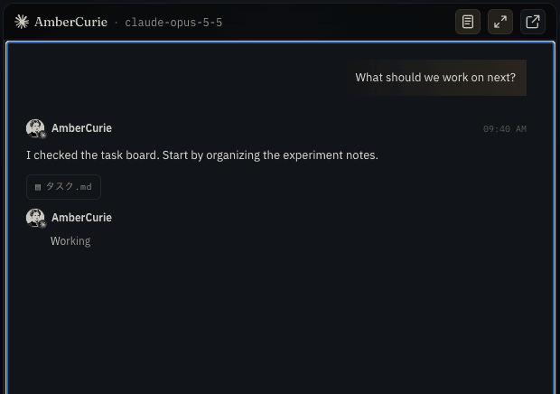

# Reader で作業と参照ファイルを見る

1. agent を選び、ペイン上部の Reader アイコンを押します。発言や作業ステップが整理され、進行中の作業を追えます。
2. 返事のファイルチップを押すと、同じペインにファイルの現在の内容が表示されます。
3. プレビュー右上の **×** で返事に戻ります。

[English](en/read-a-file.md) · [画面一覧](cockpit-map.md) · [Reader の詳しい使い方](usage.md#reader)
