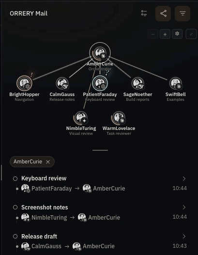

# 届いた ORRERY Mail を読む

1. 右の Mini Graph で送信元から宛先に comet が飛び、到着したノードに輪と件名が出ます。
2. 下の **ORRERY Mail** の一覧で件名を押すと、相手と本文が開きます。
3. 本文の右上の **×** で一覧に戻ります。

[English](en/read-mail.md) · [画面一覧](cockpit-map.md) · [Mail の表示切替と絞り込み](usage.md#orrery-mail)
