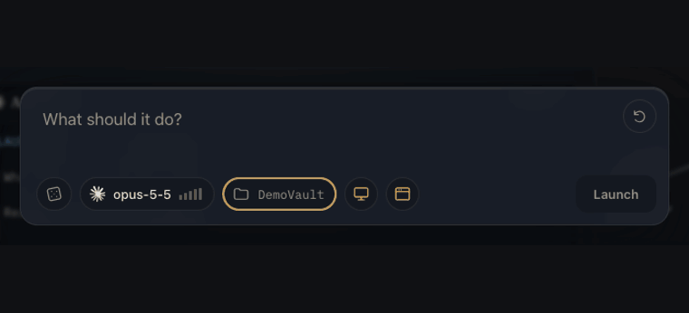

# agent を起動して依頼する

1. 左上の **New agent** を押し、タスク、モデル、作業フォルダーを選んで **Launch** を押します。
2. 左の一覧で起動した agent を選び、中央の下にある入力欄に依頼を書いて **Enter** を押します。
3. ペイン上部の Reader アイコンで返事を読みます。

[English](en/start-an-agent.md) · [画面一覧](cockpit-map.md) · [NEW AGENT の詳しい設定](usage.md#new-agent)
