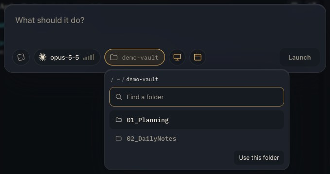

# 設定



サンプル設定では、`AGENTSTACK_SPAWN_DIRS` の先頭に置いた `demo-vault` が New agent の既定の作業フォルダーに選ばれています。

> English version: [configuration.en.md](en/telemetry-configuration.md)

[前: API reference](https://github.com/gyroid-eth/orrery-telemetry/blob/master/docs/api.md) · [README に戻る](../README.md) · [次: トラブルシューティング](telemetry-troubleshooting.md)

通常の設定箇所は installer が生成する:

```text
~/.agentstack/env.sh
```

です。file mode は `0600` です。service の environment は install 時に launchd plist / systemd unit へ書き込まれるため、変更後は `./scripts/install.sh` を再実行するか service definition も更新してください。

macOS の dashboard は `~/.agentstack/dashboard/agentctl.sh restart` でも、起動時に選ばれた mode/config を `start` と同じ処理で plist に描画して job を再設置します。設定に変化が無くても再設置します。supervised-background の再起動手順は従来どおりです。

## 明示freshの設定（切替準備）

以下はlegacyのDB/project設定とは別の入口です。正確な順序と本人の段は[fresh手順](https://github.com/gyroid-eth/orrery-telemetry/blob/master/docs/fresh-global-update.md)を使います。既定modeは維持し、値を推測して有効化しません。

| 設定 | 明示freshでの用途 |
|---|---|
| `AGENTSTACK_RUNTIME_MODE=fresh` | 起動するprocessだけをfreshへ固定 |
| `AGENTSTACK_FRESH_CLIENT_CONTEXT` | prepareで返された正確な保護context。旧`AGENTSTACK_CLIENT_CONFIG`/`AGENTSTACK_GLOBAL_SERVER_CONFIG`と併用しない |
| `AGENTSTACK_HOME` / `AGENTSTACK_PYTHON` | 対応する配布先とMail moduleを使える承認済みinterpreter |
| `AGENTSTACK_FRESH_DASHBOARD_SOCKET` | dashboardの自動子起動用に準備・確認した私有tmux socket |
| `AGENTSTACK_SPAWN_ROOTS` / `AGENTSTACK_SPAWN_DIRS` | 許可する作業folder。managed manifest/provider binaryは既存の明示設定を使う |

Cockpitは同host/UID・同contextに加え、health由来の`ORRERY_FRESH_MAIL_INSTANCE_ID`と固定`ORRERY_DASHBOARD_URL`を使います。dashboardのprivate host IPCが先に必要です。新daemonは作りません。準備済みのcontext/socketを明示したinstallerは、同じconfig/Iと参照pathだけをenv.sh・manifest・dashboardサービスへ保存し、通常updateでも選択を保持します。watcherは本人contextのkeyを除去して同configを使います。Mailは既存の所有runner/lockを使うfresh CLIへ接続します。未準備のroot作成・登録・資格移行やhook trustは行いません。指定Pythonには対応Mail moduleが必要です。稼働Mailの既定keepは所有とhealthの両確認が必要で、freshの明示--update-mailは所有Mailを正常停止してから再実行します。通常起動の実環境受入は別段です。再起動・DB復旧は[fresh手順の停止復旧](https://github.com/gyroid-eth/orrery-telemetry/blob/master/docs/fresh-global-update.md#8-失敗したら手順で戻す)へ。

### 準備済みfreshを通常起動へ保存する

[fresh手順](https://github.com/gyroid-eth/orrery-telemetry/blob/master/docs/fresh-global-update.md)で既に確認した同じPython/配布先/context/socketを使います。source checkoutでdry-runを読み、本人在席の導入判断後に同じ引数から`--dry-run`だけを外します。新規登録・資格移行・trust承認は行いません。保存後の通常再更新は選択を保持し、Mail/dashboardの停止・再開は同じ配布先の`agentstack-mailctl`/`dashboard/agentctl.sh`を使います。稼働fresh Mailの明示更新は、所有Mailを正常停止してから行います。

```sh
orrery_source='/absolute/path/to/orrery-telemetry-source'
orrery_python='/absolute/path/to/approved/python-with-matching-mail'
orrery_install='/absolute/path/to/matching/orrery-install'
orrery_context='/absolute/path/to/prepared/context.json'
orrery_socket='/absolute/path/to/verified-private-tmux.sock'
env AGENTSTACK_RUNTIME_MODE=fresh AGENTSTACK_CLIENT_CONFIG= AGENTSTACK_GLOBAL_SERVER_CONFIG= \
  AGENTSTACK_HOME="$orrery_install" AGENTSTACK_PYTHON="$orrery_python" \
  AGENTSTACK_FRESH_CLIENT_CONTEXT="$orrery_context" \
  AGENTSTACK_FRESH_DASHBOARD_SOCKET="$orrery_socket" \
  "$orrery_source/scripts/install.sh" --dry-run
```

## Dashboard service の log と再起動

| 環境変数 | 既定値 | 用途 |
| --- | --- | --- |
| `AGENTSTACK_DASHBOARD_LOG` | `$AGENTSTACK_RUNTIME_DIR/dashboard.log` | 常駐 dashboard の log の保存先 |
| `AGENTSTACK_DASHBOARD_LOG_MAX_BYTES` | `5242880`（5 MiB） | ローテーション前の log サイズ上限（byte） |
| `AGENTSTACK_DASHBOARD_LOG_BACKUPS` | `3` | 保存する世代数 |
| `AGENTSTACK_DASHBOARD_RESTART_DELAY` | `5` | dashboard の再起動までの待ち時間（秒） |

installer はこれらの値を保存し、通常の更新で引き継ぎます。

## Dashboard / `server.py`

`server.py` が直接参照する `AGENTSTACK_*` は次のとおりです。

| 環境変数 | 既定値 | 意味 |
| --- | --- | --- |
| `AGENTSTACK_PORT` | `8770` | HTTP port |
| `AGENTSTACK_BIND_HOST` | `127.0.0.1` | bind address |
| `AGENTSTACK_DASHBOARD_ALLOWED_ORIGINS` | 空文字 | legacy dashboard で追加許可する固定の HTTP(S) origin。半角スペース区切り。下記参照 |
| `AGENTSTACK_MAIL_DB` | `~/.agentstack/mail/storage.sqlite3` | ORRERY Mail SQLite |
| `AGENTSTACK_MAIL_ENV` | `~/.agentstack/mail/.env` | standalone dashboard の互換 bearer 参照先。installer は service render を明示 |
| `AGENTSTACK_MAIL_HTTP_BEARER_MODE` | `disabled` | legacy Authorization header を付けない |
| `AGENTSTACK_PROJECT_KEY` | 未設定 | ORRERY Mail project の human key |
| `AGENTSTACK_VAULT` | 未設定 | project key 不在時の fallback と、vault 内 Output item の Obsidian link hint |
| `AGENTSTACK_DELIVERABLE_ROOTS` | 未設定 | `:` 区切りで `LOG_*.md` を再帰走査する root。未設定時は project の `logs/` |
| `AGENTSTACK_LANG` | browser language | murmur の言語を `ja` / `en` で上書き |
| `AGENTSTACK_MURMUR` | enabled | `off` で murmur の吹き出しを無効化 |
| `AGENTSTACK_LABEL_PREFIX` | `org.agentstack` | launchd label prefix |
| `AGENTSTACK_TERMINAL` | `auto` | `ghostty / iterm / terminal / wt / none`。`wt` は WSL2 の Windows Terminal（`auto` は WSL2 内で `wt.exe` が見えれば選ぶ） |
| `AGENTSTACK_HOOKS_DIR` | `~/.agentstack/hooks` | hook と既定 spawn script の root |
| `AGENTSTACK_RUNTIME_DIR` | `~/.agentstack/runtime` | token、annotation、session index、child / watcher state |
| `AGENTSTACK_MAIL_HOME` | `~/.agentstack/mail` | signal data root |
| `AGENTSTACK_SIGNALS_DIR` | `$AGENTSTACK_MAIL_HOME/signals` | mail signal directory |
| `AGENTSTACK_PORTRAITS_DIR` | 未設定 | private PNG overlay directory |
| `AGENTSTACK_CUSTOM_PORTRAITS` | 未設定 | agent name → portrait key JSON |
| `AGENTSTACK_SPAWN_SCRIPT` | `$AGENTSTACK_HOOKS_DIR/spawn_child.sh` | NEW AGENT launcher |
| `AGENTSTACK_SPAWN_DIRS` | `~` | `:` 区切りの spawn directory preset |
| `AGENTSTACK_SPAWN_ROOTS` | `$HOME` | `:` 区切りの directory typeahead 許可 root |
| `AGENTSTACK_CLAUDE_MODELS` | 未設定 | `,` 区切りの dashboard Claude model 明示 override |
| `AGENTSTACK_CODEX_MODELS` | `unset` | `,` 区切りの dashboard Codex model allow-list |
| `AGENTSTACK_CODEX_DEFAULT_MODEL` | `unset` | Codex child の既定 model ID または短縮名 |
| `AGENTSTACK_CODEX_DEFAULT_EFFORT` | `unset` | Codex child の既定 effort |

path 系は `~` を展開します。空文字は未設定として扱います。integer の `AGENTSTACK_PORT` が不正なら `8770` に戻ります。

murmur の言語は `?lang=ja` / `?lang=en`、`AGENTSTACK_LANG`、browser の
`navigator.language` / `navigator.languages` の順で決まります。browser の言語に
`ja` 系があれば日本語、それ以外は英語です。`?murmur=on` / `?murmur=off` は
その URL だけ service の既定を上書きし、`AGENTSTACK_MURMUR=off` は service の
既定として吹き出しを止めます。利用者は dashboard の `SETTINGS` › DISPLAY の
Murmur switch でも on / off を切り替えられ、その選択は browser に保存されます
（優先順は URL、browser の保存値、service 既定）。環境変数を
常駐 service に反映するには、設定後に installer を再実行してください。

## LAN / VPN から使う場合の Host 設定

Dashboard と ORRERY Mail は、受け付ける Host とブラウザーの要求元を照合します。LAN から使うときは、利用する接続先だけを明示してください。スマホには専用のペアリングがあります。[スマホで使う](mobile.md) · [ローカル HTTP の信頼境界](https://github.com/gyroid-eth/orrery-telemetry/blob/master/docs/local-http-security.md)

legacy dashboard は、全 HTTP メソッド・全パスで `Host` を検査します。既定では、実際の待受ポートの `127.0.0.1`、`localhost`、`[::1]` だけを許可します。通常のローカル利用や、loopback URL へ接続する cockpit bridge の設定追加は不要です。

既に LAN / VPN 向けに待ち受けている場合は、更新前に利用する URL の origin（scheme、host、port）を明示してください。例えば、既存 checkout で次を dry-run し、結果を確認してから同じ環境変数付きで `--dry-run` を外して実行します。

```bash
AGENTSTACK_DASHBOARD_ALLOWED_ORIGINS='http://dashboard.example:8770 https://dashboard.example' \
  ./scripts/install.sh --keep-mail --dry-run
```

この値は `env.sh` と dashboard の service 定義へ保存され、再インストール時も引き継がれます。空文字を明示するか `--reset-settings` で追加許可を消せます。`server.py` を直接起動する場合は、そのプロセスへ同じ環境変数を渡してください。この設定は bind address を変更しません。既存の待受設定は別途維持してください。

origin にパス・認証情報・query・fragment・wildcard は書けません。引用符や改行などを含む不正な値は、installer が設定や service を書く前に拒否し、server も起動を拒否します。区切りは改行やタブではなく半角スペースです。大文字小文字と IPv6 表記を正規化し、port 省略は HTTP の `80` / HTTPS の `443` として照合します。`8770` など他の port は必ず明示してください。

`AGENTSTACK_BIND_HOST=0.0.0.0`、実 interface、`Forwarded` / `X-Forwarded-*` から許可先を推測しません。HTTPS を proxy で終端する場合も、利用する HTTPS origin を明示し、upstream の `Host` と browser の `Origin` がその同じ origin に対応するようにしてください。別途許可した origin でも、異なる `Host` の POST は通りません。

これは認証機能ではありません。dashboard にはログインがなく、許可した Host を送れる相手は操作できます。公開範囲は信頼できる LAN / VPN に限定してください。isolated global mode の capability 認証と公開 static resource の扱いは変わりません。

## Project key がない場合

`AGENTSTACK_PROJECT_KEY` と `AGENTSTACK_VAULT` の両方が未設定でも次は動きます。

- DECK の tmux state
- terminal open / local capture
- local annotation
- bundled portrait
- Output / deliverables（cwd または git root の `logs/` へ fallback）

次は動きません。

- launcher の shell-side agent registration
- NETWORK の mail edge / drawer
- mail history / DIGEST REPLAY
- dashboard spawn
- project-scoped retire

mail 系だけを `NOT CONFIGURED` にし、local telemetry を診断に残す設計です。

<a id="native-connections"></a>

## DeepSeekやLocalの接続先を複数残す

API 27以降では、1つの私有manifestにDeepSeek、workstationのLocal、EPYCのLocalなどを同時に登録できます。既存の`deepseek`/`strata`は変更不要です。追加接続には別のIDと`kind`が必要です。以下はmanifestの`backends`部分の例です。`<FORMAL_MODEL_ID>`は、そのサーバーが受け付ける実際のmodel IDへ置き換えます。

```json
{
  "backends": {
    "deepseek": {"model": "deepseek-flash", "models": ["deepseek-flash"]},
    "strata": {"label": "workstation", "server": "workstation", "model": "<FORMAL_MODEL_ID>", "models": ["<FORMAL_MODEL_ID>"]},
    "strata-epyc": {"kind": "strata", "label": "EPYC", "server": "EPYC", "model": "<FORMAL_MODEL_ID>", "models": ["<FORMAL_MODEL_ID>"]}
  }
}
```

既存のDeepSeekと`strata`の設定を残し、コピーした私有設定で次を揃えます。

| ファイル内の場所 | 追加接続に設定するもの |
| --- | --- |
| manifestの`backends.strata-epyc` | `kind: "strata"`、実際のmodel ID、見分けられる`label`と`server` |
| dsh backendファイルの`backends.strata-epyc` | この接続専用の`base_url`、`model`、キー参照。必要なら`model_definition.id`、`contextWindow`、`maxTokens`もここへ |
| Hermes設定の`profiles.strata-epyc` | この接続専用の`provider`名、`base_url`、`api_mode`、`model`、`context_length`、キー参照 |

dshとHermesのURL形式は同じとは限りません。[初期設定のAPI条件](native-setup.md#1-最初に使う組合せを選ぶ)に従います。Macのキー参照は既存のkeychain/service/accountと`key_cmd`の形式、WSLはmanifestの接続ごとの`credential_ref`を使います。キーの値はJSONへ書きません。contextは各サーバーの実際の値、maxTokensは必要な出力上限に合わせます。同じmodel IDだからといって別サーバーの値やキー参照を流用しないでください。

接続IDは`[a-z][a-z0-9_-]{0,63}`の形式です。CLI名や`same`/`auto`/`main`/`custom`などの予約名は使えません。新IDの`kind`は`deepseek`か`strata`を明示し、旧IDの種別は変更できません。同じIDの重複、未知ID、未知kind、別接続のhelper modelは拒否します。helperは同じ接続のmodel一覧から選びます。

manifestを有効化して使うharnessごとに正規の静的validateを行い、[初期設定の手順5](native-setup.md#5-設定例をコピーして接続先をつなぐ)どおりinstallerへ渡します。cockpitではLocal modelsの各行のserver名（workstation / EPYC）で選び分けます。Telemetry単体では接続labelが別タブに出ます。APIとCLIでは接続IDを保持し、例えば`--harness dsh --backend strata-epyc --model <FORMAL_MODEL_ID>`を指定します。resumeも保存した接続IDとnative sessionを使い、別の接続へ自動で移しません。global modeと実接続の受入範囲は従来どおりです。

## Output / deliverables

Output index は `LOG_*.md` の先頭付近にある `agent: <name>` と dashboard の agent 名が一致する file を最大25件表示します。

- `AGENTSTACK_DELIVERABLE_ROOTS` を設定した場合、その `:` 区切り root 群を再帰走査します。明示 root は既定の `logs/` を置き換えます
- 未設定時は、絶対 path の `AGENTSTACK_PROJECT_KEY`、絶対 path の `AGENTSTACK_VAULT`、dashboard の cwd / git root の順で base を決め、その直下の `logs/` を走査します
- `AGENTSTACK_VAULT` は private directory layout の走査指定ではありません。検出 item がその vault 内にあるときだけ `obsidian://` link を作る hint です
- vault 外の item も一覧に出ますが、無効な Obsidian link を作らず非リンク項目として表示します

custom root は service environment へ配線するため、設定後に installer を再実行します。

```bash
export AGENTSTACK_DELIVERABLE_ROOTS="$HOME/project-a/logs:$HOME/shared logs"
./scripts/install.sh
```

## Installer

| 環境変数 | 既定値 | 意味 |
| --- | --- | --- |
| `AGENTSTACK_HOME` | `~/.agentstack` | install root。`--install-dir` でも指定可 |
| `AGENTSTACK_MAIL_DIR` | `$AGENTSTACK_HOME/mail-service` | candidate、immutable render、runtime log / pidfile |
| `AGENTSTACK_MAIL_HOME` | `~/.agentstack/mail` | canonical DB / archive / signals root |
| `AGENTSTACK_MAIL_DB` | `$AGENTSTACK_MAIL_HOME/storage.sqlite3` | dashboard が読む ORRERY Mail SQLite |
| `AGENTSTACK_MAIL_ENV` | render ID から導出 | ORRERY Mail service env |
| `AGENTSTACK_MAIL_STATE_ROOT` | `~/.agentstack/mail` | canonical DB / archive / signals root |
| `AGENTSTACK_MAIL_SERVICE_ROOT` | `$AGENTSTACK_HOME/mail-service` | candidate、immutable render、runtime log / pidfile |
| `AGENTSTACK_MAIL_SERVICE_VENV` | candidate ID から導出 | 検証済み candidate venv を明示的に再利用する場合の path |
| `AGENTSTACK_MAIL_ENROLL_BIN` | 採用した Mail deployment から導出 | installer が `env.sh` に保存する対応済み `agentstack-enroll`。通常は手動設定しない |
| `AGENTSTACK_MAIL_HTTP_BEARER_MODE` | `disabled` | legacy HTTP bearer を使用しない |
| `AGENTSTACK_PROJECT_KEY` | 再 install 時は既存 `env.sh`、初回は必須 | project human key。`--project-key` が最優先 |
| `AGENTSTACK_EXTRA_PROTECTED_ROOTS` | process の値（空も含む）→ installed extras（空も含む）→ installed legacy roots を一度だけ → 空 | 永続する順序付き追加 reservation root。下記の自動移行を参照 |
| `AGENTSTACK_PROTECTED_ROOTS` | managed 起動ごとに計算 | runtime 出力: 追加 root、次に実 workspace。installed の旧値は direct/unmanaged hook 互換のためだけに保持 |
| `AGENTSTACK_RELEASE_GRACE_SECONDS` | `90` | 成功した Edit / Write 後、reservation を解放するまでの debounce 秒数。旧 `FILE_RESERVATION_RELEASE_GRACE_SECONDS` も fallback として利用可 |
| `AGENTSTACK_DELIVERABLE_ROOTS` | 未設定 | Output index の `:` 区切り走査 root。env / service / manifest へ保存 |
| `AGENTSTACK_LANG` | 未設定 | murmur の `ja` / `en` override。未設定時は browser 判定 |
| `AGENTSTACK_MURMUR` | 未設定 | `off` で murmur を無効化 |
| `AGENTSTACK_PORT` | `8770` | dashboard port |
| `AGENTSTACK_LABEL_PREFIX` | `org.agentstack` | service label prefix |
| `AGENTSTACK_TERMINAL` | `auto` | terminal integration |
| `AGENTSTACK_PYTHON` | `python3` の解決結果 | installer が version 検証した service / installed persistent launcher 用 Python。persistent launcher は ambient `PATH` の `python3` へ fallback しない |
| `AGENTSTACK_PATH` | Homebrew と system path | service に渡す `PATH` |
| `AGENTSTACK_MCP_URL` | `http://127.0.0.1:18765/mcp` | launcher / hook / dashboard / Bridge の MCP endpoint |
| `AGENTSTACK_CLAUDE_SETTINGS` | `~/.claude/settings.json` | merge 対象 settings |
| `AGENTSTACK_CLAUDE_MD_SCOPE` | `global` | 利用者単位のみ。明示 project/both は拒否。[移行](instruction-migration.md) |

健康な ORRERY Mail listener が既にある場合、installer は server を更新・再起動せず、稼働中の immutable render に記録された deployment metadata を採用します。metadata 導入前の managed render は、render ID と candidate directory の決定論的対応が一意な場合だけ採用します。生成する `env.sh` の `AGENTSTACK_MAIL_ENV` と `AGENTSTACK_MAIL_ENROLL_BIN` は同じ deployment を指します。既知の legacy render に enrollment CLI が無い場合は Mail と既設 autostart を維持し、enrollment だけ unavailable として保存します。

DB が一致する健康な listener でも service env を特定できない場合、明示 pin が無い通常の再 install は listener をそのまま再利用します。この degraded 状態では deployment / enrollment の path を空にし、enrollment profile と Mail autostart を更新しません。既設 trigger は削除・停止せず残しますが、installer は次回 login での再起動を保証しません。明示した `AGENTSTACK_MAIL_SERVICE_VENV` / `AGENTSTACK_MAIL_SERVICE_ENV` を稼働 deployment と照合できない場合、既知 metadata が不正な場合、または metadata が約束した enrollment CLI が無い場合は、listener を切り替えず明示エラーで停止します。

再 install では、上の表の設定のうち利用者が選ぶもの（project key、明示した追加 protected roots、
port、label prefix、terminal、MCP URL、`PATH`、Python、Mail の state / service root、
`LANG` / `MURMUR` / `DELIVERABLE_ROOTS` など）を、明示した値 → 前回の `env.sh` → 既定値
の順で決めます。一覧は `hooks/project-context.sh` の `AGENTSTACK_INHERITED_SETTINGS`、
既定値に戻す方法は [install.md](telemetry-install.md) の Upgrade「前回の設定の引き継ぎ」を参照して
ください。

installer の project key 解決順は `--project-key` / process の
`AGENTSTACK_PROJECT_KEY` → `PROJECT_KEY` → install 先の既存 `env.sh` です。
初回 install でどれも無い場合は repo checkout を project と推測せず、変更前に
exit 2 で停止します。永続設定には `AGENTSTACK_PROJECT_KEY` を推奨します。

hook と helper の実行時は `AGENTSTACK_PROJECT_KEY` → `PROJECT_KEY` →
`${AGENTSTACK_HOME:-$HOME/.agentstack}/env.sh` → 現在の cwd の順です。installed
`env.sh` は source せず、共通 resolver は project と追加 root の設定を literal として
読み取ります。direct/unmanaged hook は互換用に残した旧 `AGENTSTACK_PROTECTED_ROOTS`
を参照できますが、managed 起動はこれを設定として使いません。このため install
済みの editor を別 directory から起動しても reservation と registration は同じ project
key を使い、同時に `env.sh` 内の任意 shell code は実行されません。

installer は `AGENTSTACK_MAIL_DB`、`AGENTSTACK_MAIL_ENV`、`AGENTSTACK_SIGNALS_DIR`
を state / render から導出し、`env.sh` へ state root と
`AGENTSTACK_MAIL_HTTP_BEARER_MODE=disabled` を一緒に保存します。

## Reservation の保護範囲と移行

対象の managed `workspace-v1` 起動経路では、起動先と `AGENTSTACK_EXTRA_PROTECTED_ROOTS` の物理 path 内に `*`・`?`・`[`・`\` があると拒否します。ORRERY Mail は前3文字を glob と解釈し、`\` を `/` に置き換えて予約名を比べるため、自己一致や別フォルダとの競合照合を崩すおそれがあります。エラーには該当文字と path を表示します。単独の `]` は使用できます。

`AGENTSTACK_EXTRA_PROTECTED_ROOTS` は追加 reservation root の永続設定です。絶対 path または `~/` path を colon 区切りで指定します（空白は可、path 内の colon は不可）。managed 起動は物理 path に解決し、symlink / 末尾 slash の別名と重複を、順序を変えずにまとめます。今回対象の top-level と delegated child の起動では、順序付き追加 root の後へ、起動先として選んだ物理作業 directory を保護対象に追加します。Git root は検出しても自動的には保護しません。必要なら `AGENTSTACK_EXTRA_PROTECTED_ROOTS` で明示します。前の起動の `AGENTSTACK_PROTECTED_ROOTS` は設定として再利用しません。path 形式の project key や `AGENTSTACK_VAULT` だけでは保護に追加しません。namespace の選択は変えず、installed project key も保持します。

起動時の追加 root は、明示した process の値（空も含む）、installed extras、空、の順です。旧設定を移行するのは install/update だけです。

install/update は空かどうかではなく設定の有無を使い、次の順で追加 root を自動選択・保存します。

1. process の `AGENTSTACK_EXTRA_PROTECTED_ROOTS`（明示した空文字も含む）
2. installed `env.sh` の `AGENTSTACK_EXTRA_PROTECTED_ROOTS`（空文字も含む）
3. installed `env.sh` の旧 `AGENTSTACK_PROTECTED_ROOTS` を、literal の値と順序をそのまま一度だけコピー
4. どれも存在しなければ空

移行は installed file を literal として読み、shell 式を実行せず、root の意図を推測せず、ambient shell/tmux の `AGENTSTACK_PROTECTED_ROOTS` も取り込みません。旧設定が不正・曖昧なら installed file を上書きする前に更新を停止します。installer は選択した移行元・値・保存先を `--dry-run` でも表示します。通常の更新が自動移行するため、手動コピーは不要です。 installed file は installer が生成する形の literal な export 代入を使います。手書きの shell command、計算した変数名、展開を含む値は更新前に確認が必要です。model list など、保護設定以外の引用符で囲んだ複数行の値は引き続き使えます。

成功した install は、空でも extras marker を `env.sh`、dashboard service 設定、install-state に保存します。この設定の存在が旧 list の再取り込みを防ぎます。installed の旧値は direct/unmanaged hook 互換のためだけに保持し、managed 起動は設定として無視します。shell/tmux の旧値が非空で installed 値と異なれば、extras が既に存在しても警告します。古い shell は開き直すか旧変数を解除し、警告を消すために runtime root の list をコピーしないでください。

再 install と `--reset-settings` は extras を保持します。明示的な `AGENTSTACK_EXTRA_PROTECTED_ROOTS=` は追加分を解除し、空の marker と起動 workspace の必須保護を残します。意図的な置き換え・解除を次のように preview し、確認後に `--dry-run` を外して再実行します。

```bash
AGENTSTACK_EXTRA_PROTECTED_ROOTS="$HOME/shared-vault" ./scripts/install.sh --dry-run
# 追加 root を明示的になしにする場合:
AGENTSTACK_EXTRA_PROTECTED_ROOTS= ./scripts/install.sh --dry-run
```

cutover 前に作業を完了するか active reservation を解放してください。従来の相対予約名は root によって変わりましたが、更新後の managed 起動では root に依存しない物理絶対 path を予約名として使います。旧予約をそのまま引き継ぐことはできません。dry run を確認して更新し、影響する session をまとめて再起動してください。既存 session の環境は restart まで残り、file の更新だけでは変わりません。dashboard resume と persistent 起動の再計算は後続PRの対象です。既存の再開経路では旧 root が残る可能性があり、今回の範囲では新しい保護境界を保証しません。

## Launcher

| 環境変数 | 既定値 | 意味 |
| --- | --- | --- |
| `AGENTSTACK_BASE_DIR` | `$HOME` | `fzf` picker root |
| `AGENTSTACK_CLAUDE_BIN` | `claude` | Claude CLI |
| `AGENTSTACK_CLAUDE_MODEL` | `claude-code` | Claude 登録 model label。子と dashboard から resume した session は、その session の model（`CLAUDE_CHILD_MODEL`）を優先します。子の tmux session に開いた新しい window はこの値を継ぐので、そこで別の agent を `AGENT_NAME=<name> claude --resume` で開くときは、先に `unset CLAUDE_CHILD_MODEL` してください（しないと子の model で登録されます） |
| `AGENTSTACK_CODEX_BIN` | install 時に operator の shell で解決した、`--version` に答える `codex`（WSL では `/mnt/<drive>/` 配下の Windows 版を除く。`--codex-bin` で明示可） | Codex CLI。dashboard は launchd / systemd の最小 PATH で動くので、nvm / nodebrew / `~/.npm-global` の codex はこの値で届く |
| `AGENTSTACK_CODEX_MODEL` | launcher / bootstrap の既定 | Codex 登録 model |
| `AGENTSTACK_CODEX_SANDBOX` | `workspace-write` | `danger-full-access` で legacy mode の Codex CLI を Full Access にする。対象は `agent-start-codex`、`/delegate`、親なしの NEW AGENT と dashboard からの再開。直接の `agent-start-codex` では `read-only` も指定可 |
| `AGENTSTACK_CODEX_APPROVAL` | `on-request` | `agent-start-codex`（利用者自身の対話 session）の `--ask-for-approval`。spawn される child は `AGENTSTACK_CODEX_CHILD_APPROVAL`（Child spawn 参照） |
| `AGENTSTACK_VAULT` | 未設定 | Codex へ追加する writable `--add-dir` |
| `AGENTSTACK_MCP_URL` | `http://127.0.0.1:18765/mcp` | registration / hook endpoint |
| `AGENTSTACK_CONTACT_POLICY` | `open` | 登録後の contact policy。`skip` で server default |
| `AGENTSTACK_AGENT_NAME_ATTEMPTS` | implementation default | name 候補の最大試行数 |
| `AGENTSTACK_NAME_UNKNOWN_LIMIT` | `3` | 連続 `unknown` の停止閾値 |
| `AGENTSTACK_TCC_GUARD` | enabled | macOS TCC warning。`0` で無効 |
| `AGENTSTACK_TCC_DIRS` | `$HOME/Desktop:$HOME/Downloads:$HOME/Documents` | `:` 区切りの TCC probe 対象 |
| `AGENTSTACK_SCIENTISTS_JSON` | bundled JSON | scientist vocabulary override |

launcher（`agent-start`・`agent-start-codex`・`agent-start-gemini`）は起動時に
`env.sh` を読み込みますが、起動前に設定されていた `AGENTSTACK_INHERITED_SETTINGS` の
値は上書きしません。たとえば `AGENTSTACK_PROJECT_KEY=/path/to/other ./agent-start` は
install 時の project ではなく `/path/to/other` に登録しますが、保護範囲は実際の起動先
workspace と明示した追加 root から決まります。project key を明示しなければ `env.sh` の
namespace を使います。この分離は namespace の選択を変えず、installed project key も保持します。

`AGENTSTACK_TCC_DIRS` は空白を含む path も保持できる `:` 区切りが正本です。colon を含まない旧 whitespace 区切りも legacy compatibility として解釈します。

Full Access を使うには、`~/.agentstack/env.sh` に `export AGENTSTACK_CODEX_SANDBOX=danger-full-access` を設定します。通常の再インストールでもこの値を引き継ぎます。
Full Access では Codex の sandbox とコマンド承認が無効になり、OS が許す任意の場所への書き込みや削除、認証済みのリモートへの `git push` が可能になります。

`AGENTSTACK_RESERVED_IDENTITY`、proxy token path、child token などは spawner が session ごとに設定する内部値です。top-level launcher へ手動で設定しないでください。

## Child spawn

`spawn_child.sh` と `agentstack-preregister-child` の挙動を変える変数です。

| 環境変数 | 既定値 | 意味 |
| --- | --- | --- |
| `AGENTSTACK_AUTO_OPEN_CHILD` | `1` | Claude / Codex child の起動後に OS terminal を自動表示する。`0` で自動表示だけを止める。tmux session と Deck の Open tmux は常に独立 |
| `AGENTSTACK_FOCUS_CHILD` | 未設定 | 自動表示が有効な場合、`1` で前面に出す。単独では自動表示を有効にしない |
| `AGENTSTACK_STRICT_AGENT_NAMES` | 未設定 | `1` で off-list な child 名を警告ではなくエラーにする |
| `AGENTSTACK_MONITOR_DANGER_CHECK` | `0` | `1` で monitor の危険コマンド検知を有効にする。既定は passive |
| `AGENTSTACK_CODEX_CHILD_APPROVAL` | `never` | `workspace-write` で親付きの Codex child に渡す `--ask-for-approval`。installer の `--codex-approval` で永続化。親なしの NEW AGENT は Codex の設定に従う。Full Access は常に `never` |
| `AGENTSTACK_CODEX_CHILD_CONFIG_OVERLAY` | 未設定 | macOS/Linux の全 Codex child の `config.toml` に重ねる TOML fragment の絶対 path。installer の `--codex-child-overlay <path>` で永続化 |
| `AGENTSTACK_CODEX_NETWORK` | `on` | Codex child の sandbox network（`-c sandbox_workspace_write.network_access=true`）。`--codex-network off` で切る |
| `AGENTSTACK_CHILD_DEFAULT_TOOLS` | 空 | Claude・Codex・dsh・Hermes の CLI／標準 `/api/spawn` の新規起動に使う道具。共通の一覧に `;dsh=` などの provider 別上書きを追加できる。明示の base/tools/MCP profile が優先する。[既定の道具](delegation.md#installer-の既定の道具) |
| `AGENTSTACK_CODEX_ADD_DIRS` | 未設定 | Codex child に追加で書込を許す root（`:` 区切り）。`--codex-add-dirs` で永続化 |
| `AGENTSTACK_WORKTREE_ROOT` | `$AGENTSTACK_HOME/worktrees` | 新規 isolated worktree の永続 root。installer 実行時の環境変数で上書き・永続化 |
| `AGENTSTACK_CLAUDE_CHILD_CHROME` | 未設定 | `1` で `spawn_child.sh` が起動する Claude child に `--chrome` を付ける（Claude in Chrome）。未設定・`0` は inherit（起動コマンドを変えない）。CLI の `--claude-chrome` が優先。Codex child では無視。[詳細](delegation.md#claude-child-とブラウザ操作claude-in-chrome) |
| `AGENTSTACK_CLAUDE_CHILD_CHROME_DEVICE` | 未設定 | Claude child に使わせるブラウザの deviceId。設定すると `AGENTSTACK_CLAUDE_CHILD_CHROME=1` と同じ。CLI の `--claude-chrome-device` が優先。技術的な隔離ではなく child への指示 |
| `AGENTSTACK_CHILD_RESUME_RETENTION_DAYS` | `30` | 正常終了した Claude / Codex child の再開用 state / credential を保持する日数。installer の `--child-resume-retention-days DAYS` で永続化。`0` は従来どおり cleanup 時に全削除 |
| `AGENTSTACK_WSL_ANCHOR` | `1` | WSL の従来モード用。agent の稼働・起動中や dashboard の表示中に隠れた `wsl.exe` で保持し、無活動が60秒続くと手放す。Windows の設定は読み取りのみ。 `0` で無効。installer の `--no-wsl-anchor` / `--wsl-anchor` で永続化 |

Codex child の起動フラグは製品が直接組み立てます。親付きの起動と、親なし起動の記録がないセッションの dashboard からの再開では、承認方針の既定値は `never` です。ネットワークアクセスの既定値は on です。書込を許す root は project、`AGENTSTACK_SPAWN_DIRS` / `AGENTSTACK_SPAWN_ROOTS`、install dir、`AGENTSTACK_WORKTREE_ROOT`、`~/.claude`、`~/.codex`、child 専用 `CODEX_HOME`、`AGENTSTACK_CODEX_ADD_DIRS` のうち実在する directory です。dashboard service のこれらの値は installer に渡してください。config overlay は macOS と Linux（WSL2 を含む）で `spawn_child.sh` を経由して適用されます。

製品が起動する Codex（child・dashboard の再開・`agent-start-codex`・Windows の launcher）には、`-c check_for_update_on_startup=false` を必ず付けます。Codex の起動時の更新案内は既定の選択が `npm install -g @openai/codex` で、無人の child では断る人がいません。更新の途中で child が止められると、機体の `codex` が旧版も新版も使えない状態で残ります（#60）。Codex の更新は `npm install -g @openai/codex@latest` などで利用者が行ってください。

worktree root を変える場合は、たとえば `AGENTSTACK_WORKTREE_ROOT=/srv/agent-worktrees ./scripts/install.sh ...` として installer に渡します。相対 path は受け付けません。`Syncthing` / `Obsidian` を含む path は launcher が引き続き拒否します。旧既定の `/tmp/cc-worktrees` は移動も削除もせず、新規 spawn だけが永続 root を使います。`agentstack-doctor` は現在の root のうち live でも active registration でもない directory を報告しますが、削除は operator に任せます。

`AGENTSTACK_TERMINAL=auto` は利用可能な OS terminal を選び、child window を背面で開きます。自動表示を既定にしているのは意図的です。dashboard を持たない導入直後の利用者や、ターミナルだけで使う利用者にも child が起動したことを見せるためで、自動表示を止めると正常な spawn が「何も起きなかった」ように見えます。

常用の dashboard から child を見る環境では、`AGENTSTACK_AUTO_OPEN_CHILD=0` で自動表示だけを止められます。child は引き続き独立した detached tmux session で動き、必要なときだけ Deck の Open tmux から開けます。`AGENTSTACK_TERMINAL=none` は手動の Open tmux も無効にするので、自動表示だけを止める用途には使いません。headless host では従来どおり `none` を使えます。

自動表示を止めるには、`AGENTSTACK_AUTO_OPEN_CHILD=0 ./scripts/install.sh ...` として installer に渡してください。設定は `env.sh`、Dashboard service、install-state に保存され、再インストールでも保持されます。未設定の旧 install は `1` となり、これまでと挙動は変わりません。明示した `0` / `1` は保存値より優先されます。`AGENTSTACK_FOCUS_CHILD=1` は自動表示が有効なときだけ効きます。直接 shell から起動する場合は、その shell に同じ変数を export します。child から孫への新規起動と、Claude / Codex session の再開先へも設定を渡します。Gemini の別 launcher に OS terminal 自動表示を追加する設定ではありません。

child の model は spawner の単一 model catalog と正規化関数から決まります。Claude の無指定 / `opus` / `sonnet` / `haiku` / `fable` は、Claude Code のローカル model catalog がその系統の現行として示すモデル（系統ごとに 1 つの `main` 行）に解決します（catalog が無い・読めない・系統の行が 1 つに決まらない・子が使う Claude Code より新しい版を要する・古い catalog が同梱の表より古い世代を示すときは `dashboard/claude_models.py` の同梱の表。今は `claude-opus-5-5` / `claude-sonnet-5-5` / `claude-haiku-4-5-20251001` / `claude-fable-5-1`）。`sonnet-5-5`・`sonnet-5`・`opus-5-5` のような版つきの別名は世代を固定します。Codex の無指定は設定された既定を使い、未設定なら CLI と catalog による従来の判定です。短縮名は新鮮な catalog の同系統の最新版に追従します（[Codex model catalog](#codex-model-catalog) 参照）。旧世代を固定する場合は `gpt-6-sol` のように正式 ID を指定します。旧 `claude-opus-5`、`claude-opus-4-8`、`claude-sonnet-4-6`、`gpt-5.5` の明示指定は引き続き有効です。generic な `opus[1m]` / `sonnet[1m]` は既知の legacy 1M model に正規化されます。

Codex の reasoning effort は `--effort` から決まり、`AGENTSTACK_CODEX_MODEL` と `AGENTSTACK_CODEX_EFFORT` として child session へ渡します。対応情報があれば既定は `xhigh` またはそのモデルの既定、情報がなければCLI既定です。明示 effort の互換性は Codex CLI が判定します。これらは spawner が設定する値なので、手動で export しても top-level launcher の挙動は変わりません。

正常終了した Claude / Codex child は、remote identity を retire したまま、private state と canonical owner credential を期限まで保持します。専用 home、proxy runtime、旧 MCP config は cleanup ごとに削除され、Codex resume 時には現在の source Codex home と保存済みの `codex_mcp_profile` から home を作り直し、Claude resume 時には子専用 Mail proxy config を作り直します。期限切れ material は dashboard 稼働中の maintenance が削除します。`agentstack-doctor` は期限切れ・purge 待ちを報告するだけで削除しません。期限前でも `agentstack-purge-child-resume <agent>`、期限切れをまとめて片付ける場合は `agentstack-purge-child-resume --expired` を使えます。どちらも履歴 transcript と bound receipt は削除しません。

Claude / Codex の resume も `AGENTSTACK_AUTO_OPEN_CHILD` に従います。`0` は OS の窓を開かず detached tmux で再開し、未設定 / `1` は自動表示します。`POST /api/jump` の boolean `open` を明示すると設定より優先します。Claude の起動前に Mail 認証・unretire を済ませる順序は変わりません。再開した session は後から Open tmux や cockpit で開けます。

## Skill

| 環境変数 | 既定値 | 意味 |
| --- | --- | --- |
| `AGENTSTACK_OBSIDIAN_APP` | 未設定 | `/log` の Obsidian モードを有効にする。Obsidian の launcher / CLI への path |

`/log` は `AGENTSTACK_OBSIDIAN_APP` と `AGENTSTACK_PROJECT_KEY` の両方が揃ったときだけ vault へ書き、daily note へリンクします。**installer はこれを設定しません**。Obsidian が入っていても未設定なら fallback モード（`<git root>/logs/`）のままです。

```bash
export AGENTSTACK_OBSIDIAN_APP="/Applications/Obsidian.app/Contents/MacOS/Obsidian"
```

## Advanced helper override

通常は installer が生成した path を使います。custom layout、複数 install、wrapper を運用するときだけ次を変更してください。

| 環境変数 | 既定値 | 意味 |
| --- | --- | --- |
| `AGENTSTACK_ENV_FILE` | 未設定 | `agentstack-preregister-child` / `agentstack-reregister` が標準 `env.sh` より先に読む追加 env file |
| `AGENTSTACK_CLAUDE_JSON` | `~/.claude.json` | Claude child 用 MCP config を作るとき、既存 ORRERY Mail server 名を読む source |
| `AGENTSTACK_MANAGED_AGENTS_FILE` | `$AGENTSTACK_RUNTIME_DIR/managed_agents.txt` | title / spawn / cleanup helper が管理する agent 名一覧 |
| `AGENTSTACK_MCP_HEALTH_URL` | `AGENTSTACK_MCP_URL` から導出 | `session-start-reminder.sh` の liveness endpoint |
| `AGENTSTACK_MCP_PROXY` | `$AGENTSTACK_HOME/integrations/codex_app/plugin/scripts/run-mcp.sh` | spawned child ごとの認証済み stdio proxy runner |
| `AGENTSTACK_PREREGISTER_CHILD` | `$AGENTSTACK_HOME/bin/agentstack-preregister-child` | `/delegate` が child-owned token を生成する helper |
| `AGENTSTACK_MAIL_WATCHER_SESSION` | `mail-watcher` | launcher が起動・再利用する watcher の tmux session 名 |
| `AGENTSTACK_MAIL_WATCHER_LOCK_DIR` | `$AGENTSTACK_RUNTIME_DIR/mail-watcher.lock`（利用者ごと） | watcher の単一起動 lock dir。`_PIDFILE`・`_HEARTBEAT` を含め、他人が所有する path（file・symlink の参照先も）を指す設定のときは、何も書かずに止まって直し方を log に出す |
| `AGENTSTACK_MAIL_WATCHER_PIDFILE` | lock dir の `watcher.pid` | dashboard が非 launchd watcher の実プロセスを照合する pidfile |
| `AGENTSTACK_MAIL_WATCHER_HEARTBEAT` | pidfile と同じ directory の `heartbeat` | process command を取得できない環境で使う watcher heartbeat |
| `AGENTSTACK_MAIL_NOTIFY_MIN_IMPORTANCE` | `low`（＝全通） | 通知として**割り込ませる**下限。`low` \| `normal` \| `high` \| `urgent` |
| `AGENTSTACK_MAIL_WATCHER_SCAN_INTERVAL` | Linux `2`、macOS `30` | watcher が signal を見直す回復 scan の間隔（秒、1 以上の整数）。同じ message の再試行間隔（30秒）とは別 |
| `AGENTSTACK_REREGISTER_PROGRAM` | `codex` | `agentstack-reregister` の第2引数を省略した場合の program |
| `AGENTSTACK_REREGISTER_MODEL` | program ごとの既定 | `agentstack-reregister` の第3引数を省略した場合の model label |

通知は相手の入力欄に直接タイプされます。子を何体も走らせていると、人間が親と会話している最中に進捗報告が挟まって話が細切れになります。`AGENTSTACK_MAIL_NOTIFY_MIN_IMPORTANCE=high` にすると、`normal` 以下は割り込まなくなります。**メールが消えるわけではありません。** signal はそのまま残り、次に `fetch_inbox` を呼べば普通に読めます。奪うのは割り込む権利であって、届く権利ではありません。完了報告を確実に受け取りたい場合は、子に `importance="high"` で送らせてください（`/delegate` の既定はそうなっています）。

watcher は fswatch のイベントで signal を拾い、取りこぼしを回復 scan で拾います。Linux（WSL を含む）の fswatch は inotify の再帰 watch を自分で足すため、新しくできた受信者フォルダの watch が付く前に書かれた signal は通知されません（inotify(7) の既知の制約）。受信者フォルダは配送のたびに消えて次の1通で作り直されるので、以前は WSL でほとんどの通知が30秒ごとの scan を待っていました。Linux では回復 scan を2秒にしているため、この場合も数秒で届きます。macOS（FSEvents）は30秒のままです。同じ message の再試行間隔は、scan の間隔にかかわらず30秒です。書きかけで JSON として読めない signal は、配送も記録もせずに残し、次の scan で読み直します。

`AGENTSTACK_MCP_PROXY` が欠けても spawn 自体は継続しますが、child は shared endpoint へ fallback し、自分の owner token を明示して認証する必要があります。通常は path を差し替えるより `./scripts/install.sh` を再実行して proxy payload を復旧してください。

## 内部値

次は installer、spawner、proxy、test が生成・注入する値です。公開設定として手動 export しないでください。

- `AGENTSTACK_SKILLS_DIR`、`AGENTSTACK_TEMPLATE_HOME`、`AGENTSTACK_REGISTER_LIB`、`AGENTSTACK_SCIENTISTS_LIB`: install layout と library injection
- `AGENTSTACK_PROXY_AGENT_NAME`、`AGENTSTACK_PROXY_TOKEN_FILE`、`AGENTSTACK_PROXY_PROGRAM`、`AGENTSTACK_RESERVED_IDENTITY`: child session と owner credential の binding
- `AGENTSTACK_HOME_DIR`: `spawn_child.sh` が `AGENTSTACK_HOME` から導出する shell 内部値
- `AGENTSTACK_PYTEST`、`AGENTSTACK_RUN_AGENT_MAIL_INTEGRATION`、`AGENTSTACK_RUN_CODEX_INTEGRATION`、`AGENTSTACK_RUN_CODEX_WAKE_INTEGRATION`、`AGENTSTACK_CODEX_WAKE_SESSION_ID`: test / export の opt-in と executable injection

`__AGENTSTACK_HOME__`、`__AGENTSTACK_HOOKS_DIR__`、`__AGENTSTACK_PROJECT_KEY__` のように前後が `__` の文字列は managed document の置換 token であり、環境変数ではありません。Codex Desktop Bridge 固有の生成値と tuning 値は [Codex App 統合](codex-app.md#設定)を参照してください。

## MCP endpoint の注意

`AGENTSTACK_MCP_URL` は launcher / hook の接続先です。

dashboard `POST /api/spawn` は generated `env.sh` の同じ値を使います。既定
は:

```text
http://127.0.0.1:18765/mcp
```

で、installer が transport selector を `disabled` へ同時に設定するため、launcher、
hook、dashboard spawn、Codex App Bridge が同じ authority を見ます。手動で endpoint
を上書きする場合も、これらを別々に設定しないでください。

## Spawn directory

NEW AGENT の launch directory は 2 つの値で決まります。dashboard は launchd / systemd
（または supervised background）で動くので、**shell で `export` しても届きません**。
installer に渡して `env.sh`・service 定義・`install-state.json` に永続化します。

```bash
# 初回でも再インストールでも同じ。`:` 区切り、各要素は絶対パスか `~` 始まり
./scripts/install.sh \
  --spawn-dirs "$HOME/code:$HOME/Obsidian/MyVault:/tmp" \
  --spawn-roots "$HOME/code:$HOME/Obsidian"
```

環境変数 `AGENTSTACK_SPAWN_DIRS` / `AGENTSTACK_SPAWN_ROOTS` を付けて installer を実行しても同じです。
優先順位は「command-line > 環境変数 > install 先の既存 `env.sh`」で、再インストール時に何も指定しなければ前回の値を引き継ぎます。
存在しない directory は warning だけ出して受け付けます（後で clone する checkout を先に登録できます）。相対パスは error で停止します。

- `SPAWN_DIRS` は「最初に見せる quick-select chip」。`GET /api/spawn-names` が `:` で分割した値を順番に返します。未設定時は project key、続けて `~` の順（`[project key, "~"]`）で、先頭の project folder が既定です。`~` は API では symbolic のまま保持し、実際の spawn 時に展開します
- `SPAWN_ROOTS` は「typeahead で閲覧できる範囲」。`GET /api/fs/dirs` はこの root 内の child directory だけを返します。未設定時は `$HOME` が唯一の root です。server は `realpath` で境界を検証し、`..`、root 外、hidden directory、root 外への symlink を拒否します

`SPAWN_ROOTS` は `SPAWN_DIRS` から自動導出しません。chip が root 外を指す構成では exact path として入力できますが、その配下の suggestion は表示されません。多くの場合は既定の `$HOME` が chip を含むので、`SPAWN_DIRS` だけ指定すれば足ります。

## Claude model catalog

`NEW AGENT` の Claude 候補は、`AGENTSTACK_CLAUDE_MODELS` が明示されていればその許可リストを使います。未指定なら同梱候補を残し、Claude Code の期限内の local catalog から追加候補を取得します。同梱候補の削除や並べ替えはしません。cache が無い・期限切れ・未知の形式・破損の場合は同梱候補だけを使います。

探索先は `CLAUDE_CONFIG_DIR/cache/model-catalog`、未設定・空なら `~/.claude/cache/model-catalog/` です。期限内の v2 / `surface=cc` cache のうち、取得時刻が最新の有効な1ファイルを使い、複数アカウントのファイルは合算しません。現在のログイン先と cache のアカウントが一致するかは検証しません。ここでの `CLAUDE_CONFIG_DIR` は読み取り専用の探索入力に限ります。この機能はその値を永続化せず、installer の hook・skill の配置先や子が使う profile も切り替えません。別の Claude profile へのインストール対応は別の責務です。

これは Claude Code 2.1.283 で観測した内部形式であり、安定した公開 API ではありません。読み取り上限は directory 内64件、1ファイル1 MiB、1取得元128モデルです。credential、Keychain、network、実行中 pane は探索しません。

候補を制限する場合は installer へ明示指定します。shell で export するだけでは稼働中の service に届きません。

```bash
AGENTSTACK_CLAUDE_MODELS="claude-sonnet-5-5,claude-opus-5-5" ./scripts/install.sh
```

重複、空要素、前後の空白は除去します。不正な明示IDでは許可リストを勝手に広げず、Claude の起動を止めます。NEW AGENT は Claude のタブを残して設定エラーを表示し、Codex と Gemini は選択できます。再インストール時の省略は以前のモデル設定を保持し、明示的な `AGENTSTACK_CLAUDE_MODELS=""` は自動探索へ戻します。

既定モデルは一覧の並び順に関係なく、上と同じ解決による現行の Opus（今は `claude-opus-5-5`）です。明示した許可リストにこのIDがない場合、画面では先頭候補を勝手に選ばず、利用者のモデル選択を求めます。APIでモデルを省略すると、この既定モデル（同じ解決の結果）を要求するため、その許可リストでは拒否されます。許可されたIDを明示して選んだ場合は、そのまま起動へ渡します。

明示した許可リストがない場合、正しい形式の Claude 正式IDは cache 内の有無や期限とは独立して起動へ渡せます。local catalog は、画面の候補を増やすこと（新しい catalog だけ）と、別名・既定の行き先を決めること（古い catalog も）に使い、起動権限の判定には使いません。別名が今起動するモデルは、catalog が古くなっても画面の候補に残すので、画面の既定と launcher の既定は一致します。明示指定は引き続き厳格な許可リストで、不正形式や他providerのIDは拒否します。表示後に cache が失効しても、選択したIDを拒否したり別モデルへ置き換えたりしません。

別名の解決には次の限界があります。catalog は profile（`CLAUDE_CONFIG_DIR`、既定 `~/.claude`）の中で最も新しいものを使い、今ログインしている account のものかは確かめません。古い catalog は同梱の表より必ず新しいとは限らないので、同梱の表より古い世代を示す古い catalog は使いません。Claude Code 自身の別名の解決は provider の設定や model の上書きの影響も受けるので、Orrery の解決と常に一致するとは限りません。起動後は Claude Code の `/model` などで実際のモデルを確かめてください。

候補の発見はアカウントの利用権限を保証しません。Orrery は選択された正式IDを CLI へ渡します。短縮名 `fable` は現行版を指す既存動作を保ち、明示した `claude-fable-5` は維持します。Claude Code 自身の認可・自動fallback方針は変更しません。候補表示や tmux の ready 状態だけでは実APIの利用可否は保証できません。CLI 自身の方針は [Claude Code のモデル設定](https://code.claude.com/docs/en/model-config) を参照してください。

## Codex model catalog

未設定時は同梱候補に、Codex CLI のローカルカタログにある候補を追加します。読み取り先は実行環境の `CODEX_HOME/models_cache.json`、未設定時は `~/.codex/models_cache.json` です。Dashboard と child launcher は `dashboard/codex_models.py` の同じ ID 正規化と effort metadata を使います。

```bash
# 新規起動をこの正式 ID のみに制限したい場合だけ指定します。
AGENTSTACK_CODEX_MODELS="gpt-6.1-sol,gpt-6-luna" ./scripts/install.sh
```

明示設定は cache より優先される許可リストです。空要素・前後空白・重複は除去します。不正な ID を含む場合は Codex タブに設定エラーを表示して起動を止め、別 provider や同梱候補へ黙って切り替えません。設定の永続化は既存の installer 経路を使います。shell の `export` は稼働中 service に届きません。

**既定設定がない場合のモデル省略は、起動対象 CLI が 0.159.0 以上なら `gpt-6.1-sol` を優先し、それ未満なら `gpt-6-sol` から選びます。版不明なら新鮮な catalog を初期判定に使います。** その既定候補が選択された `CODEX_HOME` の cache に無ければ、`gpt-6.1-sol` → `gpt-6-sol` → `gpt-6-luna` → `gpt-5.6-terra` → `gpt-5.6-luna` の順で、cache にある次の候補へ下げます。CLI 0.159.0 未満では GPT-6.1 Sol へ上げません。この順は製品の選好で、cache や許可リストの並び順には依存しません。既定を下げる判断には期限切れの cache も使います。古い一覧によって低いモデルを選んでも起動を続けられることを、利用できない上位モデルで最初の要求から停止することより優先するためです。候補の追加と effort 情報は引き続き取得から300秒以内に限ります。cache が無い・壊れている・読めない・未来日時の場合や、次の候補が無い場合は、CLI の版で決める従来の既定を維持します。

既定を変更した場合は、spawn の出力とログ、API の `model_note`、NEW AGENT のモデル欄に、変更前後の ID と理由を表示します。期限切れの cache を使った場合は `fetched_at` と、`codex` を一度起動して一覧を更新する案内も出します。doctor の note にも同じ判定を使います。正式 ID（例: `gpt-6.1-sol`、`gpt-6-sol`）を明示した要求は cache に無くても置き換えません。許可リストから解決された既定を除いた場合、UI はモデルの明示選択を要求し、API のモデル省略は拒否されます。短縮名と設定の扱いは下記の通りです。世代を固定したいときは正式 ID を指定してください。`gpt-6` / `gpt-5.6` を含む `gpt-*` の正式形式は別名として読み替えません。

例えば `AGENTSTACK_CODEX_DEFAULT_MODEL=terra AGENTSTACK_CODEX_DEFAULT_EFFORT=high ./scripts/install.sh` で既定を指定でき、`env.sh` と service に保存されます。installer の優先順位は今回の環境変数、既存 `env.sh`、従来の組み込み規則です。明示 `--model` と `--effort` はそれぞれの既定より優先します。空設定では従来規則を使い、effort 情報がないモデルでは無指定のままです。不正値は installer の事前確認で拒否し、後から env.sh に書いた不正値は使用時にエラーになります。

`sol` / `terra` / `luna` / `astra` は取得から300秒以内の catalog で表示対象かつ有効な effort 情報を持つ同系統の数値版が最大のものを、行順に依らず選びます。許可リストがあればその範囲に限ります。例えば `gpt-9-sol` と `gpt-10.1-sol` があれば後者を選びます（実在を示す例ではありません）。新鮮な catalog に該当行がなければその alias を拒否します。未取得・不正・期限切れでは同梱の系統別対応を使い、`sol` は既知の CLI 0.159.0 互換制限も守ります。将来のモデルと CLI の互換性は推測しません。期限切れ・不正・未取得の catalog は alias を進めず、更新されれば製品のリリースを待たず変わります。正式 ID は指定された版のままです。掲載は利用権限の証明ではありません。

cache は `fetched_at` の日時と `models[].slug`、`visibility`、`supported_reasoning_levels[].effort`、`default_reasoning_level` の観測済み形式だけを使います。Codex CLI 0.154.0 の実装に合わせ、候補追加・effort 情報には取得から300秒以内の一覧を利用します。既定候補の存在確認は `slug` を使い、picker の visibility や effort metadata の有無には依存しません。通常ファイル、または launcher が child の `CODEX_HOME` に作る正規の `models_cache.json` symlink だけを対象にし、2 MiB・256モデル・ID長128文字まで読み、hidden モデルは追加しません。欠損・破損・非対応形式・空・期限切れでは同梱候補へ戻ります。CLI の版が 0.159.0 以上なら GPT-6.1 Sol も残し、版不明なら除きます。異なるeffortを持つ同一IDの重複もfallback対象です。

Codex 側で `model_catalog_json` を指定すると起動時にそのファイルが使われ、remote catalog の取得より優先されます。ORRERY の alias 解決は `CODEX_HOME/models_cache.json` を読むため、Codex の有効 catalog と一致するとは限りません。更新しても候補が出ない場合は、有効な override や profile とその内容を確認してください。詳細は [Codex の catalog ガイド](https://learn.chatgpt.com/docs/model-catalogs)を参照してください。

同梱候補は `gpt-6.1-sol`（CLI 0.159.0 以上、または版不明で新鮮な catalog にある場合）、`gpt-6-sol`、`gpt-5.6-sol`、`gpt-6-astra`、`gpt-5.6-terra`、`gpt-5.6-luna`、`gpt-6-luna` です。一覧の消失だけでは正式 ID の直接起動を拒否しません。許可リストを明示した場合だけ membership を制限します。catalog の読み取りは CLI の起動や通信をせず、credential、API key、token、Keychain を探索しません。既定選択は spawner と共通の resolver で、環境の `AGENTSTACK_CODEX_BIN` → 保存済み `env.sh` → usable PATH candidate の順に起動対象を選びます。版の確認も子と同じ login shell・`~/.local/bin` を追加した PATH・guard 変数で `--version` を実行します。各候補の timeout は実 spawner と同じ10秒、候補全体の予算は15秒、cleanup を含む読み取り helper 全体は18秒で打ち切ります。負荷の高い login shell でも同じ usable 判定になるよう、既存 spawner の予算に揃えています。成功・失敗を60秒間メモリに保持し、環境・保存設定・選択された実行ファイルの参照先や stat が変われば再取得します。API と delegate は選んだ CLI と正式 model ID の組を起動へ渡します。古い稼働中 session が共有 cache を上書きするため、取得できた CLI の版を互換性の上限とし、cache の `client_version` が異なるだけでは除外しません。起動対象を解決できない、または版が読めない場合は新鮮な catalog による判定へ戻ります。cache の `identity` は現在のログインと照合していません。アカウントを切り替えた後に前の cache が残っていると、新しいアカウントの利用可否と異なる判断になる可能性があります。候補の表示や既定の fallback は、そのアカウントでの利用権限の証明ではありません。CLI 自身による取得・更新・認可は変更しません。

NEW AGENT と同じ判断を確認するには、dashboard の service と同じ環境変数・PATH を持つ shell で次を実行します（delegate では launcher を実行する shell で実行）。`model`、`codex_bin`、`cli_version`、`default_source`（`cli_version` / `local_catalog`）を JSON で返します。既定を変更した要求には `model_note` も含まれます。`default_source` は CLI の互換性判定に使った情報源を示し、最終的な既定は cache によって下がることがあります。`""` を `sol` や正式 ID に置き換えて確認できます。

```bash
python3 "$AGENTSTACK_HOME/dashboard/codex_models.py" resolve ""
```


UI はモデルごとの effort 情報を候補表示と無指定時の既定選択に使います。新鮮な cache に制約があればそちらを優先し、情報が無い ID では effort を勝手に補いません。明示した既知の effort 値は cache の期限切れや候補情報だけを理由に拒否せず、そのまま Codex CLI へ渡して最終判定を任せます。

`AGENTSTACK_CODEX_DEFAULT_MODEL` / `AGENTSTACK_CODEX_DEFAULT_EFFORT` は新規 Codex child の無指定時に使います。dashboard の resume はこれらを再適用せず、元の session ID を Codex に渡します。再開時の実際のモデルと effort は Codex 側の版・設定・明示 override に依存します。[Codex CLI の resume](https://learn.chatgpt.com/docs/developer-commands?surface=cli) はモデルの override を受け付けます。persistent restart は保存されたcommand/configをそのまま再利用します。別profileへのインストール対応や `CODEX_HOME` のservice設定への追加はこの機能の対象外です。

実装確認元: [Codex CLI 0.154.0 models manager](https://github.com/openai/codex/blob/rust-v0.154.0/codex-rs/models-manager/src/manager.rs)、[file cache](https://github.com/openai/codex/blob/rust-v0.154.0/codex-rs/models-manager/src/cache.rs)。CLIがモデルendpointから取得して保存し、ETag確認時に鮮度を更新します。Orreryはその結果を読み取るだけです。

## Portrait overlay

```bash
AGENTSTACK_PORTRAITS_DIR="$HOME/.agentstack/portraits" \
AGENTSTACK_CUSTOM_PORTRAITS="$HOME/.agentstack/custom_portraits.json" \
./scripts/install.sh
```

`AGENTSTACK_SPAWN_DIRS` と同じく installer に渡して永続化します（dashboard は service として動くので shell の `export` は届きません。再インストール時は前回の値を引き継ぎます）。

overlay directory に `MyBot.png` を置くだけで、登録名 `MyBot` / `mybot` のどちらにも使われます（stem の照合は大文字小文字を区別しません）。登録名と file 名が違う場合だけ、custom map で登録名（小文字 key）を portrait stem へ対応させます。

```json
{
  "mybot":"mybot",
  "windyfermi":"Fermi"
}
```

resolution 順:

1. private overlay
2. bundled high-resolution portrait
3. bundled 64px portrait
4. safe name 用 fallback SVG

sample は [`examples/custom_portraits.example.json`](https://github.com/gyroid-eth/orrery-telemetry/blob/master/examples/custom_portraits.example.json) を参照してください。private asset を repository へ commit せず、distribution asset と分離できます。

## Annotation

annotation の正本は:

```text
$AGENTSTACK_RUNTIME_DIR/annotations.json
```

です。`AGENTSTACK_RUNTIME_DIR` 未設定時は `~/.agentstack/runtime/annotations.json` になります。

既存 install の `dashboard/annotations.json` は自動移行されます。

- 新 path があれば常にそちらを読みます
- 新 path がなく旧 path だけがあれば旧 store を読み、次の annotate 書き込みで全 agent を保持したまま新 path へ書きます。この遅延移行では旧 file を残します
- installer を再実行した場合は payload copy より前に旧 store を runtime へ移します。移行後の旧 file 削除に失敗しても warning に留め、install と annotation は維持します
- annotation は user state として通常の uninstall で保持され、`--purge-data` のときだけ runtime directory とともに削除されます

role / emoji / group の入力上限と保持条件は次のとおりです。

- role: 最大40文字
- emoji: 最大8文字
- group: 最大24文字

role / emoji / group のいずれかがあれば entry を保持します。3項目すべてが空のときだけ削除するため、group だけの annotation も保存されます。dashboard spawn は role / group を渡し、emoji は空にします。

## Security boundary

dashboard は local-first で、認証 layer を持ちません。

- 既定 bind は `127.0.0.1`
- `0.0.0.0` は control endpoint、mail body、terminal bridge も公開
- owner token は agent ごとの private file から local proxy が読む
- token を `env.sh`、API response、spawn log に書かない
- private portrait と vault は repository 外に置ける

remote access は SSH tunnel、trusted VPN、または別の認証 proxy を使ってください。

## 関連文書

- [インストール](telemetry-install.md)
- [Launcher と identity](launchers.md)
- [Hooks と運用 helper](https://github.com/gyroid-eth/orrery-telemetry/blob/master/docs/hooks.md)
- [Codex App 統合](codex-app.md)
- [API reference](https://github.com/gyroid-eth/orrery-telemetry/blob/master/docs/api.md)
- [トラブルシューティング](telemetry-troubleshooting.md)

## `AGENTSTACK_MAIL_LAUNCHD_LABEL`

`agentstack-mailctl` が操作する launchd job のラベル。**どの job を停止・起動してよいかを決める設定**なので、install 時の値は `install-state.json` の manifest にも記録されます。

- 明示すればその値が使われ、installer も上書きしません
- 明示せず `AGENTSTACK_LABEL_PREFIX` を既定以外にした install は `<prefix>.mail-service` を使います
- どちらも無い場合は空のまま＝`agentstack-mailctl` の組み込み既定（`org.orrery.mail`）

pytest 実行下では、**解決結果が組み込み既定になる場合、`agentstack-mailctl` は動作を拒否します**（テストが本番の job を停止した事故があったため）。テストは自分のラベルを明示してください。
