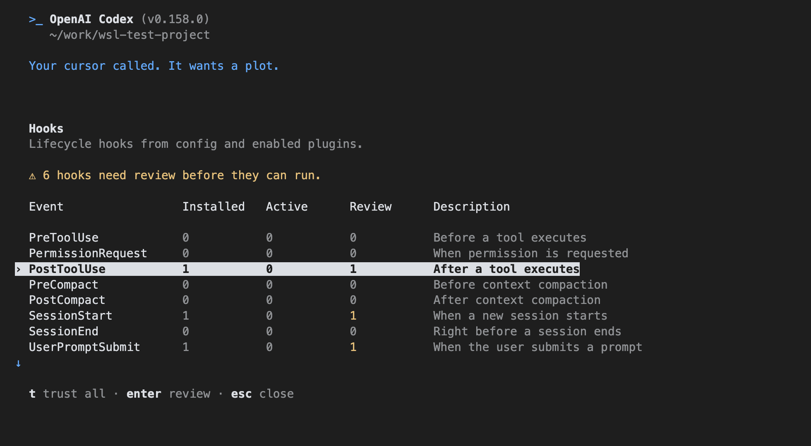
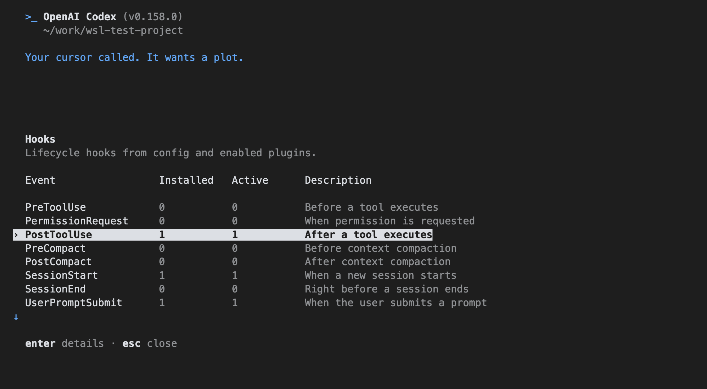

# インストール


> English version: [install.en.md](en/telemetry-install.md)

通常の `scripts/install.sh` は Gemini の連携ファイルも導入・更新します。Gemini を使う場合は利用者が Antigravity CLI を導入し、サインインします。[Gemini の導入ガイド](antigravity.md)

## dsh / Hermes の任意導入

**これまでClaude Code/Codexだけを使っていた方へ：** [DeepSeek・Localを追加する初期設定ガイド](native-setup.md)から始めてください。通常の更新だけでは、アプリの追加やAPIキーの登録は完了しません。以下は詳しい設定を調べるための参照です。

### Ubuntu WSL の Secret Service 参照（実機受け入れ前）

Linux の標準 catalog は、manifest の `backends.<id>.credential_ref` に
`{"store":"secret-service","attributes":{"service":"example-service","account":"example-account"}}`
という非秘密参照を明示した経路を静的に検査します。資格の値は書きません。
attributes の名前は英字で始まる英数字・`_`・`.`・`-`、値は非空の文字列です。
制御文字、option と紛らわしい先頭 `-`、未知の store は拒否します。

同じ backend の参照を dsh・Hermes・DeepSeek 残高の内部 reader が使います。
既存の dsh `keychain` や Hermes `key_cmd` と併記すると
`credential_reference_conflict` で止まります。新しい参照を使わない Mac の設定は維持します。
reader は `/usr/bin/secret-tool` の lookup だけを行い、登録・unlock・平文保存・別資格への fallback はしません。
利用者や agent が内部 reader を直接実行して鍵を表示する確認手順ではありません。

Ubuntu WSL の Secret Service、同じユーザー session の D-Bus、collection の unlock は別途必要です。
`DBUS_SESSION_BUS_ADDRESS` / `XDG_RUNTIME_DIR` は秘密値ではない接続 context として必要な取得 process にだけ引き継ぎます。
`credential_reader_unavailable` は実行 file の不足、`credential_unavailable` は取得不可、
`credential_timeout` は取得時間切れです。catalog の静的な可否は、鍵の存在や unlock を検査しません。
残高の取得不可は会話の成功・失敗とは別に表示します。

ここで確認済みなのは合成 store・設定生成・guard の対照です。実 WSL の版・arch・サービス環境、
runtime の Linux 依存と認証・Mail・終了/resume は受け入れ前です。Secret Service/D-Bus の構築を
動作済みの手順として案内するものではありません。Windows bridge、公開 login CLI、設定の自動移行は含みません。

### 既存の導入と設定

Claude Code / Codex CLI を使う人は、下の共通導入と各 CLI のログインの手順から始めます。API の model を dsh / Hermes で使う人は、先に[対応組合せと制限](https://github.com/gyroid-eth/orrery-telemetry/blob/master/docs/managed-catalog.md)を確認してください。実機で確認した経路は現在 macOS の legacy mode で、WSL2 / Linux の共通導入手順だけでは使えません。

起動までに用意するものは、任意導入する harness、接続先 backend の URL と正式な model ID、資格を取り出す参照、これらを結ぶ私有 manifest と harness 設定、作業 folder と親を使うかの選択です。installer は backend やログインを作らず、共通の provider ログイン機能は設計中です。利用者が設定を準備する工程と、runtime を導入する工程を分けてください。

### 同梱例から設定を準備する

installは `examples/native-harnesses/` に[日本語手順と4つの非有効例](https://github.com/gyroid-eth/orrery-telemetry/blob/master/examples/native-harnesses/README.md)を配ります。導入済みruntimeは所有receipt/currentを検証し、参照入りの `resolved/<snapshot-id>/` を完了時に案内します（B標準）。未導入・model変更・調整では、既存agentが非秘密設定を補助するAの手順を使えます。コピー後の絶対参照3箇所と接続先を合わせ、本人が秘密入力・有効化を承認します。例は常に `enabled: false`、既存例/私有設定は非上書きで、例を置くだけでcatalogを有効にしません。

MacのKeychain形式とLinuxのSecret Service `credential_ref` は同梱手順で区別します。Linux対応sourceの静的準備は、実WSLの秘密取得/接続/Mail/終了/resumeの受入を意味しません。uninstall/purgeは所有記録のhashと一致する未編集の例だけを削除し、利用者コピー・編集済み/未記録fileは保持します。

`install.sh --enable-dsh --dsh-node /absolute/node` はdsh 0.2.1-rc.2 / TUI 0.16.1と標準起動用のnative hook adapter、`--enable-hermes` は固定commit d923a5eb487a17c0a68801bba9ef0f56c81040a8のHermesを `harnesses/{dsh,hermes}/<世代>` へ導入します。両方なら2つのenableを指定します。既定ではどちらも取得せず、更新時は各々の保存済みenabledを継承します。dsh用のNodeは既存の24.2以上を絶対pathで指定し、本体は取得しません。取得はnpm/GitHubとHermesの固定PMに必要な配布元から行います。`--harness-cache PATH` はdshのtarball/npm offline cacheとHermesのlocal sourceを参照します（Hermes PMの依存取得は別です）。`--dry-run` は取得・書込なしです。

Hermes は既存 PM が取得した固定 Node/npm と、同じ固定 source の公式 `scripts/build/node-deps.mjs`・`tui.mjs` を使い、`ui-tui` と `apps/shared` の依存だけを lock に従って準備して、世代内の `tui-product/` を build します。web・desktop・一般 setup は実行しません。TUI recipe は世代 ID に含め、旧 `exa1` と profile を保持して新世代を作ります。Python があっても TUI の欠落・build 失敗があれば新世代を公開せず、従来の `current.json` を保持します。receipt は source・lock・PM の Node/npm・出力の hash を記録し、`keep` でも照合します。dsh 用の外部 Node の指定を Hermes に流用することはありません。Hermes の依存取得と TUI build には通信・追加容量が必要です。

Hermesのsource取得では、明示した `--harness-cache` を最優先します。指定がなければ、所有記録とpathを検証でき、固定commitを持つ既存の管理世代からGit repositoryを独立コピーして再利用します。元repositoryの履歴とtagを残し、未commitの変更は引き継ぎません。利用できる管理sourceがない場合は、従来どおり公式GitHubからcloneします。cacheや選択済みsourceの取得失敗を、別の取得経路への切替で隠しません。固定commitの照合、CA修正とPM依存関係の検証は従来どおりです。対象は既存管理sourceを使える更新であり、新規導入の取得量や所要時間の短縮を保証するものではありません。PMの依存取得には別途通信が必要な場合があります。

Nodeの絶対pathは `AGENTSTACK_DSH_NODE` としてenv.shに保存され、通常の更新で引き継ぎます。旧導入で未保存の場合はdshの `current.json` から補完します。`--managed-spawn-config /absolute/manifest.json` は標準のDeepSeek・Local catalogと起動に使う私有manifestの参照だけを `AGENTSTACK_MANAGED_SPAWN_CONFIG` に保存し、dashboardのlaunchd/systemd/背景起動へ渡します。再起動・次のログイン・通常更新でも保持され、manifest本体や鍵はコピーしません。明示のオプション・環境変数が保存値より優先します。

標準catalogのmanifestを設定済みなら、dshのinstall/updateで固定runtimeからeffortの段と既定を鍵なし・通信なしで取得し、世代内の能力cacheへ保存します。modelやruntime変更後の古いcacheは使わず、未取得時はpickerがunknownになります。手書きのlow/highへ戻しません。未指定の起動はハーネス既定を使います。

`--disable-dsh` / `--disable-hermes` は選択を無効化し、導入済みfileは保持します。通常のuninstallは所有receiptに記録したruntime世代とadapterを削除し、`harnesses/<harness>/profiles` の記憶・skillsは保持します。既存の手動 `hermes-managed` / Hermes homeは読まず触れず、外部Node、提供したcacheも保持します。鍵やログインは導入/移行しません。各harnessの `current.json` がruntimeの絶対参照を記録します。backend URL・model・Keychain service/accountは別途利用者が設定し、起動前に静的に検査します。導入のみでcatalogを利用可にはしません。

設定後は、同梱 dashboard の NEW AGENT または cockpit で Model と利用可能な Harness（dsh／Hermes）を選びます。同梱 dashboard も選んだ harness を spawn API に送ります。[Mail の通し確認](getting-started.md#5-しりとりで通しの確認をする)・[API reference](https://github.com/gyroid-eth/orrery-telemetry/blob/master/docs/api.md)

Hermes の新しい子は project と canonical 名ごとの安定した独立 HOME を使い、正規 resume では保存 pin と exact native session ID を照合して同じ HOME を使います。旧共有 HOME の pin は `native_resume_legacy_profile` で停止し、旧データや pin を自動移行しません。合成 provider を使う実 CLI で保存・同 HOME / ID の復帰・別子との非共有を確認していますが、resume 時に最新 memory を初回 system prompt へ再注入するものではなく、実 provider・full Mail の通し受け入れは未完です。共通 Telegram 入口は設計中、Local の手動 effort は実 Local server での受け入れ前です（[現在の制限](https://github.com/gyroid-eth/orrery-telemetry/blob/master/docs/managed-catalog.md#現在の制限)）。

[README に戻る](../README.md) · [次: Launcher と identity](launchers.md)

この文書は、はじめて ORRERY Telemetry（この repository）を入れる人向けです。3 コマンドで入れて、2 コマンドで確かめ、1 コマンドで最初の agent を起動します。以前 third-party の MCP Agent Mail を使っていた人向けの移行手順は、末尾の[付録](#付録-以前-mcp-agent-mail-を使っていた場合)にまとめました。


installer は `bin/agentstack-resume` も配置します。停止した子の道具を変更する [resume の手順](delegation.md#停止した子の道具を変更して-resume-する)で使います。

installer は完全な repository checkout または source archive から実行してください。`packages/agentstack_mail/src/agentstack_mail/schema_contract.py` と `packages/agentstack_mail/fixtures/global-server-s2a.json` は runtime client と一緒に配置する正本なので、dashboard-only でも必要です。不足時は配備前に `missing runtime client contract` と不足ファイルを表示して停止します。通常の clone・1 行 install・WSL の導入では repository 全体を取得します。

## 動作環境

主対象は macOS です。launcher と hook は macOS 標準 Bash 3.2 でも動くよう実装されています。

必須:

- Python 3.11 以上（`python3`）。全 suite を実測済みなのは 3.12 / 3.13 / 3.14 です。上限は設けていません（CI が 3.11・3.12・3.14 を毎回回すので、新しい Python で壊れた場合はそこで落ちます）
- `tmux`
- `git`
- `uv`（同梱の ORRERY Mail 用の Python 環境を作るために使います）
- `lsof`（稼働中の dashboard がポートを所有しているか確認するときに使用）、`curl`、`xz`（Node の tarball を展開するときに使用）
- Claude Code または Codex CLI。Codex CLI は最新版にしてください（`npm install -g @openai/codex@latest`）。古い版（0.153.4 で確認）では、ChatGPT アカウントで GPT-6 系のモデルが `model is not supported when using Codex with a ChatGPT account` で拒否されます（0.158.0 では通りました）。`agentstack-doctor` は 0.157 より古い版に note を出します

任意:

- `fswatch`: mail watcher。なければ 2 秒間隔の polling に fallback します（通知は届きます）。watcher 自体は installer が launchd / systemd の service として登録するので、agent をどこから起動しても通知が届きます
- `fzf`: 引数なし launcher の directory picker。なければカレントディレクトリを使います
- Ghostty: click-to-jump と window title。iTerm2、Terminal.app、`none` へ fallback。ただし既存ウィンドウの前面化は Ghostty のみで、iTerm2 と Terminal.app では jump のたびに新しいウィンドウが開きます
- Obsidian: `/log` の vault / Daily Note 統合と、vault 内 Output item を開く link。`/log` の Obsidian モードは `AGENTSTACK_OBSIDIAN_APP` を設定して初めて有効になります（installer は設定しません）。未設定なら `/log` はローカルの `logs/` に書き、dashboard は generic project log を非リンク項目として表示します

macOS では launchd の `gui/$UID` domain への実際の bootstrap 成否で常駐経路を選びます。画面スリープ中や SSH 専用環境などで bootstrap できない場合は、dashboard server の終了を検知して再起動する supervised background mode に自動で切り替えます。Linux では systemd user service、利用できなければ同じ supervised background mode を使う実装です。Ubuntu 24.04 / tmux 3.4 では install、dashboard、Codex agent が動いたという利用報告があり、そこで見つかった tmux 3.4 の separator escape（[#26](https://github.com/gyroid-eth/orrery-telemetry/issues/26)）と Codex 履歴の transcript 選択（[#27](https://github.com/gyroid-eth/orrery-telemetry/issues/27)）は修正済みです。`systemd --user` での常駐登録は作者側で未検証です（CI は `systemctl` をスタブにした unit 生成テストのみ）。WSL2（Ubuntu 26.04 / WSL 2.7）では install、Mail、dashboard、`agent-start`、`/delegate` の子、dashboard からの jump（Windows Terminal のタブで attach / resume）まで実機で確認しています。WSL の自動保持と手動停止は、[troubleshooting](telemetry-troubleshooting.md) の WSL2 節を参照してください。Windows native は対象外です。

installer は冒頭で OS、Python、必須 command、ORRERY Mail endpoint（既定 `127.0.0.1:18765`・state root `~/.agentstack/mail`）、install directory の書込権限をまとめて検査します。endpoint が使用中でも、既存の `install-state.json` があれば上書き更新として扱います。新規 install で使用中の場合も socket の所有者を推測して停止せず、health response と canonical database を確認できた場合だけ既存 service を再利用します。無関係または解決不能な listener なら、最初の書き込み前に停止します。

CI や isolated test で platform boundary を意図的に偽装する場合に限り、`AGENTSTACK_PREFLIGHT_SKIP_OS=1`、`AGENTSTACK_PREFLIGHT_SKIP_PYTHON=1`、`AGENTSTACK_PREFLIGHT_SKIP_COMMANDS=1`、`AGENTSTACK_PREFLIGHT_SKIP_PORT=1`、`AGENTSTACK_PREFLIGHT_SKIP_WRITABLE=1` で各検査を個別に skip できます。skip は依存を提供せず、未対応環境を対応済みに変えるものでもありません。

`AGENTSTACK_PYTHON` を指定した場合も Python 3.11 以上か検証します。未指定時は PATH 上の `python3` を検査し、不適格なら version 付き command や `/opt/homebrew/bin/python3`、`/usr/local/bin/python3` も探索します。互換 interpreter がなければ、サービス file を生成する前に検査した version と path を示して停止します。

## インストール

```bash
git clone https://github.com/gyroid-eth/orrery-telemetry.git
cd orrery-telemetry
./scripts/install.sh --project-key /absolute/path/to/your-project
```

`--project-key` には、agent たちに作業させる project の絶対パスを渡します（この repository の checkout ではありません）。初回は必須で、未指定なら installer は何も書かずに停止します。2 回目以降は前回の値を `~/.agentstack/env.sh` から引き継ぐので省略できます。

installer は変更がある場合に、Claude の MCP 登録と settings、Codex の利用者指示、Claude の利用者指示の最大4項目を確認します。指示の保存先は `$CODEX_HOME/AGENTS.md` と `$CLAUDE_CONFIG_DIR/CLAUDE.md`（既定 `~/.codex/AGENTS.md` と `~/.claude/CLAUDE.md`）です。既存の内容は marker の外に保持し、変更前の backup を残します。確認の条件と非対話時の扱いは [同意](instruction-migration.md#consent)、後から個別に入れるには [Claude Code から ORRERY Mail を使う](#claude-code-から-orrery-mail-を使えるようにする) を参照してください。

installer が置くもの:

- `~/.agentstack/` に dashboard、launcher、hook、skill、同梱の ORRERY Mail、`env.sh`、`VERSION`、`install-state.json`
- `~/.claude/skills/{delegate,log}` と `${CODEX_HOME:-~/.codex}/skills/{delegate,log}`（`~/.agentstack/skills/` への symlink）
- 既定の常駐構成は dashboard（port 8770）、ORRERY Mail の自動起動（新規の既定 `http://127.0.0.1:18765/mcp`）、Mail watcher です。対応する環境では launchd（macOS）または systemd user（Linux）に登録します。dashboard は登録できない場合、supervised background mode で動きます。既存 Mail を再利用する場合、実際の listener は既定の自動起動 job と異なることがあります。[Mail service の扱い](#orrery-mail-service-の扱い)

`env.sh` は mode `0600` で、token は書き込みません。shell の dotfile は変更しません。

### 確認

```bash
~/.agentstack/bin/agentstack-doctor
~/.agentstack/bin/agentstack-selftest
open http://127.0.0.1:8770/
```

`agentstack-doctor` は、必要な file と設定が揃っているか、dashboard の `/api/version` が実際に応答しているか、launchd / systemd への登録と実行状態はどうかを別々に報告します。endpoint が応答しているのに manager が実行していない場合は `unmanaged-background` と出ます。

`agentstack-selftest` は実際に 2 つの agent を登録し、message の往復と file reservation を行い、その結果を dashboard が同じ DB から読めているところまで確かめます。install 後は必ず一度実行してください。

### 最初の agent を起動する

install 前から開いていた Claude Code session は、新しく入った skill を再走査しません。既存 session を `/exit` してから、新しい terminal で project を指定して起動します。

```bash
export PATH="$HOME/.agentstack/bin:$PATH"
agent-start /path/to/your-project
# Codex CLI なら
agent-start-codex /path/to/your-project
```

`agent-start` は ORRERY Mail の identity と同名の tmux session を作ります。dashboard の jump、mail 通知、token 復旧はこの名前で結びつきます。起動した Claude Code では `/delegate` のように先頭の slash を付けて skill を呼びます。Codex では `$delegate`（ログは `$log`）または `/skills` で選択します。初回の child 起動は [Skills と file reservation](launchers.md#skills2件と-file-reservation) を参照してください。

## Windows（WSL2）で入れる

Windows では WSL2 の Ubuntu の中に入れます。Ubuntu の中は Linux なので、上の手順がそのまま使えます。以下は Windows 11 + Ubuntu 26.04 / WSL 2.7 で通した順番です。

1. **WSL2 と Ubuntu を入れる**（PowerShell、初回のみ）。
   ```powershell
   wsl --update
   wsl --install -d Ubuntu
   ```
   最後にユーザー名とパスワードを聞かれます。`Wsl/Service/E_UNEXPECTED` のようなエラーで止まるときは、先に `wsl --update` を通してから `wsl --install` をやり直します。
2. **Ubuntu の中に入る。** 以後のコマンドはすべて Ubuntu のプロンプト（`user@PC:~$`）で打ちます。PowerShell のプロンプト（`PS C:\...>`）で打つと `&&` の時点で失敗します。
   ```powershell
   wsl -d Ubuntu
   ```
3. **前提を入れる**（Ubuntu の中）。
   ```bash
   sudo apt update && sudo apt install -y ca-certificates curl git tmux python3 python3-venv lsof xz-utils
   curl -LsSf https://astral.sh/uv/install.sh | sh
   export PATH="$HOME/.local/bin:$PATH"
   uv --version
   ```
   Hermes を入れる場合は `sudo apt install libatomic1` も実行します。
   `fswatch` は任意です。無くても mail watcher は 2 秒間隔の polling で通知を届けます。
4. **clone して installer を走らせる**（Ubuntu の中）。project は WSL 側のパス（`~/work/...`）にしてください。`/mnt/c` 配下は遅く、権限の扱いも違います。
   ```bash
   git clone https://github.com/gyroid-eth/orrery-telemetry.git
   cd orrery-telemetry
   ./scripts/install.sh --project-key ~/work/your-project
   ```
   対話で出た変更だけ、それぞれの preview に従って承認します。`dashboard healthy` は dashboard が応答することを示します。次に [確認](#確認) の doctor と selftest を実行します。
5. **dashboard を開く。** Windows のブラウザで `http://127.0.0.1:8770/` を開きます。WSL2 の localhost は Windows 側に転送されるので、そのまま届きます。
6. **Claude Code か Codex CLI を Ubuntu の中に入れてログインする。** Windows 側に入れたものは使えません（agent は Ubuntu の tmux の中で動きます）。
   ```bash
   # Claude Code（native installer。~/.local/bin に入る）
   curl -fsSL https://claude.ai/install.sh | bash
   # Codex CLI（Node.js が要る。global install は home の下にして sudo を避ける）
   sudo apt install -y nodejs npm
   npm config set prefix ~/.npm-global
   echo 'export PATH="$HOME/.npm-global/bin:$HOME/.local/bin:$PATH"' >> ~/.bashrc && source ~/.bashrc
   npm install -g @openai/codex@latest
   ```
   ログインは `claude`（起動後に `/login`）と `codex login` です。表示された URL を Windows 側のブラウザで開いて認可します。
   Windows 側にも Codex を入れている場合、Ubuntu の PATH には Windows の `codex`（`/mnt/c/...`）も見えますが、これは Ubuntu の中では動きません。installer はそれを候補から外し、Ubuntu の中に入れた `codex`（`--version` に答えるもの）を選びます。agent が `/delegate` で Codex の子を起動するときも同じ規則で選び、agent の shell に `AGENTSTACK_CODEX_BIN` が無ければ、installer が `~/.agentstack/env.sh` に保存した値を使います。以前の install で Windows の `codex` が保存されていても、再実行すると選び直します。`agentstack-doctor` が `warn: Codex launcher binary ... cannot start Codex` と出したら、Ubuntu の中に Codex を入れてから installer を再実行してください。 理由の部分は 2 通りです。`exited with status N after 0s: …` は `codex --version` がすぐにエラーで終わったことを示し、続く 1 行がそのエラーです（`Missing optional dependency …` なら、その shell の PATH にある node が Codex を入れた版と違います。login shell（`zsh -lc` など）から installer を実行するか、`--codex-bin` で指定します）。`did not finish within 10s and was stopped` は時間内に応答しなかったことを示します。
   以前から Ubuntu に Codex が入っている場合も、`npm install -g @openai/codex@latest` で最新にしてください。古い版では GPT-6 系のモデルで起動した子が API に拒否されます（WSL で 0.153.4 は拒否、0.158.0 は応答）。
   Codex の子を使うなら、installer の後で [history binding を入れて `/hooks` で一度承認](#codex-を使う場合-history-binding-を入れて-hooks-で一度承認する) してください。しないと、Codex の起動が最大で約90秒待たされることがあります。
7. **agent を起動する**（Ubuntu の中）。上の「最初の agent を起動する」と同じコマンドを打ちます。dashboard の jump は Windows Terminal（`wt.exe`、Windows 11 なら標準搭載）の新しいタブを開いて tmux に attach します。Windows Terminal が無い場合は Microsoft Store から入れてください。

**WSL の自動保持は従来モードの dashboard で既定で有効です。** agent の稼働・起動中や dashboard の表示中は、隠れた `wsl.exe` で WSL を保持します。無活動が60秒続くと dashboard は保持を手放します。他の Windows プログラムが使っていれば WSL は動き続けます。状態表示と手動での対処は [troubleshooting の WSL2 節](telemetry-troubleshooting.md#wsl2-で-ubuntu-の窓を閉じたとき) を参照してください。

`systemctl --user` が使えて linger が有効な WSL では、installer が dashboard の user unit を有効にします。Ubuntu の起動時から使うには、Ubuntu 内で `loginctl enable-linger "$USER"` を実行してから導入してください。linger を確認できない環境では supervised background で起動します。WSL の自動保持は Windows 側のクライアントが担います。

## 非対話で入れる（`--assume-yes`）

確認の条件と非対話時の扱いは [同意の契約](instruction-migration.md#consent) を参照してください。repository と preview 内容を確認した利用者本人が事前に承認した場合だけ次を使えます。

```bash
./scripts/install.sh --project-key /absolute/path/to/your-project --assume-yes
```

`--assume-yes`（短縮 `-y`、環境変数 `AGENTSTACK_ASSUME_YES=1` も同じ）は approval の事前付与であり、`--force` ではありません。Python 3.11 未満、dashboard port の競合、既存 ORRERY Mail DB の複数候補・不存在・稼働 server との不一致、自動 setup の失敗は従来どおり停止します。自動承認した項目は `assume-yes:` 行として個別に出力されます。agent や自動化が「便利だから」とユーザーの明示選択なしにこの option を付けてはいけません。command-line の指定は環境変数より優先され、生成する `env.sh` には残しません。

## Install tier と option

| 呼び出し | Tier | 内容 |
| --- | --- | --- |
| `./scripts/install.sh` | Tier 1 / default | 全 payload と Claude / Codex skill link。hooks・permissions と Codex / Claude managed block は preview 後、承認時だけ merge |
| `./scripts/install.sh --dashboard-only` | Tier 0 | dashboard と helper のみ。hooks、skills、Codex / Claude template は導入しない |
| `./scripts/install.sh --scoped` | Tier 2 placeholder | payload は導入するが、user settings / managed docs は変更しない |
| `./scripts/install.sh --dry-run` | preview | 変更予定を表示し、file や service を変更しない |

`--dashboard-only` と `--scoped` は排他的です。不明 option や値不足は変更前に停止します。

```text
--install-dir PATH      default: ~/.agentstack
--project-key PATH      first install: required / re-install: existing env.sh
--port PORT             default: existing env.sh, else 8770
--label-prefix PREFIX   default: existing env.sh, else org.agentstack
--terminal MODE         auto | ghostty | iterm | terminal | none (default: existing env.sh, else auto)
--reset-settings        前回の env.sh から設定を引き継がない（Upgrade 参照）
--spawn-dirs PATHS      NEW AGENT の launch directory preset（`:` 区切り）
--spawn-roots PATHS     directory typeahead が閲覧できる root（`:` 区切り）
--child-sandbox MODE    親付きの子の sandbox（on | off、既定 off）
--codex-approval MODE   Codex child の `--ask-for-approval`（never | on-request | on-failure | untrusted、既定 never）
--codex-network MODE    Codex child の sandbox network（on | off、既定 on）
--child-default-tools SPEC  子の既定の道具（例: 'mcp:cua-driver;dsh=' で dsh だけ既定なし）
--codex-add-dirs PATHS  Codex child に追加で書込を許す root（`:` 区切り）
--retire-legacy-mail    付録参照（以前の MCP Agent Mail を退役させる）
--mail auto|update|keep 稼働中の ORRERY Mail をどうするか（既定 keep。--update-mail / --keep-mail はその別名）
--update-mail           稼働中の ORRERY Mail をこの checkout の build に必ず差し替える（できなければ exit 1。docs/agentstack-mail-update.md）
--keep-mail             稼働中の ORRERY Mail の build を差し替えない（既定。AGENTSTACK_MAIL_UPDATE=auto は安全なときだけ差し替える）
--print-mail-plan       ORRERY Mail をどうするかを 1 行出して終わる（読むだけ）
-y, --assume-yes        approval prompts only; validation errors remain fatal
```

`--project-key` は、明示した値がいつでも最優先です。次に環境変数 `AGENTSTACK_PROJECT_KEY` / `PROJECT_KEY`、最後に install 先の既存 `env.sh` を見ます。`--spawn-dirs` / `--spawn-roots` も同じ順序で解決し、再インストール時は前回の値を引き継ぎます（詳細は [configuration.md](telemetry-configuration.md) の「Spawn directory」）。`--bin-dir` は公開 option ではありません。permissions template の `__AGENTSTACK_BIN_DIR__` を展開するため、installer が内部で `agentstack-merge-settings --bin-dir "$INSTALL_DIR/bin"` を呼びます。

## Settings、permissions、Claude skill の merge

Tier 1 の merge は `scripts/lib/merge_settings.py` による JSON parser ベースです。

- 既存の hooks、permissions、その他の user settings を保持
- ORRERY Telemetry が追加する値だけを重複なしで追記
- merge 前の settings backup を `~/.agentstack/backups` に保存
- 追加した entry と変更結果を manifest に記録
- managed block は marker 間だけを idempotent に更新
- `install-state.json` を uninstall の削除範囲の正本にする

ORRERY Mail の tool に対する permissions の `deny` は、**不可逆で復旧手段がない操作だけ**に限定します。破壊的でも復旧できる操作は allow にも deny にも入れず、実行時の人間による確認に委ねます。また、allow 済みの別 tool で同じ状態へ到達できる場合は、deny に追加しても安全上の意味がないため追加しません。現在 deny する ORRERY Mail の tool は `hard_delete_agent`、`hard_delete_project`、`purge_old_messages` の 3 つです。これとは別に、下の skill directory への `Edit` を 1 つ deny します。

installer が置いた skill（`~/.agentstack/skills` と、そこを指す `~/.claude/skills/<name>` の symlink）は `additionalDirectories` に入れ、作業 directory の外でも確認なしで読めるようにします。新しい環境の親 agent が `/delegate` の SKILL.md を読む時点で、作業 directory の外を読むかどうかの確認で止まらないためです。読み取りだけに絞るため、同じ場所への `Edit` は deny に入れます。この deny が止めるのは Claude Code の file tool（Edit・Write など）と、それと分かる Bash の書き込みです。sandbox なしで動く Python や Node を通した間接的な書き込みまでは止めません。利用者が自分で置いた同名の skill は対象にしません。

単純な文字列置換ではなく構造を読んで merge するのは、再インストールと uninstall でユーザー設定を巻き込まないためです。

`skillsDirectories` は Claude Code の setting ではなく、installer は新しい値を追加しません。skill payload の正本は `~/.agentstack/skills/<name>` のままにし、Claude Code が標準で読む `~/.claude/skills/<name>` および Codex の `${CODEX_HOME:-$HOME/.codex}/skills/<name>` へ絶対 symlink を作ります。

```text
~/.claude/skills/delegate -> ~/.agentstack/skills/delegate
~/.claude/skills/log      -> ~/.agentstack/skills/log
~/.codex/skills/delegate  -> ~/.agentstack/skills/delegate
~/.codex/skills/log       -> ~/.agentstack/skills/log
```

同じ ORRERY Telemetry payload を指す symlink がすでにある場合は再利用し、manifest に所有登録します。この link は payload と一緒に無効になるため、uninstall では削除対象です。同名の file、directory、または別 target の symlink がある場合は warning を出して保持し、所有登録しません。uninstall は manifest の path と実際の symlink target を照合し、所有登録された、ORRERY Telemetry payload を指す symlink だけを削除します。利用者が file や directory に置き換えた path、または retarget した symlink は残します。

上の Codex の例は `CODEX_HOME` が未設定の場合です。設定済みなら、その directory の `skills` に置きます。リンクの再利用・競合保持・manifest 記録・uninstall の規則は両方に適用します。Codex の managed block の呼び出し案内は、通常の `agentstack-codex-setup` の preview / 承認による更新で反映します。

旧 installer が `skillsDirectories` に `~/.agentstack/skills` を追加していた環境では、Tier 1 の settings merge を承認した再インストール時にその旧 ORRERY Telemetry entry だけを削除します。同じ配列の他の user value と、それ以外の settings は保持します。

installer は shell dotfile を変更しません。Claude の管理された指示は利用者の `$CLAUDE_CONFIG_DIR/CLAUDE.md`（既定 `~/.claude/CLAUDE.md`）の marker 内に置きます。旧 project の block の扱いは [指示の移行](instruction-migration.md#legacy-blocks) に従います。Claude Code user settings の既定位置は `~/.claude/settings.json` で、`AGENTSTACK_CLAUDE_SETTINGS` で変更できます。

## Claude Code から ORRERY Mail を使えるようにする

`/delegate` skill は `mcp__orrery-mail__*` tool を許可し、Claude Code の user-scope MCP server 名も **`orrery-mail` 固定**です。

Tier 1 installer は `AGENTSTACK_CLAUDE_JSON`（既定 `~/.claude.json`）の `mcpServers` を構造として読み、既存の他 server と project 設定を保持したまま次の entry だけを追加・更新します。

```json
{
  "mcpServers": {
    "orrery-mail": {
      "type": "http",
      "url": "http://127.0.0.1:18765/mcp"
    }
  }
}
```

diff preview では bearer token を `<redacted>` に置き換えます。対話で `yes` と答えた場合、またはユーザーが明示した `--assume-yes` の場合だけ mode `0600` で atomic write し、元 file を `~/.agentstack/backups` に保存します。非対話で未承認なら書き込まず、installer と `agentstack-doctor` が安全な preview / apply コマンドを表示します。`agentstack-selftest` は HTTP server の動作だけでなく、この固定名・endpoint・authorization の登録も検査します。

install 時に `no` と答えた、または登録が無い場合は、doctor の出力に従って preview してください。

```bash
~/.agentstack/bin/agentstack-doctor
```

Codex child は launcher が child-scoped MCP proxy config を自動生成します。top-level Codex CLI を `agent-start-codex` から使う場合は、`$CODEX_HOME/config.toml` に次を一度設定します。bootstrap が `MCP_AGENT_MAIL_TOKEN` を process environment に読み込むため、token 自体を TOML に保存する必要はありません。

```toml
[mcp_servers.orrery-mail]
url = "http://127.0.0.1:18765/mcp"
```

key は `[mcp_servers.orrery-mail]` に固定します。

### Codex を使う場合: history binding を入れて `/hooks` で一度承認する

Codex の子を起動すると、launcher は子が最初の task を始めたことを、その起動の Codex の記録（rollout）で確かめます。この確認には、Codex の history binding（任意の plugin）が起動時に残す receipt が要ります。**入れていないと、Codex の起動が最大で約90秒待たされることがあります**（短い応答が画面に出れば待機を早く終えることがありますが、それは receipt による開始の確認とは違い、長い応答では90秒待つことがあります）。receipt が出る状態にすると、WSL の実機で短い task も長い task も約7秒で確定しました。

macOS・WSL（Ubuntu の中）とも、手順は同じです。

1. integration を入れる（repository の checkout で）。

   ```bash
   . "$HOME/.agentstack/env.sh"
   ./scripts/install-codex-app-integration.sh \
     --project-key "$AGENTSTACK_PROJECT_KEY" \
     --agent-mail-url "$AGENTSTACK_MCP_URL"
   ```

   codex は、core の installer が `~/.agentstack/env.sh` に保存したものを使います（WSL で Windows 側の `codex` は選びません）。macOS 以外では Bridge の常駐 service は入れず、`Bridge service: not installed` と表示します。Codex の子の history binding には、常駐 service は要りません。
2. installer が選んだ codex で Codex を起動し、`/hooks` を開く。installer は最後に、そのためのコマンドを `Next: start Codex with the codex this installer used:` の次の行に表示します。通常は次と同じです。

   ```bash
   "$AGENTSTACK_CODEX_BIN" -C "$AGENTSTACK_PROJECT_KEY"
   ```

   素の `codex` は使わないでください。WSL では PATH の先頭に Windows 側の `codex` があることが多く、それは Ubuntu の中では動きません。`/hooks` を開くと、確認が要る hooks とその件数が表示されます。

   

3. 内容を確かめてから承認する（`t` ですべてを trust）。承認した hook が Active になります。

   

4. その `codex` を終了する。承認は、この後に起動した Codex から効きます。すでに動いている Codex の子には効きません。

`agentstack-doctor` は、history binding の plugin が入っているか、有効かを表示します。hooks の承認状態までは読めないので、そこは `/hooks` で確かめてください。詳しくは [Codex App 統合](codex-app.md) を参照してください。

### Managed instruction helper

Tier 1 が preview / merge に使う helper は単独でも実行できます。

```bash
~/.agentstack/bin/agentstack-codex-setup --print
~/.agentstack/bin/agentstack-claude-setup --print
```

`--print` は placeholder を解決した block と対象を表示するだけで変更しません。

`--check` は、対象にすでにある block と、インストール済みの template が今 render する block を比べます。何も変更しません。marker の間の文面が一致するときだけ `ok` を出します。一致しないときは、違う（古い指示、または手で編集した）・無い・marker が壊れている、のどれかを示し、解決済みの `CODEX_HOME` や scope を含む更新コマンドを表示します。marker の外の文面は比べません。`agentstack-doctor` と installer の最後も、同じ検査を使います。managed setup を skip したときは、installer が最後に `Runtime updated; managed instructions differ` とそのコマンドを出します。コマンドを実行するまで、その後に起動した agent は古い block を読みます。

```bash
~/.agentstack/bin/agentstack-codex-setup --check
~/.agentstack/bin/agentstack-claude-setup --check
```
引数なしでは既存 file を backup し、marker 間の ORRERY Telemetry block だけを install / update します。

```bash
~/.agentstack/bin/agentstack-codex-setup
~/.agentstack/bin/agentstack-claude-setup
```

Claude は利用者の `$CLAUDE_CONFIG_DIR/CLAUDE.md`、Codex は `$CODEX_HOME/AGENTS.md` へ設置します。`--uninstall` は記録した marker のみ撤去し、全文 backup を保持します。既存 block・中断・共有 repo・purge は[指示の移行](instruction-migration.md)を参照してください。

## ORRERY Mail service の扱い

同梱の ORRERY Mail は、launcher が要求した identity をそのまま登録する設定（`AGENTSTACK_MAIL_AGENT_NAME_ENFORCEMENT_MODE=passthrough`）で動きます。既定 endpoint は `http://127.0.0.1:18765/mcp`、state root は `~/.agentstack/mail` です。HTTP bearer は使わず、各 agent の owner token は tool argument / local proxy で扱います。

installer は endpoint に既に何かが応答している場合、それが同じ DB を返す ORRERY Mail のときだけ再利用し、別 DB を返す listener は再利用せず最初の書き込み前に停止します。新規環境では同梱 package の venv を candidate ID ごとに配置し、空 state を初期化して、health response が設定した DB を返すまで確認してから先へ進みます（内部構成は [agentstack-mail 文書](https://github.com/gyroid-eth/orrery-telemetry/blob/master/docs/agentstack-mail.md)）。

service の操作は次の controller で行います。runner 自身がクラッシュを 5 秒後に再起動し、controller は PID file と endpoint と DB を照合して、二重起動や無関係な process の停止を拒否します。

```bash
~/.agentstack/bin/agentstack-mailctl start
~/.agentstack/bin/agentstack-mailctl status
~/.agentstack/bin/agentstack-mailctl stop
~/.agentstack/bin/agentstack-mailctl restart
```

dashboard 側のサービス登録や health check が失敗しても、payload、承認済み managed block、`install-state.json` の生成は完了し、installer は warning と supervised background の手動起動コマンドを最後に表示します。mail service の provisioning / DB health が失敗した場合は install を停止します。実際の dashboard 常駐方式は `~/.agentstack/dashboard/agentctl.sh status` と `agentstack-doctor` で確認できます。

## VERSION

version の正本は repository 直下の `VERSION` です。installer は install root にコピーします。

`GET /api/version` は次の順で version を解決します。

1. install 済み artifact に隣接する `VERSION`
2. repository の `VERSION`
3. `git describe --tags --always --dirty`
4. `unknown`

dashboard の HTML だけをコピーせず `VERSION` も installer 経由で更新してください。配布物と表示 version を一致させるためです。

## macOS の TCC / Full Disk Access

`~/Desktop`、`~/Documents`、`~/Downloads` は macOS TCC の保護対象です。Full Disk Access のない terminal から root agent を起動すると、その terminal identity が tmux と子孫へ伝播し、子 agent だけ `EPERM` になることがあります。

対処:

1. root agent を Full Disk Access 済み terminal から起動
2. または project を保護対象外へ移動
3. context を変えた後は既存 tmux server / session を作り直す

launcher はこの状態を警告します。必要なら:

```bash
export AGENTSTACK_TCC_GUARD=0
export AGENTSTACK_TCC_DIRS="$HOME/Desktop:$HOME/Documents:$HOME/Downloads"
```

`AGENTSTACK_TCC_DIRS` は `:` 区切りが正本です。colon を含まない旧 whitespace 区切りも compatibility のため引き続き受け付けます。

権限エラーを `chmod` だけで直そうとしないでください。判定主体は file mode ではなく起動元 app です。

## Upgrade

保護設定の更新前に作業を完了するか active file reservation を解放し、更新後に影響する session をまとめて再起動してください。先に選択される root を preview します。

```bash
git pull
./scripts/install.sh --dry-run
./scripts/install.sh
~/.agentstack/bin/agentstack-doctor
```

installer は payload と `VERSION` を更新し、service を再登録して、managed merge を再び preview します。同梱 ORRERY Mail の candidate と state を検証して再利用します。

更新の後は、動いている agent（Claude Code・Codex・dsh・Hermes、常駐 bot を含む）を起動し直してください。managed block の指示と ORRERY Mail の道具の一覧（`show_files` など）は session の起動時に読み込まれるので、起動し直すまでは更新前のままです。managed merge の preview を承認しなかった場合は、指示も更新されません。

### Reservation 保護設定の移行

対象の top-level と delegated child 起動は、順序付き `AGENTSTACK_EXTRA_PROTECTED_ROOTS` の後に選択した物理作業 directory を保護します。Git root へ自動拡張はしません。namespace の選択と installed project key は変えません。install/update は process extras（空も含む）、installed extras（空も含む）、installed の旧 `AGENTSTACK_PROTECTED_ROOTS` の literal 値と順序をそのまま一度だけ、最後に空、の順で自動選択します。ambient shell/tmux の旧 root は取り込みません。移行元・値・保存先を `--dry-run` でも表示し、不正・曖昧な旧設定は上書き前に停止します。

空でも extras marker を永続化するため、旧 list を再取り込みしません。installed の旧 field は direct/unmanaged hook 互換のためだけに保持し、managed 起動は無視します。shell/tmux の旧値が非空で installed 値と異なれば、extras があっても警告します。`--reset-settings` は extras を保持し、`AGENTSTACK_EXTRA_PROTECTED_ROOTS=` で明示的に解除できます。相対 reservation 名は最初に一致する root から決まるため、cutover 前に作業を完了するか active reservation を解放し、更新後に影響する session をまとめて再起動してください。[設定と移行の詳細](telemetry-configuration.md#reservation-の保護範囲と移行)を参照してください。

### 前回の設定の引き継ぎ

更新後に起動・再開する親付きの子は、既定で sandbox を使いません。sandbox を使う場合は installer に `--child-sandbox on` を付けます。一度保存した設定は次回の更新にも引き継がれます。[provider ごとの設定](telemetry-configuration.md#child-spawn)

入れ直しでは、各設定を次の順で決めます。

1. 明示した値（option、または installer を起動したときの環境変数）
2. 前回の install が書いた `~/.agentstack/env.sh` の値
3. 既定値

したがって、既定値から変えた設定は、環境変数のない新しいターミナルで `./scripts/install.sh` を実行しても保たれます。対象は project key と明示した追加 protected roots、dashboard port（`AGENTSTACK_PORT`）、label prefix（`AGENTSTACK_LABEL_PREFIX`）とそこから決まる ORRERY Mail の launchd label、terminal、MCP URL、service の `PATH`、Python、ORRERY Mail の state root（DB の場所）と service root と management socket、`AGENTSTACK_LANG` / `AGENTSTACK_MURMUR` / `AGENTSTACK_DELIVERABLE_ROOTS`、`AGENTSTACK_VAULT`、`AGENTSTACK_MANAGED_AGENTS_FILE`、dashboard の log と再起動の設定（`AGENTSTACK_DASHBOARD_LOG` / `_LOG_MAX_BYTES` / `_LOG_BACKUPS` / `_RESTART_DELAY`）、spawn の dirs / roots、worktree root、Codex child の設定、`AGENTSTACK_CODEX_BIN`、portraits、model catalog です。一覧は `hooks/project-context.sh` の `AGENTSTACK_INHERITED_SETTINGS` が正本です。

- **今の既定値と違う保存済みの値は、そのまま引き継ぎます。** `AGENTSTACK_CHOSEN_SETTINGS` が無い場合や、対象の設定名が未列挙の場合も同じです。子のターミナル自動表示や肖像フォルダーなどの設定は、次の更新に備えてこの一覧へ記録します。`PATH` と Python も対象です。一覧に記録された設定は、今の既定値と同じ値でも引き継ぎます。`AGENTSTACK_CODEX_BIN` は探して見つけた場所も引き継ぎます（使えなくなっていれば探し直します）。 保護の追加 root は `AGENTSTACK_CHOSEN_SETTINGS` にかかわらず、上記の設定の有無に基づく移行順で選びます。
- 前回の値を変えるには、その option か環境変数を明示します（例: `./scripts/install.sh --port 8771`）。
- **1 つだけ既定値に戻すには、空の値を明示します**（例: `AGENTSTACK_VAULT= ./scripts/install.sh`、`./scripts/install.sh --codex-add-dirs ""`）。`env.sh` からその設定の値の行を削除した場合も、今回明示した値がなければ既定値になります。`AGENTSTACK_CHOSEN_SETTINGS` から設定名だけを削除しても、保存済みの非既定値は引き継ぎます。
- 選んだ値をまとめて既定値に戻すには `--reset-settings`（または `AGENTSTACK_RESET_SETTINGS=1`）を付けます。ただし、データの置き場所と、そこで動いている service の名前は reset でも引き継ぎます。project key、明示的な追加 protected roots、ORRERY Mail の state root・service root・management socket、label prefix、ORRERY Mail の launchd label、MCP URL です。これらを reset で既定値に戻すと、前の service が登録されたまま、同じ DB に別の名前の ORRERY Mail が立つためです。変えるときは明示してください（前の service は自分で止める必要があります）。 共有予約の保護を黙って外さないため、明示した追加 root は reset 後も引き継ぎます。解除する場合は `AGENTSTACK_EXTRA_PROTECTED_ROOTS=` を指定します。
- 環境変数の値が `env.sh` に記録された値と同じ場合は、`env.sh` を読み込んだ shell や ORRERY cockpit の更新 script から来た値とみなし、新しく選んだ値としては扱いません（通常は上記の規則で引き継ぎ、`--reset-settings` では既定値に戻ります）。option で渡した値は常に明示です。選んだ設定の記録が無い以前の版の `env.sh` に対しては、同じ値でも明示として扱います（毎回明示してきた値を既定値に戻さないため）。
- 前回記録した Python が無くなっていた・古すぎる場合は、通知を出して探し直します（明示した `AGENTSTACK_PYTHON` が使えない場合は従来どおり停止します）。
- `AGENTSTACK_CLAUDE_JSON` は引き継ぎません。試験用に別の場所へ入れるための差し替え口で、次の通常の install は `~/.claude.json` に書きます。
- ORRERY Mail の service env（`AGENTSTACK_MAIL_ENV`）と DB path（`AGENTSTACK_MAIL_DB`）は引き継ぐ設定ではなく、state root と render から毎回決め直します（下記）。

dry-run の冒頭に、決まった project key・port・label prefix・terminal・MCP URL が表示されます。`AGENTSTACK_AUTO_OPEN_CHILD` と `AGENTSTACK_PORTRAITS_DIR` に実際の変更がある場合は、reset も含めて旧値 → 新値を表示します（空の値は `(empty)`）。

`env.sh` を shell の起動時に読み込んでいる場合、その shell の `AGENTSTACK_*` は「明示した値」として扱われます。別の shell で入れ直した後は、新しい shell を開くか `env.sh` を読み直してから launcher や installer を使ってください。

稼働中の ORRERY Mail の build はそのまま使い続け、この checkout の build と違えば `notice:` で知らせます。build も差し替えるときは `--update-mail` を付けます。candidate の検証と database の backup を Mail を止めずに済ませてから切り替え、新しい build が応答しなければ前の build に戻します。`AGENTSTACK_MAIL_UPDATE=auto`（opt-in）は、安全に差し替えられるときだけ差し替え、だめなら今の build を残して install を成功させます。最後の `mail-result:` 行が結果を示します（[agentstack-mail-update.md](agentstack-mail-update.md#--update-mail-による差し替え)）。

**in-place upgrade 中も ORRERY Mail server は稼働させたまま**にしてください。稼働 listener から解決した実 DB path は filesystem の候補探索より優先されます。ORRERY Mail を先に止めると候補探索へフォールバックし、複数の DB がある環境では誤選択を避けるため installer が停止します。

`AGENTSTACK_MAIL_ENV` は installer が `env.sh` に書き出す runtime の値で、shell 起動時に読まれます。render のパスは source id と venv / endpoint / state の hash から決まるため、**前回の install が書いた値は次の upgrade の期待値と一致しません**。installer は、継承した値が「**読み取れた `env.sh` の値と一致し、かつこの install の管理 render 配置**（`<native service root>/renders/<1 階層>/service.env`）にある」ときに限り、set されていなかったものとして扱い、現在の render を解決します。この免除は 1 行の通知とともに行われます。

**値が等しいことは、誰がその変数を設定したかの証明にはなりません。** upgrade をまたいで native path を固定したい場合は `AGENTSTACK_MAIL_SERVICE_ENV` を明示してください。そちらが優先され、免除の対象になりません。管理 render 配置の外にあるパスは、従来どおり不一致として停止します。

長く生きた shell が、別の shell で更新された後の古い render を保持している場合は、現在の `env.sh` を読み直すか、その install コマンドに限って `env -u AGENTSTACK_MAIL_ENV ./scripts/install.sh` を使ってください。

dashboard port を現在の ORRERY Telemetry launchd job または supervised-background pidfile 配下のプロセスが保持している場合、installer は所有者を照合してその dashboard を新しい payload で置換します。同じ port を無関係なプロセスが保持している場合は、従来どおり停止します。

service の environment は install 時に plist / unit へ書き込まれます。`~/.agentstack/env.sh` を変更しただけでは既存 service に反映されないため、installer を再実行するか service definition も更新してください。

## Uninstall

```bash
~/.agentstack/bin/agentstack-uninstall --dry-run
~/.agentstack/bin/agentstack-uninstall
```

uninstaller は `install-state.json` に記録された file、service、settings 変更だけを対象にします。

- merge した Claude settings entry を構造的に除去
- ORRERY Telemetry 所有 file を削除
- 空になった所有 directory だけを削除
- ORRERY Mail state / DB と runtime directory（annotation、token、session state / log）は既定で保持

旧 `dashboard/annotations.json` は user state として payload の owned file に含めません。upgrade 時は installer が payload copy の前に `$AGENTSTACK_RUNTIME_DIR/annotations.json` へ自動移行し、通常の uninstall 後も runtime directory に保持します。

保持データも削除する場合:

```bash
~/.agentstack/bin/agentstack-uninstall --purge-data
```

`--purge-data` も manifest に記録された exact path だけを対象にし、home directory や未記録 path は削除しません。runtime directory は purge path に含まれるため、この option では annotation も削除されます。

## 付録: 以前 MCP Agent Mail を使っていた場合

はじめて入れる人には関係ありません。この節は、同梱の ORRERY Mail の元になった third-party の [MCP Agent Mail](https://github.com/gyroid-eth/orrery-telemetry/blob/master/docs/third-party.md) を、launchd job として自前で動かしていた人向けです。

### 旧 launchd mail service の退役

旧 `mcp_agent_mail` の launchd job が endpoint を保持している場合は、明示的に `--retire-legacy-mail` を付けて installer を実行します。installer は既存 listener を ORRERY Mail として再利用できるか調べる**前**に、既知の legacy label と plist の実行内容を照合し、該当 job を bootout して plist を `~/.agentstack/parked-launchd/` へ退避します。フラグなしでは service を止めず、検出 label と同フラグを示して停止します。

`--dry-run --retire-legacy-mail` は job を実際には止めませんが、退役計画を先に表示し、その listener は退役される前提で同梱 ORRERY Mail の provision 計画を表示します。同じ installer process 内で legacy scan が再度呼ばれても二重に bootout / 退避しません。

Claude Code の旧 `mcp-agent-mail` key が同じ endpoint を指す場合、承認された設定 merge で `orrery-mail` key へ移します。別 endpoint を指す旧 key は無関係な entry として残します。

### 旧 DB の手動移行

旧 state（DB、archive、signals）を引き継ぐ場合は、先に旧 writer を止め、3 つの path を確認します。installer は自動移行しません。移行先がまだ存在しない状態で、repository checkout から migration CLI の `copy` と `verify` を手動実行し、その後に installer を走らせます。

```bash
LEGACY_DB="/absolute/path/to/the-stopped-legacy-database"
LEGACY_ARCHIVE="/absolute/path/to/the-stopped-legacy-archive"
LEGACY_SIGNALS="/absolute/path/to/the-stopped-legacy-signals"
DESTINATION="$HOME/.agentstack/mail"

uv run --project packages/agentstack_mail agentstack-mail-migrate copy \
  --source-db "$LEGACY_DB" \
  --source-archive "$LEGACY_ARCHIVE" \
  --source-signals "$LEGACY_SIGNALS" \
  --destination-root "$DESTINATION"

uv run --project packages/agentstack_mail agentstack-mail-migrate verify \
  --source-db "$LEGACY_DB" \
  --source-archive "$LEGACY_ARCHIVE" \
  --source-signals "$LEGACY_SIGNALS" \
  --destination-root "$DESTINATION"

./scripts/install.sh
```

source と destination の DB / archive を共有する構成は migration helper と service controller が拒否します。2026-08-12 の切替では、この手順で DB と archive の合計約 6 万件を実際に移送し、照合済みです。copy から verify まで旧 writer を停止したままにしてください。

### ロールバック

installer は third-party 版への自動切替を行いません。必要なら ORRERY Mail を停止し、migration backup と設定 backup を使って手動で復旧します。

## スマホ閲覧用画面（任意）

通常のinstall・更新では既定オフのままで、待受もServeも開始しません。本人の指定スマホ向けに閲覧専用の経路を用意する場合は[スマホ用の設定手順](mobile.md)へ進んでください。legacy Telemetry API 30以上を使い、global modeは未対応です。Mail本文は認証後の1件タップで開きます。実効端末policy・実Serve・本人スマホの受入は別の運用手順です。

## 関連文書

- [Launcher と identity](launchers.md)
- [Hooks と運用 helper](https://github.com/gyroid-eth/orrery-telemetry/blob/master/docs/hooks.md)
- [Codex App 統合](codex-app.md)
- [設定](telemetry-configuration.md)
- [トラブルシューティング](telemetry-troubleshooting.md)
- [第三者コンポーネント](https://github.com/gyroid-eth/orrery-telemetry/blob/master/docs/third-party.md)

## 決定的daemonのlocal helper

[専用bindingと通知](https://github.com/gyroid-eth/orrery-telemetry/blob/master/docs/daemon-agents.md) は固定source releaseから実行するlocal entryで、一般installerの配備対象にはまだ加えていません。HTTP healthのMail UUID対応buildが必要です。通常のClaude/Codex profileにdaemonを偽装せず、live Mail更新・identity作成・配備は別のoperator承認を経てください。

Codex の専用 installer の再利用単位・hook 承認の引渡し・隔離試験は [Codex plugin 導入処理の再利用](https://github.com/gyroid-eth/orrery-telemetry/blob/master/docs/codex-plugin-lifecycle.md) を参照してください。本体 install への接続は別の変更です。

隔離 global client の準備は [global child client](https://github.com/gyroid-eth/orrery-telemetry/blob/master/docs/global-child-client.md) を参照してください。既定の旧運用は維持します。

明示的な隔離起動・配送と operator の復旧は [global delivery client](https://github.com/gyroid-eth/orrery-telemetry/blob/master/docs/global-delivery-client.md) を参照してください。既定は旧 mode のままです。
