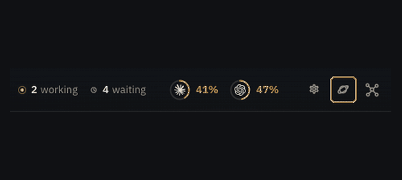

# agent の親子関係をたどる

1. ヘッダーの土星形の **Planetarium** アイコンを押します。
2. 線をたどると、どの agent がどの子を起動したか分かります。
3. agent を押すとその端末に移ります。元の端末へ戻るなら **Esc** で閉じます。

枝はどの agent がどの子を起動したかを示します。直近 90 秒の Mail のやり取りは線が光り、新しい Mail が届くと彗星が飛びます。

[English](en/trace-agent-family.md) · [画面一覧](cockpit-map.md) · [Planetarium の詳しい使い方](usage.md#planetarium)
