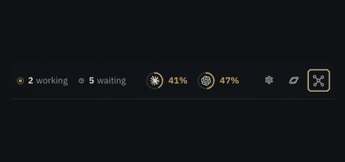

# Telemetry で状態と履歴を見る

1. ヘッダーのつながった点の **Telemetry** アイコンを押します。
2. **DECK** または **NETWORK** で agent を選び、作業状況と履歴を見ます。
3. 対象のカードで、稼働中なら **EXIT**、再開できる agent なら **RESUME** が使えます。**OPEN IN COCKPIT** で端末に戻れます。

**DECK** は agent のカード、**NETWORK** は agent のつながりを表示します。NETWORK の **SELECT** では複数体の **EXIT**・**RESUME**・**Replay** が使えます。選んだ agent の **History** で発言とツール操作、**Output** で作業ログが見られます。Replay では起動と Mail の件名が時間順に現れ、速さを変えたり、時間軸を押して時刻を移動したりできます。

[English](en/view-telemetry.md) · [画面一覧](cockpit-map.md) · [Telemetry の詳しい使い方](usage.md#telemetry)
